<p align="center">
  An operating system where every program runs in a box.<br>
  The box is a short list in the program's signed listing, and every call the program makes is checked against it.
</p>

<p align="center">
  <a href="docs/install/README.md"><strong>Install it</strong></a> ·
  <a href="docs/using/README.md">Using NØNOS</a> ·
  <a href="docs/release/0.9.3.md">0.9.3 release notes</a> ·
  <a href="#build-it">Build it</a> ·
  <a href="docs/release/0.9.3-security-limits.md">Security limits</a>
</p>

<p align="center">
  
  
  
  
</p>

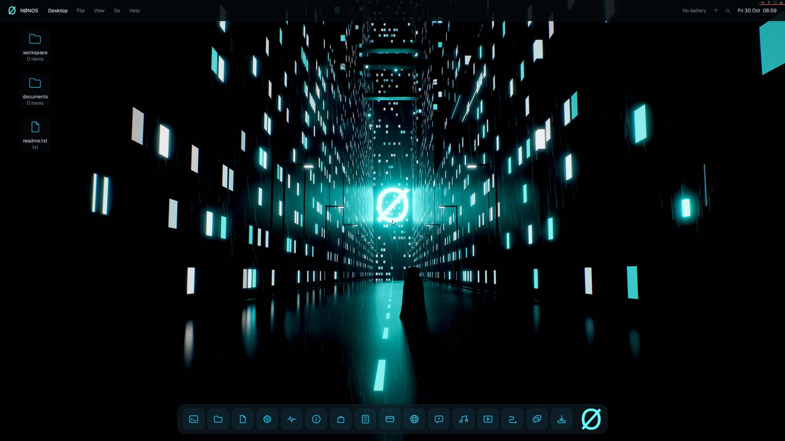

A box lists what a program may touch: a window, its own home folder, the network over Nym or Anyone, a
terminal, the right to start other programs. Anything not on the list is refused, and the log says why. The
kernel sends every Linux call to one supervisor, which holds the box and checks it, and gives the program
no rights of its own. Around that the
machine has what a daily system needs: a desktop, a browser, a terminal, a wallet, a local model, and a
Marketplace of 31 Linux programs. Memory is wiped when you power off, and nothing is written to a disk
unless you install.

0.9.3 is the release where those Linux programs get their own windows on the NØNOS desktop. Every claim on
this page points at code or at evidence in the tree, and what 0.9.3 does not do yet is under
[Where 0.9.3 stands](#where-093-stands).

## See it

### From the stick to the desktop

| | |
|---|---|
| 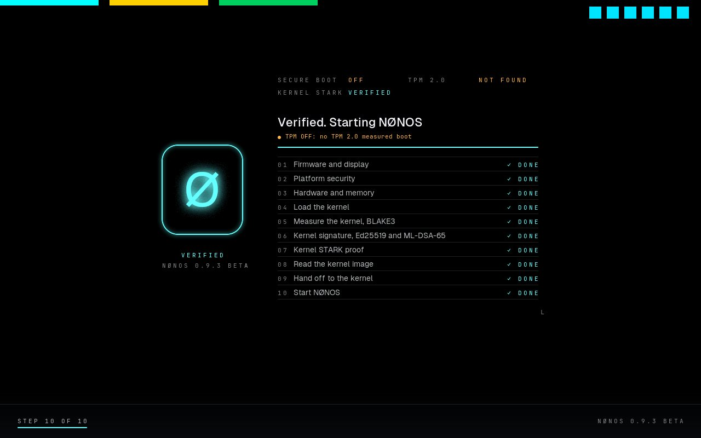 | 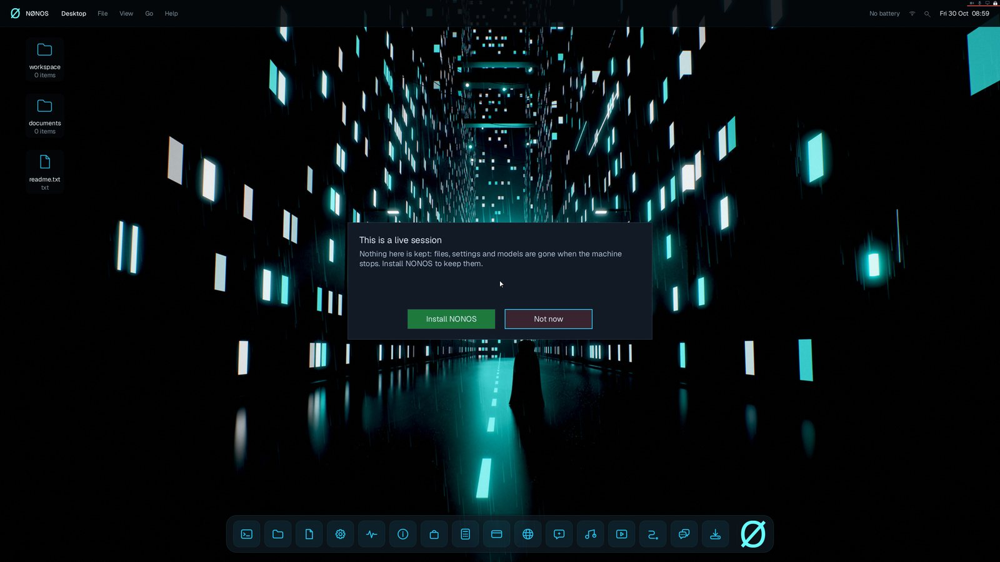 |
| The boot checks the kernel's STARK proof before it starts anything. This one ran under KVM, which has no TPM, and the screen says so. | A live session says it keeps nothing: files, settings and models are gone when the machine stops. Install NØNOS to keep them. |

First-boot setup, one screen at a time:

| | | |
|---|---|---|
| 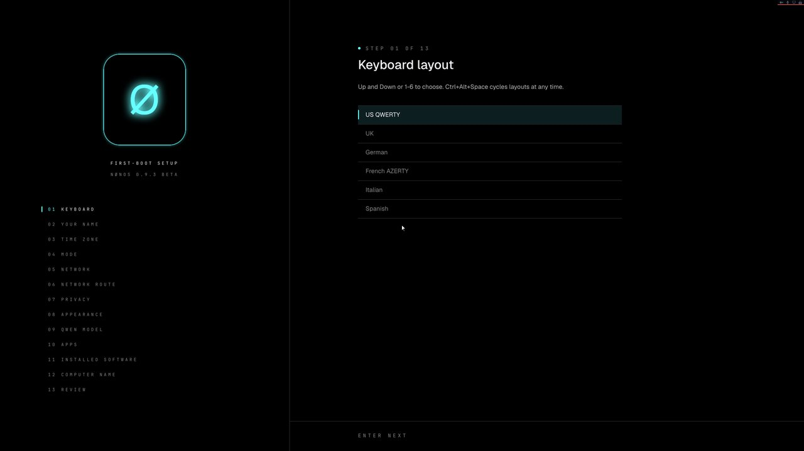 | 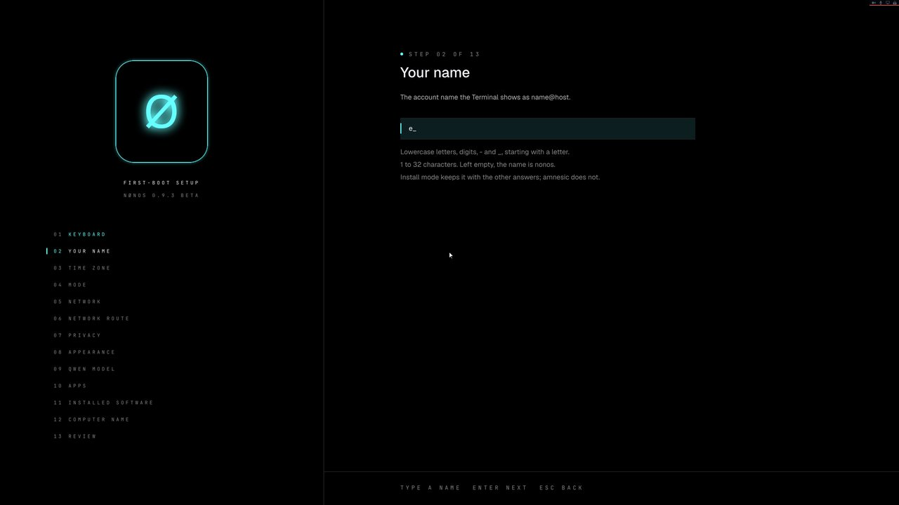 | 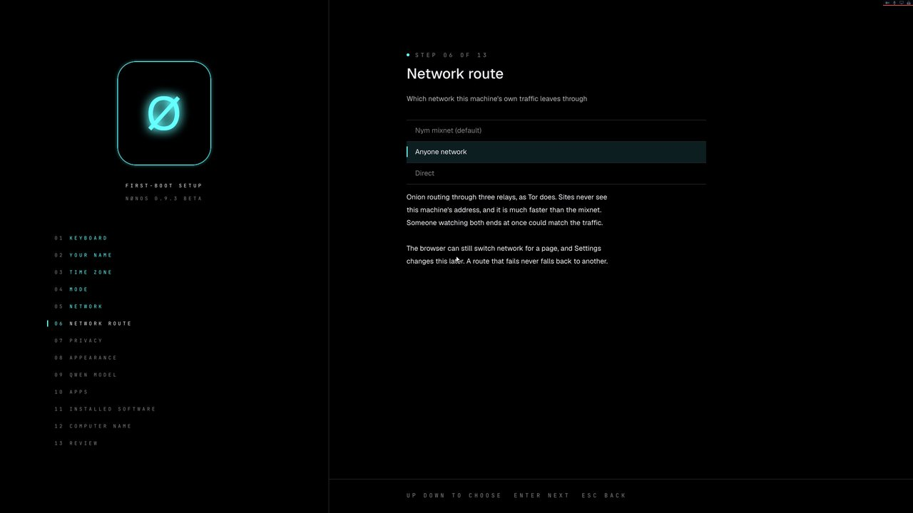 |
| Pick a keyboard layout. Ctrl+Alt+Space switches layouts at any time. | Name the account. | Choose the network the machine's traffic leaves through: the Nym mixnet, the Anyone onion network, or direct. |
| 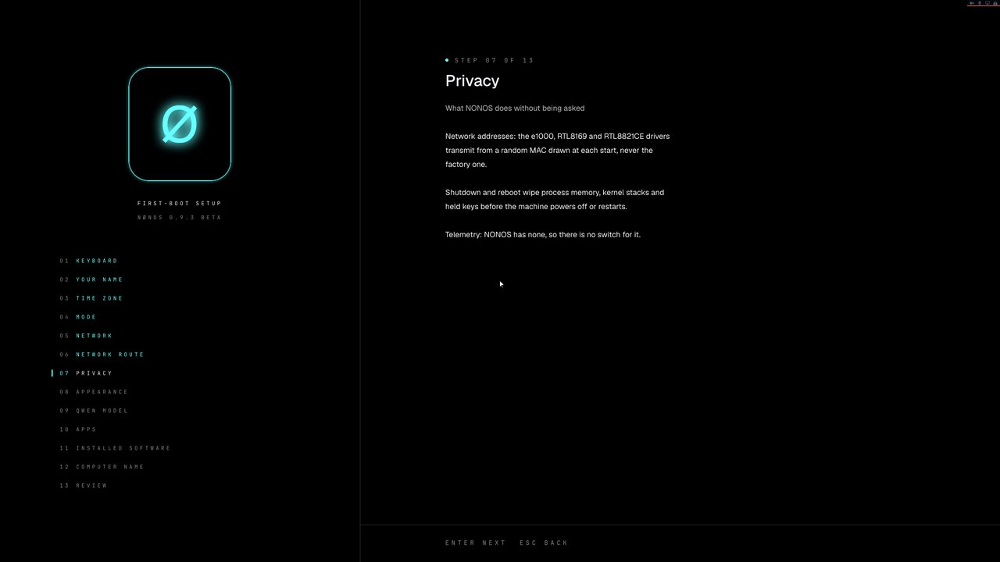 | 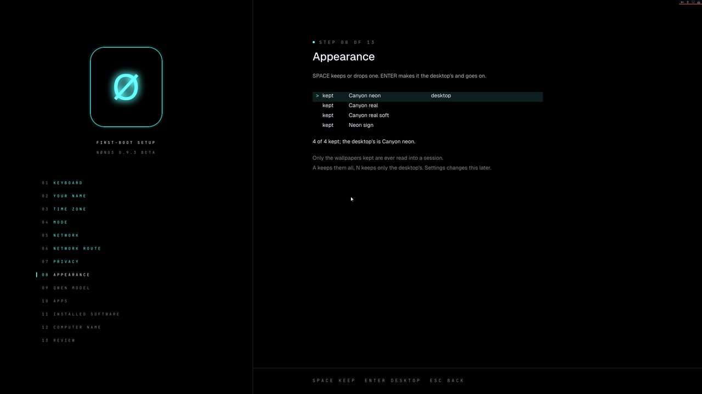 | 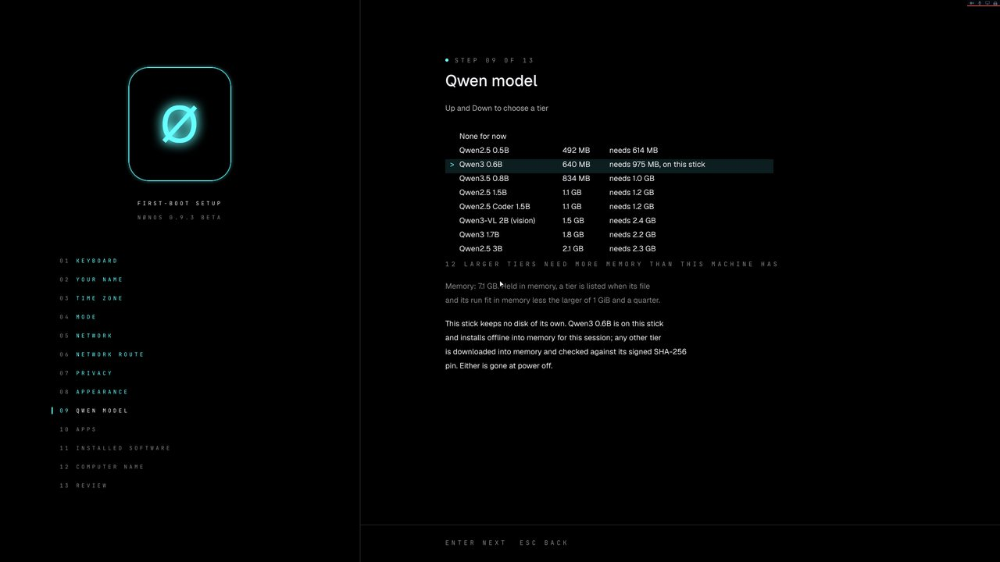 |
| What the machine does without being asked: a random MAC address at each start, memory wiped at shutdown, and no telemetry because there is no switch for it. | Choose which wallpapers are kept in the session and which is the desktop's. | Pick a Qwen model that fits this machine's memory, or none. |
| 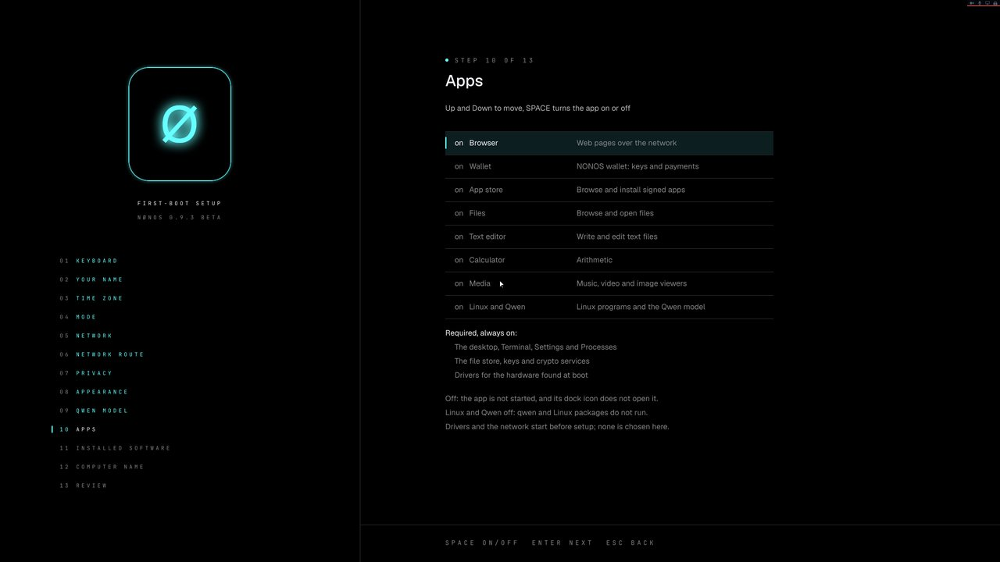 | 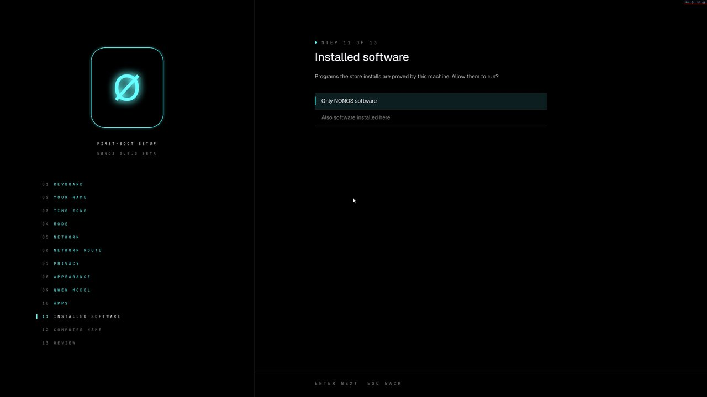 | 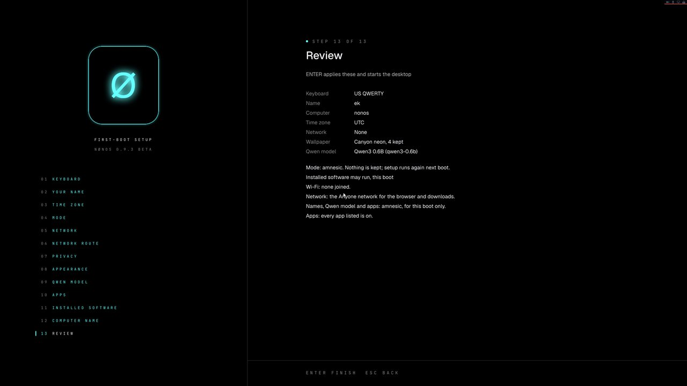 |
| Turn the desktop apps on or off: browser, wallet, App store, files, editor, media, Linux programs. | Decide whether software installed here may run, or only NØNOS software. | Review the choices before the desktop starts. |

### Apps

| | |
|---|---|
| 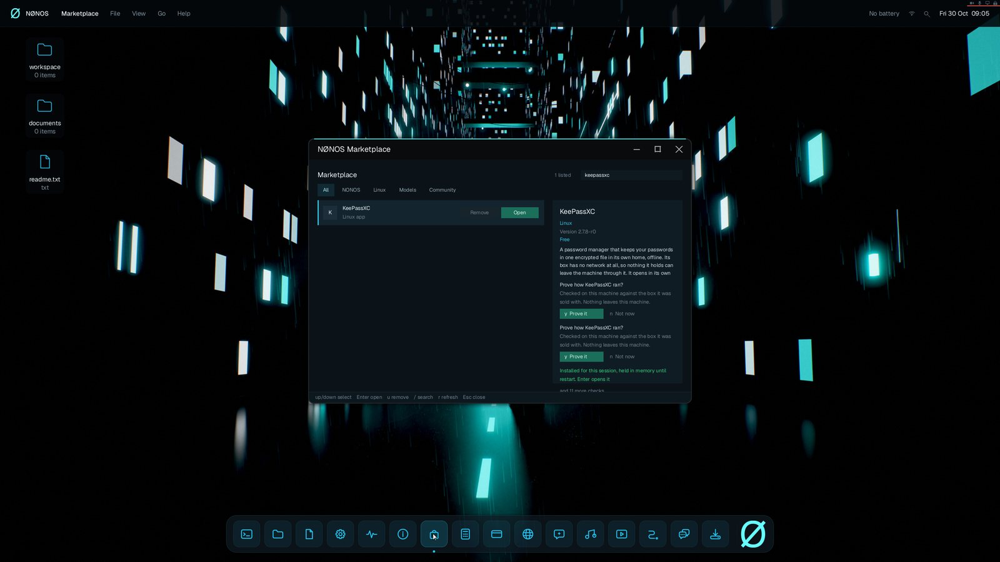 | 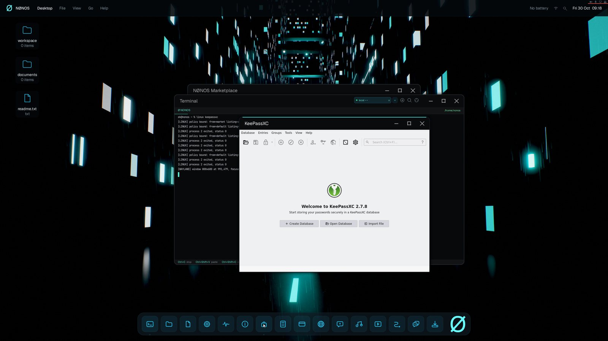 |
| The Marketplace lists each Linux program with what it is and what its box allows. | KeePassXC, a Linux program, in its own window. Its box has a window and a home folder and no network. |
| 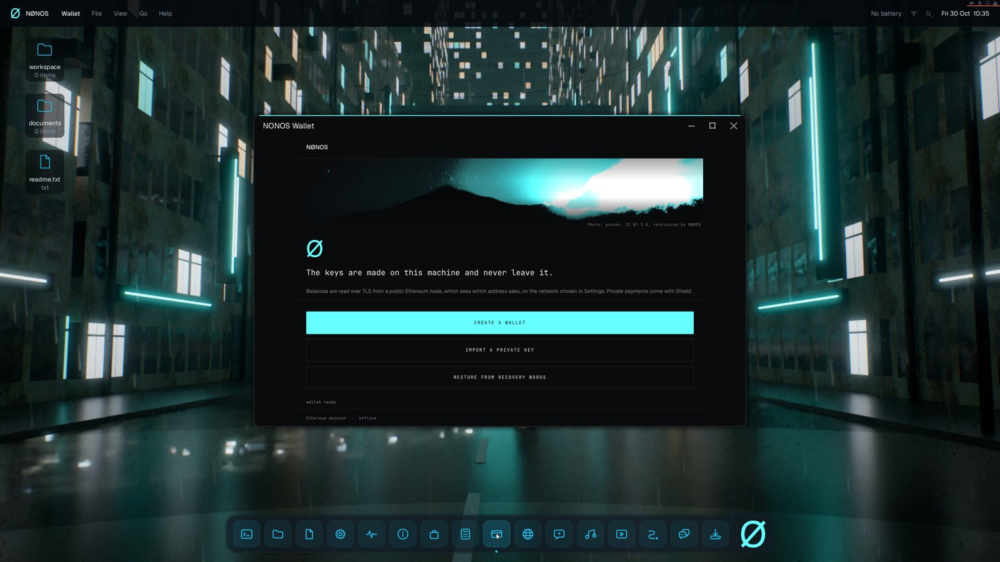 | 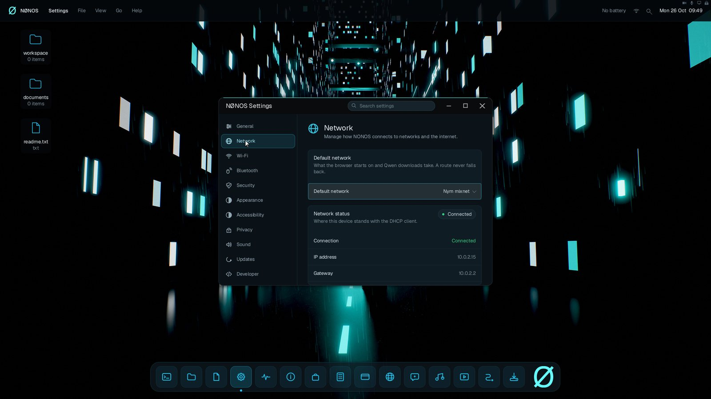 |
| The NØNOS Wallet. Its first screen says the keys are made on this machine and never leave it. | Settings shows the network the machine is using, and changes it. |

### The kernel's side

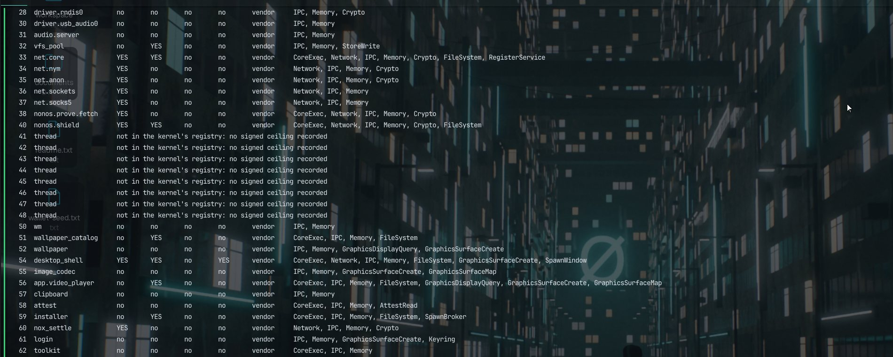

`audit` lists every process with its grants. Kernel threads show as not in the registry, with no signed
ceiling recorded.

## What a box holds back

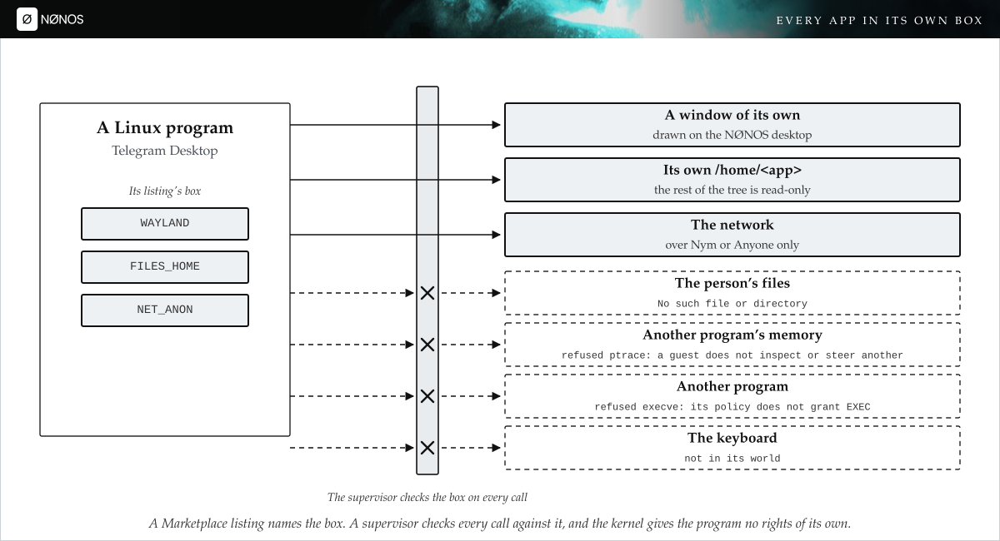

*Figure 1. What a program can reach. Sources: [`docs/using/linux-box.md`](docs/using/linux-box.md), [`docs/using/marketplace.md`](docs/using/marketplace.md).*

Each row below is a real attempt from inside a Linux program on the sealed 0.9.3 image, and the answer it got.
The recorded run, with every command and screenshot, is in
[docs/release-evidence/0.9.3/kvm-box-refusals](docs/release-evidence/0.9.3/kvm-box-refusals/README.md).
The file, process and keyboard rows ran in the default box, which is what a program with no listing gets: a
terminal, its own home and the right to start programs, with no network. The refused program launch is from
Telegram, which runs in the box its listing names.

| The program tries to | The box | What it got |
|---|---|---|
| Read your files | `FILES_HOME` gives a program its own home and nothing else | `cat: can't open '/home/nonos/wallet-seed.txt': No such file or directory`. Its `/home` is empty. |
| Find a wallet anywhere | | `find / -name '*wallet*'` finds nothing, because no file of yours is in its world |
| Read another program's memory | a Linux program is never granted it | `[LINUX] refused ptrace: a guest does not inspect or steer another` |
| Open a connection out | `NET_ANON`, over Nym or Anyone | `[LINUX] refused an internet socket: its policy does not grant NET_ANON, NET_LISTEN_LO or SERVE_ONE` |
| Start another program | `EXEC` | `[LINUX] refused execve: its policy does not grant EXEC` |
| Read the keyboard | not in the box | `cat: can't open '/dev/input/event0': No such file or directory` |
| See other programs | | `ls /proc` shows one process, its own |

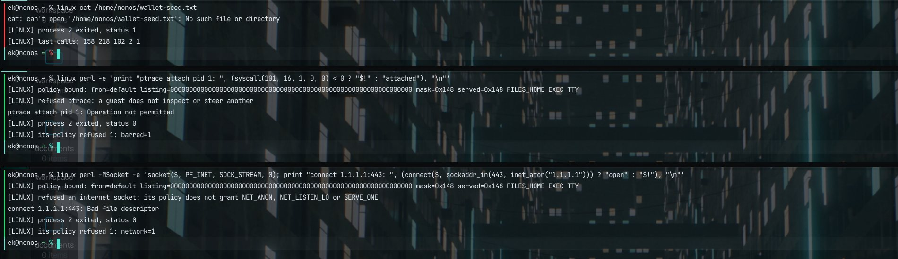

These are single attempts from inside an app, not an exploit chain. Nobody here claims the box cannot be
broken. [Security limits](docs/release/0.9.3-security-limits.md) lists what the design does not cover.

## Run a program you did not write

`linux --box` runs a Linux program, or one a model wrote, in a sealed box and prints everything the box
refused:

```
linux --box strict sh -c 'echo ok > /tmp/out; echo no > /home/out; nc 10.0.0.1 80'
linux --box offline python3 script.py
linux --box allow:/tmp/out,net:api.example.com:443 python3 agent.py
```

`strict` has no network and writes only to `/tmp`. An `allow:` box names its folders and, if it needs any,
its network destinations, and a connection anywhere else is refused and counted. `linux --box learn` runs a
program once and writes the tightest box file that would let it do what it did. See
[Run a program in a box](docs/using/linux-box.md).

## What changed since 0.9.2

| | 0.9.2 | 0.9.3 |
|---|---:|---:|
| Driver capsules | 18 | 67 |
| Capsules in all | 91 | 152 |
| Rust files in the kernel, `src/` | 5,139 | 7,579 |
| Rust files in `userland/` | 10,069 | 31,674 |
| Proof crates (directories named `*_proofs`) | 56 | 223 |

Counted from git at the commit where the 0.9.2 changelog landed, and at this release. About 6,000 commits
separate them.

The changes a person would notice:

- Linux programs in windows. A Wayland bridge puts a program's window on the desktop, with a title bar and close, minimise and maximise buttons. KeePassXC, Telegram Desktop, foot and swayimg have drawn their windows on booted images. mpv and zathura are listed.
- Pseudo-terminals. Linux programs open `/dev/ptmx` and `/dev/pts/N`, so a terminal emulator can start its shell.
- Monero over Nym and Anyone. The Monero wallet syncs from its node through the mixnet or the onion network. A fresh wallet has refreshed in full on a KVM host.
- Installing Linux apps. An install checks every package against the signed index and fetches them one at a time over the chosen network. A failure names the package and the check that stopped it.
- Updates in place. A disk installed by 0.9.3 can be updated to a later release and keep its encrypted data volume.

[The release notes](docs/release/0.9.3.md) name the file, commit or evidence directory behind each line.
[docs/release-evidence/0.9.3](docs/release-evidence/0.9.3/README.md) indexes the evidence.

## The Marketplace

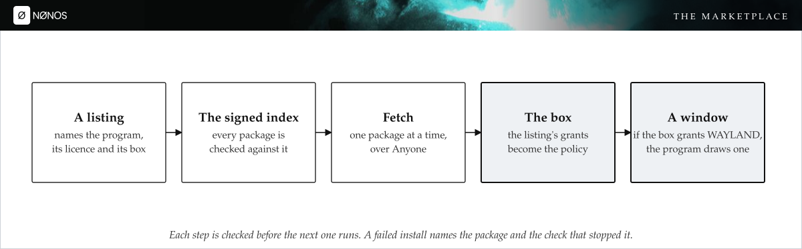

*Figure 2. From a Marketplace listing to a window. Sources: [`docs/using/marketplace.md`](docs/using/marketplace.md), [`docs/release/0.9.3-what-is-new.md`](docs/release/0.9.3-what-is-new.md).*

31 Linux programs, each with its licence and its box in the catalogue (`userland/capsule_market/linux-catalogue.json`). Each is checked against a signed index before it installs.

The words in the last column are the box:

| Word | What it grants |
|---|---|
| `WAYLAND` | a window of its own |
| `TTY` | the terminal |
| `FILES_HOME` | the program's own home, and no other files |
| `EXEC` | the right to start other programs |
| `NET_ANON` | the network, only over Nym or Anyone |
| `NET_LISTEN_LO` | listening on the machine's own loopback and nowhere else |
| `JIT` | making code as the program runs |

With a window:

| Program | What it is | Its box |
|---|---|---|
| swayimg | An image viewer that opens in its own window: PNG, JPEG, GIF, WebP, SVG and more, with zoom, pan and a slideshow. | `WAYLAND · FILES_HOME` |
| Telegram Desktop | Telegram's desktop client, in its own window. | `WAYLAND · FILES_HOME · NET_ANON` |
| KeePassXC | A password manager that keeps your passwords in one encrypted file in its own home, offline. | `WAYLAND · FILES_HOME` |
| foot (terminal) | A fast Wayland terminal in its own window, running a shell. | `WAYLAND · TTY · FILES_HOME · EXEC` |
| mpv (media player) | A media player in its own window, for the video and audio files in its own home. | `WAYLAND · FILES_HOME` |
| zathura (PDF viewer) | A keyboard-driven PDF viewer that opens in its own window. | `WAYLAND · FILES_HOME` |
| DarkFi (chat app) | DarkFi's desktop app, built here from v0.5.0 without tor or i2p. | `WAYLAND · FILES_HOME · NET_ANON` |

In the terminal:

| Program | What it is | Its box |
|---|---|---|
| Helix | A modal text editor with multiple selections and syntax trees built in. | `TTY · FILES_HOME` |
| micro | A terminal text editor with the keys people already know: Ctrl-S saves, Ctrl-Q quits. | `TTY · FILES_HOME` |
| Kakoune | A modal editor where you select first and act second. | `TTY · FILES_HOME · EXEC` |
| Vim | The classic modal editor, with its full runtime of syntax files and plugins. | `TTY · FILES_HOME` |
| bat | cat with syntax highlighting and line numbers. | `TTY · FILES_HOME · EXEC` |
| eza | A modern ls: colours, file types, trees and long listings. | `TTY · FILES_HOME` |
| nnn | A tiny, fast file manager. | `TTY · FILES_HOME · EXEC` |
| ncdu | See what takes the space in a directory tree, and clean it up. | `TTY · FILES_HOME` |
| fzf | A fuzzy finder for files, lines and anything else piped into it. | `TTY · FILES_HOME · EXEC` |
| Git | Version control for repositories on this machine: init, commit, branch, merge, log and diff. | `TTY · FILES_HOME · EXEC` |
| tig | A text interface for browsing a Git repository's history. | `TTY · FILES_HOME · EXEC` |
| lazygit | A terminal interface for Git: stage, commit, branch and rebase with a few keys. | `TTY · FILES_HOME · EXEC` |
| age | Simple, modern file encryption, offline, to a passphrase or to a recipient key made elsewhere. | `TTY · FILES_HOME` |
| minisign | Sign files and verify signatures, offline, with tiny Ed25519 keys. | `TTY · FILES_HOME` |
| FLAC | Encode and decode lossless FLAC audio files. | `TTY · FILES_HOME` |
| LAME | Encode audio files to MP3. | `TTY · FILES_HOME` |
| Geth (dev chain) | go-ethereum for local development: geth --dev runs a private chain on this machine with its console. | `TTY · FILES_HOME · NET_LISTEN_LO` |
| Profanity (XMPP, OMEMO) | A terminal XMPP chat client with OMEMO end-to-end encryption. | `TTY · FILES_HOME · NET_ANON` |
| Monero wallet (CLI) | Monero's command-line wallet. | `TTY · FILES_HOME · NET_ANON` |
| DarkFi wallet (drk) | DarkFi's command-line wallet, built here from DarkFi v0.5.0 without its tor and i2p transports, as a prompt in the... | `TTY · FILES_HOME · NET_ANON` |
| DarkFi local dev chain | A DarkFi chain of your own, for trying the wallet, transfers and contracts: DarkFi's darkfid on its localnet, the... | `TTY · FILES_HOME · NET_LISTEN_LO · JIT` |
| DarkIRC (P2P chat) | DarkFi's peer-to-peer IRC, in the Terminal: the darkirc daemon, built here from DarkFi v0.5.0 without its tor and... | `TTY · FILES_HOME · NET_ANON · NET_LISTEN_LO` |
| SimpleX Chat (terminal) | SimpleX Chat v7.0.3 in a terminal: SimpleX's own release binary, not built here, pinned by sha256 and BLAKE3 and... | `TTY · FILES_HOME · NET_ANON` |
| SimpleX Chat core | the engine for NØNOS's SimpleX window; not for direct use | `FILES_HOME · NET_ANON` |

[The Marketplace](docs/using/marketplace.md) explains installing, and [the Linux box](docs/using/linux-box.md)
what a box holds.

## What you get

| | |
|---|---|
| Desktop | a compositor, a window manager and a desktop shell with a dock; windows size themselves from small laptop panels to 4K |
| Browser | its own HTML parser, CSS layout, a QuickJS engine and TLS with the Mozilla roots; pages load over Nym, Anyone or direct |
| Terminal | tabs, pipelines and jobs, built-in commands, `git` over HTTPS, and the Linux tools |
| Wallet | BIP39 and HD keys held by the keyring capsule, sealed to the TPM, signing in ring 3 |
| Local model | a private Qwen model installed from the store, checked against its published hashes and kept on the encrypted data volume |
| Network | Nym mixnet by default, the Anyone onion network, or direct; chosen in setup and changed in Settings |
| Install | amnesic by default; first-boot setup and an installer that writes NØNOS to a disk only when the person types the disk's word |
| Proofs screen | About shows every admitted capsule with its measurement and enroller, and how traffic is leaving right now |

## Drivers

There are 67 driver capsules. Each runs in ring 3 with a claim on its own device, and DMA is confined by the
IOMMU where the machine has one in service.

| Class | Count | Drivers |
|---|---:|---|
| Storage | 12 | `ahci`, `nvme`, `piix_ide`, `buslogic`, `mpt`, `pvscsi`, `storvsc`, `ufs`, `sdhci`, `rtsx`, `virtio_blk`, `virtio_scsi` |
| USB | 17 | `xhci`, `ehci`, `ohci`, `uhci`, `usb_hub`, `usb_hid`, `usb_msc`, `usb_audio`, `usb_mic`, `uvc`, `ccid`, `fido`, `cdc_acm`, `cdc_ecm`, `cdc_ncm`, `rndis`, `bt_usb` |
| Wired network | 14 | `e1000`, `e1000e`, `igb`, `igc`, `ixgbe`, `rtl8139`, `rtl8153`, `rtl8169`, `ax88179`, `pcnet`, `tulip`, `virtio_net`, `vmxnet3`, `netvsc` |
| Wi-Fi | 5 | `iwlwifi`, `mt7921`, `rtl8821ce`, `rtl8822ce`, `rtl8852be` |
| Input | 5 | `ps2_input`, `i2c_hid`, `spi_hid`, `virtio_input`, `vmmouse` |
| Display | 5 | `bga`, `bootfb`, `intel_display`, `virtio_gpu`, `vmware_svga` |
| Audio | 2 | `hda`, `ac97` |
| Buses | 4 | `gpio`, `i2c_pci`, `spi`, `smbus` |
| Virtual machine guests | 3 | `virtio_rng`, `vmbus`, `vmmdev` |

Which of these have run on real hardware, and which have run only in their host model, is set out in
[the 0.9.3 hardware notes](docs/release/0.9.3-supported-hardware.md). A driver whose device is missing leaves
at once, and one whose device fails gives up after a few seconds.

## How it is built

<details>
<summary><strong>The kernel</strong>: a capability microkernel, with everything else in ring 3</summary>

The kernel is a capability microkernel, about 390,000 lines of Rust under `src/`. It does what only
ring 0 can do: page tables and address spaces, the scheduler, IPC between capsules, the
syscall boundary with its capability check, the attestation gate at spawn, the TPM, and a
hardware broker that hands device windows to driver capsules. Everything a person would call
the operating system runs in ring 3, drivers included.

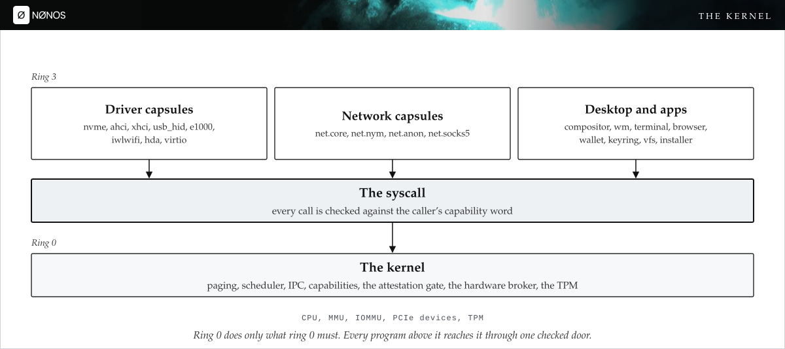

*Figure 3. The kernel in ring 0 and everything else in ring 3. Sources: [`docs/overview/architecture.md`](docs/overview/architecture.md).*

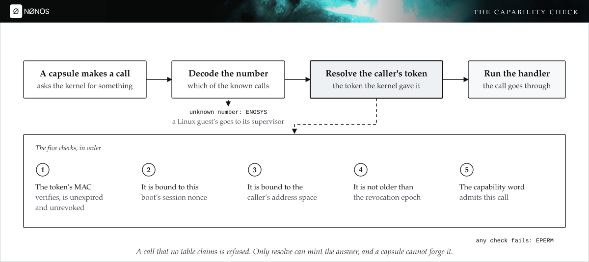

*Figure 4. The capability check on every system call. Sources: [`docs/kernel/syscalls.md`](docs/kernel/syscalls.md), [`docs/kernel/capabilities.md`](docs/kernel/capabilities.md).*

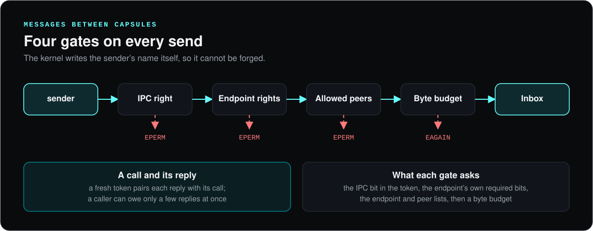

*Figure 5. IPC between capsules: the gates on a send. Sources: [`docs/kernel/ipc.md`](docs/kernel/ipc.md).*

A capability is one of 40 bits, defined once in [abi/caps.toml](abi/caps.toml). A capsule's
word is fixed when it is enrolled, the kernel installs it from the verified manifest at spawn,
and every syscall is checked against it. A capsule that was never enrolled for the network
holds no socket and cannot send to the network services' inboxes by pid. Driver capsules reach
their device only through a broker claim, with DMA confined by the IOMMU where a remapping unit
is in service.

[Architecture](docs/overview/architecture.md) is the place to start reading the kernel. Then
[capabilities](docs/kernel/capabilities.md), [IPC](docs/kernel/ipc.md),
[memory](docs/kernel/memory-and-paging.md), [the IOMMU](docs/kernel/iommu.md) and
[the syscall surface](docs/kernel/syscalls.md).

</details>

<details>
<summary><strong>Capsules</strong>: signed programs that each carry a capability word</summary>

Everything that runs is a capsule. There are 152, each a directory with a `Capsule.mk` that names
its service and its capability word. A capsule is compiled ahead of time, signed with Ed25519
and ML-DSA-65, enrolled under the STARK policy root and shipped inside the kernel image or the
image's store. At spawn the kernel checks the certificate, the manifest and the proof, then
installs the capabilities from the manifest.

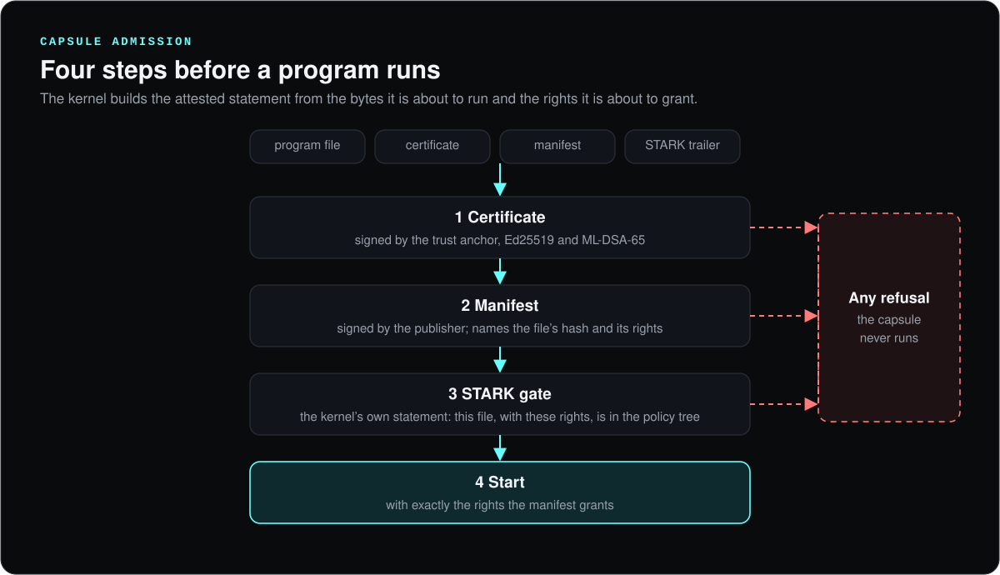

*Figure 6. Capsule admission. Sources: [`docs/security/stark-attestation.md`](docs/security/stark-attestation.md).*

The capabilities installed come from the verified manifest, never from what the spawn site
asked for. Every capsule is listed with its service and decoded word in
[the capsule catalog](docs/using/apps.md). Writing one is in
[adding a capsule](docs/userland/writing-an-app.md).

</details>

<details>
<summary><strong>Privacy</strong>: an amnesic machine and a network you choose</summary>

The machine forgets because it has almost nothing to remember with. The kernel's file tree
lives in RAM. Every boot is amnesic: nothing reaches a disk unless the person chose to install
in first-boot setup, and then only the installer and the system's own store may touch a disk's
raw sectors. At shutdown the kernel stops every device, then wipes live device buffers, every
process's memory, the kernel stacks, the filesystem caches and the keys. That wipe sits on the
one path that powers the machine off, and Lean proves no reachable state reaches off without it.

A program's traffic leaves by the network the person chose:

- Nym mixnet, the default. Each packet is a Sphinx packet across three mix layers to an exit
 gateway, with single-use reply blocks for the way back.
- Anyone, the onion network: three relays, each knowing only its neighbours.
- Direct, which the sites reached can see.

When the chosen network is down, the browser, the terminal, the wallet and the Linux guests
send nothing another way. Network cards transmit from a new locally administered address every
boot. The private model runs without the network, and its files come only through the
installer's checked fetch.

Some traffic does not follow the choice. The Nym and Anyone capsules fetch their directories
and build their paths from boot on every image that carries them, so a machine set to Direct
still shows Nym and Anyone traffic on its local network. Programs built on the toolchain's Rust
std connect direct. The TPM's counter keeps a count of boots. These and the other gaps are listed
on the privacy page.

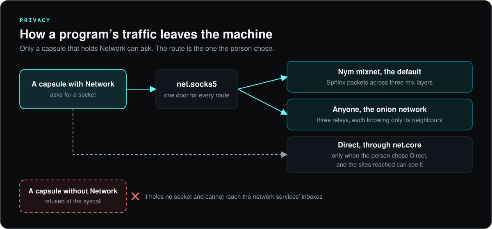

*Figure 7. How a program's traffic leaves the machine. Sources: [`docs/security/anonymity-transports.md`](docs/security/anonymity-transports.md).*

The whole model, with what it does not cover, is in [privacy](docs/security/README.md),
[the amnesic design](docs/security/protections-and-limits.md), [storage](docs/drivers/storage/README.md) and
[the route model](docs/security/anonymity-transports.md).

</details>

<details>
<summary><strong>The STARK gate</strong>: what may run is checked against a proof</summary>

A signature says a key holder approved an image, and it keeps that key holder in the trust base
for as long as the image exists. Admission asks a narrower question: is this one of the images
the policy committed to. So the kernel and every capsule carry a transparent STARK proof over
Poseidon, with a Fiat-Shamir transcript, that its measurement is a member of the set under one
policy root. It is hash-based, with no trusted setup and no pairing.

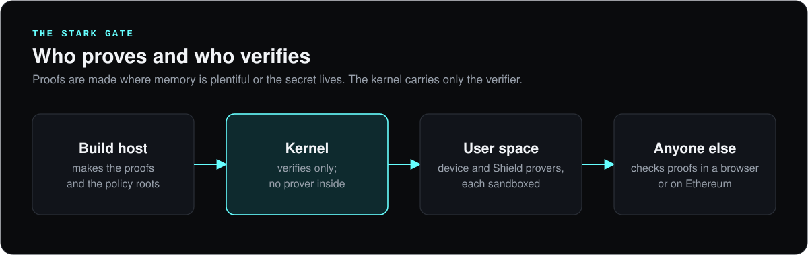

*Figure 8. Who proves and who verifies. Sources: [`docs/security/stark-attestation.md`](docs/security/stark-attestation.md).*

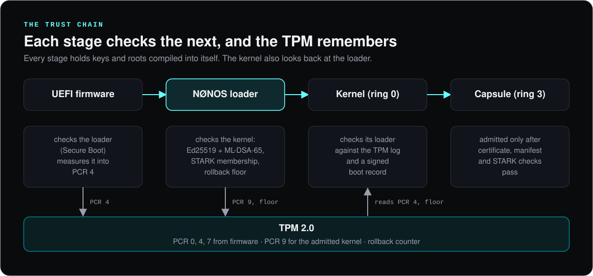

*Figure 9. The boot chain and the TPM registers each stage uses. Sources: [`docs/security/boot-chain-and-signatures.md`](docs/security/boot-chain-and-signatures.md), [`docs/security/measured-boot-and-tpm.md`](docs/security/measured-boot-and-tpm.md).*

The gates link only the verifier, `nox_verify`, from the STARKs repository at the commit `flake.lock` pins. The prover
runs on the enrolling host in `nonos-stark-enroll`, which builds the one policy root over every
capsule and checks each proof with the gates' own verifier before writing it. The machine that
boots holds no prover. The verifier measures the image in front of it and supplies the root
itself, so a trailer lifted from another image fails.

Signatures still answer what signatures answer well. The kernel is signed with Ed25519 and
ML-DSA-65 together and measured into the TPM behind an anti-rollback counter: who released this
image, and is it older than what this machine already accepted. The details are in
[the STARK layer](docs/security/stark-attestation.md), [signing](docs/security/boot-chain-and-signatures.md),
[keys](docs/security/device-secrets-and-keys.md) and [the TPM](docs/security/measured-boot-and-tpm.md).

</details>

## What has been checked

- The kernel and every capsule carry a STARK proof that their measurement belongs to one policy root, and
  the boot refuses an image whose proof does not verify.
- Lean 4 holds 1,503 theorems about isolation, capabilities, the spawn path, page-table permissions, the
  attestation binding, the anti-rollback floor and the wipe at power off, with no `sorry` in any Lean tree.
  115 Kani harnesses under `userland/` and 222 proof crates run against the shipped source. These are the
  figures in [verification/evidence/EVIDENCE.json](verification/evidence/EVIDENCE.json); other counting rules
  give slightly higher numbers.
- The build is reproducible: `make` ends with a receipt of every artifact by sha256, and `REPRODUCED` when
  the artifacts match the committed `receipts/<profile>.json`.
- 57 evidence directories sit under [docs/release-evidence/0.9.3](docs/release-evidence/0.9.3/README.md),
  each naming the boot or test behind a line of the release notes.

NØNOS does not claim functional correctness of the whole kernel. The proved surface is what may run, what
it may reach, and what survives a power cut. [The proof suites](docs/security/checking-the-claims.md) says
what each one guarantees, and [verification/MAP.md](verification/MAP.md) ties each property to the source it
constrains.

<details>
<summary><strong>Lean 4 and the proofs</strong>, in full</summary>

The security-critical surface is machine-checked. Lean 4 carries isolation and
non-interference, the capability algebra and its delegation, the spawn path and the
capabilities a spawn installs, page-table permissions, the user-copy boundary, the attestation
binding, the anti-rollback floor and the ZeroState wipe: 1,503 theorems in
`verification/lean`, with no `sorry` in any Lean tree. An extraction pipeline turns kernel
functions into Lean so theorems speak about the shipped code, not a model of it. Verus takes
the properties that live in real bit operations. 115 Kani harnesses sit under `userland/`. 222 proof
crates pull the shipped source in through `#[path]` and run it.

NONOS does not claim functional correctness of the whole kernel. The proved surface is what may
run, what it may reach, and what survives a power cut.
[The proof suites](docs/security/checking-the-claims.md) says what each one guarantees and
which run in CI. [verification/MAP.md](verification/MAP.md) ties each property to the source it
constrains.

</details>

## Hardware

The driver classes are in [Drivers](#drivers). The machines they have run on, and the ones they have only
been modelled for, are in [the 0.9.3 hardware notes](docs/release/0.9.3-supported-hardware.md).

## Build it

You need Nix with flakes turned on (https://nixos.org/download) and nothing else. On Linux and
on a Mac with Apple silicon:

 make # the kernel, every capsule, the Linux userland and the loader
 make check # every proof crate and every static check

On Windows, run the same two commands inside WSL2, or open the repository in its devcontainer
(`.devcontainer/`), which has Nix already.

The toolchain, every crate and every C source are pinned by hash, and the build runs offline in
Nix's sandbox. `make` ends with a receipt: every artifact by sha256, the toolchain and every
pinned input, the kernel's own bytes held to the profile's promises, and `REPRODUCED` when the
artifacts are byte for byte the ones in the committed `receipts/<profile>.json`. Those artifacts
are unsigned, and no build ever needs a key. Enrolling and signing take keys only the release
holder has:

 make seal # enroll, sign and pack: needs the keys
 make boot # boot the sealed image under QEMU, with a TPM
 make boot-install # beside a blank disk, to try the installer
 make usb DISK=/dev/sdX # write it to a stick, after typing the path again

A build is one of the profiles below, set in `nonos.toml` or as `PROFILE=airgapped make`:

| profile | for | what it adds or takes away |
|---|---|---|
| standard | a person's own machine | every driver, the desktop, first-boot setup and the installer; no capsule writes to a serial console |
| hardened | a machine that may be seized | standard, with Secure Boot and a TPM required at boot |
| airgapped | keys that must never touch a network | hardened, with no network driver, stack or online program compiled in |
| qemu | trying NONOS in a virtual machine | the desktop, without the drivers only real hardware has |
| dev | working on NONOS | the loader's development policy; never sealed for release |
| selftest | the self-test | dev, with a capsule that tries what an attacker would at boot ([docs/security/self-test.md](docs/security/self-test.md)) |
| core | kernel work | the microkernel and its base capsules, no desktop |

A release image is built `hardened`. [docs/build](docs/build/README.md) is the step by step
guide, from installing Nix on each platform to an installed disk.
[Build and verify](docs/build/README.md) is the whole flow,
[tools/nix/README.md](tools/nix/README.md) the build in one page, and
[CONTRIBUTING.md](CONTRIBUTING.md) the way in.

## Where 0.9.3 stands

The release notes say what works, what does not, and how each line was shown:

- [Known issues](docs/release/0.9.3-known-issues.md): a Linux app's home lives in memory and is gone at power off, creating a wallet on a machine with no TPM makes the keyring restart, SimpleX's desktop window is not in this release, and some programs listed in the Marketplace have not been booted.
- [Security limits](docs/release/0.9.3-security-limits.md): on a machine whose firmware left VT-d or AMD-Vi off, a Standard boot goes on with device DMA unconfined and says so on its `[IOMMU]` line.
- [Supported hardware](docs/release/0.9.3-supported-hardware.md): what has run on real silicon and what has run only in its host model.
- [Upgrade notes](docs/release/0.9.3-upgrade-notes.md): moving an installed system to 0.9.3.

## Documentation

| | |
|---|---|
| [Diagrams](docs/overview/diagrams.md) | 23 figures of how the system works, each with the files it is drawn from |
| [The handbook](docs/README.md) | how NØNOS works, one page per subsystem, every claim tied to a file and line |
| [Installing NØNOS](docs/install/README.md) | from a stick to an installed disk |
| [Using NØNOS](docs/using/README.md) | the desktop and its programs, for the person at the keyboard |
| [The Marketplace](docs/using/marketplace.md) | the programs, what each is allowed, how they are installed |
| [Run a program in a box](docs/using/linux-box.md) | `linux --box`, the boxes and the report |
| [Building NØNOS](docs/build/README.md) | from a fresh machine to a sealed, booted and installed image |
| [Building on 0.9.3](docs/userland/README.md) | the rules for capsule and driver authors |
| [Release notes 0.9.3](docs/release/0.9.3.md) | what is new, with the evidence |
| [Security](SECURITY.md) | how to report a vulnerability |
| [CONTRIBUTING.md](CONTRIBUTING.md) | the way in |

Design work happens at [discord.gg/nonos](https://discord.gg/nonos).

## Licence

AGPL-3.0-or-later. Redistributable device firmware is not part of the source and carries its own
terms.
