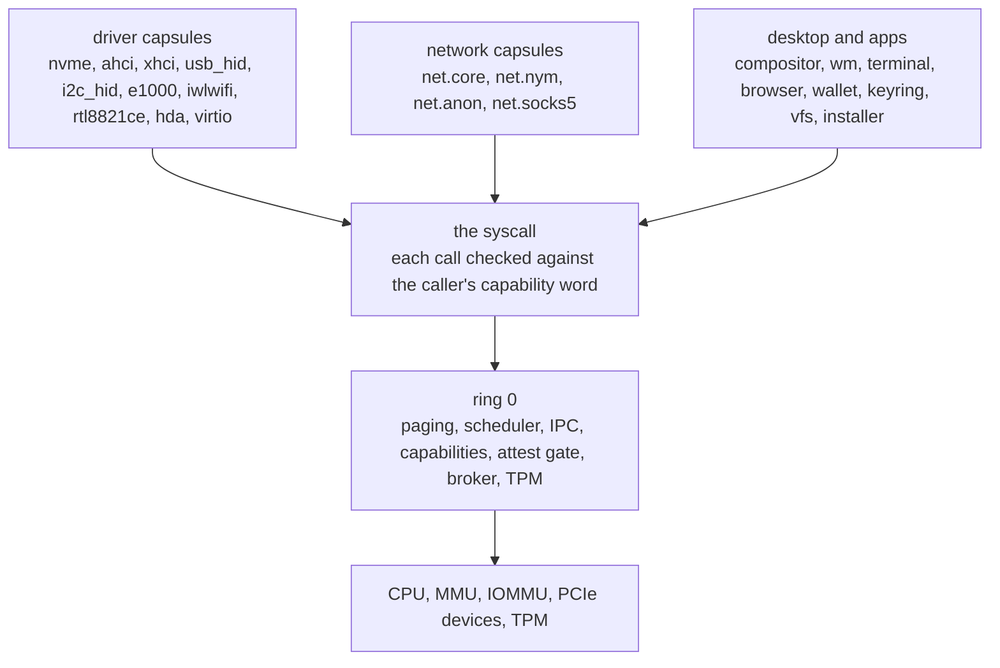
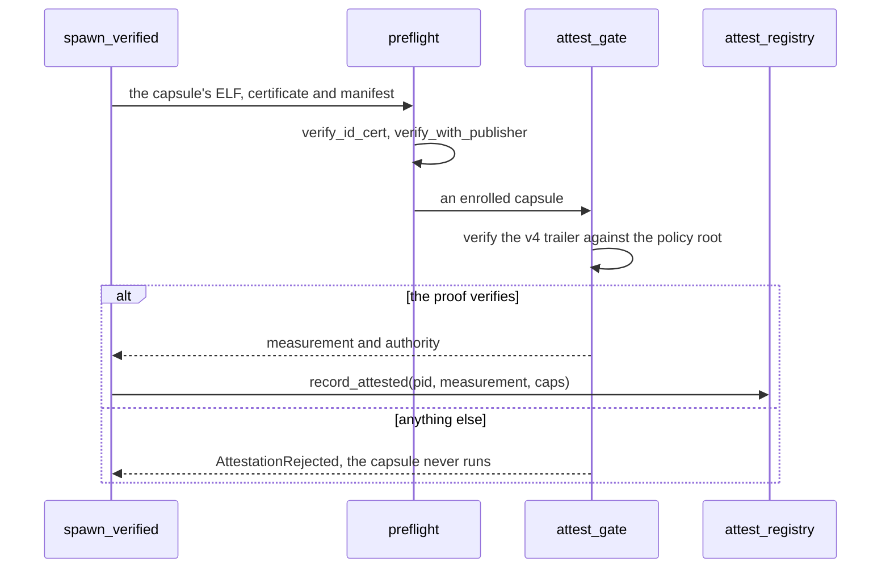
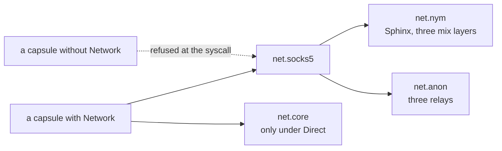
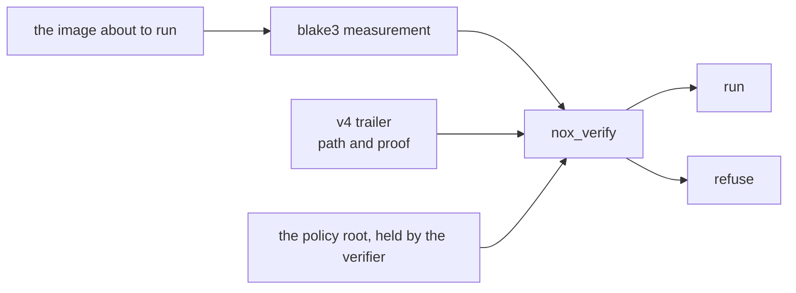

<p align="center">
  An operating system for people who don't want it to remember them.<br>
  It boots a signed image into RAM and runs each program in a box that lists what the program may touch.
  Traffic leaves over the network you picked. When you power off, memory is wiped.
</p>

<p align="center">
  <a href="docs/install/README.md"><strong>Install it</strong></a> ·
  <a href="docs/using/README.md">Using NØNOS</a> ·
  <a href="docs/release/0.9.3.md">0.9.3 release notes</a> ·
  <a href="#build-it">Build it</a> ·
  <a href="docs/release/0.9.3-security-limits.md">Security limits</a>
</p>

<p align="center">
  
  
  
  
</p>


Since 0.9.2 the tree has about 6,000 more commits. The kernel and userland grew, the driver set nearly
quadrupled, and Linux programs now open their own windows on the NØNOS desktop. Telegram Desktop and
KeePassXC are two of them, and each runs in a box that names what it may reach. Every claim on this page
points at code or at evidence in the tree. What 0.9.3 does not do yet is under
[Where 0.9.3 stands](#where-093-stands).

## What changed since 0.9.2

| | 0.9.2 | 0.9.3 |
|---|---:|---:|
| Driver capsules | 18 | 67 |
| Capsules in all | 91 | 152 |
| Rust files in the kernel, `src/` | 5,139 | 7,579 |
| Rust files in `userland/` | 10,069 | 31,674 |
| Proof crates | 56 | 223 |

Counted from git at the commit where the 0.9.2 changelog landed, and at this release.

The changes a person would notice:

| | |
|---|---|
| Linux programs in windows | A Wayland bridge puts a program's window on the desktop, with a title bar and close, minimise and maximise buttons. KeePassXC, Telegram Desktop, foot and swayimg have drawn their windows on booted images. mpv and zathura are listed. |
| A box for every app | A Marketplace listing names what its program may reach: a window, the Anyone network, its own home, a terminal, the right to start programs. The kernel refuses the rest. |
| Pseudo-terminals | Linux programs open `/dev/ptmx` and `/dev/pts/N`, so a terminal emulator can start its shell. |
| Monero over Nym and Anyone | The Monero wallet syncs from its node through the mixnet or the onion network. A fresh wallet has refreshed in full on a KVM host. |
| Installing Linux apps | An install checks every package against the signed index and fetches them one at a time over the chosen network. A failure names the package and the check that stopped it. |
| Updates in place | A disk installed by 0.9.3 can be updated to a later release and keep its encrypted data volume. |

[The release notes](docs/release/0.9.3.md) name the file, commit or evidence directory behind each line, and
[docs/release-evidence/0.9.3](docs/release-evidence/0.9.3/README.md) indexes the evidence.

## Drivers

There are 67 driver capsules. Each one runs in ring 3 with a claim on its own device, and DMA is confined by
the IOMMU where the machine has one in service.

| Class | Count | Drivers |
|---|---:|---|
| Storage | 12 | `ahci`, `nvme`, `piix_ide`, `buslogic`, `mpt`, `pvscsi`, `storvsc`, `ufs`, `sdhci`, `rtsx`, `virtio_blk`, `virtio_scsi` |
| USB | 17 | `xhci`, `ehci`, `ohci`, `uhci`, `usb_hub`, `usb_hid`, `usb_msc`, `usb_audio`, `usb_mic`, `uvc`, `ccid`, `fido`, `cdc_acm`, `cdc_ecm`, `cdc_ncm`, `rndis`, `bt_usb` |
| Wired network | 14 | `e1000`, `e1000e`, `igb`, `igc`, `ixgbe`, `rtl8139`, `rtl8153`, `rtl8169`, `ax88179`, `pcnet`, `tulip`, `virtio_net`, `vmxnet3`, `netvsc` |
| Wi-Fi | 5 | `iwlwifi`, `mt7921`, `rtl8821ce`, `rtl8822ce`, `rtl8852be` |
| Input | 5 | `ps2_input`, `i2c_hid`, `spi_hid`, `virtio_input`, `vmmouse` |
| Display | 5 | `bga`, `bootfb`, `intel_display`, `virtio_gpu`, `vmware_svga` |
| Audio | 2 | `hda`, `ac97` |
| Buses | 4 | `gpio`, `i2c_pci`, `spi`, `smbus` |
| Virtual machine guests | 3 | `virtio_rng`, `vmbus`, `vmmdev` |

Which of these have run on real hardware, and which have run only in their host model, is set out in
[the 0.9.3 hardware notes](docs/release/0.9.3-supported-hardware.md). A driver whose device is missing leaves
at once, and one whose device fails gives up after a few seconds.

## Every app in its own box

A program runs with what its signed listing grants. Telegram Desktop's listing grants a window, its own home
and the Anyone network. foot's grants a window, a terminal, its home and the right to start programs.
KeePassXC has no network. The kernel checks the box on every call, and a program that asks for more is
refused with the reason in the log. This is Telegram asking to start another program on the sealed 0.9.3
image:

```
[LINUX] policy bound: from=market  mask=0xb  WAYLAND NET_ANON FILES_HOME
[LINUX] refused execve: its policy does not grant EXEC
[LINUX] process 17 exited, status 255
```

The program that was refused is a helper Telegram runs on its first start. Telegram carried on without it,
with no prompt and nothing to configure. [The Linux box](docs/using/linux-box.md) explains what a box holds,
and [the Marketplace](docs/using/marketplace.md) lists each program and its grants.

## What you get

| | |
|---|---|
| Desktop | a compositor, a window manager and a desktop shell with a dock; windows size themselves from small laptop panels to 4K |
| Browser | its own HTML parser, CSS layout, a QuickJS engine and TLS with the Mozilla roots; pages load over Nym, Anyone or direct |
| Terminal | tabs, pipelines and jobs, built-in commands, `git` over HTTPS, and the Linux tools |
| Linux programs | a Linux personality that traps and translates Linux system calls; programs come from the Marketplace, one box each |
| Wallet | BIP39 and HD keys held by the keyring capsule, sealed to the TPM, signing in ring 3 |
| Local model | a private Qwen model installed from the store, checked against its published hashes and kept on the encrypted data volume |
| Messaging and money | SimpleX Chat, DarkFi (the wallet, a local dev chain, DarkIRC), Telegram Desktop and the Monero wallet, from the Marketplace |
| Apps | files, text editor, image viewer, audio and video players, settings, process manager, clock, calculator, the Marketplace |
| Network | Nym mixnet by default, the Anyone onion network, or direct; chosen in setup and changed in Settings |
| Install | amnesic by default; first-boot setup and an installer that writes NØNOS to a disk only when the person types the disk's word |
| Proofs screen | About shows every admitted capsule with its measurement and enroller, and how traffic is leaving right now |

[The handbook](docs/README.md) has a page for each. Someone at the keyboard should start with
[Using NØNOS](docs/using/README.md).

## The kernel

The kernel is a capability microkernel, about 390,000 lines of Rust under `src/`. It does what only
ring 0 can do: page tables and address spaces, the scheduler, IPC between capsules, the
syscall boundary with its capability check, the attestation gate at spawn, the TPM, and a
hardware broker that hands device windows to driver capsules. Everything a person would call
the operating system runs in ring 3, drivers included.



A capability is one of 40 bits, defined once in [abi/caps.toml](abi/caps.toml). A capsule's
word is fixed when it is enrolled, the kernel installs it from the verified manifest at spawn,
and every syscall is checked against it. A capsule that was never enrolled for the network
holds no socket and cannot send to the network services' inboxes by pid. Driver capsules reach
their device only through a broker claim, with DMA confined by the IOMMU where a remapping unit
is in service.

[Architecture](docs/overview/architecture.md) is the place to start reading the kernel. Then
[capabilities](docs/kernel/capabilities.md), [IPC](docs/kernel/ipc.md),
[memory](docs/kernel/memory-and-paging.md), [the IOMMU](docs/kernel/iommu.md) and
[the syscall surface](docs/kernel/syscalls.md).

## Capsules

Everything that runs is a capsule. There are 152, each a directory with a `Capsule.mk` that names
its service and its capability word. A capsule is compiled ahead of time, signed with Ed25519
and ML-DSA-65, enrolled under the STARK policy root and shipped inside the kernel image or the
image's store. At spawn the kernel checks the certificate, the manifest and the proof, then
installs the capabilities from the manifest.



The capabilities installed come from the verified manifest, never from what the spawn site
asked for. Every capsule is listed with its service and decoded word in
[the capsule catalog](docs/using/apps.md). Writing one is in
[adding a capsule](docs/userland/writing-an-app.md).

## Privacy

The machine forgets because it has almost nothing to remember with. The kernel's file tree
lives in RAM. Every boot is amnesic: nothing reaches a disk unless the person chose to install
in first-boot setup, and then only the installer and the system's own store may touch a disk's
raw sectors. At shutdown the kernel stops every device, then wipes live device buffers, every
process's memory, the kernel stacks, the filesystem caches and the keys. That wipe sits on the
one path that powers the machine off, and Lean proves no reachable state reaches off without it.

A program's traffic leaves by the network the person chose:

- Nym mixnet, the default. Each packet is a Sphinx packet across three mix layers to an exit
 gateway, with single-use reply blocks for the way back.
- Anyone, the onion network: three relays, each knowing only its neighbours.
- Direct, which the sites reached can see.

When the chosen network is down, the browser, the terminal, the wallet and the Linux guests
send nothing another way. Network cards transmit from a new locally administered address every
boot. The private model runs without the network, and its files come only through the
installer's checked fetch.

Some traffic does not follow the choice. The Nym and Anyone capsules fetch their directories
and build their paths from boot on every image that carries them, so a machine set to Direct
still shows Nym and Anyone traffic on its local network. Programs built on the toolchain's Rust
std connect direct. The TPM's counter keeps a count of boots. These and the other gaps are listed
on the privacy page.



The whole model, with what it does not cover, is in [privacy](docs/security/README.md),
[the amnesic design](docs/security/protections-and-limits.md), [storage](docs/drivers/storage/README.md) and
[the route model](docs/security/anonymity-transports.md).

## The STARK gate

A signature says a key holder approved an image, and it keeps that key holder in the trust base
for as long as the image exists. Admission asks a narrower question: is this one of the images
the policy committed to. So the kernel and every capsule carry a transparent STARK proof over
Poseidon, with a Fiat-Shamir transcript, that its measurement is a member of the set under one
policy root. It is hash-based, with no trusted setup and no pairing.



The gates link only the verifier, `nox_verify`, from the STARKs repository at the commit `flake.lock` pins. The prover
runs on the enrolling host in `nonos-stark-enroll`, which builds the one policy root over every
capsule and checks each proof with the gates' own verifier before writing it. The machine that
boots holds no prover. The verifier measures the image in front of it and supplies the root
itself, so a trailer lifted from another image fails.

Signatures still answer what signatures answer well. The kernel is signed with Ed25519 and
ML-DSA-65 together and measured into the TPM behind an anti-rollback counter: who released this
image, and is it older than what this machine already accepted. The details are in
[the STARK layer](docs/security/stark-attestation.md), [signing](docs/security/boot-chain-and-signatures.md),
[keys](docs/security/device-secrets-and-keys.md) and [the TPM](docs/security/measured-boot-and-tpm.md).

## Lean 4 and the proofs

The security-critical surface is machine-checked. Lean 4 carries isolation and
non-interference, the capability algebra and its delegation, the spawn path and the
capabilities a spawn installs, page-table permissions, the user-copy boundary, the attestation
binding, the anti-rollback floor and the ZeroState wipe: 1,517 theorems and lemmas in
`verification/lean`, with no `sorry` in any Lean tree. An extraction pipeline turns kernel
functions into Lean so theorems speak about the shipped code, not a model of it. Verus takes
the properties that live in real bit operations. 120 Kani harnesses sit in the source. 223 proof
crates pull the shipped source in through `#[path]` and run it.

NONOS does not claim functional correctness of the whole kernel. The proved surface is what may
run, what it may reach, and what survives a power cut.
[The proof suites](docs/security/checking-the-claims.md) says what each one guarantees and
which run in CI. [verification/MAP.md](verification/MAP.md) ties each property to the source it
constrains.

## Hardware

The driver classes are in [Drivers](#drivers). The machines they have run on, and the ones they have only
been modelled for, are in [the 0.9.3 hardware notes](docs/release/0.9.3-supported-hardware.md).

## Build it

You need Nix with flakes turned on (https://nixos.org/download) and nothing else. On Linux and
on a Mac with Apple silicon:

 make # the kernel, every capsule, the Linux userland and the loader
 make check # every proof crate and every static check

On Windows, run the same two commands inside WSL2, or open the repository in its devcontainer
(`.devcontainer/`), which has Nix already.

The toolchain, every crate and every C source are pinned by hash, and the build runs offline in
Nix's sandbox. `make` ends with a receipt: every artifact by sha256, the toolchain and every
pinned input, the kernel's own bytes held to the profile's promises, and `REPRODUCED` when the
artifacts are byte for byte the ones in the committed `receipts/<profile>.json`. Those artifacts
are unsigned, and no build ever needs a key. Enrolling and signing take keys only the release
holder has:

 make seal # enroll, sign and pack: needs the keys
 make boot # boot the sealed image under QEMU, with a TPM
 make boot-install # beside a blank disk, to try the installer
 make usb DISK=/dev/sdX # write it to a stick, after typing the path again

A build is one of seven profiles, set in `nonos.toml` or as `PROFILE=airgapped make`:

| profile | for | what it adds or takes away |
|---|---|---|
| standard | a person's own machine | every driver, the desktop, first-boot setup and the installer; no capsule writes to a serial console |
| hardened | a machine that may be seized | standard, with Secure Boot and a TPM required at boot |
| airgapped | keys that must never touch a network | hardened, with no network driver, stack or online program compiled in |
| qemu | trying NONOS in a virtual machine | the desktop, without the drivers only real hardware has |
| dev | working on NONOS | the loader's development policy; never sealed for release |
| selftest | the self-test | dev, with a capsule that tries what an attacker would at boot ([docs/security/self-test.md](docs/security/self-test.md)) |
| core | kernel work | the microkernel and its base capsules, no desktop |

A release image is built `hardened`. [docs/build](docs/build/README.md) is the step by step
guide, from installing Nix on each platform to an installed disk.
[Build and verify](docs/build/README.md) is the whole flow,
[tools/nix/README.md](tools/nix/README.md) the build in one page, and
[CONTRIBUTING.md](CONTRIBUTING.md) the way in.

## Where 0.9.3 stands

The release notes say what works, what does not, and how each line was shown:

- [Known issues](docs/release/0.9.3-known-issues.md): a Linux app's home lives in memory and is gone at power off, SimpleX's desktop window is not in this release, and some programs listed in the Marketplace have not been booted.
- [Security limits](docs/release/0.9.3-security-limits.md): on a machine whose firmware left VT-d or AMD-Vi off, a Standard boot goes on with device DMA unconfined and says so on its `[IOMMU]` line.
- [Supported hardware](docs/release/0.9.3-supported-hardware.md): what has run on real silicon and what has run only in its host model.
- [Upgrade notes](docs/release/0.9.3-upgrade-notes.md): moving an installed system to 0.9.3.

## Documentation

| | |
|---|---|
| [The handbook](docs/README.md) | how NØNOS works, one page per subsystem, every claim tied to a file and line |
| [Installing NØNOS](docs/install/README.md) | from a stick to an installed disk |
| [Using NØNOS](docs/using/README.md) | the desktop and its programs, for the person at the keyboard |
| [The Marketplace](docs/using/marketplace.md) | the programs, what each is allowed, how they are installed |
| [Building NØNOS](docs/build/README.md) | from a fresh machine to a sealed, booted and installed image |
| [Building on 0.9.3](docs/userland/README.md) | the rules for capsule and driver authors |
| [Release notes 0.9.3](docs/release/0.9.3.md) | what is new, with the evidence |
| [Security](SECURITY.md) | how to report a vulnerability |
| [CONTRIBUTING.md](CONTRIBUTING.md) | the way in |

Design work happens at [discord.gg/nonos](https://discord.gg/nonos).

## Licence

AGPL-3.0-or-later. Redistributable device firmware is not part of the source and carries its own
terms.
