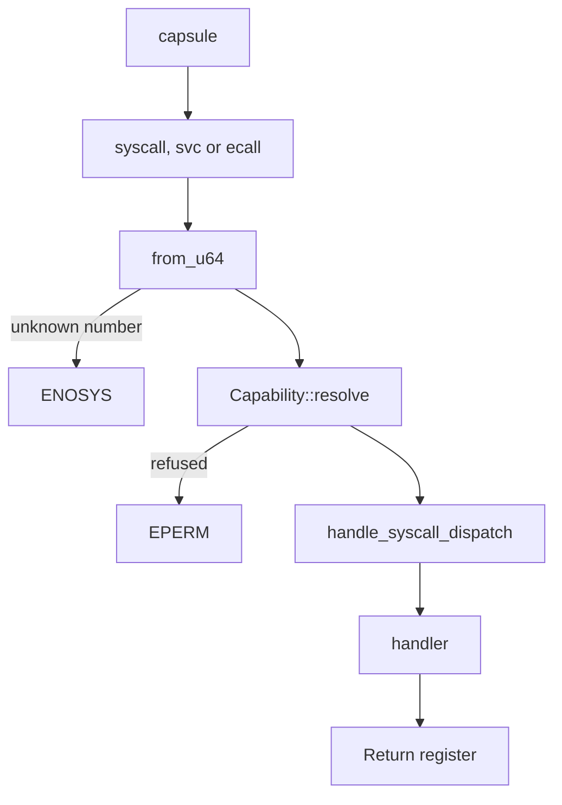

# The NONOS ABI: How a call travels

Part of [The NONOS ABI](README.md).

## How a call travels

A capsule traps with `syscall`, `svc` or `ecall`, depending on the architecture.
The kernel resolves the raw number with `from_u64`, which searches `REGISTRY`
through `lookup_id` (`src/syscall/numbers/convert.rs:22-23`,
`src/syscall/abi/mod.rs:31-40`). A number the registry does not hold is answered
with `ENOSYS`, -38, except one from a [foreign
process](../overview/glossary-dma-pool.md#foreign-process) on x86_64, which its
supervisor answers (see [Calling convention](abi-calling-convention.md#calling-convention)). A known
number goes to the contract `dispatch`, which runs `Capability::resolve` and
answers `EPERM`, -1, when the caller's [capability
token](../overview/glossary-boot-root-record.md#capability-token) does not admit the call
(`src/syscall/contract/dispatch.rs:31-37`). Otherwise `handle_syscall_dispatch`
reaches the handler, and the handler's result goes back in the return register.
The checks `Capability::resolve` makes are listed in
[Syscalls](syscalls-the-capability-check.md#the-capability-check).
