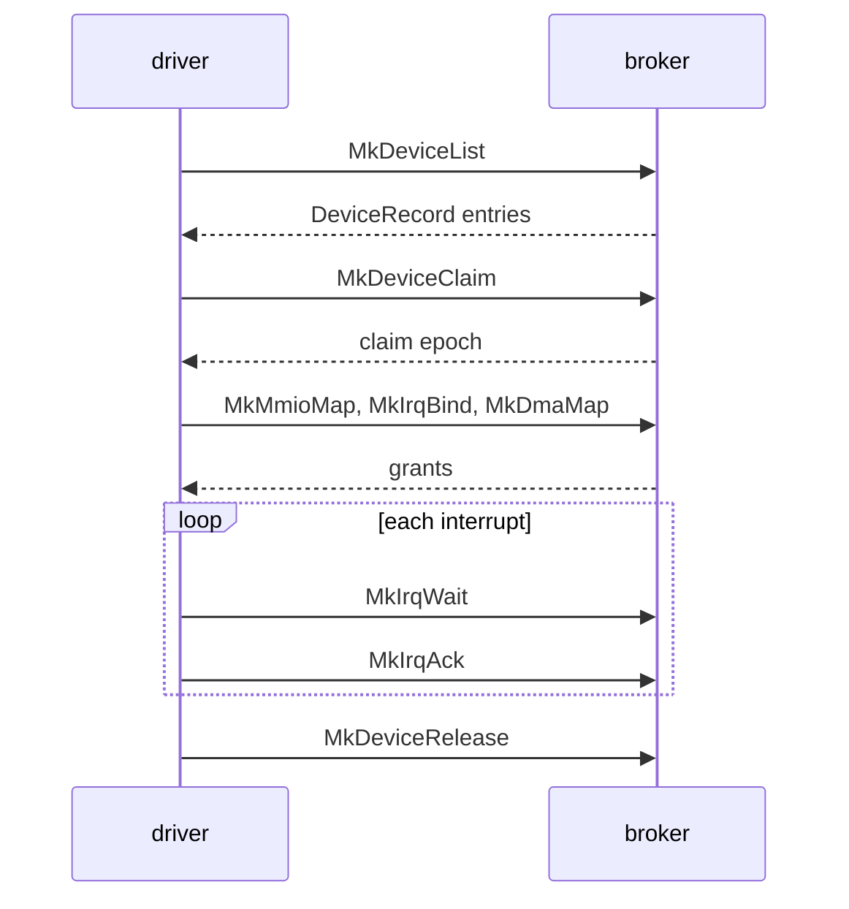

# Broker: How a driver uses the broker

Part of [Broker](broker.md).

## How a driver uses the broker

A driver lists the broker's devices with `MkDeviceList` and reads one
`DeviceRecord` per device. It claims one with `MkDeviceClaim`, which returns the
[claim epoch](../overview/glossary-claim-epoch.md#claim-epoch). The map, bind,
grant and PCI calls pass the epoch back, and an old epoch is refused with
`ESTALE`. With the claim it maps MMIO windows, binds interrupts, takes DMA
buffers and port grants; each comes back as a
[grant](../overview/glossary-dma-pool.md#grant) id. It waits with `MkIrqWait`,
acknowledges with `MkIrqAck`, and gives everything back with `MkDeviceRelease`.
A claim and its grants belong to the caller's process, its thread group, not the
thread that made the call (`src/hardware/broker/holder/`): any thread of the
process may map, bind, wait or release, `MkIrqWait` wakes the thread that waits,
and a worker thread's exit leaves them with the process; they go back when its
last thread ends. The libc wrappers in `userland/libc/src/broker/` carry the
same names in snake case, such as `mk_device_list`
(`userland/libc/src/broker/device.rs:24`).

## The calls

Arguments are in register order, first argument first. The Capability column is
the [capability](../overview/glossary-boot-root-record.md#capability) gate in the cap table; see
[Capabilities](capabilities.md).

| Tag | Name | Arguments | Returns | Capability | libc |
|---|---|---|---|---|---|
| `MDLS` | `MkDeviceList` | `class`, `buf_ptr`, `count` | Records written; with `count` 0, how many devices match | Admin or DeviceEnum | `mk_device_list` |
| `MDCL` | `MkDeviceClaim` | `device_id` | The claim epoch | Driver | `mk_device_claim` |
| `MDRL` | `MkDeviceRelease` | `device_id` | 0 | Driver | `mk_device_release` |
| `MBFB` | `MkBootFramebuffer` | `device_id`, `out_ptr`, `out_len` | 24, with a `BootFramebufferInfo` written; `EPERM` unless the caller holds the claim, `ENODEV` for any other device, and for every caller once a GPU driver's claim took the scanout (L79) | Mmio | `mk_boot_framebuffer` |
| `MMMP` | `MkMmioMap` | `device_id`, `claim_epoch`, `bar_and_flags`, `offset`, `length`, `out_ptr` | 0, with a `MmioMapOut` written | Mmio | `mk_mmio_map` |
| `MMUM` | `MkMmioUnmap` | `grant_id` | 0 | Mmio | `mk_mmio_unmap` |
| `MIRB` | `MkIrqBind` | `device_id`, `claim_epoch`, `irq_source`, `flags`, `vector_count`, `out_ptr` | 0, with an `IrqBindOut` written | Irq | `mk_irq_bind` |
| `MIRU` | `MkIrqUnbind` | `grant_id` | 0 | Irq | `mk_irq_unbind` |
| `MIRA` | `MkIrqAck` | `grant_id` | 0 | Irq | `mk_irq_ack` |
| `MIRP` | `MkIrqPoll` | `grant_id`, `out_ptr` | 0, with an `IrqPollOut` written | Irq | `mk_irq_poll` |
| `MIRW` | `MkIrqWait` | `grant_id`, `last_seq`, `timeout_ms`, `out_ptr` | 0, or 1 when the timeout passed with the sequence unmoved; the sequence is written | Irq | `mk_irq_wait` |
| `MDMM` | `MkDmaMap` | `device_id`, `claim_epoch`, `length`, `flags`, `out_ptr` | 0, with a `DmaMapOut` written | Dma | `mk_dma_map` |
| `MDMU` | `MkDmaUnmap` | `grant_id` | 0 | Dma | `mk_dma_unmap` |
| `MPCR` | `MkPciConfigRead` | `device_id`, `claim_epoch`, `offset`, `width` | The register's value | Driver | `mk_pci_config_read` |
| `MPCW` | `MkPciConfigWrite` | `device_id`, `claim_epoch`, `offset`, `value` | 0 | Driver | `mk_pci_config_write` |
| `MPGT` | `MkPioGrant` | `device_id`, `claim_epoch`, `bar_index`, `flags`, `out_ptr` | 0, with a `PioGrantOut` written | Pio | `mk_pio_grant` |
| `MPRD` | `MkPioRead` | `grant_id`, `port_offset`, `w`, `out_value` | 0, with the value written as a `u32` | Pio | `mk_pio_read` |
| `MPWR` | `MkPioWrite` | `grant_id`, `port_offset`, `w`, `value` | 0 | Pio | `mk_pio_write` |
| `MPRL` | `MkPioRelease` | `grant_id` | 0 | Pio | `mk_pio_release` |
| `MHVB` | `MkHvBackdoor` | `cmd`, `arg`, `out_regs` | 0, with EAX, EBX, ECX and EDX written as `[u32; 4]` | Pio | `mk_hv_backdoor` |
| `MHVP` | `MkHvPost` | `device_id`, `connection`, `msg_type`, `payload`, `len` | 0 | Driver | `mk_hv_post` |
| `MHVR` | `MkHvRecv` | `device_id`, `out` | The message's length, with header and payload written | Driver | `mk_hv_recv` |
| `MHVE` | `MkHvEvents` | `device_id`, `out`, `words` | The words written: on the root, the flags but for channels given to drivers; on a channel's record, one word, 1 if its flag was set | Driver | `mk_hv_events` |
| `MHVS` | `MkHvSignal` | `device_id`, `connection` | 0; on a channel's record, `connection` 0 and the host's own connection for it | Driver | `mk_hv_signal` |
| `MHVC` | `MkHvChannel` | `root_device_id`, `relid` | The new channel record's id; -ENOENT not offered, -EBUSY already given, -EPERM a host service | Driver | `mk_hv_channel` |

The rules behind the table:
