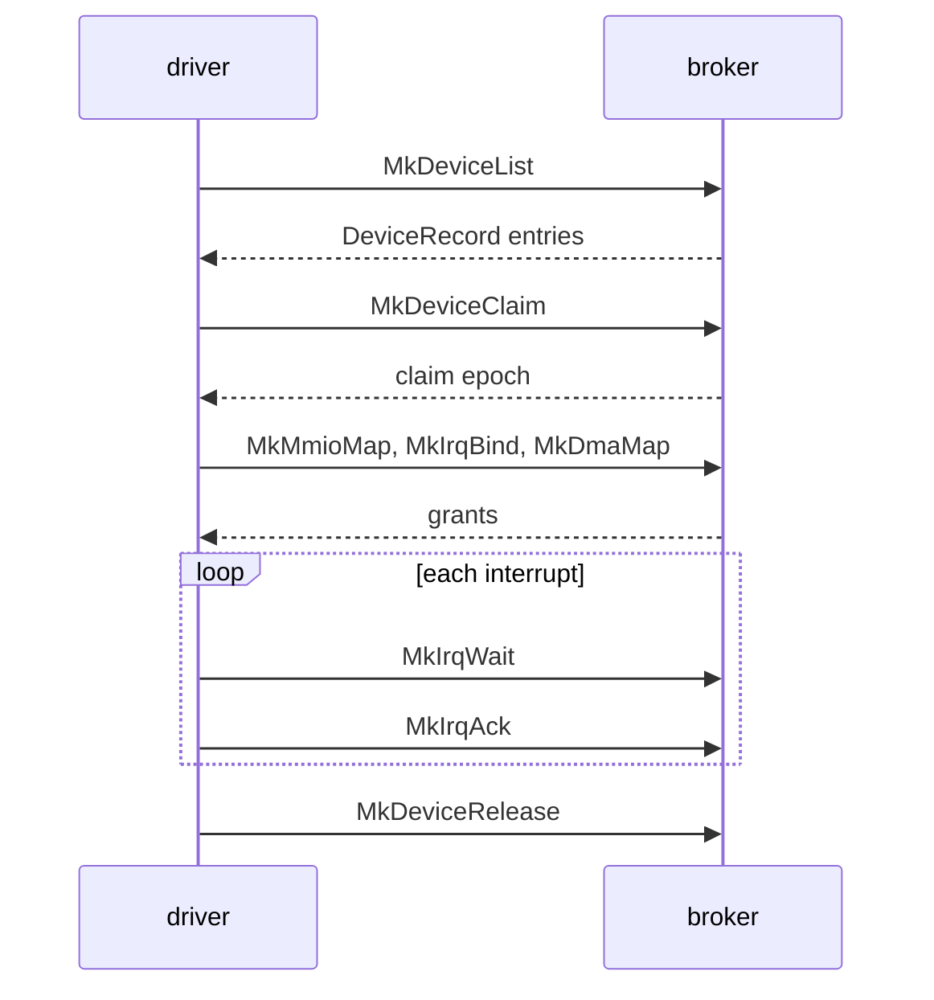

# Broker: How a driver uses the broker

Part of [Broker](broker.md).

## How a driver uses the broker

A driver lists the broker's devices with `MkDeviceList` and reads one
`DeviceRecord` per device. It claims one with `MkDeviceClaim`, which returns the
[claim epoch](../overview/glossary.md#claim-epoch). The map, bind, grant and PCI
calls pass the epoch back, and an old epoch is refused with `ESTALE`. With the
claim it maps MMIO windows, binds interrupts, takes DMA buffers and port grants;
each comes back as a [grant](../overview/glossary.md#grant) id. It waits with
`MkIrqWait`, acknowledges with `MkIrqAck`, and gives everything back with
`MkDeviceRelease`. The libc wrappers in `userland/libc/src/broker/` carry the
same names in snake case, such as `mk_device_list`
(`userland/libc/src/broker/device.rs:24`).

## The calls

Arguments are in register order, first argument first. The Capability column is
the [capability](../overview/glossary.md#capability) gate in the cap table; see
[Capabilities](capabilities.md).

| Tag | Name | Arguments | Returns | Capability | libc |
|---|---|---|---|---|---|
| `MDLS` | `MkDeviceList` | `class`, `buf_ptr`, `count` | Records written; with `count` 0, how many devices match | Admin or DeviceEnum | `mk_device_list` |
| `MDCL` | `MkDeviceClaim` | `device_id` | The claim epoch | Admin or Driver | `mk_device_claim` |
| `MDRL` | `MkDeviceRelease` | `device_id` | 0 | Admin or Driver | `mk_device_release` |
| `MMMP` | `MkMmioMap` | `device_id`, `claim_epoch`, `bar_and_flags`, `offset`, `length`, `out_ptr` | 0, with a `MmioMapOut` written | Admin or Mmio | `mk_mmio_map` |
| `MMUM` | `MkMmioUnmap` | `grant_id` | 0 | Admin or Mmio | `mk_mmio_unmap` |
| `MIRB` | `MkIrqBind` | `device_id`, `claim_epoch`, `irq_source`, `flags`, `vector_count`, `out_ptr` | 0, with an `IrqBindOut` written | Admin or Irq | `mk_irq_bind` |
| `MIRU` | `MkIrqUnbind` | `grant_id` | 0 | Admin or Irq | `mk_irq_unbind` |
| `MIRA` | `MkIrqAck` | `grant_id` | 0 | Admin or Irq | `mk_irq_ack` |
| `MIRP` | `MkIrqPoll` | `grant_id`, `out_ptr` | 0, with an `IrqPollOut` written | Admin or Irq | `mk_irq_poll` |
| `MIRW` | `MkIrqWait` | `grant_id`, `last_seq`, `timeout_ms`, `out_ptr` | 0, or 1 when the timeout passed with the sequence unmoved; the sequence is written | Admin or Irq | `mk_irq_wait` |
| `MDMM` | `MkDmaMap` | `device_id`, `claim_epoch`, `length`, `flags`, `out_ptr` | 0, with a `DmaMapOut` written | Admin or Dma | `mk_dma_map` |
| `MDMU` | `MkDmaUnmap` | `grant_id` | 0 | Admin or Dma | `mk_dma_unmap` |
| `MPCR` | `MkPciConfigRead` | `device_id`, `claim_epoch`, `offset`, `width` | The register's value | Admin or Driver | `mk_pci_config_read` |
| `MPCW` | `MkPciConfigWrite` | `device_id`, `claim_epoch`, `offset`, `value` | 0 | Admin or Driver | `mk_pci_config_write` |
| `MPGT` | `MkPioGrant` | `device_id`, `claim_epoch`, `bar_index`, `flags`, `out_ptr` | 0, with a `PioGrantOut` written | Admin or Pio | `mk_pio_grant` |
| `MPRD` | `MkPioRead` | `grant_id`, `port_offset`, `w`, `out_value` | 0, with the value written as a `u32` | Admin or Pio | `mk_pio_read` |
| `MPWR` | `MkPioWrite` | `grant_id`, `port_offset`, `w`, `value` | 0 | Admin or Pio | `mk_pio_write` |
| `MPRL` | `MkPioRelease` | `grant_id` | 0 | Admin or Pio | `mk_pio_release` |

The rules behind the table:
