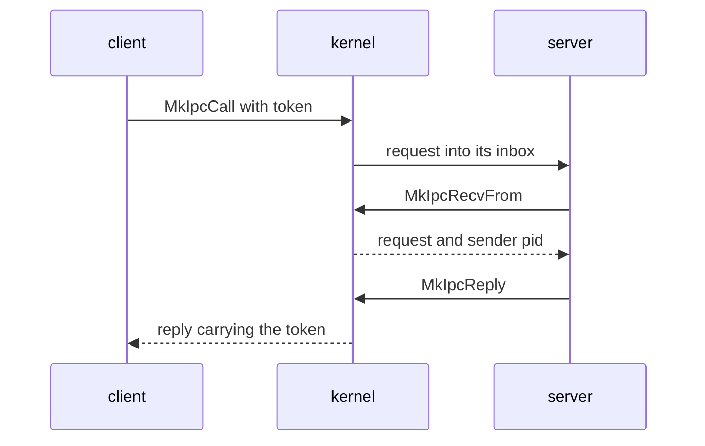

# IPC: the model and the calls

Part of [IPC](ipc.md).

## The model

Every message goes into an [inbox](../overview/glossary-hardware-broker.md#inbox), a named queue the kernel keeps. When the kernel starts a capsule it creates two inboxes for it, `proc.<pid>` for its messages and `stdin.<pid>` for what its parent feeds it, through `register` (`src/kernel_core/process_spawn/capsule_spawn/runner/install/own_inboxes.rs`, `fn register`). It also registers the capsule's two [endpoints](../overview/glossary-dma-pool.md#endpoint), a service name on a port and a [reply inbox](../overview/glossary-peer-list.md#reply-inbox) on a second port, with `register_endpoint` (`src/kernel_core/process_spawn/capsule_spawn/runner/install/install.rs`, `fn run`; `src/kernel_core/process_spawn/capsule_spawn/runner/install/install.rs`, `fn finish`). A sender names the destination by its port number, or by pid with `MkIpcSendToPid`, and finds a service's port by name with `MkServiceLookup`. A receiver drains its own inbox.

A payload is opaque bytes. The kernel adds no header to it. Each service defines its own request format; `policy_proto`, for one, starts each message with a 12-byte `Header` of op, field, kind, status and payload length (`userland/policy_proto/src/hdr.rs`, `struct Header`).

A client sends a request and waits with `MkIpcCall`. The kernel stamps the request with a [correlation token](../overview/glossary-claim-epoch.md#correlation-token) from `next_call_token`, never 0 (`src/syscall/microkernel/ipc/call/token.rs`, `fn next_call_token`). The server takes it with `MkIpcRecvFrom`, which also gives the sender's pid, and answers with `MkIpcReply`. The kernel stamps the reply with the same token, and `recv_reply_correlated` hands the client only the message carrying it, dropping any other (`src/syscall/microkernel/ipc/recv_reply.rs`, `fn recv_reply_correlated`). A server may also answer by sending to its own reply port: `redirect_reply` then hands the bytes to the caller whose request the server received last, stamped with that caller's token (`src/syscall/microkernel/ipc/send_redirect.rs`, `fn redirect_reply`), and `pop` lets one request take one reply only (`src/syscall/microkernel/ipc/pending_reply/pop.rs`, `fn pop`). Any other send cannot pass for a reply, because `sys_ipc_send` sends correlation 0 (`src/syscall/microkernel/ipc/send.rs`, `fn sys_ipc_send`).

## The calls

Arguments are in register order. Every call needs the `IPC` [capability](../overview/glossary-boot-root-record.md#capability); see [Capabilities](capabilities.md).

| Tag | Name | Arguments | Returns | Capability | libc |
|---|---|---|---|---|---|
| `MISD` | `MkIpcSend` | `endpoint`, `buf`, `len` | 0 | IPC | `mk_ipc_send` |
| `MIRC` | `MkIpcRecv` | `endpoint`, `buf`, `len`, `timeout_ms` | Bytes copied | IPC | `mk_ipc_recv` |
| `MICL` | `MkIpcCall` | `ep`, `req`, `req_len`, `resp`, `resp_len`, `timeout_ms` | Bytes of the reply copied | IPC | `mk_ipc_call` |
| `MIRF` | `MkIpcRecvFrom` | `endpoint`, `buf`, `len`, `timeout_ms`, `sender_pid_out`, `enqueued_ms_out` | Bytes copied; the sender's pid is written, and when the kernel queued the message in `MkTimeMonotonic` ms (`enqueued_uptime` in `src/syscall/microkernel/ipc/enqueued_at.rs`) | IPC | `mk_ipc_recv_from`, `mk_ipc_recv_from_at` |
| `MIRY` | `MkIpcReply` | `dest_pid`, `buf`, `len` | 0 | IPC | `mk_ipc_reply` |
| `MIRQ` | `MkIpcRecvReq` | `endpoint`, `buf`, `len`, `timeout_ms`, `meta_ptr`, `meta_len` | Bytes copied; the request's meta v1 is written to `meta_ptr` | IPC | `mk_ipc_recv_req` |
| `MIRT` | `MkIpcReplyTo` | `request`, `buf`, `len` | 0 | IPC | `mk_ipc_reply_to` |
| `MISP` | `MkIpcSendToPid` | `dest_pid`, `buf`, `len` | 0 | IPC | `mk_ipc_send_to_pid` |
| `MSVL` | `MkServiceLookup` | `name_ptr`, `name_len`, `port_out`, `pid_out` | 0; the port and the registering pid are written | IPC | `mk_service_lookup` |
| `MSVR` | `MkServiceRegister` | `name_ptr`, `name_len`, `port` | 0 | IPC | `mk_service_register` |

- `resolve_for_recv` reads endpoint 0 as the caller's own `proc.<pid>` inbox. Any other endpoint must be one the caller owns: `resolve_for_recv` answers an unknown one with `ENOENT`, and one another process owns with `EACCES` (`src/syscall/microkernel/ipc/inbox_name.rs`, `fn resolve_for_recv`).
- A receive copies at most `len` bytes and returns how many; the rest of a longer message is lost. A `timeout_ms` of 0 waits for ever, `u64::MAX` (`MK_IPC_NO_WAIT`) looks once and returns `EAGAIN` on an empty inbox (`after_empty` in `src/syscall/microkernel/ipc/wait_rule.rs`), and a timeout that runs out is `ETIMEDOUT` (`src/syscall/microkernel/ipc/recv_inbox.rs`, `fn recv_from_inbox`).
- `sys_ipc_call` treats a `timeout_ms` of 0 as 5000 ms (`src/syscall/microkernel/ipc/call/sys_ipc_call.rs`, `fn sys_ipc_call`).
- A call to a server that dies is `ESRCH` (-3): a caller already waiting is woken and answered at once, and one that looked the server up just before its names went is refused before it waits (`src/syscall/microkernel/ipc/pending_reply/abandoned.rs`, `clear_pid.rs`). Teardown drops the dead process's names before it clears the calls it owed (`src/process/exit/teardown.rs`).
- `from_envelope` gives `MkIpcRecvFrom` the sender's pid, and 0 for a message the kernel sent itself (`src/syscall/microkernel/ipc/sender_pid.rs`, `fn from_envelope`).
- `sys_ipc_reply` takes the token from `pending_reply`: of the entries whose request the server has dequeued, the one of the request it received last when it is the destination's, else the destination's oldest (`src/syscall/microkernel/ipc/pending_reply/reply_rule.rs`, `fn pick`). It drops a reply to a pid with no dequeued call outstanding on this server while still returning 0 (`src/syscall/microkernel/ipc/reply.rs`, `fn sys_ipc_reply`). A full inbox, `QueueFull`, is `EBUSY` (`src/syscall/microkernel/ipc/reply.rs`, `fn sys_ipc_reply`).
- `MkIpcRecvReq` receives as `MkIpcRecvFrom` does and writes 24 bytes of meta v1, little-endian, as `abi/wire.toml` `[ipc.recv_meta_v1]` pins them: `version` u16 = 1, `reserved` u16 = 0, `sender` u32 (0 for the kernel), `enqueued_ms` u64 in `MkTimeMonotonic` ms, and `request` u64 (`src/syscall/microkernel/ipc/recv_meta.rs`, `fn meta_v1`). `meta_len` other than 24 is `EINVAL`, so a caller built for another version is refused, not half-written; a meta pointer that is not writable is `EFAULT`, checked before the call waits (`src/syscall/microkernel/ipc/recv_req.rs`, `fn sys_ipc_recv_req`).
- `request` is the server's own name for the call: per server, from 1, never reused while the server lives, and 0 for a message no reply is owed (`src/syscall/microkernel/ipc/pending_reply/request_ids.rs`). It is not the correlation token, which counts every call on the machine and would tell each server how busy every other capsule is.
- `MkIpcReplyTo` answers the request it names and no other: the caller's reply carries that call's token. `ENOENT` when the server has no such request dequeued and unanswered, whether never queued on it, still in its inbox, or answered already, so a second answer to one request reaches no one; `ETIMEDOUT` when the call stopped waiting first: nothing is sent, and no one reads the answer; `EINVAL` for request 0 or a bad length; `EFAULT` for an unreadable buffer, with the request still owed (`src/syscall/microkernel/ipc/reply_to.rs`, `fn sys_ipc_reply_to`; `pending_reply/served_rule.rs`, `fn named_at`). It returns 0 only when the caller has the answer: a call whose wait runs out gives its entry up under the table's lock, and one that finds an answer already being delivered waits for it and takes it (`src/syscall/microkernel/ipc/call/given_up.rs`, `fn receive`; `pending_reply/give_up_rule.rs`). Once found the request is spent, as a delivery error (`EBUSY`, `ENOENT`) also says. A server that takes several requests before answering them answers each this way.
