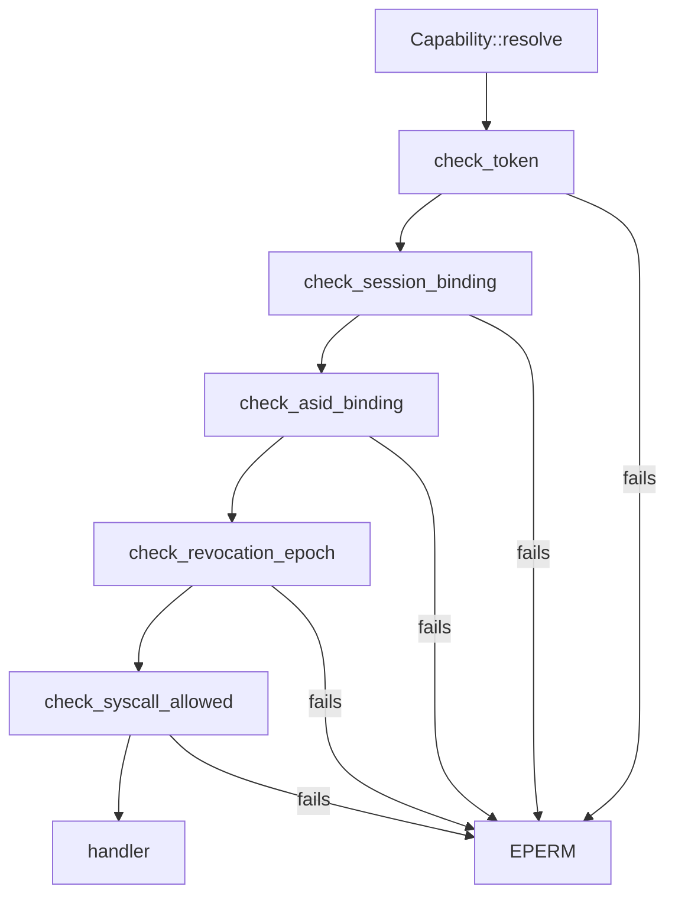

# Syscalls: The capability check

Part of [Syscalls](syscalls.md).

## The capability check

Before any handler runs, `Capability::resolve` takes the caller's [capability
token](../overview/glossary.md#capability-token) and runs five checks in order
(`src/syscall/contract/resolver/resolve.rs:31-43`). `check_token` verifies the
token's signature, its expiry and that it is not revoked
(`src/syscall/contract/resolver/check_token.rs:21-32`). `check_session_binding`
compares the token's boot session nonce with the live one
(`src/syscall/contract/resolver/check_session.rs:23-32`). `check_asid_binding`
requires the token to name the caller's address space
(`src/syscall/contract/resolver/check_asid.rs:22-30`). `check_revocation_epoch`
refuses a token whose revocation epoch is below the process's current one, which
every revoke raises (`src/syscall/contract/resolver/check_epoch.rs:22-30`).
`check_syscall_allowed` asks the cap table
(`src/syscall/contract/resolver/check_syscall.rs:23-31`). Any failure is
`EPERM`, and the handler never runs. The `[CAP-DENY]` line `log_deny` builds
goes to the structured log, which this release never starts, so it is dropped
([Logging](../kernel/logging.md#the-structured-log-and-the-debug-ring)). The
table is total: `is_allowed` refuses a number no family claims
(`src/syscall/contract/cap_table/mod.rs:28-34`).

Read the Capability column this way:

- A single name means the token must grant that capability.
- "A or B" means either is enough. No [broker](../overview/glossary.md#broker)
  or input gate accepts `Admin` in place of the call's own capability:
  predicates such as `can_driver` ask for their bit alone
  (`src/capabilities/token/types/authority_broker.rs:29-31`).
- "A and B" means both.
- "valid token" means `is_valid`: the token has not expired and grants at least
  one capability (`src/capabilities/token/types/query.rs:44-47`). The tokens
  `new_token` mints carry no expiry (`src/process/caps.rs:38-46`).
- "none" is `MTTQ` alone, whose arm is `true`
  (`src/syscall/contract/cap_table/mk_surface.rs:50`). The five checks above
  still run.
- `MADC` needs AttestRead and is refused to a caller holding Network, because
  `can_attest_doc` excludes it (`src/syscall/caps/checks/system.rs:42-47`).

The Gate column is the predicate and the line in the cap table. Some handlers
ask again. `sys_cap_grant` also needs every bit it grants
(`src/syscall/microkernel/capability/handlers.rs:42-47`), and
`sys_pci_config_read` and `sys_pci_config_write` ask for `Driver` themselves, so
`Admin` alone is refused there (`src/syscall/microkernel/pci.rs:28-35`,
`src/syscall/microkernel/pci.rs:43-50`).

## The calls
