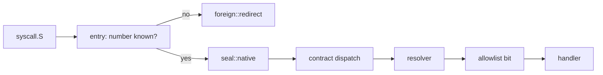

# The system-call surface today

This is the system-call surface at `551bbd34`, from `abi/syscalls.toml` and `src/syscall`. The target surface and the comparison are in [08-target-syscall-surface.md](08-target-syscall-surface.md).

## How many, and where they are defined

`abi/syscalls.toml` publishes **196** system calls. The count is `grep -c '^\[desc\.' abi/syscalls.toml`, and the `[numbers]` table holds the same 196 keys. Each entry is a `[desc.TAG]` block with `nr`, `args` (name, type, direction, optional bound) and `ret`, and either `caps` (every listed capability is needed) or `caps_any` (any one). Only two use `caps_any`: `MCOF` (`abi/syscalls.toml:690`) and `MAIS` (`abi/syscalls.toml:980`). `MBGL` (`abi/syscalls.toml:1385`) is published but retired and answered `EINVAL` by `src/syscall/microkernel/retired.rs`.

Numbers are FourCC tags, four ASCII bytes packed little-endian (`src/syscall/abi/tag.rs:20`), so `MISD` is `0x4453494D`. The first letter groups them loosely: `C` for crypto, `A` for admin, `G` for graphics, `M` for everything else.

The TOML is not the source of truth. Nothing generates Rust from it; `build.rs` does not read it. The Rust side is maintained by hand in five places that must agree: the number registry (`src/syscall/abi/registry/`), the `SyscallNumber` enum (`src/syscall/numbers/defs.rs`), the capability table (`src/syscall/contract/cap_table/`), the router (`src/syscall/dispatch/router/dispatch_fn.rs:22`) and the second-stage `SYS_*` arms (`src/syscall/microkernel/dispatch/route.rs:33`). Agreement is checked after the fact by `scripts/check_syscall_abi.py`, `scripts/check_syscall_caps.py` and `scripts/check_syscall_args.py`. At this commit all five layers hold the same 196 tags; no number is published and unreachable, or reachable and unpublished.

## By family

| Family | Count | Examples | Where the work happens |
|---|---:|---|---|
| ACPI, platform, NUMA | 33 | `MTBL` AcpiTable, `MRGN` AcpiRegion, `MASL` AcpiSleep, `MSMB` SmbiosTable, `MNNO` NUMA | Kernel broker for the userland ACPI capsule, plus an event policy in ring 0 |
| Device broker | 27 | `MDLS`/`MDCL`/`MDRL` list, claim, release; `MMMP` MMIO map; `MIRB`/`MIRW` IRQ bind and wait; `MDMM` DMA map; `MPRD`/`MPWR` port read and write; `MPCR`/`MPCW` PCI config; six Hyper-V and VMware calls | Kernel mechanism |
| Process, thread, spawn, session, stdio | 24 | `MEXT` exit, `MKIL` kill, `MTSP` thread spawn, `MCLD` capsule load, `MCVF` capsule verify, `MPST` process statistics, `MSOW` stdout write, `MTTY` terminal | Mixed: process mechanism, spawn verification, a process manager and a terminal table in ring 0 |
| Foreign process | 20 | `MFSP` spawn, `MFWT` wait, `MFRP` reply, `MFSG` signal, `MPMP` peer map, `MPCP` peer copy, `MLRN` Linux run with network | Kernel mechanism for the Linux personality |
| Trust, install, sign | 17 | `MLSG` local sign, `MLVF` local verify, `MAIN` app install, `MAPL` app launch, `MDRO` dev root, `MISR` install source | Verification, signing and install policy in ring 0 |
| Storage, data volume, user files | 15 | `MSWR`/`MSRR` raw store sectors, `MDIM` data import, `MDRD` data read, `MDPW` passphrase, `MUOP` user object put | An encrypted filesystem in ring 0 |
| Crypto | 12 | `CHSH` hash, `CENC` encrypt, `CXSH` X25519, `CKEC` Keccak, `CRND` random, `CMKY` machine key | Nine forwarded by the kernel to the crypto capsule; Keccak, random and the TPM machine key computed in ring 0 |
| Graphics, surface, input | 12 | `GDIM` display size, `MSRG` surface register, `MSPR` present, `MIEP`/`MIED` input post and drain | Surface registry and a framebuffer blit in ring 0 |
| IPC and services | 11 | `MISD` send, `MIRC` receive, `MICL` call, `MIRY` reply, `MISP` send to pid, `MSVL`/`MSVR` service lookup and register | Kernel mechanism plus an in-kernel name service |
| Attestation, TPM, device secret | 10 | `MADC` attestation document, `MBTA` boot attest, `MDVS` device secret, `MENR` enrol | TPM commands from ring 0 |
| Time | 5 | `MTMS`, `MMON`, `MCPG` clock page, `MTRT` RTC, `MTAD` time adjust | Kernel |
| Admin | 3 | `ARBT` reboot, `ASDN` shutdown, `APPS` policy push | Kernel |
| Capability management | 3 | `MCGT` grant, `MCRV` revoke, `MCCK` check | Kernel |
| Memory | 2 | `MMAP`, `MUMP` | Kernel |
| Battery, debug | 2 | `MBAT`, `MDBG` | Kernel |
| **Total** | **196** | | |

The router's own domains split them as 180 `Mk`, 12 crypto, 3 admin and 1 graphics; the 169 second-stage `SYS_*` constants are spread over seven files in `src/syscall/microkernel/numbers/` (acpi, data, foreign, hardware, ipc_process, session, trust).

## How one call is checked

1. `SyscallNumber::from_u64` decodes the tag (`src/arch/x86_64/syscall/manager/entry.rs:38`). An unknown number from a supervised guest is parked for its supervisor (`src/arch/x86_64/syscall/manager/entry.rs:49`); otherwise it is `ENOSYS`.
2. A guest naming a native number is refused (`src/arch/x86_64/syscall/manager/entry.rs:60`).
3. `Capability::resolve` runs the resolver (`src/syscall/contract/dispatch.rs:32`). The resolver checks the caller's token: its MAC only under the feature `nonos-syscall-token-mac-every-call` (`src/syscall/contract/resolver/check_token.rs:27`; by default the MAC is checked once, when the token is installed), its expiry (`src/syscall/contract/resolver/check_token.rs:30`), its revocation (`src/syscall/contract/resolver/check_token.rs:33`), the boot-session nonce, the ASID binding and the revocation epoch, and finally one bit in a per-token allowlist (`src/syscall/contract/resolver/check_syscall.rs:28`).
4. The allowlist is not the capability word. When a token is published, `derive` evaluates the capability table once for every registry slot (`src/syscall/contract/allowlist/derive.rs:31`, `src/syscall/contract/cap_table/mod.rs:38`) and stores the answers as two bitmaps, one for ordinary callers and one for launchers. At call time only the bit is read.
5. On refusal the call returns `EPERM`. A call outside the capsule's signed `declared_caps` envelope ends the process with `SIGSYS` (`src/syscall/contract/dispatch.rs:61`).

Some handlers check again on their own: `MkKill` needs `ProcessControl` or `Admin` to end a process that is not its child (`src/syscall/microkernel/kill.rs:48`), `MkCapGrant` needs `Admin` (`src/syscall/contract/cap_table/mk_ipc.rs:61`) and then every granted bit.

The token itself is a `Vec<Capability>` with a nonce and a 64-byte keyed-BLAKE3 MAC (`src/capabilities/token/types/defs.rs:23`, `src/capabilities/token/material.rs:41`).

## The capability word

44 bits, `CoreExec` at bit 0 (`src/capabilities/types/defs.rs:20`) to `PowerControl` at bit 43 (`src/capabilities/types/defs.rs:82`). Every system call has a declared gate: 194 name capabilities and 2 name `caps_any`. 22 of them, among them `CRND`, `MEXT`, `MGPD`, `MYLD`, `MTMS`, `MFTW` and `MCPG`, require only a valid token.

Bits that no system call names: `IO` and `Hardware` (both commented "Enforces nothing"), `Network`, `RegisterService`, `ProcessControl`, `Keyring`, `Entropy`, and the three capture bits no capsule holds yet. `Network` matters most for this review. It grants no system call. It takes effect in three other places: the service registry requires it of a sender to eleven network services (`src/services/registry/policy.rs:26-38`), holding it disqualifies a caller from `MkAttestDoc` (`src/syscall/caps/checks/system.rs:63`), and the boot profile strips it at spawn (`src/kernel_core/process_spawn/capsule_spawn/runner/profile_gate.rs:56`).

## Signals

There is no native `sigaction`, `sigprocmask` or `sigreturn` system call. `MkKill` accepts only `SIGINT`, `SIGTERM` and `SIGKILL` (`src/syscall/microkernel/kill.rs:27`). Guest signals are built by the Linux personality and installed through `MkForeignContext` and `MkForeignSignal` (`src/process/foreign/signal_call.rs`). The kernel also raises `SIGSYS` for an undeclared call.

## Service logic reached through system calls

These families do work in ring 0 that is service logic:

- **Crypto.** Hash, AEAD, HMAC, HKDF and X25519 are serialised by the kernel and round-tripped to the crypto capsule over the kernel's own client transport (`src/security/crypto_capsule/client/transport.rs:23`) while the caller blocks. Keccak-256 is computed in ring 0 (`src/syscall/dispatch/crypto/keccak/handler.rs:42`).
- **Storage.** The encrypted data volume (`src/syscall/microkernel/data/`) and raw store sectors.
- **Trust and install.** Capsule verification, local signing and verification, install sources, app install and launch, prover jobs.
- **Process manager.** Process statistics (`MPST`, eight `procstat*.rs` files), capability listings, log tail, boot census, a terminal table, process stdout and stdin.
- **ACPI.** Mostly a broker; `src/syscall/microkernel/acpi/event.rs` also decides that the power button becomes a key and a critical thermal or battery event shuts the machine down.
- **Graphics.** `MSPR` blits a user surface to the framebuffer in ring 0 (`src/syscall/dispatch/router/graphics_present/blit.rs`).

[04-classification.md](04-classification.md) assigns each of them a destination.
