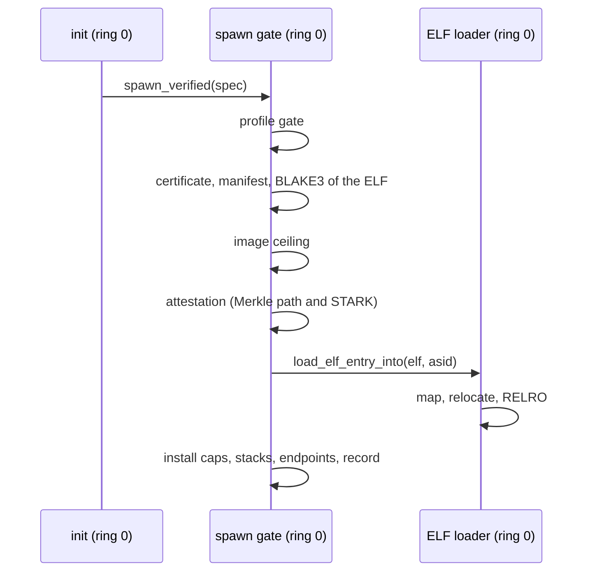
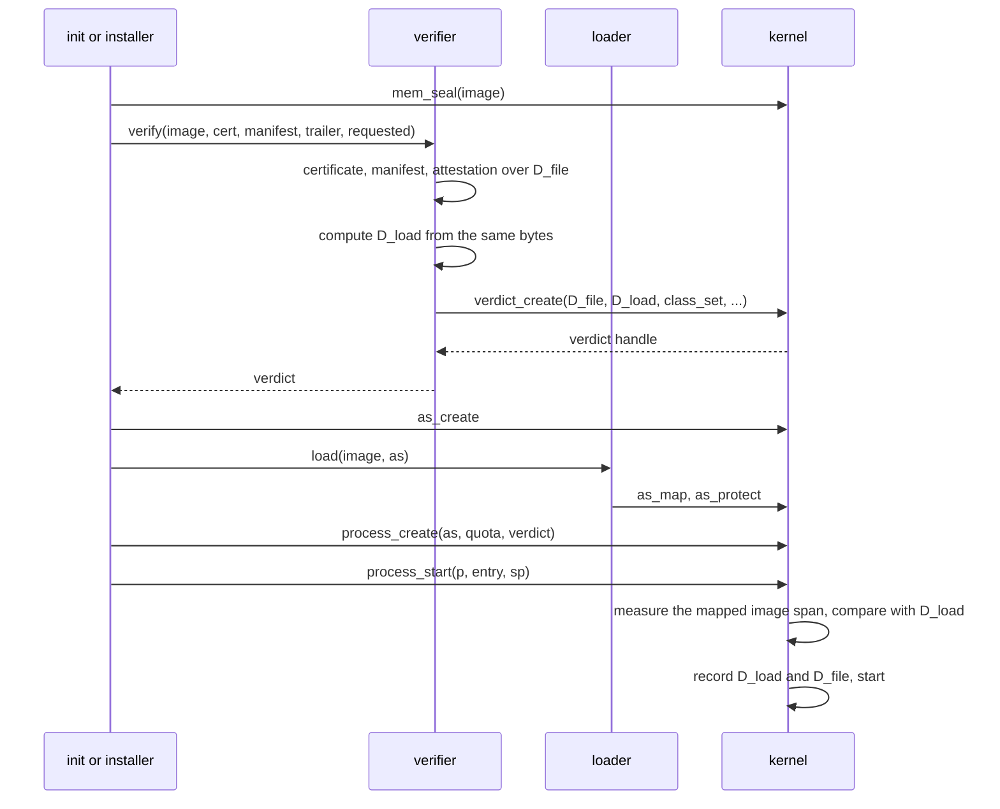

# Target kernel: spawn and boot trust

How a capsule comes to run once ELF parsing and attestation verification leave ring 0, how the kernel still knows what runs, and how it trusts a userland verifier's answer. The per-finding migration steps are in [migration/elf-loading.md](migration/elf-loading.md) and [migration/spawn-gate.md](migration/spawn-gate.md).

## Today

Every capsule, boot-time or store-loaded, goes through one ring-0 path.



1. `spawn_verified` refuses an image built without the capsule and applies the boot profile (`src/kernel_core/process_spawn/capsule_spawn/runner/verified.rs:46-50`).
2. `preflight::run` verifies the identity certificate against the baked trust anchor (`src/kernel_core/process_spawn/capsule_spawn/runner/preflight.rs:35-38`), measures the ELF once with BLAKE3 (`src/kernel_core/process_spawn/capsule_spawn/runner/preflight.rs:54`), verifies the manifest and its publisher signature against that measurement, the target triple, the requested capabilities and the declared endpoints (`src/kernel_core/process_spawn/capsule_spawn/runner/preflight.rs:55-66`), applies the image ceiling (`src/kernel_core/process_spawn/capsule_spawn/runner/preflight.rs:70-74`), and checks the attestation trailer against the measurement and the manifest's required capabilities, under the vendor root first and then enrolled roots (`src/kernel_core/process_spawn/capsule_spawn/runner/preflight.rs:80-85`, `src/security/capsule_attest/verify.rs:44-73`).
3. `install` creates the process, loads the ELF with the kernel's loader (`src/kernel_core/process_spawn/capsule_spawn/runner/install/install.rs:100`), installs the capabilities trimmed by the boot profile (`src/kernel_core/process_spawn/capsule_spawn/runner/install/install_caps.rs:20-37`), maps stacks and the clock page, registers endpoints, records the measurement in the attestation registry and queues the process (`src/kernel_core/process_spawn/capsule_spawn/runner/install/install.rs:90-128`).

The binding between what was measured and what runs is implicit: the same kernel function holds the bytes it hashed and the bytes it copies into frames. A store-loaded capsule takes the same path through `MkCapsuleLoad` (`src/syscall/microkernel/capsule_load/handle.rs:55`).

## Target

Four userland roles and two kernel checks.



### The kernel's two checks

1. **The verdict check at `process_create`.** The kernel accepts a verdict only if it is a `Verdict` object, which only a holder of the `VerdictAuthority` capability can create, and that capability is granted only to a process whose recorded measurement equals the verifier digest pinned in the kernel image. The new process's class mask is `verdict.class_set ∩ class_mask(creator) ∩ CEILING`. A verdict is single-use.
2. **The measurement check at `process_start`.** The kernel hashes the image span of the unstarted address space in a canonical order and compares it with `verdict.d_load`. On a mismatch the start is refused and the process is destroyed. On a match the kernel records `d_load`, `d_file`, the class mask, the verdict's authority (vendor, enrolled or local) and the creator's measurement in the measurement table, then starts the thread.

Nothing else in the spawn path is in ring 0.

### The canonical load digest

`D_load` is defined so that both the build and the kernel can compute it, and so that address-space randomisation does not change it:

```
page_digest(p) = BLAKE3(content(p))                    (4096 bytes)
D_load = BLAKE3(
    "nonos.load.v1" ||
    u64le(entry - base) || u64le(span_pages) ||
    for each page p in [base, base + span_pages * 4096), ascending:
        u64le(p - base) || u8(perms(p)) || page_digest(p)   (an unmapped page contributes perms 0 and 32 zero bytes)
)
```

The kernel enforces these rules at `process_start`:

- No page outside `[base, base + span)` is mapped executable.
- The entry point is inside the span, on an executable page.
- Pages outside the span (stack, heap, the clock page) are not measured; they cannot hold code that runs first, because nothing outside the span is executable.

Base independence comes from the self-relocating start ([migration/elf-loading.md](migration/elf-loading.md)): the pages hold the file's bytes as linked, unrelocated, and the capsule's own measured start code applies its relocations after it runs. The digest is therefore a property of the image file alone, and the build can compute it next to today's `D_file`.

### The cost of measuring

The digest is built from per-page digests so that the kernel can measure once and reuse:

- **Sealed pages are hashed once.** When a MemoryObject is sealed (`mem_seal`), the kernel computes and stores the digest of each of its pages; a sealed object can never be written again, so the digests stay true for its lifetime. Read-only segments are mapped straight from the sealed image object, so at `process_start` the kernel looks up their page digests and hashes nothing. A role of the Linux personality started a second time from the same sealed image costs only the writable pages.
- **Copied pages are hashed at start.** Writable segments are copies in fresh frames; the kernel hashes those pages at `process_start`. For a capsule they are its data and GOT, a small part of the image.
- **The final hash** is over 41 bytes per page of the span.

The hash itself is slow in ring 0 today. The kernel target disables SSE and AVX and builds with soft floating point (`x86_64-nonos.json:21`), so BLAKE3 runs without SIMD. Measured on one development host, the kernel's BLAKE3 runs at about 190 to 218 MB/s against about 2.6 to 2.9 GB/s for the same crate in a capsule, and the spawn gate re-hashes the personality's 9 to 12 MB image on every role spawn because only the STARK result is cached (`src/security/capsule_attest/path.rs:41-55`). The throughput figures come from that one host and were not re-measured for this document.

Three ways to pay less were weighed:

| Option | Measurement stays the kernel's own | Ring-0 cost |
|---|---|---|
| Hash once per sealed object and reuse, as above | Yes: the kernel computes every digest it records | About 150 lines (a digest array per sealed object) |
| A bounded SIMD region: save the FPU state, run BLAKE3's SSE4.1 or AVX2 path compiled for that one function, restore | Yes | About 200 lines, plus the review burden of the only vector code in ring 0 and the FPU save on that path |
| The verifier hashes and the kernel checks only a commitment | No: the record would be the verifier's claim, and a compromised verifier could make it describe other bytes | Least |

The first is the design: it removes repeated hashing, which is most of today's cost, and keeps the measurement trustworthy. The second can be added if first-start hashing of large images still matters after measurement. The third is rejected, because the measurement record is the one fact the kernel guarantees independently of every userland component ([05-trusted-computing-base.md](05-trusted-computing-base.md)).

BLAKE3 stays in ring 0 for this (the external `blake3` crate the kernel already uses).

### How a measurement binds to what runs

| Link | Who establishes it | How it is checked |
|---|---|---|
| Trailer proves a statement over `D_file` and the required capabilities | The attestation pipeline at build time | The verifier, with today's code |
| `D_load` is the load digest of the same bytes as `D_file` | The verifier computes both from one sealed MemoryObject | The verifier is pinned by digest; the build publishes `D_load` beside `D_file`, so a remote verifier can recompute it |
| The address space holds exactly `D_load` in its executable span | The loader maps it | The kernel, at `process_start` |
| The running process is the one measured | The kernel records the measurement it computed | The attest service reports the table; a TPM quote covers it through PCR 14 |

A compromised loader cannot make a different image run: the start is refused. A compromised verifier can approve an image that should be refused, but cannot hide it: the measurement table records the true `D_load`, and the image cannot receive a class outside the ceiling.

### Bootstrapping the trusted set

The verifier cannot verify itself, and init must exist before anything can be spawned.

- **init** is a flat image inside the signed kernel image: a fixed header (magic, entry offset, up to four segments with offset, size, memory size, address and permissions) produced and checked by the build. The kernel maps it without an ELF parser and records its digest. Its bytes are covered by the bootloader's signature over the kernel image (`nonos-bootloader/src/kernel_verify/verify.rs:29`), so the kernel is not parsing untrusted input.
- **The pinned set** is a table in the kernel image of `(D_load, class_set)` for the components that cannot be verified by the verifier: the verifier itself, and optionally devmgr and names. `process_create` accepts, in place of a verdict, a request naming a pinned entry; `process_start` then requires `D_load` to equal the pinned digest. `VerdictAuthority` is granted only to the process started from the verifier's pinned entry.
- **The boot package** replaces the 422 `baked_trust!` and 147 `include_bytes!` sites: one section of the kernel image holding every boot capsule's ELF, certificate, manifest and trailer, plus init's spawn plan as data. The kernel hands init a sealed, read-only MemoryObject over it and never parses it. Because the section is inside the signed kernel image, its integrity is the kernel's.

### Store-loaded capsules

Today `MkCapsuleLoad` copies the four artefacts from the installer and runs the same ring-0 path (`src/syscall/microkernel/capsule_load/handle.rs:29-61`). In the target the installer reads them from vfs, seals the image into a MemoryObject, asks the verifier for a verdict, and asks init (which holds `SpawnBroker`) to spawn on behalf of the requester. The rule today's `from_vfs` path enforces, that a store-loaded capsule's capabilities lie within the requester's unless the requester is a launcher (`src/kernel_core/process_spawn/capsule_spawn/from_vfs/load/bound.rs`), becomes the class-mask intersection with the creator, enforced by the kernel.

### Linux guests

Unchanged in shape. The personality already parses and maps guest ELFs in userland (`userland/capsule_linux/src/linux/image/load.rs`, `userland/capsule_linux/src/linux/image/segment.rs`) and verifies guest programs through the kernel's verification calls (`userland/capsule_linux/src/linux/attest_publisher.rs`, `userland/capsule_linux/src/linux/attest_local.rs`). In the target those calls go to the verifier; guests keep class mask 0 (`src/process/foreign/spawn_guest.rs:42`).

## Boot trust

| Step | Today | Target |
|---|---|---|
| Kernel image signature and rollback index | Bootloader (`nonos-bootloader/src/kernel_verify/verify.rs:29`, `nonos-bootloader/src/kernel_verify/signature_message.rs:17`) | Unchanged; the image now also covers init, the pinned set and the boot package, as today it covers the embedded capsules |
| Rollback floor | Bootloader writes, kernel re-reads (`src/security/tpm/boot_reads/floor.rs:60-66`) | Bootloader writes; the tpm service reads ([migration/tpm-rollback-floor.md](migration/tpm-rollback-floor.md)) |
| Measured-boot verdict | Ring 0, halts on refusal (`src/security/boot/loader_check/run.rs:28-55`, `src/kernel_core/init/entry/loader_refusal.rs:27`) | The attest service computes it from the handed-over log and a PCR read through tpm; init refuses to start the boot set on `Refused` or `NoEvidence` and powers off |
| Capsule measurements into PCR 14 | Ring 0 on every admission (`src/kernel_core/process_spawn/capsule_spawn/runner/attest_gate.rs:46`) | Ring 0 at `process_start`, one `PCR_Extend` at locality 1, from the kernel's append-only log (see "PCR 14 and receipts") |
| Image capability ceiling | Ring 0, missing file means unrestricted (`src/security/image_ceiling/value.rs:38-49`) | Ring 0, required, generated from the catalogue ([migration/spawn-gate.md](migration/spawn-gate.md)) |

## PCR 14 and receipts

AgentProof receipts and the nsh attestation's PCR 14 step replay the capsule event log against a quoted PCR 14 (`docs/agentproof/receipt-verify.md`, `docs/nsh/nsh-v1-attest.md`). Today the kernel extends PCR 14 on every admission, in ring 0 (`src/security/capsule_measure/extend.rs:44`, called from `src/kernel_core/process_spawn/capsule_spawn/runner/attest_gate.rs:46`). If the whole TPM driver moved to a userland service, that service would decide what reaches PCR 14, and a compromised one could skip an extend, reorder extends, or extend a digest that never ran. A quote would then prove only what the service chose to say.

The target therefore keeps two things in ring 0:

1. **The measurement log and its root.** For every `process_start` the kernel appends `(sequence, pid, D_load, D_file, class mask, authority, creator digest)` to an append-only log in the measurement table and folds it into a running root, `R_n = BLAKE3(R_{n-1} || entry_n)`. The log is readable by attest through a read-only MemoryObject and writable by nothing but the kernel. This is today's attestation registry made append-only.
2. **One TPM command: `PCR_Extend` of PCR 14 with `entry_n`'s digest,** issued by the kernel before the process's first instruction, at locality 1. The userland tpm service holds only the locality-0 register page; the TPM's own locality arbitration (the `TPM_ACCESS` request and release protocol of the FIFO and CRB interfaces) serialises the two, so the kernel needs no lock shared with userland. This is about 300 lines of command code, against the 5,674 of today's driver.

What each party can then do:

| A compromised tpm or attest service could | Effect |
|---|---|
| Skip an extend | Not possible: the kernel extends |
| Reorder extends | Not possible: the kernel extends in log order before each start |
| Extend PCR 14 with an extra digest at locality 0 | Detected: the log no longer replays to the quoted PCR 14, so receipt and nsh verification fail closed. Availability, not integrity |
| Withhold or forge a quote | A forged quote fails the AK signature check; a withheld one is a denial of service |
| Report a different log | Detected: the log must replay to the quoted PCR 14, and the kernel's root `R_n` is in the measurement table, which the verifier can also read through attest's report |

What the kernel's root guarantees on its own, without the TPM: the sequence of every image that started, with its digests, since boot, as observed by the kernel. What the quote adds: that this sequence ran on this machine after this measured boot chain (PCRs 0 to 7) and that the kernel itself was the measured one. The binding between them is the replay: a verifier recomputes PCR 14 from the log entries and compares it with the quoted value, as the receipt and nsh verifiers do today.

Whether locality 1 is available depends on the platform's TPM interface; where it is not, the kernel extends at locality 0 and the tpm service must be stopped from mapping the TPM page while the kernel's extend runs, which reintroduces a shared lock. [14-open-questions.md](14-open-questions.md) keeps this as a platform check.

## The rule for kernel-recorded facts

A fact the kernel records, a measurement, a family's measured set, a holder's grants, is never silently dropped because it arrived before the thing it belongs to existed. It is either refused, so the operation that produced it fails, or buffered against an owner that does exist. A seal gap in the Linux personality violated this: the seal ignored a program measured before its family was reserved (`src/process/foreign/seal/absorb.rs:71-75`, with the family reserved only at `src/process/foreign/spawn_guest.rs:32`), so a sealed run's measured set could omit its main program. Every append to the measurement log and the family sets in the target follows the rule.

## What the kernel no longer needs

ELF parsing, relocation and RELRO walks; every TPM command but one; certificate, manifest and trailer parsing; Ed25519, ML-DSA-65 and P-256 verification; the STARK verifier and Merkle path folding; the admission cache; dev and local roots; the 168-capsule trust set as typed constants. Of the crypto, the kernel keeps BLAKE3 for the load digest and the log root, and its RNG.
