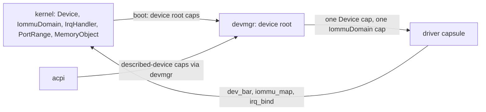

# Target kernel: device authority

How a userland driver gets MMIO, DMA and interrupt authority, and whether `src/hardware/broker` is the right boundary.

## Today

The broker (29,348 phys lines) is both the mechanism and the policy for device access.

- **Claim.** A driver calls `MkDeviceClaim`, which needs the Driver capability bit (`src/syscall/contract/cap_table/mk_device.rs:25`). `claim` refuses firmware devices, applies hold rules and a scope check, prepares a wipe, enters a claim with a fresh epoch, confines the device to the holder's IOMMU domain, turns bus mastering off, powers it to D0, resets it, restores BARs and admits it (`src/hardware/broker/claim/claim.rs:22-40` and the steps after). The scope check admits a device only if it matches a scope row for a service endpoint the holder serves (`src/hardware/broker/claim/scope_check.rs:27`); hold rules pin particular devices to particular service names (`src/hardware/broker/claim/hold_rule.rs`).
- **Confinement.** One IOMMU domain per holder, allocated on first claim (`src/hardware/broker/confine/capsule.rs:46`); isolation-group and ACS checks; a device no unit translates is refused unless the development posture allows it (`src/hardware/broker/confine/attach.rs`).
- **DMA.** The kernel allocates zeroed frames from its own pools, maps them into the caller and into the holder's domain at a fresh IOVA, and records a grant tied to the claim's epoch (`src/hardware/broker/dma/map/transaction.rs`).
- **MMIO.** A claimed BAR is mapped into the caller (`src/hardware/broker/mmio/map_install.rs:39`), never over the MSI-X table (`src/hardware/broker/mmio/msix_exclusion.rs`).
- **Interrupts.** A bound slot holds a sequence counter and a waiter pid (`src/hardware/broker/irq/slots.rs:34-38`); the ISR masks the line, bumps the counter, wakes the waiter and sends EOI (`src/hardware/broker/irq/dispatch.rs`); the driver waits with `MkIrqWait` and unmasks with `MkIrqAck`.
- **Port I/O.** Every single `in` or `out` is a system call executed in ring 0 (`src/hardware/broker/pio/access/raw/in16.rs:22`); the TSS I/O bitmap (`src/arch/x86_64/gdt/tss_struct.rs:83`) is unused.
- **PCI config.** Mediated reads and writes with a register allow-list; only a holder with Dma may set bus master and only one with Mmio may enable memory space (`src/hardware/broker/pci/write.rs`).
- **Revocation.** On holder exit the broker stops bus mastering, settles the claims, detaches the domain and wipes (`src/process/exit/devices.rs:45`, `src/process/exit/devices.rs:50`); every grant carries the claim epoch, so a stale grant is refused.

## Is the broker the right boundary?

For the **mechanism**, yes. Device isolation is enforced by IOMMU tables, interrupt routing and page tables, all of which only ring 0 can write, and the broker's design choices are sound: one domain per holder, epochs on every grant, confinement before power-on, the MSI-X exclusion, revocation on exit without asking userland. The target keeps them.

For the **policy**, no. Which driver may hold which device, the order of reset, restore and wipe, the scope tables, the hold rules, the ACPI-described device grants and the 6,172-line ACPI rule set are decisions. A mistake in one of them should cost at most a misassigned device, and a decision made in ring 0 can cost the whole kernel. They move to devmgr and acpi.

The test for the split: **if devmgr is compromised or dead, can any device DMA outside its holder's domain, or keep running after its holder died?** In the target, no. Confinement and revocation remain the kernel's, and revocation fails closed by detaching the domain, which needs no cooperation from the device or from devmgr. What devmgr can still get wrong is assignment and the wipe between holders (see below).

## Target

### What the kernel keeps

| Object | Rights | Kernel enforcement |
|---|---|---|
| **Device** (one PCI function or platform device) | `ConfigRead`, `ConfigWrite`, `MapBar`, `BindMsi`, `Reset`, `BusMaster` | The register allow-list of `src/hardware/broker/pci/write.rs`; BAR ranges checked against the kernel image, IOMMU registers and RAM; MSI-X table excluded from BAR mappings; bus master only with `BusMaster` |
| **IommuDomain** | `Attach`, `Map` | One domain per holder by default; ACS and isolation groups checked at attach; no attach without a translating unit unless the development posture is compiled in |
| **MemoryObject** with the DMA flag | `DmaMap` | Zeroed on creation, optionally from the low-32 pool; `iommu_map` only of objects the caller holds |
| **IrqHandler** | `Bind`, `Ack` | INTx through the IOAPIC, MSI and MSI-X through `drivers/pci/msi`, interrupt remapping; delivery as a notification bit; masked until `Ack` |
| **PortRange** | `Use` | Bits set in the holder's TSS I/O bitmap while its threads run |

**Revocation.** When a Device capability is revoked or its holder dies, the kernel, in this order: clears bus master in config space, detaches the device from its domain (DMA now faults at the IOMMU), masks and unbinds its interrupt sources, unmaps its BARs from every address space, and clears the holder's I/O bitmap bits. These are today's exit steps (`src/hardware/broker/claim/exit.rs`) without the policy around them. The claim epoch stays as the mechanism that refuses a grant made under an older holder.

### What moves to devmgr

- Enumeration results become the device root: at boot the kernel enumerates PCI (`src/kernel_core/init/platform/hardware_broker.rs:20`) and creates one Device object per function, handing all of them to init, which gives them to devmgr.
- The claim admission rules: firmware exclusion as data, hold rules, the scope tables (`src/hardware/broker/scope*.rs`), the VMD and non-standard-header refusals.
- Reset, restore and wipe sequencing between holders, using the Device rights `Reset` and `ConfigWrite`.
- Inventory and census (`src/hardware/inventory`, `src/hardware/boot_census`) and BAR assignment (`src/bus/pci/assign`).
- Driver spawning by device family, which today lives in init's spawn plan (`src/userspace/init/spawn_plan/`).

### What moves to acpi

The ACPI capsule already interprets AML in userland. It receives firmware tables as read-only MemoryObjects, OperationRegion windows as MemoryObjects and PortRanges, and a power capability; the rule set in `src/hardware/broker/acpi/` moves with it. The kernel keeps a fixed-table reader for MADT, MCFG, DMAR, IVRS, HPET and the FADT reset and PM1 registers, because the APIC, the IOMMU and power-off need them before any user thread runs.

### The wipe between holders

Today the broker prepares a wipe when a device changes holder (`src/hardware/broker/claim/claim.rs:27`). Device-internal memory can hold the previous holder's data, so this is a confidentiality property between drivers. In the target devmgr sequences it, which puts devmgr in the TCB for that property: a devmgr that skips the reset can let a second driver read what the first left in the device. The kernel can enforce a weaker rule cheaply, and should: a Device capability revoked from one process cannot be granted to another until `dev_reset` has completed on it. That makes the reset mandatory and leaves only its adequacy to devmgr.

### Hypervisor devices

The VMware backdoor (port 0x5658) becomes a PortRange held by the driver that needs it, in place of `MkHvBackdoor` (`src/syscall/microkernel/hv_backdoor.rs:26`). Hyper-V's SynIC message and event pages become MemoryObjects for the VMBus driver; hypercall-page setup stays in ring 0.

## Size

The broker's kernel part keeps confine (3,237), DMA mapping without the pools' policy, x86_64 IRQ binding (2,889), MMIO (1,252), PCI config (1,071), the device table and grants, and claim's record, epoch and exit path. [13-migration-plan.md](13-migration-plan.md) budgets it at about 11,000 phys lines, down from 29,348.
