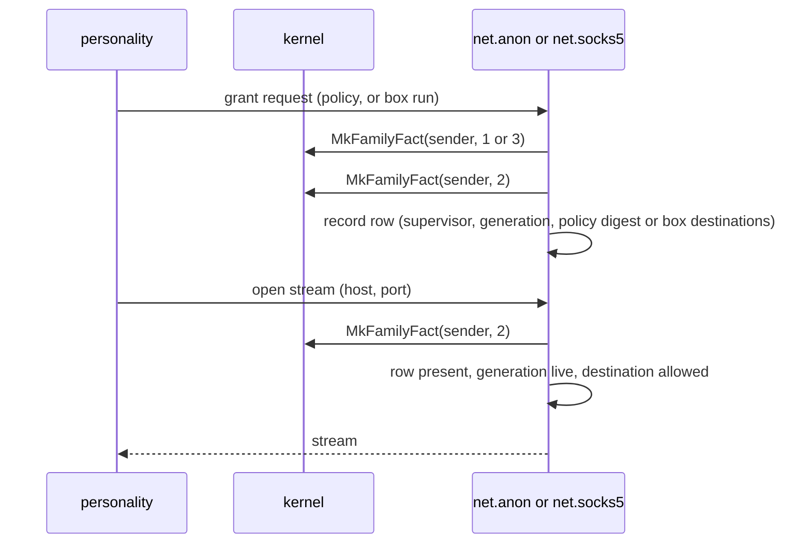

# Target kernel: narrow network authority for the Linux personality

## Today

Network authority is the Network capability bit (bit 2). It grants no system call; on the system-call gate its only effect is to disqualify its holder from `MkAttestDoc` (`src/syscall/caps/checks/system.rs:62-69`). It is a property the service registry adds to eleven network services, so that only a holder of the bit may send to them (`src/services/registry/policy.rs:26-38`, `src/services/registry/policy.rs:49-57`).

The Linux personality runs in several roles, each a separate spawn of the same signed ELF with a different endpoint and a different subset of its manifest's optional capabilities (`src/userspace/capsule_linux/roles.rs:23-72`, `src/userspace/capsule_linux/role_spawn.rs:36-56`). The run role starts without Network. When the program it is about to run has `NET_ANON` in its policy, the personality asks to be started again (`userland/capsule_linux/src/linux/run_net.rs:56-72`): it calls `MkLinuxRunNet` and exits, the kernel checks that the caller is the run role started for that package and queues the package for init (`src/syscall/microkernel/linux_run_net.rs:39-60`), and init spawns the whole personality again as `app.linux.run.net`, whose extra capability is Network (`src/userspace/capsule_linux/run_net.rs:29-36`). That role re-binds the policy and refuses any program without `NET_ANON` (`userland/capsule_linux/src/linux/run_net.rs:36-49`).

Three consequences:

1. **The whole personality holds Network** for the run: its file code, its terminal, its signal machinery, every guest process it serves, and the socket path of the one program whose policy grants it is a small part of that. A bug anywhere in 82,441 lines of personality is a bug with network authority.
2. **Network is all or nothing.** The bit opens every network service: `net.tcp`, `net.udp`, `net.dns` and `net.sockets` as well as the anonymity fronts. The rule that a guest's stream goes only through Anyone or Nym, never Direct (`userland/capsule_linux/src/linux/net/guest_route.rs:17-33`), and only to the destinations its policy names, is enforced by the personality's own code, which holds the authority to break it.
3. **The network bit is not proved.** The attestation statement covers the manifest's required capabilities (`src/kernel_core/process_spawn/capsule_spawn/runner/preflight.rs:81`); Network is optional for the personality, added by the role (`src/userspace/capsule_linux/run_net.rs:35`).

The restart also costs a whole spawn of the personality (verification, load, stacks, endpoints) before a networked program can start.

## Design

The shape: **the kernel supplies facts, and a userland authority decides and grants.** The kernel never parses a Linux policy, and the personality never holds Network.

It arrives in two stages:

- **Interim, on today's IPC.** This stage is implemented first. The two anonymity fronts, `net.anon` and `net.socks5`, are themselves the grant authority. They share one pure decision crate, `userland/linux_net_grant`, and read the facts they need through one kernel call, `MkFamilyFact`. There is no separate grant service: with no capability object to hand over today, a separate service would add a capsule to enrol and an IPC hop on the way to every stream.
- **Target, once capabilities exist.** A separate grant service, **netgrant**, makes the decision and hands the personality a capability; the fronts keep only the enforcement. The reasons, weighed against the extra hop and the extra capsule, are in "The target: netgrant" below.

The registry rule, the kernel facts and the removal of the personality's Network are common to both stages.

## Interim: the anonymity fronts as the authority



### The facts the kernel supplies

One call, `MkFamilyFact(pid, what, ptr, len)` with tag `MFAF`. Only the process registered as `net.anon` or `net.socks5` may make it. `pid` names a guest family's supervisor; a front takes it from the kernel-stamped sender of the request it is serving, never from a payload. The call answers three questions:

| `what` | Answer | Use |
|---|---|---|
| 1 | Whether a given digest is in the live family's measured set, and its kind there: program, policy or local build | A policy grant is accepted only for a policy proved for a program the family runs; the kind tag, kept only in the kernel's table, stops a policy digest from passing as a program digest or the reverse ([15-decisions.md](15-decisions.md)) |
| 2 | The live family's generation: a monotonic `u64` the kernel sets when it reserves the family, never reused | Every grant row records it; a row whose generation is no longer live is dead, so no grant outlives its family, and a reused pid or a new family under the same supervisor cannot inherit one |
| 3 | The personality's argv as the kernel set it at spawn | Read only for the `--box` destinations of a box run |

Each answer is a fact in the sense of [05-trusted-computing-base.md](05-trusted-computing-base.md): the kernel observed or assigned it itself and reports it without interpretation. The argv is fixed at spawn from the spawner's request, and the personality cannot change it afterwards.

### The decision the fronts make

- **Grant rows.** Each front keeps rows of `(supervisor pid, family generation, scope)`, where the scope is either a policy digest or a box's destination list.
  - A **policy grant** is recorded only if the policy names `NET_ANON` and its digest passes `what = 1` against the live family. It carries no destinations, because `NET_ANON` itself names none: the policy grants the anonymity networks and names no host.
  - A **box grant** takes its destinations from the kernel-set argv (`what = 3`), never from the personality's request.
- **Every stream open is checked.** The front finds the row for the sender, asks for the live generation (`what = 2`) and refuses unless it equals the row's. For a box row it refuses a destination outside the list.
- **One decision, two fronts.** Both fronts link `userland/linux_net_grant`, a crate with no I/O that holds the row type and the checks, so the two cannot decide differently, and the crate is tested on the host.
- **Never Direct.** The personality maps the system's Direct default to Nym for guests (`userland/capsule_linux/src/linux/net/guest_route.rs:17-33`). The registry rule below makes that hold whatever the personality's code does: a guest's traffic can reach only the two anonymity fronts.

### The registry rule

A ForeignExec holder may address only `net.socks5` and `net.anon`, never the other nine network services listed at `src/services/registry/policy.rs:26-38`. This is the kernel's enforcement in the interim, and it holds independently of the grant rows.

### The rule this design follows, and the seal gap

A fact the kernel records must never be silently dropped because it arrived before its container existed. The seal recorded nothing for a program proved before its family was reserved: `measured()` does nothing when the caller has no family yet (`src/process/foreign/seal/absorb.rs:71-75`), and the family is reserved only at guest spawn (`src/process/foreign/spawn_guest.rs:32`). When the personality proves a program before its first guest spawn, the measured set of a sealed run omits the main program. A front that checks a policy against that set would then refuse a correctly proved program, or, with a different ordering bug, accept a family whose set is incomplete. The kernel side therefore either refuses a measurement it cannot attribute (fail closed) or buffers it against the supervisor until the family exists; it never discards it. In the personality, a program is therefore proved only after its guest family exists.

### Interfaces

```rust
// Kernel fact call, before the object model. Tag MFAF.
// Callable only by the process registered as net.anon or net.socks5; any other caller is refused.
// `pid` is the family's supervisor, taken by the front from the kernel-stamped sender.
fn mk_family_fact(pid: u32, what: u32, ptr: *mut u8, len: usize) -> Result<usize, Errno>;
//   what = 1   in: a 32-byte digest     answer: whether it is in the live family's measured set, and its kind (program, policy, local)
//   what = 2   out: u64                 the live family's generation; ESRCH when pid supervises no live family
//   what = 3   out: bytes               the supervisor's argv as the kernel set it at spawn

// userland/linux_net_grant: the row both fronts keep and check.
struct GrantRow {
    supervisor: u32,   // kernel-stamped sender pid of the personality
    generation: u64,   // MkFamilyFact what = 2 when the row was recorded
    scope: Scope,
}
enum Scope {
    Policy { digest: [u8; 32] },               // NET_ANON policy whose digest passed what = 1; any destination
    Box { destinations: Vec<Destination> },    // from the kernel-set argv's --box
}
// On every stream open: a row for the sender exists, its generation equals what = 2 now,
// and for Scope::Box the destination is in the list. Otherwise EACCES.
```

The exact encodings of the call's arguments and answers are in `abi/syscalls.toml` and the ABI documentation; the table above states what each answer means.

### What the fronts are now trusted for

This widens the fronts' trust. Before, `net.anon` and `net.socks5` were trusted to carry streams over their networks for capsules holding Network. In the interim they also decide whether a Linux family may use the network at all: they read a Linux policy, hold the grant rows, and may read kernel family facts that no other process can. A bug in `linux_net_grant` grants the network to a family that should have none. A memory-safety bug in either front, which parse untrusted input from relays and servers and also carry other capsules' streams (an install's Nym stream goes through `net.socks5`), now also reaches the grant table.

What bounds it: the grant decision is a small shared crate with no I/O; `MkFamilyFact` only reads; the registry rule keeps guests off every other network service whatever the fronts decide; and the fronts hold no device, file or TPM authority.

## The target: netgrant

A separate grant service is the target once capabilities exist, for these reasons.

**What it costs.** One more capsule to build, enrol and supervise. One IPC hop per grant, when the personality asks netgrant for a family's factory. No hop per stream: netgrant holds an unbadged endpoint capability to each front and mints the factory as a badged copy of it, so the personality opens streams on the front directly, exactly as in the interim.

**What it buys.**

- **The fronts go back to their narrow trust.** They carry streams for whoever holds a capability to them, and enforce the destination list attached to a badge. Reading Linux policy, the measured-set read capability and the family binding leave the processes that parse untrusted network input.
- **The decision becomes a separate proof target.** netgrant has no network stack and no parser of network input. `linux_net_grant` becomes its core and can be proved alone, without the onion, TLS and SOCKS code around it.
- **One authority for every network grant.** The installer's role holds Network to reach package mirrors (`src/userspace/capsule_linux/roles.rs:35-49`). With netgrant it receives a factory scoped to the mirror hosts; without it, each front would grow a second kind of grant.
- **Revocation replaces the generation.** Ending a family revokes its factory and every stream derived from it through the kernel's derivation tree. The generation counter is the interim stand-in for that revocation, and it goes away with `MkFamilyFact`.

**Why the interim does without it.** Without capability transfer netgrant can hand the personality nothing it could use. It would have to proxy every stream, or each front would have to ask it on every open: a hop per stream for no gain in isolation. Placing the decision in the fronts is the right choice for today's kernel.

### Target interfaces

```rust
// netgrant's endpoint, held by the personality.
enum NetGrantRequest {
    /// A factory for the sender's live family. `policy` is the program's policy;
    /// netgrant checks it against the family's measured set through its read
    /// capability on the measurement table. A box run's destinations come from the
    /// family object, never from the request.
    Open { policy: Option<Bytes> },
}
enum NetGrantReply {
    Factory { factory: CapHandle }, // a badged copy of a front's endpoint
    Refused { errno: i32 },         // EACCES without NET_ANON or with an unproved policy; ENETUNREACH when no route runs
}
// netgrant to a front, on a control endpoint only netgrant holds:
// register the destination list for a badge before handing the factory out.
enum FrontControl {
    Scope { badge: u64, destinations: Option<Vec<Destination>> }, // None: any destination
}
```

Kernel support needed: endpoint badges, capability transfer over IPC, `Revoke`, a read capability on the measurement table (replacing `what = 1` and `what = 3`), revocation of a family's capabilities when it ends (replacing `what = 2`), and the rule that a Network-class endpoint capability can be copied only into a process whose class mask includes Network ([07-target-object-model.md](07-target-object-model.md)). netgrant's class mask includes Network; the personality's does not, so the personality cannot receive a capability to `net.tcp` from anyone. A factory reaches the personality because it is an endpoint the fronts create without the Network class for this purpose.

## What the personality can and cannot do

| | Today (run.net role) | Interim | Target |
|---|---|---|---|
| Open a direct socket | Yes, it holds Network and can address `net.tcp` | No: the registry rule confines it to the two fronts | No: it holds no capability to any socket service, and netgrant holds none it could pass on |
| Use the network for a guest whose program lacks `NET_ANON` | Yes, if its own check fails, for any guest of that run | No: the front finds no row for the family | No: it has no factory for that family |
| Reach a destination outside a box run's list | Yes, if its own check fails | No: the front checks the row | No: the front checks the badge's list |
| Keep a grant after the family ends | n/a | No: the generation no longer matches | No: the factory is revoked |
| Use one guest's grant for another guest of the same family | n/a | Yes | Yes. The personality multiplexes its guests, and separating them is its job, as it is for their files. This is the residual trust |
| Restart to gain the network | Yes, through `MkLinuxRunNet` | Not needed: `MkLinuxRunNet`, the `app.linux.run.net` and `app.linux.term.net` roles and the terminal ticket are deleted | As interim |

## Migration

1. **Registry rule.** A ForeignExec holder may address only `net.socks5` and `net.anon`. *Invariant*: no guest stream can leave over Direct or reach a socket service, whatever the personality's own code does. *Test*: from the run.net role, a send to `net.tcp` is refused by the kernel.
2. **Kernel facts.** `MkFamilyFact` with its three answers, callable only by the two registered fronts, plus the seal rule above: a measurement that arrives before its family exists is buffered against the supervisor or refused, never dropped. *Invariant*: every program a family runs is in its measured set, and a family's generation is never reused. *Test*: prove a program before the first guest spawn and check `what = 1` finds its digest; end a family, start another under the same supervisor and check the generation differs; call from any other process and check the refusal.
3. **Grant authority in the fronts.** `userland/linux_net_grant`, linked by `net.anon` and `net.socks5`; grant rows recorded from the facts and checked on every stream open. *Invariant*: the personality's own route rule stays in place; the fronts add an independent check. *Test*: a program without `NET_ANON` in its proved policy gets `EACCES` from the front; a box run's stream to a host outside its list is refused; a stream opened under a grant recorded before the family ended is refused.
4. **Remove the personality's Network.** Remove Network from the personality's optional capabilities in `userland/capsule_linux/Capsule.mk`; delete the network roles (`src/userspace/capsule_linux/run_net.rs`, `src/userspace/capsule_linux/role_term_net.rs`), `MkLinuxRunNet` and the terminal ticket. *Invariant*: no process in the Linux personality's image holds Network. *Test*: `mk_cap_check(personality, Network)` is false in every role.
5. **netgrant, with capabilities.** When endpoints and capability transfer exist ([13-migration-plan.md](13-migration-plan.md), phase 4), netgrant takes the grant decision with `linux_net_grant` as its core; the fronts keep stream service and per-badge destination enforcement; the measured-set query becomes a read capability on the measurement table and family revocation replaces the generation. `MkFamilyFact` and the fronts' grant rows are deleted. *Invariant*: every refusal of step 3's tests still happens, now from netgrant or from the front's badge check. *Test*: step 3's tests; a front given no control registration for a badge refuses every stream on it.
