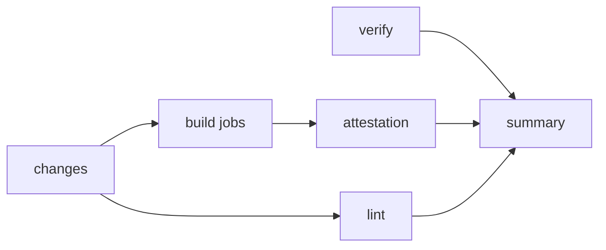

# CI

See how the workflows are laid out, what GitHub runs for a pull request, a push, a schedule and a tag, where results are kept, what `make check` covers on your machine, what `[skip ci]` does, and how the checks stood at this commit.

## How the workflows are laid out

Four entry workflows start runs; every job they run is a reusable workflow (`workflow_call`) under `.github/workflows/ci-*.yml`, and the steps the jobs share are composite actions under `.github/actions/` (`nix-setup`, `rust-setup`, `nonos-verify`). Anything longer than a few lines of shell lives in a script under `nonos-ci/`.

| entry | when | what it runs |
|---|---|---|
| `pr.yml` | every pull request | the gate, `ci.yml` |
| `main.yml` | every push to `main` or `develop`, or by hand | the gate, then the benchmark and fuzz records to `bench-results` (main only) |
| `nightly.yml` | daily, 02:00 UTC, or by hand | the module set built from source with the QEMU runtime job, the benchmark with three boots, 30 minutes of fuzzing per target, the boot matrix, then the records |
| `release.yml` | a tag `v*`, or `cut-release` | every blocking job in production mode, the release bundle, one attestation, a pre-release with signed build provenance; the benchmark is recorded beside it |

A newer push to the same pull request, or to the same branch, cancels the run it supersedes, so a push never queues behind a stale run; nightly and release runs are never cancelled (`concurrency` in each entry workflow). The jobs themselves set no concurrency of their own: a job called by two entries at once would otherwise cancel or hold one of them.

The tools started by hand stay separate: `cut-release`, `starks-bump` (daily, 05:17 UTC), `build-for-enrollment` and `windows-virtualbox`. Each job that has its own inputs (`ci-benchmark`, `ci-fuzz`, `ci-boot-matrix`, `ci-boot-smoke`, `ci-reproducible`) can also be started by hand.

## The gate: `ci.yml`



| job | what it does |
|---|---|
| `changes` | classifies the change (`dorny/paths-filter`): a change only to `docs/` or Markdown is docs-only; `abi/` and `docs/market/` count as code, because a build or the seal reads them |
| `verify` | `nix flake check` in shards, the Kani, Verus and Lean proofs and the extraction (`ci-verify.yml`); runs on every change, docs-only included, because the static and drift checks read the docs |
| `lint` | actionlint, shellcheck, SHA pins and the fuzz target list (`ci-lint.yml`), on any change under `.github/`, `nonos-ci/` or `fuzz/` |
| `build` | `nix build .#default` on Linux x86_64 and macOS; `make build` and `make check` inside WSL2 on Windows; `nix build` inside the devcontainer; and `nonos-verify build` (`ci-build.yml`) |
| `production-build` | `nonos-verify build` against the committed trust set, the build a release tag runs; skipped for Dependabot, which gets no secrets. The platform builds do not depend on the trust mode and run once, in `build` |
| `build-aarch64`, `boot-aarch64` | the aarch64 kernel through `make nonos-mk-arm`, checked as a loadable ELF, then booted under QEMU with each serial log held to its expected lines |
| `every-arch-capsules`, `every-arch-proofs` | every capsule and every proof crate for aarch64 and riscv64 |
| `trust-ledger` | `sha256sum -c MANIFEST.sha256` over the committed [trust set](../overview/glossary-stark-proof.md#trust-set) |
| `reproducible` | the comparison of [reproducible-builds.md](reproducible-builds.md): Linux and macOS build from source with no shared cache and must name the same bytes |
| `supply-chain` | the bill of materials and the policy checks of [sbom.md](sbom.md) |
| `trust-chain` | `nonos-verify trust-chain`: every embedded [capsule](../overview/glossary-boot-root-record.md#capsule)'s certificate and manifest checked against the [trust anchor](../overview/glossary-stark-proof.md#trust-anchor) policy, through `nonos_capsule_sign`, as the kernel checks it at spawn |
| `adversarial` | `nonos-verify adversarial`: a valid signed capsule tampered with in many ways, each of which must be refused |
| `evidence`, `benchmark` | the evidence and benchmark reports ([benchmarks/README.md](../../benchmarks/README.md)) |
| `boot-smoke` | the boot gate, below |
| `fuzz` | every target of `fuzz/targets.json` for two minutes over the kept corpus ([fuzz/README.md](../../fuzz/README.md)) |
| `attestation` | `nonos-verify attest` fuses the module reports and fails when a required one failed or is missing |
| `summary` | one verdict: every job and its result, and for each job that did not run, why; it fails when a job failed or was cancelled, or was skipped without a reason |

On a docs-only change every build job is skipped and the summary names each one with the reason. Builds cannot see those files: `tools/nix/src.nix` leaves `*.md` out of every build source except the files Rust names, and the seal leaves Markdown out of the capsule sources (`CAPSULE_SOURCES`, `tools/nonos_seal/__main__.py`) and reads only `docs/market/logos-licences.md`, which counts as code.

### verify

`nix flake check` runs as six jobs: four shards on Linux x86_64 and two on macOS. Each shard asks the flake for this host's checks, sorts them and takes every n-th one, so the shards cover the set exactly once whatever is added; shard 1 also runs `nix flake check --no-build`, which evaluates every output (`nonos-ci/flake-check-shard.sh`). Each shard writes its checks and verdicts to the job summary and to an artifact. Beside them run the checkers that pin their own toolchains:

| job | what it checks |
|---|---|
| `kani (fs_proofs)` | Kani 0.67.0 over `userland/fs_proofs` |
| `kani (proof crates)` | Kani over fifteen proof crates, the trailer parser and the loader's [rollback floor](../overview/glossary-peer-list.md#rollback-floor) (`nonos-ci/kani-proof-crates.sh`) |
| `verus` | the capability theorems in `verification/verus` |
| `lean` | the Lean specification theorems, the proof-corpus root, and the axiom profile: a profiled theorem that depends on `sorryAx` fails (`nonos-ci/lean-evidence.sh`) |
| `extraction` | the Charon and Aeneas extraction, checked for drift, and its refinement theorems |

### boot-smoke

The boot test of every pull request (`ci-boot-smoke.yml`, `nonos-ci/boot-smoke.sh`). It makes scratch keys that exist only on the runner, [seals](../overview/glossary-rollback-index.md#seal) the qemu profile, and boots it headless with a software [TPM](../overview/glossary-stark-proof.md#tpm) and no network. The boot passes when the [serial console](../overview/glossary-rollback-index.md#serial-console) shows `Handoff OK`, `Capsules spawned`, the [package store](../overview/glossary-linux-personality.md#package-store) being served, and `[BOOT-ATTEST] bootloader measured and enrolled`. A boot whose log says `[INIT] capsule spawn incomplete` fails at once, whatever else it showed (`watch`, `tools/nonos_qemu/__main__.py`); init prints `Capsules spawned` only when no capsule failed to spawn. A second boot plugs the same image into the xHCI controller as a USB stick and expects the first three lines again, then the USB mass storage driver starting. With KVM the deadline is 300 seconds; on a runner without KVM the boot runs under TCG with 900 seconds (`nonos-ci/enable-kvm.sh`).

Neither boot passes `--smp`, so the guest has 8 CPUs, or the runner's cores when fewer (`cpus`, `tools/nonos_qemu/machine.py`), and no expected line checks how many of them came up.

### Windows and the devcontainer

On pull requests and pushes, the Nix inside WSL2 and inside the devcontainer reads the project's public binary cache, so they rebuild only what the change touched; what they build is the same set of derivations as on Linux, which the cache already holds when nothing changed. Nightly and release runs build both from source with no cache, as a contributor without the cache would (`from-source`, `ci-build.yml`).

## Caches

| what | where | written by |
|---|---|---|
| Nix store paths | the Cachix cache `vars.NONOS_CACHIX` (`nix-setup`) | pushes, schedules and dispatches; a pull request reads it and never writes it ([The Nix flake](nix-flake.md#the-binary-cache)) |
| fuzz corpus | Actions cache `fuzz-corpus-<crate slug>-<target>-<run id>` | main and nightly runs |
| cargo-fuzz | Actions cache, keyed on its version and the toolchain | any run |
| extraction Lean build | Actions cache of `verification/extraction/lean/.lake` and the elan toolchains; Lake rebuilds whatever its traces show changed | any run |

`ci-reproducible` reads no cache at all, by design.

## Results kept

Benchmark run directories, fuzz logs, crash inputs and summaries are uploaded as artifacts on every run, pass or fail, and kept 90 days. On `main`, nightly and release runs, `ci-publish-results.yml` commits the compact records with their history to the `bench-results` branch: `benchmarks/runs/<date>-<sha>/`, `benchmarks/history.csv`, `benchmarks/LATEST.md`, `fuzz/results/<date>-<sha>/`, `fuzz/history.csv` and `fuzz/LATEST.md`. [benchmarks/README.md](../../benchmarks/README.md) and [fuzz/README.md](../../fuzz/README.md) describe each file.

Dependabot looks for cargo and GitHub Actions updates once a week, for the root directory and the composite actions, and keeps at most five of its pull requests open for each (`.github/dependabot.yml`).

## On your machine

`make check` builds every flake check for your host, the same set the `verify` shards build, and prints what each one proved; [nix-flake.md](nix-flake.md) lists them and shows how to run one. It does not run Kani, Verus, Lean, the extraction, the fuzzers or the boot smoke test; [make-targets.md](make-targets.md) lists the boot targets you can run yourself, and [host-tools.md](host-tools.md) the programs under `tools/` that no workflow runs.

## `[skip ci]`

GitHub documents that it starts no `push` or `pull_request` workflow for a commit whose message contains `[skip ci]`; scheduled and manual workflows still run. Count how many recent commits on your branch carry it:

```
git log -300 --format=%s | grep -c '\[skip ci\]'
```

On this release's history the command prints 300: every one of the latest 300 commits carries it, so by GitHub's rule no push workflow ran on them. For those commits the record of the checks is a local run of the flake checks, and the run below is that record for this commit.

`cut-release` refuses to tag a commit only when one of its completed check runs ended other than success, skipped or neutral. A commit on which no workflow ran has no such run, so it passes that test (`nonos-ci/require-green.sh`).

## State of the checks at this commit

The flake checks of this commit were built on one x86_64-linux machine for this release, the same set `make check` builds. Of the 143 checks, 142 evaluated, 133 passed, 9 failed, and 1 did not evaluate. The 110 proof crates that passed ran 6,932 tests.

| check | state | why |
|---|---|---|
| `proofs-rtl8169_proofs` | failed | its tests passed; clippy then refused a hand-written `div_ceil` near `leading_zeros` in `userland/capsule_driver_rtl8169/src/log/line.rs:41` |
| `proofs-usb_msc_proofs` | failed | clippy asks for a `Default` beside the `new` in `userland/capsule_driver_usb_msc/src/state/types.rs:38` |
| `proofs-xhci_proofs` | failed | clippy refuses two assertions in its tests, in `userland/xhci_proofs/src/conformance/silicon_tests.rs` and `userland/xhci_proofs/src/event_ring/address_tests.rs` |
| `static-hygiene` | failed | `scripts/check_stubs.py` counts 15 new admissions of unsupported work against its baseline |
| `static-abi` | failed | `scripts/check_prebuilt.py` finds two binaries it cannot classify: the market index and the model catalogue under `nonos-data/` |
| `static-tree` | failed | `nonos-ci/run-static-checks.sh` refuses the `read` and `write` imports in `userland/capsule_driver_ahci/src/server/handlers/emmc/dispatch.rs:29` |
| `inputs` | failed | `tools/nix/inputs.json` did not match what the checked tree reads for `userland/capsule_market`, `userland/capsule_model_fetch` and `userland/model_fetch_proofs` |
| `nonos-verify` | failed | `nonos-verify hygiene` failed, and the end of its log does not say why |
| `busybox-source` | failed | it did not run: the machine running the checks could not download the pinned Zig compiler |
| `proofs-model_fetch_proofs` | did not evaluate | its derivation did not evaluate; `crate` computes its source from its entry in `tools/nix/inputs.json` (`crate`, `tools/nix/src.nix:22-34`) |

The `inputs` failure and the missing proof check concern the same three crates, and the committed entry of each names `.keys/marketplace_operator_ed25519.pub`, the market operator's public key. In a tree without that file, `crate` cannot build the source of these crates and the regenerated table no longer matches, which gives exactly these two results. They may therefore come from the tree the checks ran on rather than from the commit; a run on a full checkout is not tested in this release.

Every other check passed, among them all six `kernel-profile-*` and all six `kernel-features-*` checks, both live TPM suites, and the `starks-pin`, `git-pins`, `catalogues` and `rust-src-lock` drift checks. No workflow run of this commit on GitHub is recorded here.

## See also

- [The Nix flake](nix-flake.md)
- [Reproducible builds](reproducible-builds.md)
- [Tests and proofs](../contributing/tests-and-proofs.md)
- [Commits](../contributing/commits.md)
- [Review](../contributing/review.md)
