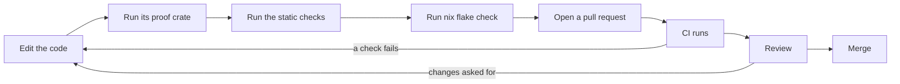

# Contributing to NONOS: Make a change

Part of [Contributing to NONOS](README.md).

## Make a change



1. Edit the code, following [Code style](code-style.md).
2. Run its proof crate: the [proof
   crate](../overview/glossary-peer-list.md#proof-crate) that compiles the
   source you changed and tests it on the host.
3. Run the static checks that read the whole tree. Most compare against a
   [baseline](../overview/glossary-amnesic-boot.md#baseline) that may only
   shrink.
4. Run `nix flake check`, or `make check`, before you push.
5. Open a pull request against `main`.
6. CI runs the workflows that [Review](review.md) lists.
7. Review follows. Reviewers ask for evidence: a serial log, a failing proof, a
   diff.

For step 2, `tools/nix/inputs.json` lists the paths each crate reads, so this
prints the proof crates that read a given file:

```
python3 -c "import json,sys; f=sys.argv[1]; d=json.load(open('tools/nix/inputs.json')); print(' '.join(k for k,v in d.items() if k.endswith('_proofs') and any(f==p or f.startswith(p+'/') for p in v['include'])))" src/ipc/nonos_inbox/budget.rs
```

For that file it prints `userland/kernel_proofs`; an empty line means no proof
crate reads the file. [Tests and proofs](tests-and-proofs-proof-crates.md#proof-crates) gives
the command that runs one crate, and [Static
checks](tests-and-proofs-static-checks.md#static-checks) the commands for step 3.
