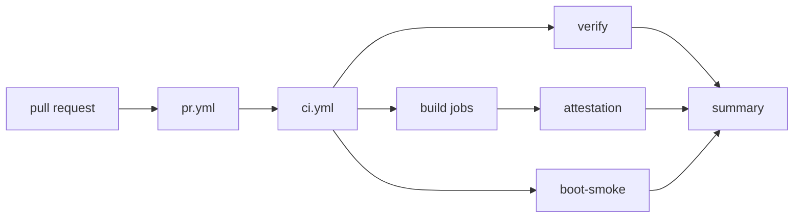

# Review

What CI runs on a NONOS pull request, how review is routed, and what review looks for.

## What CI runs on a pull request

One workflow starts on a pull request, `pr.yml`, and it runs the gate `ci.yml`: every job as a reusable workflow, the attestation that fuses their reports, and a `summary` job that gives one verdict for the commit ([CI](../build/ci.md)).

- The build jobs are the x86_64 build, the aarch64 build and boot, every capsule and proof crate for aarch64 and riscv64, the trust ledger check, the reproducible double build, the production build (left out for a Dependabot pull request), the supply-chain, trust-chain and adversarial modules, the evidence, the benchmark and a short fuzz run of every CI target. The `attestation` job reads their reports and fails the run when `build`, `supply-chain`, `trust-chain`, `adversarial`, `evidence` or `reproducible` failed (`.github/workflows/ci.yml`).
- `verify` runs `nix flake check` split into shards on Linux x86_64 and on macOS aarch64, then the Kani, Verus, Lean and extraction jobs (`.github/workflows/ci-verify.yml`); the Lean job fails when the axiom profile shows `sorryAx`. [Tests and proofs](tests-and-proofs.md) describes each.
- `boot-smoke` is the blocking boot check. It builds the `qemu` [profile](../overview/glossary-boot-root-record.md#profile) and [seals](../overview/glossary-rollback-index.md#seal) it with scratch keys made for the run, then boots the image twice, headless with a software [TPM](../overview/glossary-stark-proof.md#tpm) (`nonos-ci/boot-smoke.sh`). The first boot's `serial` log must show `Handoff OK`, `Capsules spawned`, `[VFS] serving, store status` and `[BOOT-ATTEST] bootloader measured and enrolled`; the second boots the same image as a USB stick on the xHCI controller and must start the USB mass storage driver. Its `BOOT_TIMEOUT` is 300 seconds with KVM and 900 seconds under TCG (`nonos-ci/enable-kvm.sh`).
- A pull request that changes only `docs/` or Markdown runs `verify`, whose static checks read the docs, and skips the build jobs; the summary names each skipped job and why.

The nightly run gates no merge. Its boot matrix boots every cell of the QEMU matrix, and its header says the [SMP](../overview/glossary-rollback-index.md#smp) cells are known to fail (`.github/workflows/ci-boot-matrix.yml`). [CI](../build/ci.md) lists every workflow.

## How review is routed

`.github/CODEOWNERS` routes review of every path to one account, and lists the trusted path again on its own: `src/crypto/`, `src/kernel_core/`, `src/syscall/`, `nonos-bootloader/`, `nonos-sign/` and `nonos-verify/`.

Two kinds of pull request come from automation:

- Dependabot opens updates for the Cargo crates of the root manifest and for GitHub Actions, weekly by its `schedule`, with at most five open pull requests for each (`.github/dependabot.yml`).
- `starks-bump.yml` looks at STARKs main every day on its `cron`, at 05:17 UTC, and when main has moved it moves the flake input, writes the new commit into every `Cargo.lock`, runs `nix flake check` and opens a pull request with the result (`.github/workflows/starks-bump.yml`). It never merges: the STARKs change is read before it is merged or closed. A pull request opened with the workflow's token starts no other workflow, so `pr.yml` runs on it only after a push to it or a rerun.

## What review looks for

The project expects the following of every pull request. None of it is enforced by a check.

- One concern per pull request.
- A description that says what changed and why, what you ran with its results (the [proof crate](../overview/glossary-peer-list.md#proof-crate) and its test count, clippy, the static checks), and what you did not verify, such as a boot or real hardware. [Commits](commits.md) shows the same habit in commit bodies.
- Evidence rather than assertion. The [Code of Conduct](../../CODE_OF_CONDUCT.md) names the kinds that count: a serial log, a failing proof, a diff.
- For a driver change, the PCI or USB id of the device and the serial log of the boot you tested it on.
- A number that grows, said out loud. The ring 0 size may not pass its `tcb` budget, and a pull request that raises the budget has to say why (`nonos-verify/src/build.rs:44-46`). A counting [baseline](../overview/glossary-amnesic-boot.md#baseline) that grows names the new value in `baseline_file`, in the same pull request (`nonos-ci/check-baseline.sh:39-42`).
- The closest reading for the trusted path: kernel core, crypto, the syscall layer, the bootloader, and the signing and verification tools.

## Issues

The hardware bug form asks for the machine or the QEMU command line, the architecture (x86_64, aarch64 or riscv64), the make target and commit, the serial log, what you expected and what happened, and the PCI or USB id of the device involved, in its fields from `machine` to `device` (`.github/ISSUE_TEMPLATE/hardware-bug.yml:10-52`). [Reporting a machine](../hardware/report.md) explains what to collect.

Anything exploitable goes through a private security advisory, never a public issue, as the form's `contact_links` say (`.github/ISSUE_TEMPLATE/config.yml:2-5`). [Reporting a vulnerability](../security/reporting-a-vulnerability.md) covers it.

## Conduct

The Code of Conduct applies in the repositories, issues, pull requests and the project chat, and to everyone in them equally. A blunt technical disagreement is welcome; a personal attack is not. Reports go to the address the Code of Conduct gives.

## See also

- [Contributing](README.md)
- [Tests and proofs](tests-and-proofs.md)
- [Commits](commits.md)
- [CI](../build/ci.md)
- [Reporting a vulnerability](../security/reporting-a-vulnerability.md)
- [CODE_OF_CONDUCT.md](../../CODE_OF_CONDUCT.md)
