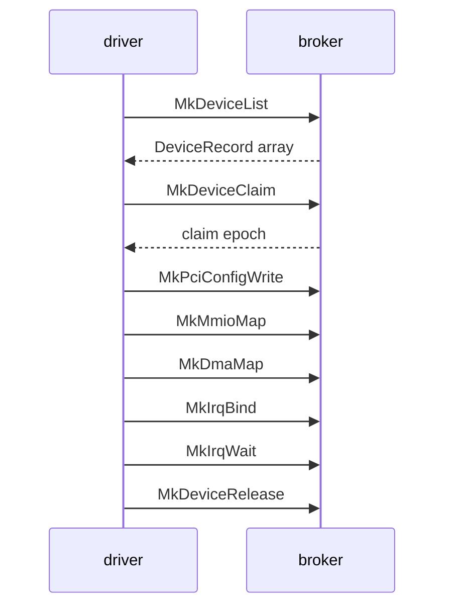

# Broker API: Where the calls live

Part of [Broker API](broker-api.md).

## Where the calls live

A driver calls the [hardware broker](../overview/glossary-hardware-broker.md#hardware-broker)
through `nonos_libc`, the crate in `userland/libc` that every driver depends on
(`userland/capsule_driver_virtio_rng/Cargo.toml:22`). The wrappers are in
`userland/libc/src/broker/`, re-exported as `mk_device_list`, `mk_mmio_map` and
the rest (`userland/libc/src/broker/mod.rs:29-51`). Each makes one system call
whose number is four ASCII letters read as a little-endian integer by `tag4`,
such as `N_MK_DEVICE_LIST` for `MDLS`
(`userland/libc/src/syscall/numbers/broker.rs:18-33`,
`src/syscall/abi/tag.rs:20-22`).

`nonos_abi`, the bottom of the native runtime, carries no broker numbers
(`userland/nonos_abi/README.md`). The crates in `userland/sdk` are for
applications and `userland/platform` is a host-side packaging tool, so a driver
uses neither. `nonos_devmodel` runs only on the host, where it gives a [proof
crate](../overview/glossary-peer-list.md#proof-crate) a register window in memory
(`userland/nonos_devmodel/README.md`); [Writing a
driver](writing-a-driver.md#15-the-proof-crate) shows it in use.

On the kernel side every call first passes the contract table, which checks the
capability before any handler runs, for example `can_driver` for `MkDeviceClaim`
(`src/syscall/contract/cap_table/mk_device.rs:24-37`). A handler in
`src/syscall/microkernel/` then turns the arguments into a request to
`src/hardware/broker`. The register-level tables of numbers, arguments and
return values are in the [Broker ABI](../abi/broker.md).

A typical driver makes the calls in the order above: list, claim, turn on the
PCI command bits it needs, map registers, take DMA memory, bind an interrupt,
wait on it while serving, and release.
