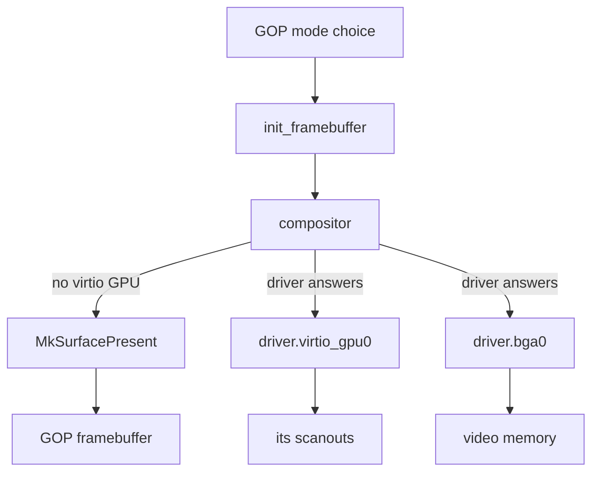

# Display

How NONOS puts the desktop on a screen: through the UEFI GOP framebuffer on any machine, through virtio-gpu or the Bochs adapter in a virtual machine, and what it cannot drive.

## Three paths

| Path | Code | Used when |
|---|---|---|
| UEFI GOP framebuffer | the bootloader, `src/kernel_core/init/framebuffer`, the compositor | on every UEFI machine, whenever no virtio GPU driver answers |
| virtio-gpu | `capsule_driver_virtio_gpu`, served as `driver.virtio_gpu0` | a virtio GPU in a virtual machine |
| Bochs BGA | `capsule_driver_bga`, served as `driver.bga0` | QEMU's `-device VGA` or `bochs-display`, in an image built with it (below) |

There is no native driver for an Intel, AMD or NVIDIA GPU. On real hardware the desktop is drawn through the framebuffer the firmware set up before boot.

The loader makes the GOP mode choice, `init_framebuffer` maps it in the kernel, and the compositor either presents its frames through `MkSurfacePresent` to that framebuffer or hands them over the display wire to the first display driver on the kernel's list that has announced itself (`src/services/registry/displays.rs`: virtio-gpu before bga), which shows them.

## The GOP framebuffer

### The mode the loader picks

The bootloader tries the GOP on the handle that carries the firmware console first, as Linux's EFI stub does, so that on a machine with a GOP on each of two GPUs it takes the one the firmware console uses; `console_order` keeps the firmware's order otherwise (`nonos-bootloader/src/display/gop/order.rs:16-31`).

It takes a mode only if it has a linear 32-bit framebuffer: PixelRedGreenBlueReserved8BitPerColor, PixelBlueGreenRedReserved8BitPerColor, or a PixelBitMask with exactly one of those two layouts, as `linear_bgr` and `bitmask_bgr` decide (`nonos-bootloader/src/display/gop/mode.rs:20-33`, `nonos-bootloader/src/display/gop/pick.rs:75-92`). A PixelBltOnly GOP, 16 or 24 bits a pixel, 10-bit channels, or a FrameBufferSize too small for the mode, which `fb_covers_mode` checks, leave no framebuffer (`nonos-bootloader/src/display/gop/mode.rs:35-40`). `init_framebuffer` then has nothing to map, and `log_refused` writes `[FB] not mapped: the loader handed over no framebuffer; the desktop has no display` (`src/kernel_core/init/framebuffer/init.rs:25-29`, `src/kernel_core/init/framebuffer/report.rs:21-26`).

`choose` picks the mode in this order (`nonos-bootloader/src/display/gop/pick.rs:156-211`):

1. A mode pinned by a development build.
2. The panel's native timing, from the first detailed timing in its EDID, which `parse_edid` reads with the header and checksum checks Linux applies (`nonos-bootloader/src/display/gop/pick.rs:99-146`).
3. The mode the firmware left set, when it has at least `KEEP_MIN_HEIGHT` (720) lines.
4. Otherwise the largest offered mode with more pixels than the current one, no wider or taller than the native mode when the EDID names it, and never more pixels than `FALLBACK_MAX_PIXELS`, 3840 times 2400. When no offered mode qualifies, the current mode stays.

Any width or height above `MAX_DIM` (8192) is refused (`nonos-bootloader/src/display/gop/pick.rs:61-73`). The loader logs one line from `report_gop_mode`, `[GOP] WxH <source> pitch=Npx fmt=BGRX or RGBX fb=0x... panel=WxHmm`, or `[GOP] no linear framebuffer:` with the reason (`nonos-bootloader/src/display/gop/report.rs:26-63`).

### The kernel's mapping

`init_framebuffer` takes the framebuffer from the [boot handoff](../overview/glossary-amnesic-boot.md#boot-handoff) (`src/kernel_core/init/framebuffer/init.rs:25-57`). `frame` maps the pitch times the height and never the firmware's FrameBufferSize, which some firmware reports as the whole GPU aperture. It refuses, with a `Refusal` it logs, a zero width, height, pitch or address, a pitch shorter than a row of 4-byte pixels, an overflow, or a FrameBufferSize smaller than the frame (`src/kernel_core/init/framebuffer/frame.rs:21-75`).

Before the mapping and before any AP starts, `program_boot` makes page attribute table entry 1 write-combining on the boot CPU, `mirror_on_ap` writes the same table on each AP, and on a CPU with no PAT the frame is mapped uncached (`src/arch/x86_64/pat/program.rs:31-61`). The new table comes from `with_wc`, which changes entry 1 and keeps every other entry (`src/arch/x86_64/pat/value.rs:31-40`). The kernel logs `[FB] mapped WxH pitch=N BGRX write-combining scale=S`, with `RGBX` or `uncached` where those apply, or `[FB] not mapped:` with the reason, through `log_mapped` and `log_refused` (`src/kernel_core/init/framebuffer/report.rs:21-41`).

`hidpi_scale` doubles the scale on a panel of 192 DPI or more each way whose half is still at least 1280 by 720; without a physical size from the EDID, it doubles from 2560 by 1440 up (`src/kernel_core/init/framebuffer/hidpi.rs:23-79`). The compositor keeps the same rule in `scale_for_panel` (`userland/compositor/src/setup/canvas_scale.rs`), and `setup_layout_proofs` holds the two to the same answer (`userland/compositor/src/setup/canvas_scale.rs`); it passes 56 tests at this commit.

### The compositor on GOP

When no virtio GPU driver announces itself, `run_gop_once` gives the compositor a surface backed by its own memory and presents through `MkSurfacePresent`; the kernel copies each frame into the firmware framebuffer (`userland/compositor/src/setup/prime_gop.rs`). The present path refuses a rectangle outside the screen, through `blit` (`src/syscall/dispatch/router/graphics_present/blit.rs:22-67`).

A screen smaller than 1024 by 720, such as an 800 by 600 firmware mode or a 1024 by 600 panel, gets a canvas of its own shape that covers 1024 by 720 and is shrunk onto the screen, from `floor_canvas` (`userland/compositor/src/setup/canvas_floor.rs`). The picture is soft but every screen fits.

If a display driver answers after the compositor fell back to GOP, `upgrade_from_gop` moves the display over and repaints the whole scene there (`userland/compositor/src/setup/upgrade.rs`).

## virtio-gpu

### Outputs and modes

`seed` asks the device for its display info and records each enabled scanout at the size the host reports, when it is at least 16 by 16 and its frame fits one display grant; any other size is recorded at 1280 by 720, and with no enabled scanout scanout 0 is set to that size (`userland/capsule_driver_virtio_gpu/src/setup/scanouts.rs`, `setup/mode.rs`). Every reply is the device's word: the type, the length the used ring claims, and for an EDID its size word and magic are checked before any of it is read (`device/cmd/get_display_info.rs`, `get_edid.rs`). `take` makes each recorded scanout, up to the wire's four outputs, an output: a zeroed DMA surface with a B8G8R8A8 2D resource and one backing entry, sent to the host whole, set on the scanout and flushed. A scanout whose surface cannot be made is left as the host has it, and with none taken the attempt fails (`userland/capsule_driver_virtio_gpu/src/display/take.rs`).

CAPS reports kind 1 (`VIRTIO_GPU`), MODE_SET, MODE_RANGE up to 4096 a side with any width, and HINTS; FLUSH copies into the driver's surface, so DEVICE_READS is not set (`userland/capsule_driver_virtio_gpu/src/display/describe.rs`). MODES lists the host's wanted size first, then output 0's EDID modes, then the size shown, each once (`userland/capsule_driver_virtio_gpu/src/display/modes.rs`). One display grant from the [hardware broker](../overview/glossary-hardware-broker.md#hardware-broker) is capped at `DISPLAY_FRAMEBUFFER_PAGES`, 8192 pages or 32 MiB (`src/hardware/broker/dma/limits.rs:28-44`). CAPS gives that as the surface budget and MODES offers no mode whose surface would not fit it, so a 4096 by 4096 mode is never offered; the wire server refuses a MODE_SET over the budget (`userland/capsule_driver_virtio_gpu/src/display/modes.rs`).

QEMU's virtio GPU is given 1920 by 1080 as its wanted size (`tools/nonos_qemu/machine.py`, `devices`). To boot at another size, use `gpu=1024x768` (the smallest mode windows are fitted to) or one of the `gpu=virtio-WxH` lanes: `gpu=virtio-1280x800`, `gpu=virtio-1366x768`, `gpu=virtio-1920x1080` or `gpu=virtio-2560x1440`, as in `nix run .#qemu -- --lane gpu=virtio-1280x800`. Each puts the same device in place of the default, with that size in its EDID (`tools/nonos_qemu/lane_devices.py`, `SCREENS`). The UI work boots each change at more than one of these sizes.

### Mode sets, flushes and the host's events

A mode set makes before it breaks: a new surface of the size, the compositor's shadow loaded into it whole, and only then the scanout pointed at it. A step that fails gives the new surface back and leaves the old one showing (`userland/capsule_driver_virtio_gpu/src/display/mode_set.rs`). FLUSH copies the rectangles from the shadow, transfers them to the host and flushes them (`userland/capsule_driver_virtio_gpu/src/display/show.rs`). A surface is given back by detaching its backing, unreferencing the resource and only then unmapping its pages; one the host keeps waits in limbo with its pages mapped and is tried again on each mode set and each STATE (`userland/capsule_driver_virtio_gpu/src/display/limbo.rs`).

The driver reads the device's events word on every turn of its receive loop and on each STATE. When the host raised the display bit (a window resized, a display turned on or off) the driver asks for the display info again, and each output follows it (`userland/capsule_driver_virtio_gpu/src/display/events.rs`, `userland/capsule_driver_virtio_gpu/src/display/plug.rs`). A scanout turned off is let go of and answers dark: FLUSH sends nothing and MODE_SET answers EAGAIN. One turned back on answers LOST once, while the wire server shows the primary on it again. Any change moves the generation and is told to the compositor at once with OUTPUT_NOTICE. Only scanouts taken at bring-up are outputs. There is no cursor plane yet: CURSOR answers ENOSYS and the compositor draws the arrow itself (`userland/capsule_driver_virtio_gpu/src/display/wire.rs`).

### A device that stops answering

A command the device does not answer within the control queue's deadline, or answers out of turn, resets the device and takes the queue out of service. The serve loop then recovers in place (`userland/capsule_driver_virtio_gpu/src/server/recover/`): the queue restarted, every output's surface made again under its own id and shown, limbo given back. It tries up to three times in a row, logging `driver.virtio_gpu0: control queue stalled; device reset, recovering (try N of 3)` and `driver.virtio_gpu0: recovered in place, same surfaces`. Past that the driver is down: every output answers STATE LOST and dark, FLUSH and MODE_SET answer ENXIO, the compositor is told OUTPUT_NOTICE LEAVING once so it can drive another display, and `driver.virtio_gpu0: down; ...` is logged. The claim and every grant are kept.

Without a virtio GPU the capsule exits with `EXIT_ABSENT` (2) at once, and the compositor stays on GOP; a device that fails every bring-up attempt (seven, on the shared bounded schedule) exits with `EXIT_GAVE_UP` (6) (`userland/capsule_driver_virtio_gpu/src/main.rs`). `virtio_gpu_proofs` mounts the shipping source by `#[path]` and holds the bring-up and the 2D command bytes to the virtio specification; a host model answers the ring on the driver's own thread for the wire server's sweeps and the recovery, and `tests/reply_sweep` fuzzes every reply the driver reads against what the response rules say. It passes 85 host tests at this commit.

## Bochs BGA

`capsule_driver_bga` drives the QEMU and Bochs display adapter, PCI 1234:1111 (`VENDOR_QEMU_BOCHS`, `DEVICE_BGA`), served as `driver.bga0` on service 4240 (`userland/capsule_driver_bga/Capsule.mk`). Its video memory is BAR 0, mapped write-combining; BAR 2 holds the EDID at 0 and the DISPI registers at 0x500, mapped uncached. It needs no DMA and no interrupt: every wire request is answered at once.

One bring-up attempt (`userland/capsule_driver_bga/src/setup/`) turns Memory Space on and Bus Master off, maps both BARs, refuses a register window that ends inside the DISPI block, and refuses an adapter whose DISPI ID is outside 0xB0C0 to 0xB0C5. It reads the DISPI state firmware left, whole, so it can be written back at every drop. It zeroes video memory, then starts on firmware's mode when DISPI shows a linear 32-bit mode from the start of video memory that fits both video memory (VIDEO_MEMORY_64K) and the mapping; else on the monitor's preferred mode when it fits; else 1024 by 768 (`setup/mode.rs`). A mode past video memory or the mapping is refused by name before any register is written, and a mode set must read back as set, line layout included.

It speaks the display wire through `nonos_gfx_serve`, a single output of kind 2 (`DISPI`): MODE_SET and MODE_RANGE from 640 by 480 to 4096 a side, widths a multiple of 8, no cursor plane (CURSOR answers ENOSYS), the surface budget the video memory (`display/describe.rs`). MODES lists the EDID's modes that fit, and the one shown. FLUSH copies its rectangles from the compositor's shadow into video memory at the mode's stride. STATE checks DISPI still shows the mode; when firmware or a VGA reset turned it off, the mode is set again before the answer and STATE says LOST under a new generation, so the compositor repaints (`display/health.rs`). A MODE_SET the adapter does not take is refused with EINVAL and the previous mode put back.

Without an adapter the capsule exits `EXIT_ABSENT` (2) before claiming anything; an adapter that fails bring-up is retried seven times on the shared schedule, each failed try giving its claim back with firmware's DISPI state written back, then `EXIT_GAVE_UP` (6). The kernel spawns it only when the inventory sees `DisplayBga` (`src/userspace/init/spawn_plan/drivers_virtio_display.rs`), in an image built with `nonos-capsule-driver-bga`: today the `microkernel-driver-bga` profile. It joins `microkernel-full-gui`, the image `make` builds, when the release seal gives it its trust artifacts; until then `scripts/check_display_profiles.py`, which holds every display driver on the kernel's list to the full image, carries it in its shrink-only baseline, as it does intel_display. `bga_proofs` runs the bring-up end to end on a libc shim and the wire on the shipping server, and `tests/dispi_sweep` fuzzes every DISPI register and EDID byte it reads. It passes 77 host tests at this commit.

## The primaries, and a compositor started again

Each output's primary is anonymous memory of the driver's own, zeroed when made, registered as an ARGB8888 surface and shared writable with the compositor alone (`userland/nonos_gfx_pool`). Device memory is never shared. A share right belongs to the pid it names and dies with it, so when the compositor is started again under a new pid, the driver keeps the primary it holds and names the new pid a receiver of it on its first SURFACE; the new compositor attaches the same pages and the picture comes back. A compositor not heard for three seconds has its primaries scrubbed and the screen blanked, so the next one never sees the last one's picture (`userland/nonos_gfx_serve/src/watch.rs`). `gfx_pool_proofs` holds the pool to the kernel's surface rules on a shim.

## What a good boot shows

With the Debug capability granted to the compositor and the driver, the kernel log shows, for virtio-gpu:

- `[GPU-EDID] EDID read: its modes offered`, or `[GPU-EDID] no EDID: the host's size leads`
- `[GPU-3D] virgl not offered (2d scanout only)` on a 2D device
- `[DISPLAY] gfx lookup: driver.virtio_gpu0`
- `[DISPLAY] on driver.virtio_gpu0 1280x720, canvas 1280x720 at scale 1.00`, at the size the host set

and for bga the same `[DISPLAY]` lines naming `driver.bga0`. None of `control queue stalled`, `down;`, or `[EXIT] ... status 6` should appear. Without Debug only the kernel's own lines show (`[FB]`, and `[EXIT]` for a capsule that left).

A driver whose compositor has been silent for 3 s clears its screen (cursor off, every primary scrubbed and shown blank, `nonos_gfx_serve/src/watch.rs`) and says `[DISPLAY] compositor silent 3 s: screen cleared` once for that silence. A black screen with that line is a hung or dead compositor, not a bad frame; the compositor's own watchdog line (`[DISPLAY] turn N stuck T ms in ...`) names where it stopped.

On a machine with no Intel graphics function, QEMU among them, the kernel says `[DRIVER-INTEL-DISPLAY] no controller present, not spawned`, and the same for bga where there is no Bochs adapter (`[DRIVER-BGA]`).

The screen: the desktop with the menubar on top and the dock below. A Terminal opens centred with the NONOS banner, a fetch block (os, kernel, shell, signed, arch, uptime), the prompt `nonos@nonos ~ %` and the footer of key hints; About opens on its Overview with three ring tiles, the Display tile showing the mode inside its ring. Killing the compositor brings the same picture back once it is started again. `userland/demo_screen_proofs` draws both apps through their own paint code at 1024x768, 1280x720, 1280x800 and 1920x1080 under each driver.

## What is not supported

- Native GPU drivers. AMD and NVIDIA display functions are enumerate-only, and `missing_path` names a `native modeset and scanout driver` for them (`src/hardware/inventory/missing.rs`). Intel graphics goes to `capsule_driver_intel_display`, spawned where the inventory sees the function (`src/userspace/init/spawn_plan/drivers_native_display.rs`) in an image built with `nonos-capsule-driver-intel-display` (the `microkernel-driver-intel-display` profile); it joins the full image with the release seal, and has not been booted on a machine. The boot framebuffer driver, `capsule_driver_bootfb`, is in no image: the kernel side it claims from is not on main. There is no mode change after boot, no second display and no hardware acceleration on real machines.
- A GOP without a linear 32-bit framebuffer.
- 3D. The virtio-gpu probe logs whether the host could, and no op uses it.
- Backlight control.

## See also

- [Drivers](README.md)
- [Broker API](broker-api.md)
- [Platform](platform.md)
- [The desktop](../using/desktop.md)
- [Boot handoff and kernel init](../kernel/boot-handoff.md)
- [Support matrix](../hardware/MATRIX.md)
- [UEFI specification](https://uefi.org/specifications)
- [virtio specification](https://docs.oasis-open.org/virtio/virtio/v1.2/virtio-v1.2.html)
