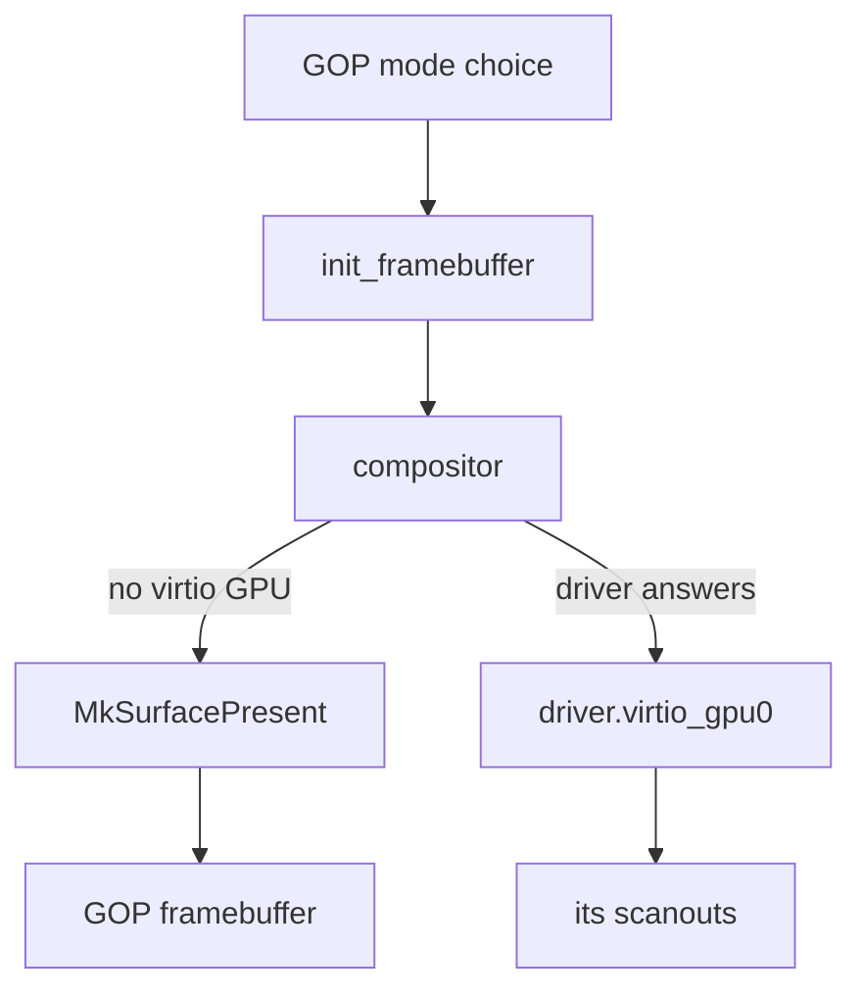

# Display

How NONOS puts the desktop on a screen: through the UEFI GOP framebuffer on any machine, through virtio-gpu in a virtual machine, and what it cannot drive.

## Three paths

| Path | Code | Used when |
|---|---|---|
| UEFI GOP framebuffer | the bootloader, `src/kernel_core/init/framebuffer`, the compositor | on every UEFI machine, whenever no virtio GPU driver answers |
| virtio-gpu | `capsule_driver_virtio_gpu`, served as `driver.virtio_gpu0` | a virtio GPU in a virtual machine |
| Bochs BGA | `capsule_driver_bga` | never: the capsule is parked and in no image |

There is no native driver for an Intel, AMD or NVIDIA GPU. On real hardware the desktop is drawn through the framebuffer the firmware set up before boot.

The loader makes the GOP mode choice, `init_framebuffer` maps it in the kernel, and the compositor either presents its frames through `MkSurfacePresent` to that framebuffer or hands them over the display wire to `driver.virtio_gpu0`, which shows them on each scanout it took.

## The GOP framebuffer

### The mode the loader picks

The bootloader tries the GOP on the handle that carries the firmware console first, as Linux's EFI stub does, so that on a machine with a GOP on each of two GPUs it takes the one the firmware console uses; `console_order` keeps the firmware's order otherwise (`nonos-bootloader/src/display/gop/order.rs:16-31`).

It takes a mode only if it has a linear 32-bit framebuffer: PixelRedGreenBlueReserved8BitPerColor, PixelBlueGreenRedReserved8BitPerColor, or a PixelBitMask with exactly one of those two layouts, as `linear_bgr` and `bitmask_bgr` decide (`nonos-bootloader/src/display/gop/mode.rs:20-33`, `nonos-bootloader/src/display/gop/pick.rs:75-92`). A PixelBltOnly GOP, 16 or 24 bits a pixel, 10-bit channels, or a FrameBufferSize too small for the mode, which `fb_covers_mode` checks, leave no framebuffer (`nonos-bootloader/src/display/gop/mode.rs:35-40`). `init_framebuffer` then has nothing to map, and `log_refused` writes `[FB] not mapped: the loader handed over no framebuffer; the desktop has no display` (`src/kernel_core/init/framebuffer/init.rs:25-29`, `src/kernel_core/init/framebuffer/report.rs:21-26`).

`choose` picks the mode in this order (`nonos-bootloader/src/display/gop/pick.rs:156-211`):

1. A mode pinned by a development build.
2. The panel's native timing, from the first detailed timing in its EDID, which `parse_edid` reads with the header and checksum checks Linux applies (`nonos-bootloader/src/display/gop/pick.rs:99-146`).
3. The mode the firmware left set, when it has at least `KEEP_MIN_HEIGHT` (720) lines.
4. Otherwise the largest offered mode with more pixels than the current one, no wider or taller than the native mode when the EDID names it, and never more pixels than `FALLBACK_MAX_PIXELS`, 3840 times 2400. When no offered mode qualifies, the current mode stays.

Any width or height above `MAX_DIM` (8192) is refused (`nonos-bootloader/src/display/gop/pick.rs:61-73`). The loader logs one line from `report_gop_mode`, `[GOP] WxH <source> pitch=Npx fmt=BGRX or RGBX fb=0x... panel=WxHmm`, or `[GOP] no linear framebuffer:` with the reason (`nonos-bootloader/src/display/gop/report.rs:26-63`).

### The kernel's mapping

`init_framebuffer` takes the framebuffer from the [boot handoff](../overview/glossary.md#boot-handoff) (`src/kernel_core/init/framebuffer/init.rs:25-57`). `frame` maps the pitch times the height and never the firmware's FrameBufferSize, which some firmware reports as the whole GPU aperture. It refuses, with a `Refusal` it logs, a zero width, height, pitch or address, a pitch shorter than a row of 4-byte pixels, an overflow, or a FrameBufferSize smaller than the frame (`src/kernel_core/init/framebuffer/frame.rs:21-75`).

Before the mapping and before any AP starts, `program_boot` makes page attribute table entry 1 write-combining on the boot CPU, `mirror_on_ap` writes the same table on each AP, and on a CPU with no PAT the frame is mapped uncached (`src/arch/x86_64/pat/program.rs:31-61`). The new table comes from `with_wc`, which changes entry 1 and keeps every other entry (`src/arch/x86_64/pat/value.rs:31-40`). The kernel logs `[FB] mapped WxH pitch=N BGRX write-combining scale=S`, with `RGBX` or `uncached` where those apply, or `[FB] not mapped:` with the reason, through `log_mapped` and `log_refused` (`src/kernel_core/init/framebuffer/report.rs:21-41`).

`hidpi_scale` doubles the scale on a panel of 192 DPI or more each way whose half is still at least 1280 by 720; without a physical size from the EDID, it doubles from 2560 by 1440 up (`src/kernel_core/init/framebuffer/hidpi.rs:23-79`). The compositor keeps the same rule in `scale_for_panel` (`userland/compositor/src/setup/canvas_scale.rs:65`), and `setup_layout_proofs` holds the two to the same answer (`userland/compositor/src/setup/canvas_scale.rs:17-21`); it passes 56 tests at this commit.

### The compositor on GOP

When no virtio GPU driver announces itself, `run_gop_once` gives the compositor a surface backed by its own memory and presents through `MkSurfacePresent`; the kernel copies each frame into the firmware framebuffer (`userland/compositor/src/setup/prime_gop.rs:26-30`). The present path refuses a rectangle outside the screen, through `blit` (`src/syscall/dispatch/router/graphics_present/blit.rs:22-67`).

A screen smaller than 1024 by 720, such as an 800 by 600 firmware mode or a 1024 by 600 panel, gets a canvas of its own shape that covers 1024 by 720 and is shrunk onto the screen, from `floor_canvas` (`userland/compositor/src/setup/canvas_floor.rs:16-43`). The picture is soft but every screen fits.

If a display driver answers after the compositor fell back to GOP, `upgrade_from_gop` moves the display over and repaints the whole scene there (`userland/compositor/src/setup/upgrade.rs:32-44`).

## virtio-gpu

The [driver capsule](../overview/glossary.md#driver-capsule) `capsule_driver_virtio_gpu` drives a virtio GPU, PCI 1AF4:1010 (transitional) or 1AF4:1050 (modern), the ids `VIRTIO_GPU_TRANSITIONAL` and `VIRTIO_GPU_MODERN` that `is_match` accepts (`userland/capsule_driver_virtio_gpu/src/constants/pci.rs:16-18`, `userland/capsule_driver_virtio_gpu/src/discover/match_device.rs:23-27`). It polls and binds no interrupt. Its [capability word](../overview/glossary.md#capability-word), `0x1B9018`, adds `GraphicsSurfaceCreate` to the usual driver bits so the wire server can register and share each output's primary surface (`userland/capsule_driver_virtio_gpu/Capsule.mk`). It is one of the names on the display list the compositor asks (`src/services/registry/displays.rs:27`).

### Outputs and modes

`seed` asks the device for its display info and records each enabled scanout at the size the host reports. A scanout smaller than 640 by 480 gets `DEFAULT_SCANOUT_WIDTH` by `DEFAULT_SCANOUT_HEIGHT`, 1280 by 720, and with no enabled scanout scanout 0 is set to that size (`userland/capsule_driver_virtio_gpu/src/setup/scanouts.rs`). `take` makes each recorded scanout, up to the wire's four outputs, an output: a zeroed DMA surface with a B8G8R8A8 2D resource and one backing entry, sent to the host whole, set on the scanout and flushed. A scanout whose surface cannot be made is left as the host has it, and with none taken the attempt fails (`userland/capsule_driver_virtio_gpu/src/display/take.rs:33-64`).

CAPS reports kind 1 (`VIRTIO_GPU`), MODE_SET, MODE_RANGE up to 4096 a side with any width, and HINTS; FLUSH copies into the driver's surface, so DEVICE_READS is not set (`userland/capsule_driver_virtio_gpu/src/display/describe.rs:28-40`). MODES lists the host's wanted size first, then output 0's EDID modes, then the size shown, each once (`userland/capsule_driver_virtio_gpu/src/display/modes.rs:25-50`). One display grant from the [hardware broker](../overview/glossary.md#hardware-broker) is capped at `DISPLAY_FRAMEBUFFER_PAGES`, 8192 pages or 32 MiB (`src/hardware/broker/dma/limits.rs:28-44`). CAPS gives that as the surface budget and MODES offers no mode whose surface would not fit it, so a 4096 by 4096 mode is never offered; the wire server refuses a MODE_SET over the budget (`userland/capsule_driver_virtio_gpu/src/display/modes.rs`).

### Mode sets, flushes and the host's events

A mode set makes before it breaks: a new surface of the size, the compositor's shadow loaded into it whole, and only then the scanout pointed at it. A step that fails gives the new surface back and leaves the old one showing (`userland/capsule_driver_virtio_gpu/src/display/mode_set.rs:32-50`). FLUSH copies the rectangles from the shadow, transfers them to the host and flushes them (`userland/capsule_driver_virtio_gpu/src/display/show.rs`). A surface is given back by detaching its backing, unreferencing the resource and only then unmapping its pages; one the host keeps waits in limbo with its pages mapped and is tried again on each mode set and each STATE (`userland/capsule_driver_virtio_gpu/src/display/limbo.rs:31-47`).

The driver reads the device's events word on every turn of its receive loop and on each STATE. When the host raised the display bit (a window resized, a display turned on or off) the driver asks for the display info again, and each output follows it (`userland/capsule_driver_virtio_gpu/src/display/events.rs`, `userland/capsule_driver_virtio_gpu/src/display/plug.rs`). A scanout turned off is let go of and answers dark: FLUSH sends nothing and MODE_SET answers EAGAIN. One turned back on answers LOST once, while the wire server shows the primary on it again. Any change moves the generation and is told to the compositor at once with OUTPUT_NOTICE. Only scanouts taken at bring-up are outputs. There is no cursor plane yet: CURSOR answers ENOSYS and the compositor draws the arrow itself (`userland/capsule_driver_virtio_gpu/src/display/wire.rs:55-57`).

## Bochs BGA

`capsule_driver_bga` matches the QEMU and Bochs display adapter, PCI 1234:1111 (`VENDOR_QEMU_BOCHS`, `DEVICE_BGA`), with its framebuffer in BAR 0 and registers in BAR 2, as `find_bga` checks (`userland/capsule_driver_bga/src/constants.rs:17-22`, `userland/capsule_driver_bga/src/discover.rs:34-57`). It sets one mode, `MODE_WIDTH` by `MODE_HEIGHT` at 32 bits, 1024 by 768 (`userland/capsule_driver_bga/src/constants.rs:33-35`), then serves nothing and sleeps in turns of `HOLD_MS`, 60 seconds (`userland/capsule_driver_bga/src/main.rs:32-53`).

It is parked. It has no `Capsule.mk`, no Cargo feature and no kernel mirror, and `family_driver` leaves `DisplayBga` without a driver on purpose: re-moding the adapter would destroy the firmware scanout the compositor presents into (`src/hardware/inventory/driver.rs:33-36`). `bga_proofs` passes 9 host tests at this commit.

## What is not supported

- Native GPU drivers. Intel, AMD and NVIDIA display functions are enumerate-only, and `missing_path` names a `native modeset and scanout driver` for them (`src/hardware/inventory/missing.rs:19-27`). There is no mode change after boot, no second display and no hardware acceleration on real machines.
- A GOP without a linear 32-bit framebuffer.
- 3D. The virtio-gpu probe logs whether the host could, and no op uses it.
- Backlight control.

## See also

- [Drivers](README.md)
- [Broker API](broker-api.md)
- [Platform](platform.md)
- [The desktop](../using/desktop.md)
- [Boot handoff and kernel init](../kernel/boot-handoff.md)
- [Support matrix](../hardware/MATRIX.md)
- [UEFI specification](https://uefi.org/specifications)
- [virtio specification](https://docs.oasis-open.org/virtio/virtio/v1.2/virtio-v1.2.html)
