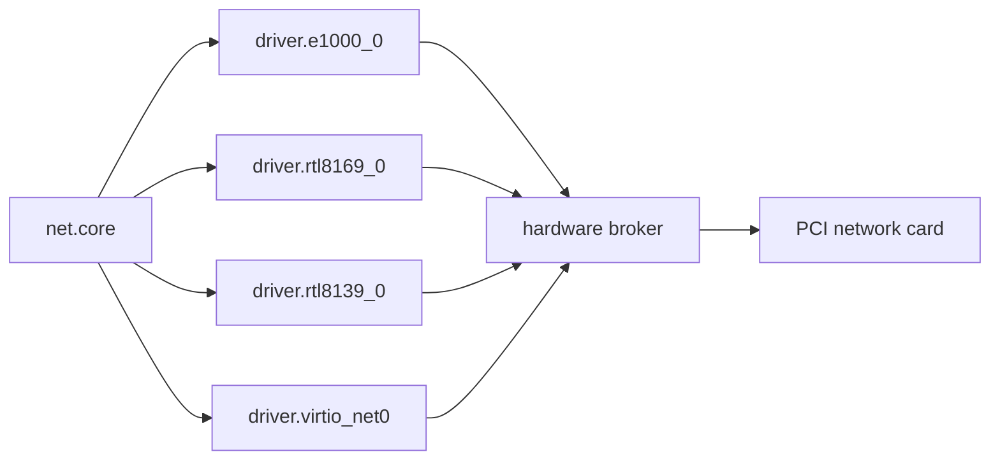

# How a frame travels

How a wired frame reaches `net.core`: the driver capsules on one side, the [hardware broker](../../overview/glossary-hardware-broker.md#hardware-broker) on the other, and the link protocol between the stack and every driver. The drivers themselves are listed on the [Ethernet drivers](README.md) page.

Each driver is a capsule that moves raw Ethernet frames and nothing more; ARP, IP, DHCP, DNS and TCP live in `net.core` above it. The driver reaches its PCI network card only through [grants](../../overview/glossary-dma-pool.md#grant) from the hardware broker: a device claim, a register mapping or port range, and DMA buffers.

## The link protocol

Every wired driver answers the same link protocol: a 20-byte header tagged `NNET` (0x4E4E4554), and the operations link status (2), MAC address (3), transmit (4) and receive (5) (`userland/capsule_net_core/src/protocol/ops.rs:17-25`, `MAGIC_NNET`, `OP_RX_PACKET`). Operation 6 is the receive batch, every waiting frame in one numbered reply (`userland/capsule_net_core/src/protocol/ops.rs:26-27`, `OP_RX_BATCH`); virtio-net, e1000, RTL8139 and RTL8169 serve it. Operation 7 is the register snapshot the PCI drivers answer (`userland/capsule_driver_e1000/src/protocol/ops.rs:32`, `OP_STATS`), and the USB drivers answer operation 6 with `E_INVAL`, their counters being at 7 as well.

On its first poll of a newly bound card, `net.core` sends operation 6 with no body, once per port (`userland/capsule_net_core/src/device/rx_probe.rs:30-40`, `serves`; `userland/capsule_net_core/src/device/batch_call.rs:54`, `OP_RX_BATCH`). An empty batch in a status 0 reply marks the driver as one that serves receive batches, and from then on that card is asked only for batches; any other answer, or none, and the card is read one frame at a time with operation 5 (`userland/capsule_net_core/src/device/receive.rs:22-32`, `receive`). [The receive fault](README.md#the-receive-fault) says why a status 0 reply alone is not taken as a yes.

## Who may reach a driver

The kernel holds every wired card on its card table, the USB network drivers among them, to `net.core` and `net.l2`; no other capsule may send to them (`src/services/registry/nics.rs`, `NICS`; `src/services/registry/held_cards.rs`, `card_callers` and `WIRED_STACK`). See [held endpoint](../../overview/glossary-hardware-broker.md#held-endpoint). The USB network drivers may also send to the USB host drivers, whose names the kernel keeps in one list (`src/services/registry/usb_hosts.rs`, `USB_HOSTS`); see [USB networking](usb-net.md).

## Which card is bound

`net.core` binds the first candidate whose link answers up. Wi-Fi comes first, then the wired cards in the order of the kernel's card table: `driver.virtio_net0`, the PCI cards, then the USB drivers (`src/services/registry/nics.rs:41-58`, `NICS`; `userland/capsule_net_core/src/setup/candidates.rs:42-46`, `candidate`). The igc capsule is not on that table. It asks the bound driver for its MAC address only when the port it is bound to changes (`userland/capsule_net_core/src/setup/reevaluate.rs:33-54`, `reevaluate`).

## See also

- [Ethernet drivers](README.md)
- [Images and tests](images-and-tests.md)
- [USB networking](usb-net.md)
- [The broker API](../broker-api.md)
