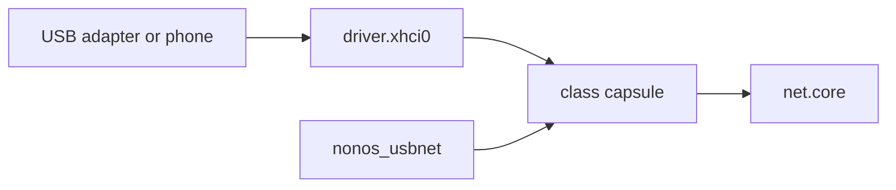

# USB networking

Five USB network driver [capsules](../../overview/glossary-boot-root-record.md#capsule) (CDC-ECM,
CDC-NCM, RNDIS, and ASIX AX88179 and Realtek RTL8153, both written again) sit in the tree on
one shared core, `nonos_usbnet`; none runs in 0.9.2. This page says what kept them out and where
they stand now; [what each binds](usb-net-binding.md) has its own page.

## State

USB Ethernet adapters and USB tethering from a phone do not work in NONOS 0.9.2. Four facts in that release's code stopped them, and each is now addressed on this tree:

1. No image built them. Each now has a kernel mirror and a spawn wherever an xHCI controller is
   (`src/userspace/init/spawn_plan/drivers_usbnet.rs`, `spawn`), and the build includes their
   makefiles (`mk/20-build.mk`, `capsule_driver_cdc_ecm`); none has an owner certificate yet, so no
   image carries one until the owner signs it.
2. The USB host driver did not serve their polled bulk IN, operation 0x0014
   (`userland/nonos_usbnet/src/xhci/wire.rs`, `OP_BULK_IN_POLL`). It now keeps one IN transfer armed
   per slot on its own page and answers each look at once
   (`userland/capsule_driver_xhci/src/controller/transfer/bulk/poll.rs`, `poll_bulk_in`).
3. The kernel held `driver.xhci0` to the USB keyboard, storage and audio drivers alone; the three
   are now on its list (`src/services/registry/held_lists.rs`, `XHCI_CLIENTS`), and each is held to
   `net.core` and `net.l2` through the card table (`src/services/registry/nics.rs`, `NICS`).
4. The shared core answered operation 6, which `net.core` asks first as its receive batch, with its
   counters and status 0, so `net.core` would have taken the counters for frames ([the receive
   fault](README.md#the-receive-fault)). The counters are now on 7 and 6 is refused
   (`userland/nonos_usbnet/src/nnet/wire.rs`, `OP_STATS`), so `net.core` reads these drivers one
   frame at a time with operation 5.

`net.core` tries the USB cards after the PCI cards, in the kernel's card table order (`userland/capsule_net_core/src/setup/candidates.rs`, `candidate`). For a machine with no supported Ethernet port, see [Wi-Fi chips with no driver](../wifi/not-supported.md#what-to-use-instead) for what does work.

## How the pieces fit



Each class capsule holds only its binding and its framing. The shared core `nonos_usbnet` holds the client side of every USB host, the descriptor walk, the search for a device on the hosts' root ports and the NNET frame service that `net.core` speaks (`userland/nonos_usbnet/src/lib.rs`, `run`). No USB network capsule touches the controller: it holds no Driver, DeviceEnum, Mmio, Irq, Dma or Pio [capability](../../overview/glossary-boot-root-record.md#capability-word). What each capsule binds is on [its own page](usb-net-binding.md).

## ASIX AX88179

The ASIX AX88179 (USB 3.0) and AX88178A (USB 2.0) gigabit chips, one of the two most common USB Ethernet dongles, are driven by `capsule_driver_ax88179` (`driver.ax88179_0`, port 4256). The first AX88179 capsule was quarantined (branch `quarantine/ax88179`) because its structure followed another system's driver. On the owner's instruction this one is written here from a reading of Linux v6.12's `ax88179_178a.c` for behaviour only: what the chip is sent, in which order and with which values, with this tree's own structure, names and bounds (`userland/capsule_driver_ax88179/BINDING.md`). It binds the 13 vendor and product pairs Linux v6.12 lists, in a configuration with the chip's vendor interface; one that offers only a class configuration is left to CDC-NCM or CDC-ECM.

It is not in the Standard image: it is held from Standard until the owner rules on Decision 10 (its register programming was read from Linux). Its own profile, `microkernel-driver-ax88179`, builds it; there it is spawned wherever a USB host is (`src/userspace/init/spawn_plan/drivers_usbnet/ax88179.rs`) and held to `net.core` and `net.l2` through the card table. It is host-proven only: QEMU has no AX88179, and no boot on the hardware exists ([the test plan](../../hardware/real-hardware-checklist.md#usb-ethernet-asix-ax88179)).

## Realtek RTL8153

`capsule_driver_rtl8153` (`driver.rtl8153_0`, port 4258) is the driver for the common laptop rescue dongle: Realtek RTL8153 and RTL8153B USB 3.0 gigabit adapters, Realtek's own 0bda:8153 and fifteen rebrands (Lenovo, Microsoft, TP-Link, Linksys, Samsung, Nvidia), each id checked against Linux v6.12's r8152 table. It was written anew for this tree, reading Linux v6.12 `drivers/net/usb/r8152.c` for the chip's behaviour only; its code and names are its own, with the bring-up written as tables of register steps (`userland/capsule_driver_rtl8153/src/rtl`).

It is not in the Standard image: it is held from Standard until the owner rules on Decision 10 (its register programming was read from Linux). Its own profile, `microkernel-driver-rtl8153`, builds it. Until then RTL8153 adapters are bound by the CDC-ECM capsule in their ECM configuration.

It takes the adapter's vendor configuration, as Linux does, and reads the chip's version first: an RTL8152, RTL8153C, RTL8156 or RTL8156B behind a listed id is refused by name before the device is configured. It then wakes the chip (settings loaded, PHY powered, power saving off, receive aggregation off), writes the drawn station address into the chip, starts autonegotiation, and starts the MAC; the link word is read one request in 16, and receive and transmit go on only with the link. Every wait on the chip is a bounded number of looks (`bounds.rs`), a whole bind's under 9.5 s, inside the 15 s bind budget. Every receive descriptor's length is bounded against the bytes that came. It is in Standard (`microkernel-full-gui`) and waits on the owner's seal like the others; it is host-proven and has not driven a real adapter ([test plan](../../hardware/real-hardware-checklist.md#realtek-rtl8153-usb-ethernet-adapter)).

Many of these adapters offer a CDC-ECM configuration too. Whichever capsule configures the adapter first holds it, and the other finds its port claimed; both serve it. What this driver leaves out, though Linux does it: firmware patches, the PHY's EEE and analog tuning, ALDPS, U1/U2 and the chip's other power saving, receive aggregation, checksum offload ([BINDING.md](../../../userland/capsule_driver_rtl8153/BINDING.md)).

## Addresses and capabilities

Like the PCI drivers, these capsules never use the adapter's own station address. Each draws one from `CryptoRandom` once a run, before the first bind, and hands the same one to every device it binds, so a device bound again after a loss keeps the address `net.core` took at the first bind; without entropy no device is bound (`userland/nonos_usbnet/src/station.rs`, `draw`; `userland/nonos_usbnet/src/scan/net.rs`, `NetScanner::new`). CDC-NCM gives it with SET_NET_ADDRESS when the device offers that, RNDIS sets OID_802_3_CURRENT_ADDRESS, and a device that cannot take it has its packet filter opened; CDC-ECM has no request for it, so its filter is always opened. The AX88179 has it written into its station register before receive is started; its factory address is never read (`userland/capsule_driver_ax88179/src/ax/plan.rs`, `plan`).

All four ask for the capability mask 0x38: IPC, Memory and Crypto, the bit `CryptoRandom` is gated on, with Debug (0x100) optional (`userland/capsule_driver_cdc_ecm/Capsule.mk`, `CAPSULE_REQUIRED_CAPS`; `src/capabilities/types/defs.rs`, `Crypto`). Their loop drops the messages it sent itself by its own pid, which it reads back with `MkServiceLookup` under its service name rather than `MkGetPid`, so no CoreExec is needed (`userland/nonos_usbnet/src/run/me.rs`, `own_pid`). The kernel admits `MkDebug` only with Debug (`src/syscall/contract/cap_table/mk_device.rs`, `can_debug`), so the `[usbnet ...]` lines reach the log only in a build that compiles `capsule-serial-debug`.

## Tests on this commit

Each capsule has a [proof crate](../../overview/glossary-peer-list.md#proof-crate) that runs its binding and framing on the host against scripted devices, some of them built from QEMU's `usb-net` descriptors. No QEMU run and no hardware boot exists for any of them. The counts below are host `cargo test` runs on this commit; the flake checks have not been run on it.

| Crate | Result |
|---|---|
| `usbnet_proofs` | 53 tests pass |
| `cdc_ecm_proofs` | 24 tests pass |
| `cdc_ncm_proofs` | 46 tests pass |
| `rndis_proofs` | 30 tests pass |
| `ax88179_proofs` | 32 tests pass; 17 mutants, one per bound, each caught |
| `rtl8153_proofs` | 55 tests pass, on a modelled chip; a mutant for every bound is caught |

```sh
cd userland/cdc_ncm_proofs && cargo test --release --config profile.release.overflow-checks=true
```

Not tested in this release.

## See also

- [What each USB capsule binds](usb-net-binding.md)
- [Ethernet drivers](README.md)
- [Realtek Ethernet](realtek.md)
- [USB host controller](../usb/README.md)
- [Wi-Fi chips with no driver](../wifi/not-supported.md)
- [Hardware support matrix](../../hardware/MATRIX.md)
