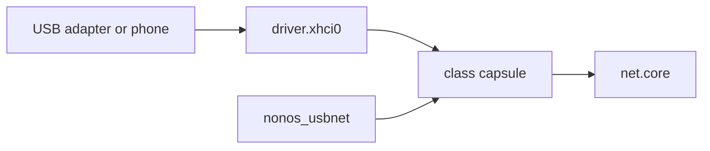

# USB networking

The tree holds five USB network driver [capsules](../../overview/glossary.md#capsule) (CDC-ECM, CDC-NCM, RNDIS, ASIX AX88179 and Realtek RTL8153) on one shared core, `nonos_usbnet`; none of them runs in 0.9.2, and this page says what each would bind and why it does not run.

## State in this release

USB Ethernet adapters and USB tethering from a phone do not work in NONOS 0.9.2. Three facts in the code stop them, and any one would be enough:

1. No image builds them. The Ethernet makefiles the build includes are those of virtio-net, e1000, RTL8139 and RTL8169 (`mk/20-build.mk:540-550`, `capsule_driver_e1000`), and the kernel has no spawn entry for any USB network capsule.
2. The USB host driver does not serve the transfer they rely on. `nonos_usbnet` reads with a polled bulk IN, operation 0x0014 (`userland/nonos_usbnet/src/xhci/wire.rs:38-40`, `OP_BULK_IN_POLL`). The xHCI driver's operations stop at 0x0013 (`userland/capsule_driver_xhci/src/protocol/ops.rs:17-30`, `OP_RESET_BULK`) and it answers any other with `E_INVAL` (`userland/capsule_driver_xhci/src/server/dispatch.rs:41-45`, `reply_with_status`).
3. The kernel holds `driver.xhci0` to the USB keyboard and mouse driver and the USB storage driver alone (`src/services/registry/held_table.rs:32`, `driver.usb_hid0`), so a network capsule could not send to it.

[The receive fault](README.md#the-receive-fault) would not follow once those are fixed: the shared core keeps its counters at operation 0x0100 and answers net.core's operation 6 with `E_INVAL` (`userland/nonos_usbnet/src/nnet/wire.rs:36-39`, `OP_STATS`), so net.core reads these drivers one frame at a time with operation 5.

`net.core` already lists the five services as candidates after the PCI cards (`userland/capsule_net_core/src/setup/candidates.rs:25-38`, `WIRED_NICS`). For a machine with no supported Ethernet port, see [Wi-Fi chips with no driver](../wifi/not-supported.md#what-to-use-instead) for what does work.

## How the pieces fit



Each class capsule holds only its binding and its framing. The shared core `nonos_usbnet` holds the client side of `driver.xhci0`, the descriptor walk, the search for a device on the root ports and the NNET frame service that `net.core` speaks (`userland/nonos_usbnet/src/lib.rs:17-21`, `run`). No USB network capsule touches the controller: it holds no Driver, DeviceEnum, Mmio, Irq, Dma or Pio [capability](../../overview/glossary.md#capability-word). What each capsule binds is on [its own page](usb-net-binding.md).

## Addresses and capabilities

Like the PCI drivers, these capsules never use the adapter's own station address. Each draws one from `CryptoRandom` once a run, before the first bind, and hands the same one to every device it binds, so a device bound again after a loss keeps the address `net.core` took at the first bind; without entropy no device is bound (`userland/nonos_usbnet/src/station.rs:59-66`, `draw`; `userland/nonos_usbnet/src/scan/scanner.rs:38-44`, `Scanner::new`). The AX88179 capsule writes it to AX_NODE_ID and the RTL8153 capsule to PLA_IDR, so each chip's unicast filter matches it; neither reads the factory address there or in PLA_BACKUP (`userland/capsule_driver_ax88179/src/ax/station.rs:28-32`, `station`; `userland/capsule_driver_rtl8153/src/r8153/up/mac.rs:31-37`, `station_address`). CDC-NCM gives it with SET_NET_ADDRESS when the device offers that, RNDIS sets OID_802_3_CURRENT_ADDRESS, and a device that cannot take it has its packet filter opened.

All five ask for the capability mask 0x38: IPC, Memory and Crypto, the bit `CryptoRandom` is gated on, with Debug (0x100) optional (`userland/capsule_driver_cdc_ecm/Capsule.mk:15-26`, `CAPSULE_REQUIRED_CAPS`; `src/capabilities/types/defs.rs:28`, `Crypto`). The kernel admits `MkDebug` only with Debug (`src/syscall/contract/cap_table/mk.rs:138`, `can_debug`), so the `[usbnet ...]` lines reach the log only in a build that compiles `capsule-serial-debug`.

## Tests on this commit

Each capsule has a [proof crate](../../overview/glossary.md#proof-crate) that runs its binding and framing on the host against scripted devices, some of them built from QEMU's `usb-net` descriptors. No QEMU run and no hardware boot exists for any of them. The counts below are host `cargo test` runs on this commit; the flake checks have not been run on it.

| Crate | Result |
|---|---|
| `usbnet_proofs` | 38 tests pass |
| `cdc_ecm_proofs` | 13 tests pass |
| `cdc_ncm_proofs` | 36 tests pass |
| `rndis_proofs` | 22 tests pass |
| `ax88179_proofs` | 27 tests pass |
| `rtl8153_proofs` | 31 tests pass |

```sh
cd userland/cdc_ncm_proofs && cargo test --release --config profile.release.overflow-checks=true
```

Not tested in this release.

## See also

- [What each USB capsule binds](usb-net-binding.md)
- [Ethernet drivers](README.md)
- [Realtek Ethernet](realtek.md)
- [USB host controller](../usb/README.md)
- [Wi-Fi chips with no driver](../wifi/not-supported.md)
- [Hardware support matrix](../../hardware/MATRIX.md)
