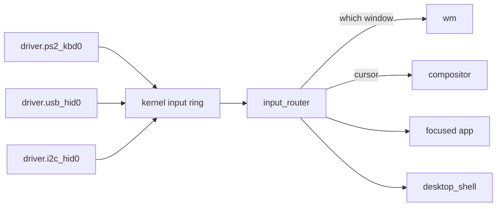

# Input drivers

How a key press, a mouse movement or a touch on the touchpad reaches an
application in NONOS 0.9.2, and which driver handles which device. Keyboard
layouts and what is not there are in [Input: layouts and limits](layouts.md),
and how it is checked in [Input: how it is checked](checks.md).

## Which driver handles what

| Device | Driver | Service | Page |
|---|---|---|---|
| Keyboard, mouse or touchpad on the i8042 (PS/2) controller | `capsule_driver_ps2_input` | `driver.ps2_kbd0` | [PS/2 keyboard and mouse](ps2.md) |
| HID-over-I2C touchpad on an Intel LPSS or AMD I2C controller | `capsule_driver_i2c_hid` over `capsule_driver_i2c_pci` | `driver.i2c_hid0`, `driver.i2c_pci0` | [I2C-HID touchpads](i2c-hid.md) |
| USB keyboard, mouse or tablet behind an xHCI controller | `capsule_driver_usb_hid` | `driver.usb_hid0` | [USB keyboards and mice](../usb/hid.md) |

Each driver is its own [capsule](../../overview/glossary.md#capsule) in ring 3,
and none of them decides which window gets the input. Only the PS/2 driver holds
grants from the [hardware broker](../../overview/glossary.md#hardware-broker)
itself. The USB HID driver holds IPC, Memory and InputSource alone and asks
`driver.xhci0` for its transfers (`CAPSULE_REQUIRED_CAPS`,
`userland/capsule_driver_usb_hid/Capsule.mk:15`); the touchpad driver does the
same through `driver.i2c_pci0`.

## The path of one event

A driver decodes what its device sends and posts each key, motion, wheel or
button event to the kernel input ring with `MkInputEventPost`
(`src/syscall/contract/cap_table/mk.rs:190`). The kernel admits that call from a
capsule holding the `InputSource`, `Irq` or `Admin`
[capability](../../overview/glossary.md#capability) (`can_input_source`,
`src/capabilities/token/types/authority_broker.rs:59-63`). Draining the ring, or
sleeping until it has events, needs `InputSource` or `Admin`; `Irq` alone is not
enough (`can_input_consumer`,
`src/capabilities/token/types/authority_broker.rs:71-73`).

The ring holds 1024 events (`INPUT_RING_CAP`,
`src/kernel_core/surface_registry/types.rs:18`). When it is full, `push` drops
the new event and counts it rather than wait
(`src/kernel_core/surface_registry/input_ring/post.rs:50-58`).

`input_router` drains the ring. It takes up to 32 events a pass (`MAX_BATCH`,
`userland/capsule_input_router/src/sources/kernel_ring.rs:25`) and parks for at
most 8 ms when the ring is empty (`INPUT_WAIT_MS`,
`userland/capsule_input_router/src/server/runner.rs:33`).

Where the router sends each event, the keys it keeps from the focused window,
and what no input driver keeps: [Input: routing and privacy](routing.md).

## See also

- [Drivers](../README.md)
- [Input: routing and privacy](routing.md)
- [Input: layouts and limits](layouts.md)
- [Input: how it is checked](checks.md)
- [PS/2 keyboard and mouse](ps2.md)
- [PS/2 keys](ps2-input.md)
- [PS/2 pointer](ps2-pointer.md)
- [I2C-HID touchpads](i2c-hid.md)
- [USB keyboards and mice](../usb/hid.md)
- [Keyboard layouts](../../using/keyboard-layouts.md)
- [Hardware broker](../../kernel/hardware-broker.md)
- [Support matrix](../../hardware/MATRIX.md)
- [Reporting a machine](../../hardware/report.md)
