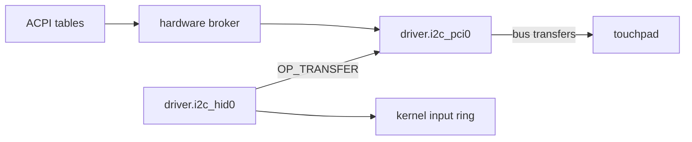

# I2C-HID touchpads

How NONOS drives a laptop touchpad that speaks HID over I2C. Which I2C
controllers it finds is in [controllers](i2c-hid-controllers.md), how it binds
the pad in [finding the pad](i2c-hid-finding.md), and waking the pad, reading
its reports and the gestures it turns into pointer events in [the
pad](i2c-hid-pad.md).

## Two capsules

A touchpad takes two [driver
capsules](../../overview/glossary.md#driver-capsule): one owns the I2C bus, the
other reads the touchpad on it.

- `capsule_driver_i2c_pci` serves `driver.i2c_pci0`. It owns the I2C host
  controller: it claims it through the [hardware
  broker](../../overview/glossary.md#hardware-broker), maps its registers and
  runs bounded bus transfers. It parses no HID report.
- `capsule_driver_i2c_hid` serves `driver.i2c_hid0`. It holds no hardware grant
  at all. It asks `driver.i2c_pci0` for transfers with `OP_TRANSFER`, decodes
  the touchpad's reports and posts pointer, wheel and button events to the
  kernel input ring.

Only `driver.i2c_hid0` may send to `driver.i2c_pci0` (`HELD`,
`src/services/registry/held_table.rs:20-33`), and even its transfers reach only
the addresses setup put in reach; any other is refused before the bus, so a
subverted HID driver cannot talk to the PMIC, the USB-PD controller or an I2C
TPM on the same bus (`Reach`,
`userland/capsule_driver_i2c_pci/src/transaction/types/reach.rs:27-49`). The
ACPI tables, read by the kernel, tell both where the touchpad is.

## See also

- [I2C-HID touchpads: controllers](i2c-hid-controllers.md)
- [I2C-HID touchpads: finding the pad](i2c-hid-finding.md)
- [I2C-HID touchpads: a pad with no address](i2c-hid-sweep.md)
- [I2C-HID touchpads: the pad](i2c-hid-pad.md)
- [I2C-HID touchpads: authority, limits and checks](i2c-hid-limits.md)
- [Input drivers](README.md)
- [PS/2 keyboard and mouse](ps2.md)
- [Platform: GPIO and pinctrl](../platform.md)
- [Broker API](../broker-api.md)
- [Support matrix](../../hardware/MATRIX.md)
- [Reporting a machine](../../hardware/report.md)
