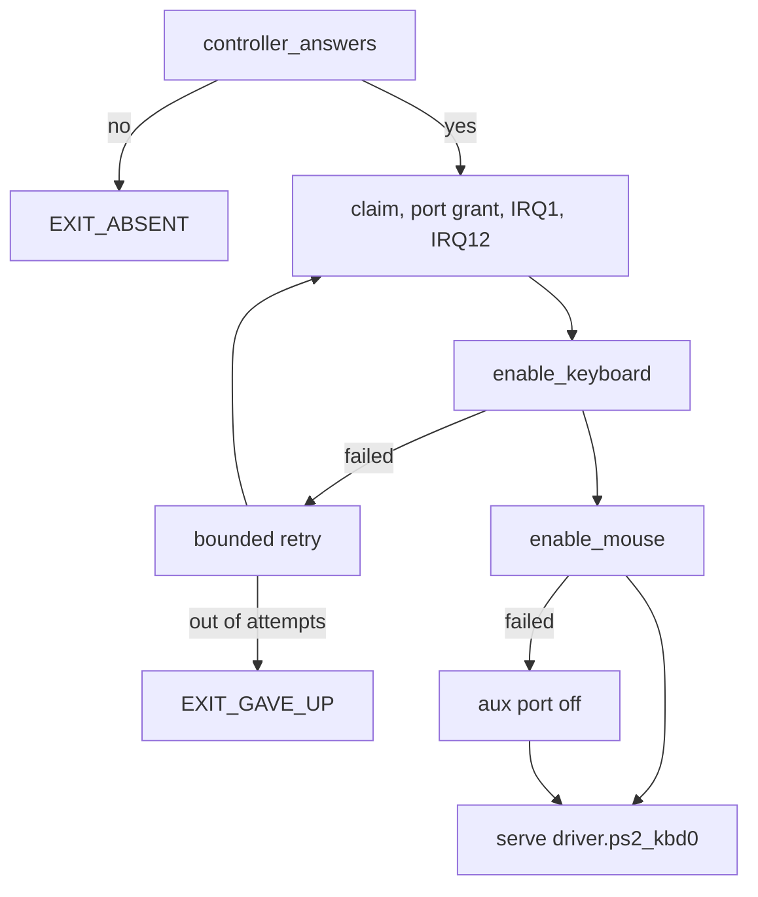

# PS/2 bring-up

The order in which `capsule_driver_ps2_input` claims the i8042 and brings the
keyboard and the mouse up, and how a failed attempt is retried. How it finds
the controller is in [PS/2 keyboard and mouse](ps2.md).

## Bring-up

`run` performs one attempt in this order
(`userland/capsule_driver_ps2_input/src/setup/sequence.rs:30-75`):

1. Claim the keyboard record and take the grant for the i8042 ports. Bind IRQ1.
   If IRQ1 cannot be bound, the driver takes the port grant again and goes on
   without the line.
2. Claim the aux record and bind IRQ12 (`setup_aux`,
   `userland/capsule_driver_ps2_input/src/setup/setup_aux.rs:31`).
3. Empty the output buffer, then bring the keyboard up: hold its port off, read
   the configuration byte, set the IRQ1 and translation bits, enable the port
   and send Enable Scanning (0xF4). Only a keyboard that does not acknowledge
   that is reset with 0xFF, then asked again. A keyboard that answers neither is
   tolerated, so one plugged in later still works (`enable_keyboard`,
   `userland/capsule_driver_ps2_input/src/init/enable_keyboard/enable.rs:28-38`).
4. If IRQ12 was bound, bring the mouse up: enable the aux port, set the IRQ12
   bit, set defaults, try the wheel knock (sample rates 200, 100, 80, then read
   the id, 3 means a wheel), enable reporting (`enable_mouse`,
   `userland/capsule_driver_ps2_input/src/init/enable_mouse/enable.rs:32-58`).
   Without the aux line the mouse step is skipped. A keystroke that lands while
   the mouse's reply is awaited is dropped and counted, as nothing serves the
   keyboard yet.
5. If the mouse step fails, turn the aux port back off and restore the keyboard,
   so a port with nothing behind it does not stream bytes for ever. The keyboard
   keeps working (`disable_aux`,
   `userland/capsule_driver_ps2_input/src/setup/sequence.rs:56-64`).
6. Open both lines and serve `driver.ps2_kbd0`. The serve loop's first pass sets
   the lock LEDs, whatever firmware left lit.

If a claim, the port grant or the keyboard step fails, the attempt fails. After
a keyboard failure the driver gives back both claims, with the port grant and
both lines, and tries again; that is the bounded retry in the diagram
(`release`, `userland/capsule_driver_ps2_input/src/setup/sequence.rs:44-50`). It
tries 7 times, sleeping 100 ms after the first failure and doubling up to 3200
ms, about six seconds asleep in all (`BRINGUP_ATTEMPTS`,
`userland/libc/src/bringup/policy.rs:31-35`). Then it exits with status 6,
`EXIT_GAVE_UP` (`userland/libc/src/bringup/policy.rs:41`).

## See also

- [PS/2 keyboard and mouse](ps2.md)
- [PS/2 authority, limits and checks](ps2-authority.md)
- [PS/2 keys](ps2-input.md)
- [Hardware broker](../../kernel/hardware-broker.md)
