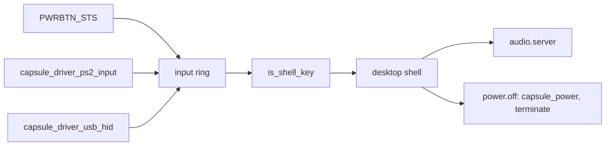

# Platform: ACPI power button, lid and volume keys

Part of [Platform](platform.md).

## ACPI power button, lid and volume keys

The kernel scans ACPI AML for device declarations and constant packages and
never executes it, so nothing that needs an AML method works: no battery level,
no lid events, no control-method button. `sys_battery_status` returns -19 when
no battery is declared and -95 otherwise, never a percentage
(`src/syscall/microkernel/battery.rs:17-44`). `PowerDevices` records whether a
lid is declared, through `is_lid` for PNP0C0D, and nothing acts on it
(`src/arch/x86_64/acpi/aml/power_devices.rs:17-37`,
`src/arch/x86_64/acpi/aml/power_devices.rs:63-65`). No driver changes the panel
backlight.

### The power button

`classify` reads the FADT. A fixed-feature button, with the `FADT_PWR_BUTTON`
flag clear, latches `PWRBTN_STS` (`PM1_STS_PWRBTN`, bit 8) in the PM1 status
register, which the kernel reads without AML
(`src/arch/x86_64/acpi/hw/power_button.rs`). `init` takes the button only when
firmware has handed ACPI to the OS (SCI_EN set) and clears a press left from
before boot (`src/arch/x86_64/acpi/power_button/init.rs:31-62`). `poll` runs
every tenth tick of the boot CPU's 100 Hz clock, so every 100 ms
(`power_button/poll.rs:29-64`); a press counts once per `DEBOUNCE_MS` (1000 ms,
`power_button/gate.rs`) and becomes a `KEYCODE_POWER` (0x1304) press and release
in the input ring (`power_button/deliver.rs`).

QEMU's PM1 latches `PWRBTN_STS` only while `PWRBTN_EN` is set
(`acpi_pm1_evt_power_down`, QEMU `hw/acpi/core.c`), where ACPI 6.5 4.8.1.1 has
a status bit latch whatever its enable says. So once device interrupt routing
is up, `arm` masks the SCI's IO-APIC line and then sets `PWRBTN_EN`, keeping
every enable firmware set, and logs `[ACPI] power button: SCI line masked,
PM1_EN=…` (`power_button/arm.rs`, the rule in `hw/power_button_arm.rs`, called
from `src/arch/init_broker_irq_routing.rs`). It refuses, with a line saying
why, when routing failed or is not up, when the line cannot be masked, or when a
capsule holds the SCI. Booted on q35 under QEMU 11.1: a QMP `system_powerdown`
reached the desktop ([P-05](../security/privacy-evidence/2026-10-25/p05-c39b8edd9/README.md)). On hardware the enable is not needed by the spec,
and is harmless with the line masked; not hardware-verified.

From QEMU's monitor, read and write the PM1 registers 16 bits wide: `i/h 0x602`,
`o/h 0x602 0x0100`. In HMP `/w` is 32 bits, the PM1 regions take 1 or 2 bytes,
and a 32-bit access is dropped: writes do not stick and reads return 0.

A `ControlMethod` button (PNP0C0C), a hardware-reduced platform or a status
register outside port I/O gets one log line and stays with the firmware
(`power_button/init.rs:58-60`), pointing to Power Off in the desktop's menu.

The shell answers the Power key, and that menu item, with "Power off and wipe
memory?" (`userland/capsule_desktop_shell/src/server/handlers/system_keys.rs:40`).
Power Off goes to `power.off`, which the kernel registers for `capsule_power`
at spawn (`src/userspace/capsule_power/power_off.rs:30`); it checks the sender
is the shell, then calls `AdminShutdown`, zerostate's `terminate`. Booted:
[the walk](../security/privacy-evidence/2026-10-25/merge-fd40dd41f/walk/README.md).

### The volume keys

The volume keys are not ACPI events. The keyboard drivers post them, and a
keyboard's own power key, as key codes: the PS/2 driver maps the extended
scancodes 0x20, 0x2E and 0x30 to `KEYCODE_MUTE`, `KEYCODE_VOLUME_DOWN` and
`KEYCODE_VOLUME_UP`, and 0x5E to `KEYCODE_POWER`
(`userland/capsule_driver_ps2_input/src/keymap/set1_e0.rs:28-46`), and the USB
HID driver maps the keyboard page's usage 0x66 to Power
(`userland/capsule_driver_usb_hid/src/hid/usage_keycode/map.rs:57`,
`KEYCODE_POWER`). The input router sends all four keys to the desktop shell
whatever has focus, through `is_shell_key`
(`userland/capsule_input_router/src/route/shell_keys.rs:17-34`).
[Audio](audio.md#volume-and-the-volume-keys) follows a volume key from the press
to the speaker.

The power button and the volume keys: Works on an x86_64 laptop (Intel Gemini
not recorded.
