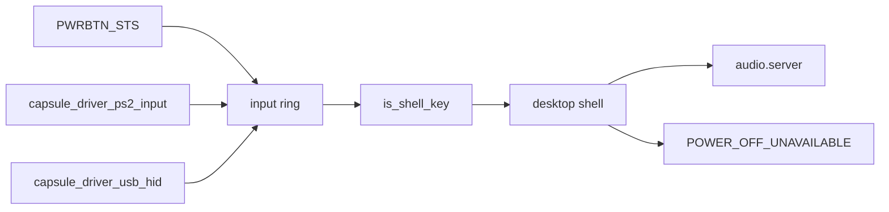

# Platform: ACPI power button, lid and volume keys

Part of [Platform](platform.md).

## ACPI power button, lid and volume keys

The kernel scans ACPI AML for device declarations and constant packages and
never executes it, so nothing that needs an AML method works: no battery level,
no lid events, no control-method button. `sys_battery_status` returns -19 when
no battery is declared and -95 otherwise, never a percentage
(`src/syscall/microkernel/battery.rs:17-44`). `PowerDevices` records whether a
lid is declared, through `is_lid` for PNP0C0D, and nothing acts on it
(`src/arch/x86_64/acpi/aml/power_devices.rs:17-37`,
`src/arch/x86_64/acpi/aml/power_devices.rs:63-65`). No driver changes the panel
backlight.

### The power button

`classify` reads the FADT. A fixed-feature button, with the `FADT_PWR_BUTTON`
flag clear, latches `PWRBTN_STS`, which the kernel names `PM1_STS_PWRBTN` (bit
8), in the PM1 status register, and the kernel can read it without AML
(`src/arch/x86_64/acpi/hw/power_button.rs:17-36`). `init` arms polling only when
the firmware has handed ACPI to the OS (SCI_EN set) and clears a press left from
before boot (`src/arch/x86_64/acpi/power_button.rs:62-91`). `poll` runs every
tenth tick of the boot CPU's clock (`src/interrupts/timer/clock.rs:43-48`),
which ticks at 100 Hz as `MS_PER_TICK` assumes, so every 100 ms
(`src/arch/x86_64/acpi/power_button.rs:47-48`). A press counts once per
`DEBOUNCE_MS` (1000 ms) and becomes a `KEYCODE_POWER` (0x1304) press and release
in the input ring (`src/arch/x86_64/acpi/hw/power_button.rs:39-41`,
`src/arch/x86_64/acpi/power_button.rs:42-46`).

A `ControlMethod` button (PNP0C0C), a hardware-reduced platform or a status
register outside port I/O gets one log line and stays with the firmware
(`src/arch/x86_64/acpi/power_button.rs:87-89`). Those lines point to a Shut Down
menu, which the desktop does not have in this release.

The desktop shell answers the Power key with `POWER_OFF_UNAVAILABLE`, the notice
`Power off is not available from the desktop`, because `capsule_power` is built
but not spawned and the desktop cannot shut the machine down in this release
(`userland/capsule_desktop_shell/src/state/system_key.rs:42-47`,
`userland/capsule_desktop_shell/src/server/handlers/system_keys.rs:39`).

### The volume keys

The volume keys are not ACPI events. The keyboard drivers post them, and a
keyboard's own power key, as key codes: the PS/2 driver maps the extended
scancodes 0x20, 0x2E and 0x30 to `KEYCODE_MUTE`, `KEYCODE_VOLUME_DOWN` and
`KEYCODE_VOLUME_UP`, and 0x5E to `KEYCODE_POWER`
(`userland/capsule_driver_ps2_input/src/keymap/set1_e0.rs:28-46`), and the USB
HID driver maps the keyboard page's usage 0x66 to Power
(`userland/capsule_driver_usb_hid/src/hid/usage_keycode/map.rs:57`,
`KEYCODE_POWER`). The input router sends all four keys to the desktop shell
whatever has focus, through `is_shell_key`
(`userland/capsule_input_router/src/route/shell_keys.rs:17-34`).
[Audio](audio.md#volume-and-the-volume-keys) follows a volume key from the press
to the speaker.

The power button and the volume keys: Works on an x86_64 laptop (Intel Gemini
Lake, 8 GB), developer hardware report, 6 October 2026; the image commit was
not recorded.
