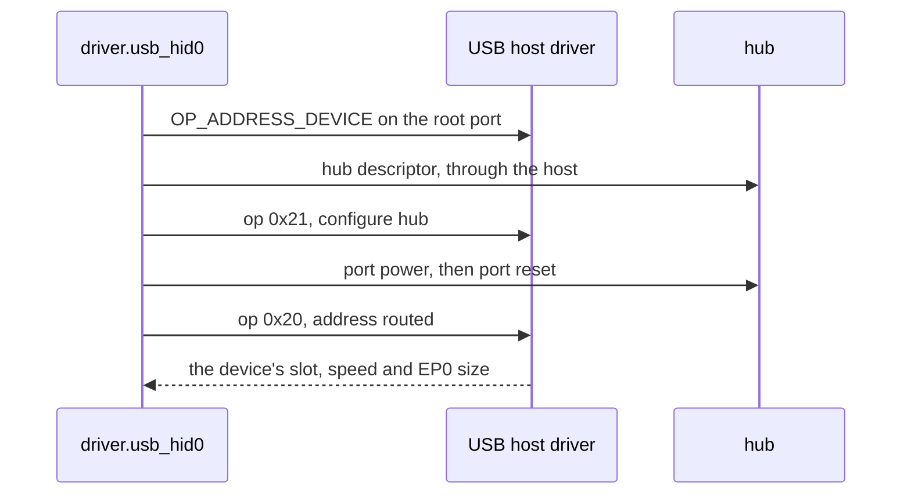

# USB hubs

What NONOS does with a USB hub: the hub is brought up, and the keyboards and mice plugged into it are reached on every USB host the system has. Other devices behind a hub are not reached yet.

## In short

Keyboards and mice work behind a hub: external hubs, internal hubs, and the rate-matching hub an Intel PCH from the 5 series on puts behind its EHCI. USB sticks, network adapters and other non-HID devices only work straight on a root port, because only the HID driver walks hubs (see [What is not reached yet](#what-is-not-reached-yet)). None of this has run on hardware or under QEMU yet. The proofs below drive it against models.

## What happens with a hub

The hub class lives in the `nonos_usb_hub` library (`userland/nonos_usb_hub/src/lib.rs`). It reaches the host driver, the clock and the log only through its `Host` trait (`host.rs`). What a device is bound to is left to the caller's `Classes` (`classes.rs`). `driver.usb_hid0` runs it over whichever host it found (`userland/capsule_driver_usb_hid/src/hub/host.rs`, `XhciHost`; `orchestrator/enumerate/walk.rs`, `Hid`):

1. The driver addresses the hub on its root port like any device and reads its configuration. An interface of class 09h marks a hub (`userland/capsule_driver_usb_hid/src/descriptors/config.rs`, `is_hub`).
2. `attach` reads the hub descriptor, sets a SuperSpeed hub's depth, tells the host with op 0x21 that the slot is a hub, claims the hub's status endpoint and powers its ports (`userland/nonos_usb_hub/src/attach.rs`).
3. For each hub port with a device on it, the walk waits 100 ms, resets the port through the hub and gives the reset up to 800 ms (`attach_child.rs`, `DEBOUNCE_MS`; `reset.rs`, `RESET_TIMEOUT_MS`).
4. It asks the host with op 0x20 to address the device at its route: one 4-bit hub port per tier, at most five hubs deep (`route.rs`, `child_route`). A full or low speed device below a high-speed hub also carries that hub's transaction translator (TT) (`route.rs`, `child_tt`).
5. The device is classified as one on a root port would be. If nothing binds, its slot is given back. Each port is tried three times, then left alone until its device is unplugged (`node.rs`, `TRIES`).
6. An unplugged device is forgotten, and a hub takes every device below it along (`forget_slot.rs`).

## What each host does with op 0x20 and op 0x21

| Host | Below which hubs | How a device below a hub is reached |
|---|---|---|
| xHCI (`driver.xhci0`) | any | The route string, the speed and the TT go into the Slot Context before Address Device, and the root port is not reset. Op 0x21 sets the Hub flag, port count, TT think time and MTT through Configure Endpoint (`userland/capsule_driver_xhci/src/contexts/route.rs`, `hub.rs`). |
| EHCI (`driver.ehci0`) | high-speed | Each slot keeps its speed and TT. A full or low speed device's QHs name the TT's hub and port and use split transactions; an interrupt QH completes in micro-frames 2 to 4 (`userland/capsule_driver_ehci/src/sched/link.rs`). |
| UHCI (`driver.uhci0`), OHCI (`driver.ohci0`) | full-speed | A full-speed hub has no TT. A low-speed device's TDs (UHCI) or EDs (OHCI) are marked low speed, so the controller sends the preamble. |

On every host, a routed request is refused with E_INVAL in these cases:

- no hub is on the root port;
- the route has a gap or more than five tiers;
- a TT is named for a device that needs none, or is missing for one that needs one.

Giving back a device below a hub leaves the root port, and the hub, up. A polled bulk IN (a network adapter's read) holds a place of the host's own, not the root port's, so devices below one hub poll side by side.

## What is not reached yet

- Only `driver.usb_hid0` walks hubs. A stick, webcam or Bluetooth adapter behind a hub is addressed, found not to be HID, and its slot is given back. `driver.usb_msc0` looks at root ports only (`userland/capsule_driver_usb_msc/src/xhci/port.rs`, `connected_ports`). Two capsules walking one hub would race each other's port resets. Which capsule runs the walk for every class is an open design point.
- The hub's status endpoint is claimed but not read: the walk looks at each hub port on every rescan.
- The `[usb-hub]` log lines go through `mk_debug`. `driver.usb_hid0` holds no Debug capability (`src/userspace/capsule_driver_usb_hid/spawn.rs`, `requested_caps`), so they do not reach the [serial console](../../overview/glossary.md#serial-console).

## How it was verified

All of it on the host, none on hardware or under QEMU:

- `userland/usb_hub_proofs` (15 tests) covers the descriptor, port status, route and TT rules. It also runs the walk over a modelled hub and clock.
- In each host's proof crate, `nonos_usb_hub`'s own walk runs over that driver's own request dispatch against its model controller, with a model hub on root port 1 (`userland/uhci_proofs/src/hub_lane.rs`, shared by the three).
  - The model halts any transaction whose speed, TT, completion mask or low-speed mark does not match where the device sits (`userland/ehci_proofs/src/model/reach.rs`, `userland/uhci_proofs/src/model/bus.rs`).
  - Counts: `ehci_proofs` 40, `uhci_proofs` 40, `ohci_proofs` 42. `xhci_proofs` 151 holds the Slot Context fields.

## See also

- [USB and the xHCI host controller](README.md)
- [USB keyboards and mice](hid.md)
- [USB mass storage](../storage/usb-mass-storage.md)
- [Hardware support matrix](../../hardware/MATRIX.md)
