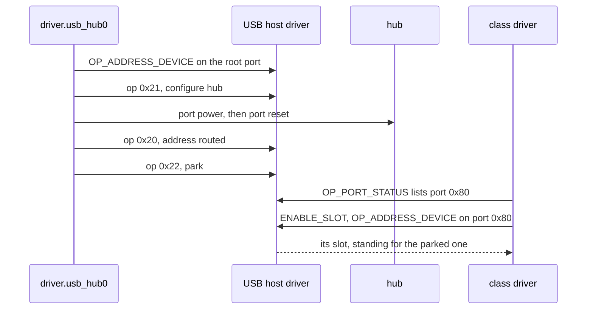

# USB hubs

What NONOS does with a USB hub: one capsule, `driver.usb_hub0`, brings every hub up on every USB host, and each device behind a hub is offered to all the class drivers as if it sat on a root port.

## In short

Keyboards, mice, sticks, network adapters and other devices work behind a hub. That covers external hubs, internal hubs, and the rate-matching hub an Intel PCH from the 5 series on puts behind its EHCI. None of this has run on hardware or under QEMU yet; the proofs below drive it against models. `driver.usb_hub0` needs the owner's certificate before an image carries it.

## What happens with a hub

The hub class lives in the `nonos_usb_hub` library (`userland/nonos_usb_hub/src/lib.rs`). It reaches the host, the clock and the log only through its `Host` trait (`host.rs`). `driver.usb_hub0` (`userland/capsule_driver_usb_hub`) runs it over every host:

1. Root ports (`roots.rs`, `roots`). A device on a root port is addressed. A hub is configured, told to the host with op 0x21, has its status endpoint claimed and its ports powered (`parker.rs`, `as_hub`; `attach.rs`). Anything else is given back at once for the class drivers.
2. Hub ports (`scan_hub.rs`). A new device waits 100 ms, is reset through the hub (at most 800 ms), and is addressed with op 0x20 at its route: one 4-bit hub port per tier, at most five hubs deep (`route.rs`, `child_route`). A full or low speed device below a high-speed hub also carries that hub's TT (`child_tt`).
3. Parking (`parker.rs`, `Parker`). A hub below a hub is brought up the same way. Any other device is parked with the host by op 0x22, and the host lists it as a virtual port (below).
4. A device that leaves has its slot given back. A hub that leaves, from a hub port or a root port, takes every device below it along (`forget_slot.rs`).

`driver.usb_hid0` keeps no hub code. It is a class driver like the others and claims keyboards and mice on virtual ports as on root ports.

## Virtual ports

Each host keeps a table of parked children (`userland/nonos_usb_virt`). Every host shares it: UHCI, OHCI and EHCI through their front (`userland/capsule_driver_uhci/src/server/many`), and xHCI through its multiplexer (`userland/capsule_driver_xhci/src/server/mux_virt.rs`).

- **Listing.** OP_PORT_STATUS lists the parked children after the root ports. The reply's head is `ports u8, virtual u8, 0, 0`. Then come `ports` 8-byte entries, root ports first: `port u8, owner u8, kind u8 (0 root, 1 virtual), 0, PORTSC u32 le`, in xHCI's form (connected bit 0, enabled bit 1, speed bits 13:10, connect change bit 17). After them come `virtual` 8-byte extensions: `port u8, parent slot u8, TT hub slot u8, TT port u8, route u32 le`. Virtual ports are numbered from 0x80. A parser that knows only root ports reads them as ports.
- **Claiming.** A class driver claims a virtual port exactly as a root port: ENABLE_SLOT, then OP_ADDRESS_DEVICE naming it. The first claim wins; a second is answered E_BUSY. The reply is the address reply with the claimant's own slot. From then on every request for that slot goes to the parked one.
- **Detaching.** When the child leaves, usb_hub0 gives its slot back. Unclaimed, the port goes at once. Claimed, the port reads disconnected with its connect change set, as a root port does, until the claimant gives its slot back; then both slots go.
- **Letting go.** A claimant that lets a child go that is still there leaves it parked for the next claim.

## What each host does with op 0x20 and op 0x21

| Host | Below which hubs | How a device below a hub is reached |
|---|---|---|
| xHCI (`driver.xhci0`) | any | The route string, the speed and the TT go into the Slot Context before Address Device, and the root port is not reset. Op 0x21 sets the Hub flag, port count, TT think time and MTT through Configure Endpoint (`userland/capsule_driver_xhci/src/contexts/route.rs`, `hub.rs`). |
| EHCI (`driver.ehci0`) | high-speed | Each slot keeps its speed and TT. A full or low speed device's QHs name the TT's hub and port and use split transactions; an interrupt QH completes in micro-frames 2 to 4 (`userland/capsule_driver_ehci/src/sched/link.rs`). |
| UHCI (`driver.uhci0`), OHCI (`driver.ohci0`) | full-speed | A full-speed hub has no TT. A low-speed device's TDs (UHCI) or EDs (OHCI) are marked low speed, so the controller sends the preamble. |

On every host, a routed request is refused with E_INVAL in these cases:

- no hub is on the root port;
- the route has a gap or more than five tiers;
- a TT is named for a device that needs none, or is missing for one that needs one.

Giving back a device below a hub leaves the root port, and the hub, up. A polled bulk IN (a network adapter's read) holds a place of the host's own, not the root port's, so devices below one hub poll side by side.

## Limits

- The hub's status endpoint is claimed but not read: the walk looks at each hub port every 250 ms.
- 32 virtual ports a host.
- The `[usb-hub]` log lines go through `mk_debug`, which only a serial-debug build grants `driver.usb_hub0`.

## How it was verified

All of it on the host, none on hardware or under QEMU:

- `userland/usb_hub_proofs` (24 tests) covers the descriptor, port status, route and TT rules, the walk and the parking over a modelled hub and clock, and the virtual port table.
- In each host's proof crate, `nonos_usb_hub`'s own walk runs over that driver's own request dispatch against its model controller, with a model hub on root port 1 (`userland/uhci_proofs/src/hub_lane.rs`, shared by the three).
  - The model halts any transaction whose speed, TT, completion mask or low-speed mark does not match where the device sits (`userland/ehci_proofs/src/model/reach.rs`, `userland/uhci_proofs/src/model/bus.rs`).
  - In `uhci_proofs`, usb_hub0's own walk and root-port pass run over the real host front. Children are parked, listed and claimed, and their bulk data reaches them; detaches and give-backs follow the table.
  - Counts: `uhci_proofs` 48, `ehci_proofs` 41, `ohci_proofs` 43, `xhci_proofs` 152.

## See also

- [USB and the xHCI host controller](README.md)
- [USB keyboards and mice](hid.md)
- [USB mass storage](../storage/usb-mass-storage.md)
- [Hardware support matrix](../../hardware/MATRIX.md)
