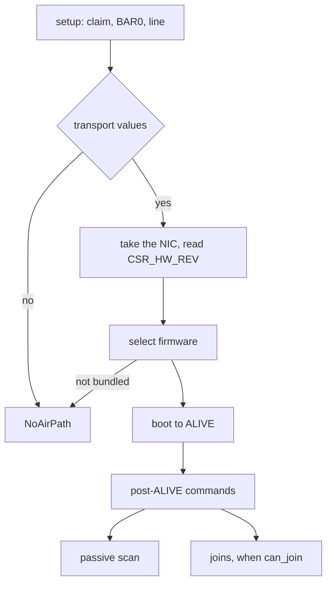

## Firmware choice on the SO platforms

`select` picks the image from the MAC type and step in CSR_HW_REV and the RF type in CSR_HW_RF_ID, as Linux names it (`userland/capsule_driver_iwlwifi/src/firmware/gen3/select.rs:151-185`, `select`). The MAC types are SO 0x37, SO-F 0x43, TY 0x42 and MA 0x44; the RF types are GF 0x10D and HR 0x10C or 0x10A (`userland/capsule_driver_iwlwifi/src/firmware/gen3/select.rs:76-85`, `MAC_SO`, `RF_GF`).

| MAC | RF | Image | In the tree |
|---|---|---|---|
| SO or SO-F | GF, single radio | `iwlwifi-so-a0-gf-a0-86.ucode` | yes |
| SO or SO-F | HR | `iwlwifi-so-a0-hr-b0-84.ucode` | yes |
| TY | GF | `iwlwifi-ty-a0-gf-a0` | no |
| MA, step B | GF | `iwlwifi-ma-b0-gf-a0` | no |
| any | GF dual radio (CDB), JF, blank | none | refused |

Only the two SO images are bundled (`userland/capsule_driver_iwlwifi/src/firmware/blob.rs:40-51`, `gen3_blob`). No platform NVM (PNVM) file is committed, so the firmware runs on its built-in defaults (`userland/capsule_driver_iwlwifi/src/firmware/blob.rs:53-62`, `gen3_pnvm`).

## Bring-up

1. Setup claims the function and maps BAR0. It binds INTx when firmware routed a line, else one MSI-X vector, else runs polled (`userland/capsule_driver_iwlwifi/src/setup/irq_plan.rs:17-25`, `ERRNO_STALE`). It maps no memory for the device. The [hardware broker](../../../overview/glossary.md#hardware-broker) gives a network-class device at most 64 pages in one DMA grant (`src/hardware/broker/dma/limits.rs:31-37`, `dma_page_limit_for_class`), so the driver spreads its memory over several grants.
2. `bring_up` takes the NIC, reads CSR_HW_REV and CSR_HW_RF_ID, selects the image and maps the control, receive and firmware regions (`userland/capsule_driver_iwlwifi/src/server/radio/bring.rs:102-135`, `map_all`).
3. It boots the firmware to ALIVE, then runs the post-ALIVE commands (`userland/capsule_driver_iwlwifi/src/server/radio/bring.rs:149-196`, `boot`, `up`).
4. After ALIVE every device interrupt is masked and the driver polls; the cause registers still latch for the error checks (`userland/capsule_driver_iwlwifi/src/firmware/gen3/start.rs:138-146`, `mask_interrupts`). The interrupt bound at setup is acknowledged once there and never waited on.
5. It checks that the firmware runs every join command at the layout the driver encodes; if not, it only scans (`userland/capsule_driver_iwlwifi/src/server/radio/bring.rs:209-220`, `check_join_api`).

A failure after the firmware was told where its memory is stops the device and keeps the grants mapped, so nothing the device may still write to is handed back (`userland/capsule_driver_iwlwifi/src/server/radio/bring.rs:149-164`, `stop_device`). A firmware that fails while running is not restarted (`userland/capsule_driver_iwlwifi/src/firmware/gen3/outcome.rs:57-59`, `Lost`).
