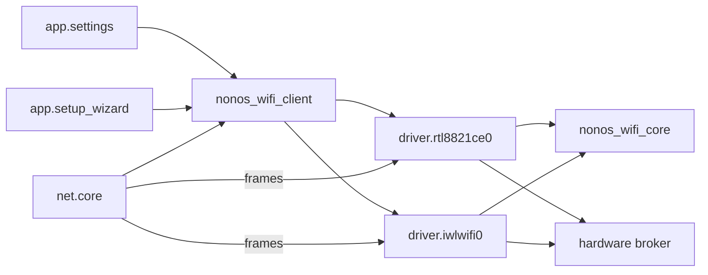

## How a scan and a join travel

The Settings Wi-Fi panel (`app.settings`), the first-boot setup wizard (`app.setup_wizard`) and `net.core` all reach a driver through one library, `nonos_wifi_client`. Its `find` asks for `driver.rtl8821ce0` first and `driver.iwlwifi0` second, so a machine with both cards keeps the RTL8821CE (`userland/nonos_wifi_client/src/driver/services.rs:27-35`, `SERVICES`).

The kernel holds both driver endpoints: only `net.core`, the three Settings windows and the setup wizard may send to them (`src/services/registry/held_table.rs:46-50`, `WIFI_STACK`). Read more under [held endpoint](../../../overview/glossary-hardware-broker.md#held-endpoint).

The kernel starts a Wi-Fi driver only when the boot PCI scan found its chip: `spawn_iwlwifi` for any Intel network controller of subclass 0x80, and `spawn_rtl8821ce` for 10ec:c821 (`src/userspace/init/spawn_plan/drivers_wifi.rs:33-62`). The family comes from `classify_network` (`src/hardware/inventory/classify_network.rs:19-28`).

The 802.11 frames, the WPA3 SAE exchange, the WPA2 four-way and group key handshakes, CCMP and the receive checks run in the shared crate `nonos_wifi_core`; each driver implements its `LinkPort` and `KeyStore` traits over its own rings (`userland/nonos_wifi_core/src/lib.rs:17-25`). IP, DHCP and DNS stay in `net.core`, which binds an up Wi-Fi link before any wired one (`userland/capsule_net_core/src/setup/candidates.rs:19-24`, `WIFI_NICS`).

## The control protocol

Every request starts with a 10-byte header: the tag `0x57494649`, an operation and a request id (`userland/nonos_wifi_client/src/driver/call.rs:18-26`, `WIFI_MAGIC`).

| Operation | Number | How long the client waits |
|---|---|---|
| connect | 1 | 30 s, `CONNECT_TIMEOUT_MS` (`userland/nonos_wifi_client/src/driver/connect.rs:24`) |
| disconnect | 2 | 2 s, `DISCONNECT_TIMEOUT_MS` (`userland/nonos_wifi_client/src/driver/link.rs:20`) |
| scan | 3 | 15 s, `SCAN_TIMEOUT_MS` (`userland/nonos_wifi_client/src/driver/scan.rs:18`) |
| status | 4 | 500 ms, `STATUS_TIMEOUT_MS` (`userland/nonos_wifi_client/src/driver/stage.rs:12`) |
| link | 5 | 500 ms, `LINK_TIMEOUT_MS` (`userland/nonos_wifi_client/src/driver/link.rs:19`) |

A join body is `[ssid_len][ssid][pass_len][pass][flags]`. Flag bit 0 says the network was saved as WPA3, so the driver joins it with SAE or not at all; bit 1 says it is hidden (`userland/nonos_wifi_client/src/join_wire.rs:47-48`, `FLAG_WPA3_ONLY`, `FLAG_HIDDEN`). The request buffer that carried the passphrase is wiped before the call returns (`userland/nonos_wifi_client/src/driver/call.rs:55`, `wipe`).

Both drivers answer a scan at once from the list their background scan keeps. That list holds at most 16 networks, drops a network not heard for 3 sweeps, and when full lets a newly heard network replace the one heard longest ago (`userland/nonos_wifi_core/src/scan_list.rs:25-37`, `MAX_RESULTS`, `MAX_AGE`).
