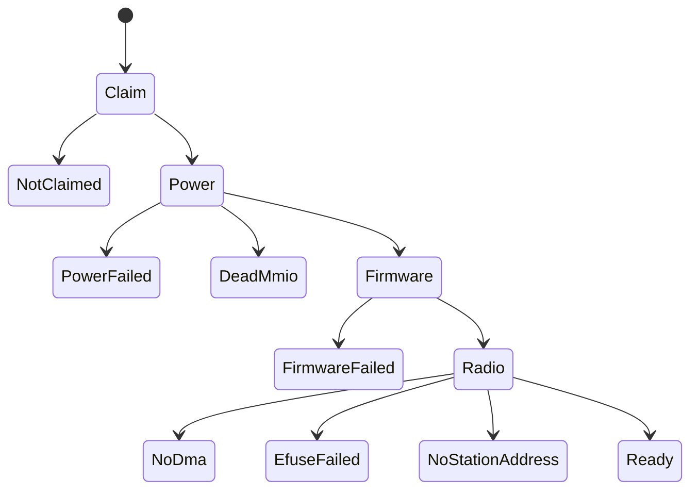

## Bring-up

The driver goes as far as it can and then serves whatever stage it reached, so the Settings panel can show why the radio is down. Claim, Power, Firmware and Radio are the four phases.

1. Claim: `start_driver` finds the chip, claims it and maps its registers (`userland/capsule_driver_rtl8821ce/src/main.rs:87-95`, `start_driver`). With no chip the capsule exits with `EXIT_ABSENT` (2). A refused claim is retried on the shared bring-up schedule in `nonos_libc`: 7 attempts, the sleep between them starting at 100 ms and doubling up to 3.2 s (`userland/libc/src/bringup/policy.rs:30-35`, `BRINGUP_ATTEMPTS`, `BRINGUP_MAX_DELAY_MS`). Running out leaves the driver serving `NotClaimed`.
2. Power: the power-on sequence runs and the chip is read back (`userland/capsule_driver_rtl8821ce/src/main.rs:96-106`, `probe`). Failure stops at `PowerFailed` or `DeadMmio`.
3. The PCIe link is held out of L1, which gates clocks inside the chip. A DBI read or write that never completes is named on the console (`userland/capsule_driver_rtl8821ce/src/start_board.rs`, `link_and_board`; `userland/capsule_driver_rtl8821ce/src/pcie/mod.rs`, `hold_link_awake`). The PCIe completion timeout is left on, unlike rtw88, so a completion that never comes ends in an error rather than a DMA engine waiting for good.
4. The efuse is read on the freshly powered MAC (`userland/capsule_driver_rtl8821ce/src/start_board.rs`, `link_and_board`; `userland/capsule_driver_rtl8821ce/src/efuse/info.rs`, `read`).
5. Firmware: the 8051 firmware is downloaded through reserved-page staging and DDMA (`userland/capsule_driver_rtl8821ce/src/main.rs:132-139`, `fwload::load`). Failure stops at `FirmwareFailed`.
6. The transmit and receive engines are enabled and the MAC table runs (`userland/capsule_driver_rtl8821ce/src/main.rs:140-152`, `init_trx_cfg`, `run_mac_table`). An engine that does not start also stops at `FirmwareFailed`.
7. Radio: `build_radio` maps the DMA rings, configures the PHY from the efuse and draws the station address (`userland/capsule_driver_rtl8821ce/src/serve/radio/up.rs`, `build_radio`). Failures stop at `NoDma`, at `EfuseFailed` for an efuse that still does not read or an RF front-end with no register table, or at `NoStationAddress` (`userland/capsule_driver_rtl8821ce/src/serve/radio/phy.rs`, `phy_setup`).

A bring-up that passes every phase ends at `Ready`. The stage numbers are listed in `Stage` (`userland/capsule_driver_rtl8821ce/src/serve/stage.rs:19-43`) and their panel texts on the [Wi-Fi overview](../overview/stages.md#bring-up-stages).

Every wait is by elapsed time, with rtw88's budget for the same step, and is asked once more at its deadline (`userland/capsule_driver_rtl8821ce/src/wait.rs`, `until_ms`). A download that does not finish leaves the 8051 halted, its clock off and the WL platform held in reset (`userland/capsule_driver_rtl8821ce/src/fw/prep/run.rs`, `abort`). A bring-up that stops short stops the chip's engines and then turns Bus Master off before it serves its stage, as does giving the chip back (`userland/capsule_driver_rtl8821ce/src/setup/master.rs`, `stopped`, `release`). Whether halting the 8051 also stops a wedged DDMA channel on silicon is not shown by the host tests.

The card is a Wi-Fi and Bluetooth combo. The driver hands the shared antenna to Wi-Fi and keeps the Bluetooth grant low; Bluetooth is not driven (`userland/capsule_driver_rtl8821ce/src/coex/wl_only.rs:17-34`, `take_antenna`).
