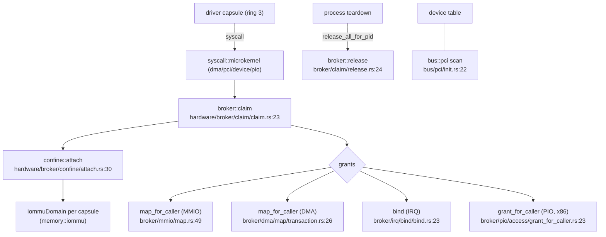

# hardware, bus and drivers: The broker is the gate; hardware

Part of [hardware, bus and drivers](hardware.md).

## The broker is the gate



A capsule claims a device by pid; the broker gives that capsule its own IOMMU domain and moves the device into it, out of the blocked state every function found at boot starts in. Each grant kind — MMIO window, DMA buffer, IRQ binding, port I/O — is a separate brokered call, each needing its own capability bit. When the process ends, teardown calls `release_all_for_pid` and the broker retires the device: bus mastering off, its BAR mappings revoked, the function reset, its DMA frames freed, then the domain detached (`retire` in `src/hardware/broker/claim/retire.rs`). The device table the broker works from is built from the `bus::pci` bus scan.

## hardware

```
src/hardware/
  broker/           the device-claim + grant engine
    claim/          claim, release, quiesce
    confine/        attach (per-capsule IOMMU domain), the confinement table, posture
    mmio/ dma/ irq/ pio/   the four grant kinds (pio is x86-only)
    pci/            the brokered PCI config-access gate
    class.rs, table/, windows.rs, power.rs
  inventory/        device scan + family classification
  block_device/     a block abstraction over ahci/nvme/virtio/usb-msc
  <device>_capsule/ one packager per driver (spawn + embed + state), e.g. nvme_capsule, xhci_capsule
```

| Item | Where | What it does |
|---|---|---|
| `claim` | `src/hardware/broker/claim/claim.rs:23` | A capsule claims a device by pid. |
| `release` / `release_all_for_pid` | `src/hardware/broker/claim/release.rs:24` / `:51` | Drop one claim, or all a pid holds. |
| `attach` | `src/hardware/broker/confine/attach.rs:30` | Give the capsule an `IommuDomain` and move the device into it (`:88-99`). |
| `map_for_caller` (MMIO) | `src/hardware/broker/mmio/map.rs:49` | Grant an MMIO window. |
| `map_for_caller` (DMA) | `src/hardware/broker/dma/map/transaction.rs:26` | Grant a DMA buffer. |
| `bind` (IRQ) | `src/hardware/broker/irq/bind/bind.rs:23` | Bind an interrupt (arch variants for GICv3/PLIC). |
| `grant_for_caller` (PIO) | `src/hardware/broker/pio/access/grant_for_caller.rs:23` | Grant x86 port I/O. |
| `read` (brokered PCI) | `src/hardware/broker/pci/read.rs:24` | A brokered PCI config read. |
| `classify_pci` | `src/hardware/broker/class.rs:57` | Classify a PCI device by class/subclass/prog-if. |
| `init_from_pci` | `src/hardware/broker/table/init.rs:28` | Build the device table from the bus scan. |
| `scan` | `src/hardware/inventory/scan.rs:24` | Scan and record present devices. |
