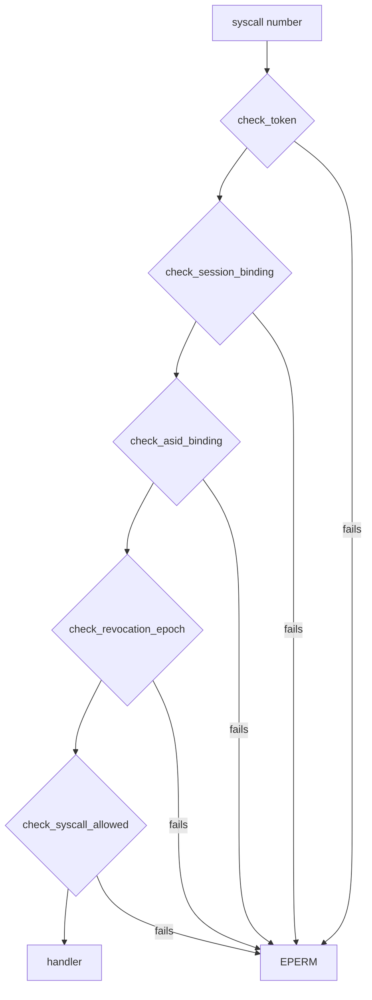

# Capabilities: The check on every NONOS system call

Part of [Capabilities](capabilities.md).

## The check on every NONOS system call

Every architecture's syscall entry hands each number the kernel knows to the
same `dispatch`, which runs `Capability::resolve` and returns `EPERM` when it
fails (`src/syscall/contract/dispatch.rs:25-40`). A number it does not know
never reaches `dispatch`: it gets `ENOSYS`, or on x86_64 goes to a Linux guest's
supervisor, as [System calls](syscalls.md) describes. A refusal is also passed
to the structured log as a `[CAP-DENY]` line with the pid and the call, from
`log_deny` (`src/syscall/contract/dispatch.rs:42-46`). No log manager is
installed in this release, so that line is dropped; see
[Logging](logging.md#the-structured-log-and-the-debug-ring).

`resolve` reads the calling process's token and builds the context from its
address space id, the boot session nonce and its revocation epoch
(`src/syscall/contract/capability.rs:35-46`). It then runs five checks, in the
order `resolve` lists them (`src/syscall/contract/resolver/resolve.rs:31-43`):

1. `check_token`: the signature verifies, the token has not expired, and its
   module id and nonce are not on the revocation list
   (`src/syscall/contract/resolver/check_token.rs:21-32`).
2. `check_session_binding`: the boot session nonce is set and equals the
   token's, compared in constant time
   (`src/syscall/contract/resolver/check_session.rs:23-32`).
3. `check_asid_binding`: the token names the address space the caller runs in
   (`src/syscall/contract/resolver/check_asid.rs:22-30`).
4. `check_revocation_epoch`: the token is not older than the process's
   revocation epoch (`src/syscall/contract/resolver/check_epoch.rs:22-30`).
5. `check_syscall_allowed`: the cap table admits this call for this token
   (`src/syscall/contract/resolver/check_syscall.rs:23-31`).

The cap table is total. `is_allowed` asks the crypto, admin, microkernel and
graphics tables in turn and refuses any call none of them claims
(`src/syscall/contract/cap_table/mod.rs:28-35`). Only `resolve` can build the
witness type `Capability` (`src/syscall/contract/capability.rs:23-32`), and
`dispatch` calls the handler only once it holds one; it does not pass the
witness on to the handler at this commit
(`src/syscall/contract/dispatch.rs:31-40`).

Some handlers check again. `sys_cap_grant` asks for `Admin` once more and for
every bit it hands on (`src/syscall/microkernel/capability/handlers.rs:42-47`).
`sys_pci_config_read` and `sys_pci_config_write` ask for `Driver` itself, so
`Admin` alone is refused there (`src/syscall/microkernel/pci/config.rs:27-34`).
