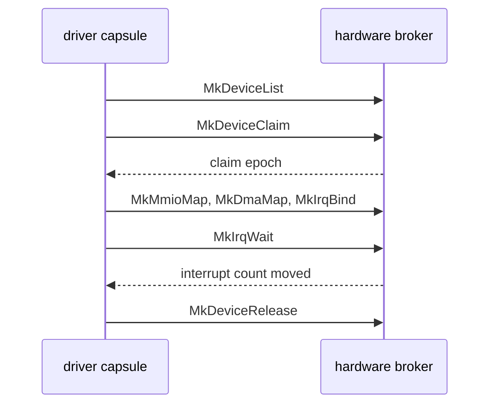

# The hardware broker

How a [driver capsule](../overview/glossary-dma-pool.md#driver-capsule) gets a device from the NONOS kernel: the device table, claims, register windows, DMA buffers, port I/O, PCI configuration, interrupts, and how all of it is taken back.

Drivers run in ring 3. The [hardware broker](../overview/glossary-hardware-broker.md#hardware-broker) is the ring 0 code under `src/hardware/broker` that hands a driver exactly the parts of a device it claimed, each as a [grant](../overview/glossary-dma-pool.md#grant) the kernel can revoke. The call layouts are on [Broker ABI](../abi/broker.md); a worked driver is on [Writing a driver](../drivers/writing-a-driver.md).

## Parts

- [The device table; claims](hardware-broker-table-claims.md)
- [MMIO windows; DMA buffers](hardware-broker-mmio-dma.md)
- [Port I/O; PCI configuration; interrupts](hardware-broker-pio-pci-irq.md)
- [Revocation; errors; tests](hardware-broker-revocation.md)

## DMA buffers

On [the MMIO and DMA page](hardware-broker-mmio-dma.md#dma-buffers).

## PCI configuration

On [the port, PCI and interrupt page](hardware-broker-pio-pci-irq.md#pci-configuration).

## Interrupts

On [the port, PCI and interrupt page](hardware-broker-pio-pci-irq.md#interrupts).

## Revocation

On [the revocation page](hardware-broker-revocation.md#revocation).

## See also

- [Broker ABI](../abi/broker.md): the request and result layouts.
- [Driver model](../drivers/README.md) and [Broker API](../drivers/broker-api.md): the broker from the driver's side.
- [IOMMU](iommu.md): when a device is confined to its capsule's domain.
- [PCI and ACPI](pci-and-acpi.md): where the device table comes from.
- [Capabilities](capabilities.md): `Driver`, `Mmio`, `Irq`, `Dma`, `Pio` and `DeviceEnum`.
