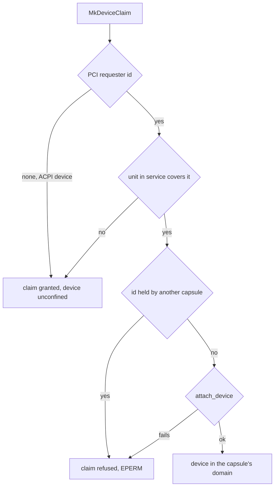

# IOMMU: Per capsule domains

Part of [IOMMU](iommu.md).

## Per capsule domains

The [hardware broker](hardware-broker.md) gives each driver capsule one domain,
which maps nothing until `MkDmaMap` grants the capsule a buffer
(`src/hardware/broker/confine/mod.rs:17-21`). `attach` runs inside
`MkDeviceClaim` and decides what the device can reach; when it refuses, the
claim fails with `EPERM`.

- If `translates` says no unit in service covers the device, the device stays on
  physical addresses, and the claim goes ahead with a serial line saying it
  reaches all memory (`src/hardware/broker/confine/attach.rs:34-48`).
  `translates` decides coverage: a unit must be enforcing and its scope must
  hold the device (`src/arch/x86_64/iommu/backend/device.rs:47-54`).
- If a unit does cover it, the device leaves the identity domain and
  `attach_device` puts it in the capsule's domain
  (`src/hardware/broker/confine/attach.rs:88-100`).
- If a unit in service would not take the device, the claim is refused rather
  than granted unconfined; `unconfined_allowed` lets a claim through only when
  no unit is in service at all (`src/hardware/broker/confine/posture.rs:30-50`).
- Drives behind one VMD share a requester id; one capsule may hold several of
  them, and a second capsule is refused the shared id with `Refused`
  (`src/hardware/broker/confine/attach.rs:72-82`).
- A device with no PCI requester id, such as a controller found through ACPI, is
  not confined at all: `pci_address` returns nothing for it and `attach` lets
  the claim through without a domain
  (`src/hardware/broker/confine/table.rs:35-43`). Its DMA grants carry physical
  addresses and are counted as unconfined.

A DMA [grant](../overview/glossary.md#grant) in a confined domain is mapped with
`IommuProtection::READ_WRITE` at an I/O virtual address from the capsule's own
range (`src/hardware/broker/confine/map.rs:22-50`). When the capsule releases
the device, `detach` puts it back to denied, not to the identity domain, and the
domain goes with the capsule's last device
(`src/hardware/broker/confine/detach.rs:21-46`).

## When remapping is not in service

Every call that claims to confine a device asks first whether a unit is
translating. `require` refuses with `NotInitialized` before bring-up has
succeeded, so the kernel never writes entries into tables no hardware walks, and
never hands a device an I/O virtual address it would take as physical
(`src/arch/x86_64/iommu/backend/enforced.rs:17-36`). On an AMD-Vi machine the
calls are refused with `AmdViNotDriven`, and with no IOMMU with `NoIommu`, each
with a serial line from `amd_vi` or `absent`
(`src/arch/x86_64/iommu/backend/refuse.rs:22-38`).

The device then reaches all of memory, and the kernel counts it instead of
hiding it. Each DMA grant made without a confining domain adds one to the count
through `note_unconfined`, and its release takes one off
(`src/memory/iommu/unconfined.rs:35-51`). The kernel's own virtio-rng entropy
driver counts its buffers the same way, with `note_unconfined`
(`src/drivers/virtio_rng/device/core.rs:44-45`).
