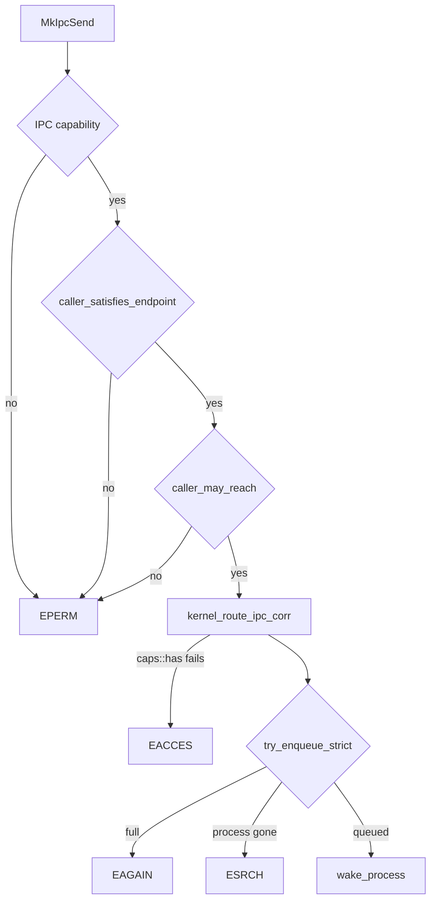

# IPC: who may send to whom

Part of [IPC](ipc.md).

## Who may send to whom

A send by name passes four gates, in this order.

1. The syscall contract checks the caller's [capability token](../overview/glossary-boot-root-record.md#capability-token) for `IPC`; a refusal is `EPERM`. [Capabilities](capabilities.md) describes that check.
2. `caller_satisfies_endpoint` finds the endpoint by name or port and refuses an unknown endpoint, an endpoint whose requirement is zero, and a caller that lacks any required bit (`src/syscall/microkernel/ipc/send_caps.rs`, `fn caller_satisfies_endpoint`).
3. `caller_may_reach` applies two lists that capabilities cannot express: the [held endpoints](../overview/glossary-hardware-broker.md#held-endpoint) and the [peer list](../overview/glossary-peer-list.md#peer-list) (`src/services/registry/peers_check.rs`, `fn caller_may_reach`).
4. `kernel_route_ipc_corr` looks the endpoint up again and tests the caller's bits with `caps::has`, answering `EACCES` when they fall short (`src/ipc/kernel_ipc.rs`, `fn kernel_route_ipc_corr`), then queues with `try_enqueue_strict` and wakes the receiving process with `wake_process` (`src/ipc/kernel_ipc.rs`, `fn kernel_route_ipc_corr`).

A send to the sender's own reply endpoint is a reply and does not go through the router: `redirect_reply` hands it to the caller waiting in `MkIpcCall`, or leaves it in that reply inbox for the kernel when no call is pending (`src/syscall/microkernel/ipc/send_redirect.rs`, `fn redirect_reply`).

What an endpoint requires is set when it is registered. A capsule's service endpoint is registered at spawn with `required_caps(name, IPC)` (`src/kernel_core/process_spawn/capsule_spawn/runner/install/install.rs`, `fn finish`), and `required_caps` adds `Network` for the 11 names in `NETWORK_SERVICES`, from `net.core` to `net.socks5` (`src/services/registry/policy.rs`, `const NETWORK_SERVICES`). A capsule's reply endpoint is created unowned before its pid exists, then claimed by `adopt_endpoint` with an `IPC` requirement (`src/kernel_core/process_spawn/capsule_spawn/runner/install/install.rs`, `fn finish`); only an endpoint still owned by pid 0 can be adopted (`src/services/registry/adopt.rs`, `fn adopt_endpoint`).

The held endpoints are driver endpoints that only named services may reach, listed in `HELD` (`src/services/registry/held_table.rs`, `const HELD`). The wired network drivers take messages only from `net.core` and `net.l2`; the Wi-Fi drivers from `net.core`, the Settings windows and the setup wizard; `driver.xhci0` from the USB HID and storage drivers; `driver.i2c_pci0` from the I2C-HID driver; `driver.virtio_gpu0` from `compositor`; and `driver.hda0` from `audio.server`. The keyboard, pointer, USB storage and random source drivers are `KERNEL_ONLY`: no capsule may send to them, because the kernel drives them itself (`src/services/registry/held_table.rs`, `const KERNEL_ONLY`). A caller counts as named when it owns the endpoint of that name, which `endpoint_admits` checks (`src/services/registry/held.rs`, `fn endpoint_admits`).

The peer list holds a capsule to the endpoints named for it and nothing else. In this release it has one entry, in `PEERS`: `shield_prover` may send only to `shield.core` (`src/services/registry/peers.rs`, `const PEERS`). A capsule not on the list is not limited by it.

`MkIpcSendToPid` writes into the inbox every endpoint of the destination is read from, so `caller_satisfies_inbox` makes the caller pass the gate of each endpoint the destination serves (`src/syscall/microkernel/ipc/send_caps.rs`, `fn caller_satisfies_inbox`). `sys_ipc_send_to_pid` applies the peer list through `caller_may_reach_pid` before that (`src/syscall/microkernel/ipc/send_to_pid.rs`, `fn sys_ipc_send_to_pid`).

Receiving is narrower. `resolve_for_recv` maps endpoint 0 to the caller's own `proc.<pid>`, accepts another endpoint only when the caller owns it, and answers `EACCES` otherwise (`src/syscall/microkernel/ipc/inbox_name.rs`, `fn resolve_for_recv`).

Registering a name at run time is refused for any name starting `proc.` or `endpoint.`, for the reserved core services and for ports 4098 to 4107, in `allowed` (`src/syscall/microkernel/ipc/register_allowed.rs`, `fn allowed`). The reserved names are `keyring`, `entropy_pool`, `crypto_pool`, `vfs_pool` and `market.index`, in `RESERVED_NAMES` (`src/services/registry/reserved.rs`, `const RESERVED_NAMES`). A name the caller does not already hold on that port must be one of the five network services in `RUNTIME_REGISTRABLE` (`src/services/registry/reserved.rs`, `const RUNTIME_REGISTRABLE`), and `caller_has_register_right` asks for `RegisterService` or `Admin` (`src/services/registry/auth/caller_has_register_right.rs`, `fn caller_has_register_right`).
