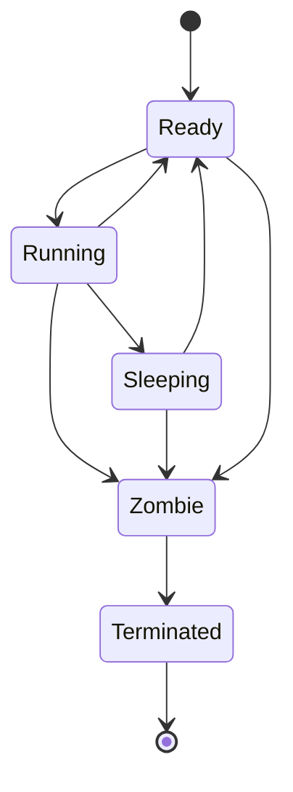

# Processes and capsule spawn: exit and reaping

Part of [Processes and capsule spawn](processes-and-spawn.md).

## Exit and reaping

A process ends in one of three ways, all through `exit_and_yield` or `teardown`: it calls `MkExit` (`src/syscall/microkernel/process.rs`, `fn sys_exit`), a fault in ring 3 or a signal kills it (`src/process/exit/exit_and_yield.rs`, `fn exit_and_yield`), or another process ends it with `MkKill`.

`teardown` runs at once (`src/process/exit/teardown.rs`, `fn teardown`):

- When the thread whose exit frees the process's tables ends, it releases the surfaces the thread group holds (surfaces, like device claims, belong to the group, so a worker thread's exit leaves them); then every MMIO, IRQ, DMA and PIO grant it holds in the [hardware broker](hardware-broker.md), in `release_all_for_pid` and its neighbours (`src/process/exit/teardown.rs`, `fn teardown`). The MMIO release also drops the process's device claims, which stops each device mastering the bus before its DMA buffers are freed; [Hardware broker](hardware-broker.md#revocation) gives the order.
- It drops the calls the process made and the replies it owed, with `release_pending_replies_for_pid` (`src/process/exit/teardown.rs`, `fn teardown`).
- It marks the process `Zombie` and releases its names, its endpoints and its reply inbox, with `release_names` (`src/process/exit/teardown.rs`, `fn teardown`), so a relaunch does not collide with the dead process's names.
- It records the exit code for the parent with `reap_log::record` and queues the process for finalization (`src/process/exit/teardown.rs`, `fn teardown`).

`finalize_teardown` runs later, from a timer tick, once `drain` finds no CPU still using the process's page tables (`src/process/exit/pending.rs`, `fn drain`). It frees the address space, drops the [inboxes](../overview/glossary-hardware-broker.md#inbox) or keeps the output inbox for the parent, reparents orphans with `reparent_orphans` and removes the process row (`src/process/exit/finalize.rs`, `fn finalize_teardown`). Removing the row sets the state to `Terminated` first, in `terminate_process` (`src/process/core/table/ops.rs`, `fn terminate_process`).

`MkWait(pid, timeout_ms)` is for the parent only. `sys_wait` returns the child's exit code, `ECHILD` for a pid that is not the caller's child, or `ETIMEDOUT` when the deadline passes; it checks every `SLICE_MS`, 5 ms, and a `timeout_ms` of 0 checks once and returns (`src/syscall/microkernel/wait.rs`, `fn sys_wait`). After the row is gone the code is read from the reap log, which keeps 64 entries and drops the lowest pid first, as `record` does (`src/process/exit/reap_log.rs`, `fn record`).

`MkKill(pid, sig)` accepts only `SIGINT`, `SIGTERM` and `SIGKILL`. `sys_kill` lets a parent end its child, a supervisor end its guest, and a holder of `ProcessControl` or `Admin` end anything, and gives the exit code 128 plus the signal (`src/syscall/microkernel/kill.rs`, `fn sys_kill`). The signal numbers are 2, 15 and 9: `SIGINT` (`src/process/signal/constants.rs`, `const SIGINT`), `SIGTERM` (`src/process/signal/constants.rs`, `const SIGTERM`) and `SIGKILL` (`src/process/signal/constants.rs`, `const SIGKILL`).

A capsule whose name starts with `driver.` and that exits on its own with a status other than 0 gets a serial line from the kernel, as `told` decides: status 2 is read as no device present and 6 as a device that never came up, in `words` (`src/process/exit/end_rule.rs`, `fn words`).
