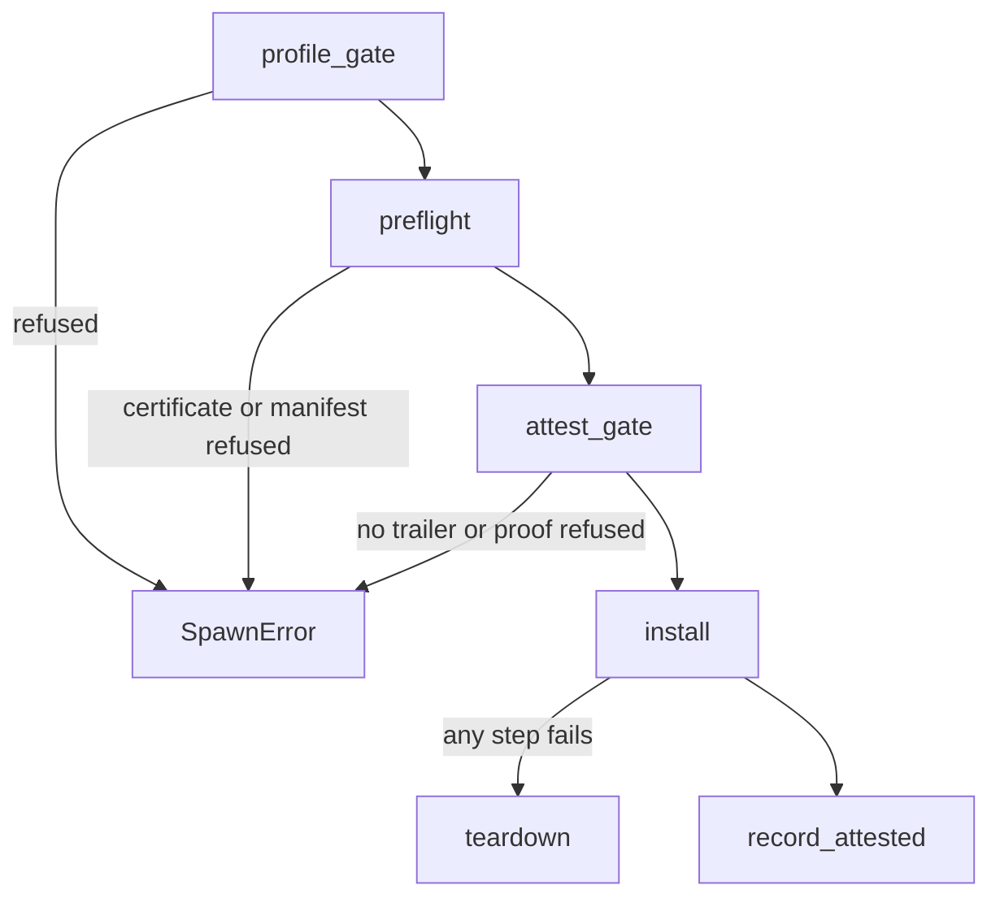

# Processes and capsule spawn: the spawn gate

Part of [Processes and capsule spawn](processes-and-spawn.md).

## The spawn gate

Every verified capsule, built in or installed, goes through the [spawn gate](../overview/glossary-rollback-index.md#spawn-gate), `spawn_verified_as`, and any refusal comes back as a `SpawnError` (`src/kernel_core/process_spawn/capsule_spawn/runner/verified.rs`, `fn spawn_verified_as`).

1. The [boot profile](../overview/glossary-amnesic-boot.md#boot-profile) may refuse the capsule by name; `check` in `profile_gate` prints a `[PROFILE]` line and returns `ProfileRefused` (`src/kernel_core/process_spawn/capsule_spawn/runner/profile_gate.rs`, `fn check`).
2. `run` in `preflight` decodes the identity certificate with `decode_id_cert` and checks it against the baked [trust anchor](../overview/glossary-stark-proof.md#trust-anchor) with `verify_id_cert` (`src/kernel_core/process_spawn/capsule_spawn/runner/preflight.rs`, `fn run`).
3. `verify_with_publisher` checks the manifest and its [publisher](../overview/glossary-peer-list.md#publisher) signature against the ELF, the target triple, the requested capabilities and the two declared endpoints, and returns the capabilities to install (`src/kernel_core/process_spawn/capsule_spawn/runner/preflight.rs`, `fn run`). The manifest may not ask for any bit above the [capability ceiling](../overview/glossary-boot-root-record.md#capability-ceiling), `allowed_caps_ceiling`, of the identity certificate, which `check_ceiling` enforces (`src/security/capsule_manifest/verify/caps.rs`, `fn check_ceiling`). The spawn site does not choose the word: its `requested_caps` only picks which optional bits come along (`src/kernel_core/process_spawn/capsule_spawn/runner/verified.rs`, `fn spawn_verified`), and [Capabilities](capabilities-granting-and-revoking.md#granting-and-revoking) gives the rule.
4. `classify` puts a capsule in the `systems.nonos` namespace in the `Enrolled` tier and any other in the `Publisher` tier (`src/kernel_core/process_spawn/capsule_spawn/runner/tier.rs`, `fn classify`). Both tiers end in the same `attest_gate` (`src/kernel_core/process_spawn/capsule_spawn/runner/publisher_gate.rs`, `fn publisher_gate`), which `run` calls with the manifest's `required_caps` (`src/kernel_core/process_spawn/capsule_spawn/runner/preflight.rs`, `fn run`).
5. `attest_gate` refuses a capsule with no trailer and otherwise calls `verify_capsule_attestation`, printing a `[ZK-ATTEST]` line either way (`src/kernel_core/process_spawn/capsule_spawn/runner/attest_gate.rs`, `fn attest_gate`).
6. `install` creates the process (below).
7. `record_attested` enters the pid, the proved measurement, the [capability word](../overview/glossary-boot-root-record.md#capability-word) and the authority that vouched in the attestation registry (`src/kernel_core/process_spawn/capsule_spawn/runner/verified.rs`, `fn spawn_verified_as`).

What the attestation check does, from the kernel side: `measure` takes the BLAKE3 digest of the ELF (`src/security/capsule_attest/measure.rs`, `fn measure`), and `verify_capsule_attestation` tries the vendor's [policy root](../overview/glossary-peer-list.md#policy-root) first and then each root a person enrolled on the machine (`src/security/capsule_attest/verify.rs`, `fn verify_capsule_attestation`). Against a root, `verify_against` builds the leaf from that digest, the capability word it is given and the policy epoch, folds the trailer's path to the kernel's own root, and checks the STARK proof over the same statement (`src/security/capsule_attest/path.rs`, `fn verify_against`). The word it is given is the manifest's required capabilities; the optional bits a spawn site adds are bounded by the signed manifest and the certificate ceiling, not by the proof. A capsule whose bytes or required capabilities differ from what was proved is refused. Against an enrolled root, a trailer that starts with the `local_build` magic, for a capsule this machine built itself, carries a keyed tag only this kernel can mint or check, and `local_build::verify` checks that tag instead of a STARK proof (`src/security/capsule_attest/against_root.rs`, `fn enrolled`). The proof system itself is on [STARK attestation](../security/stark-attestation.md), and signatures on [Signing and publisher keys](../userland/signing-and-publisher-keys.md).

A [development image](../overview/glossary-claim-epoch.md#development-image) may admit capsules on the path alone with `nonos-dev-attest`; `compile_error` refuses that feature together with `nonos-release` (`src/lib.rs`, `compile_error!`).
