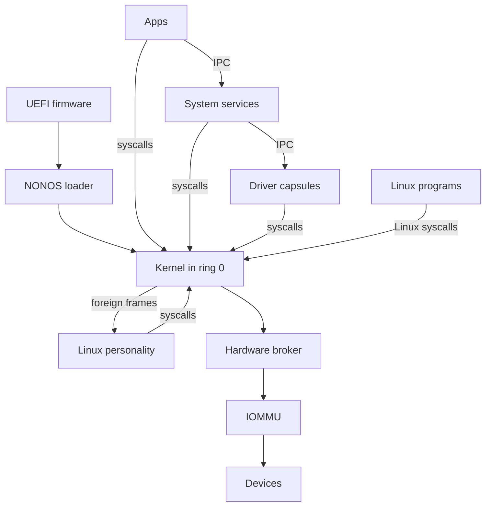

# Architecture: The system in one diagram

Part of [Architecture](architecture.md).

## The system in one diagram

Read it from the top. UEFI firmware starts the NONOS loader, which starts the
kernel after the checks its boot menu names. Apps, System services, [Driver
capsules](glossary-dma-pool.md#driver-capsule) and the [Linux
personality](glossary-linux-personality.md#linux-personality) are [capsules](glossary-boot-root-record.md#capsule)
in ring 3: they reach the kernel only through syscalls, and each other only
through IPC. Linux programs make Linux syscalls, which the kernel does not
answer itself: it parks each one as a foreign frame for the Linux personality.
Driver capsules reach Devices only through the [Hardware
broker](glossary-hardware-broker.md#hardware-broker), and on Intel VT-d machines the
[IOMMU](glossary-hardware-broker.md#iommu) confines device DMA: each PCI device a driver claims
reaches only the buffers granted to that driver.

## UEFI firmware and the NONOS loader

The loader in `nonos-bootloader/` is a UEFI application. Its menu has seven
entries: Standard, Hardened, Safe Mode, Air-Gapped, Recovery, `Install NØNOS`
and Shut down (`ENTRIES` in `nonos-bootloader/src/bootmenu/entries.rs:33-56`).
Under every entry that boots, the menu names what the loader checks before the
kernel runs: Ed25519, ML-DSA-65, STARK, rollback and RNG, with [Secure
Boot](glossary-rollback-index.md#secure-boot) and [TPM](glossary-stark-proof.md#tpm) 2.0 added under
Hardened (`STD` in `nonos-bootloader/src/bootmenu/entries.rs:40-59`). The code
that runs those checks is the loader's verification module, which these pages do
not describe; the security pages say what the loader does with its verdict. The
loader then hands the kernel a boot record (`BootHandoffV1` in
`src/boot/handoff/types/handoff.rs:28`). Before init, the kernel checks the
loader in turn against the signed [boot-root
record](glossary-boot-root-record.md#boot-root-record), and starts no program when that check
fails (`check_bootloader` in
`src/kernel_core/init/entry/microkernel_main.rs:24-27`). [Boot chain and
signatures](../security/boot-chain-and-signatures.md), [Rollback
protection](../security/rollback-protection.md) and [Measured boot and the
TPM](../security/measured-boot-and-tpm.md) cover the checks, [Boot
handoff](../kernel/boot-handoff.md) covers the record, and [Boot
modes](../install/boot-modes.md) covers the menu.
