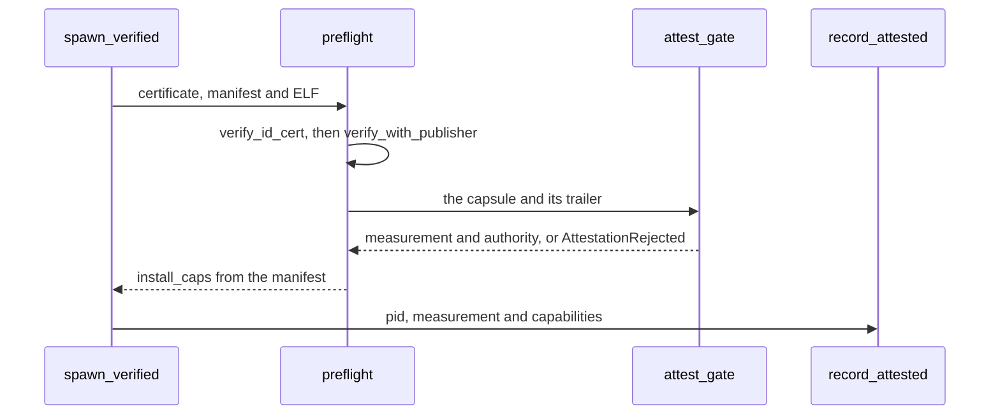

# Design principles: Everything that runs is signed and measured

Part of [Design principles](design-principles.md).

## Everything that runs is signed and measured

A capsule runs only after `spawn_verified` has passed it through `preflight`.
Before that, the profile gate refuses a capsule the boot's menu entry rules out,
such as a network driver on an Air-Gapped boot (`check` in
`src/kernel_core/process_spawn/capsule_spawn/runner/profile_gate.rs:17-31`).

1. `verify_id_cert` checks the capsule's [NONOS ID
   certificate](glossary-linux-personality.md#nonos-id-certificate) against the [trust
   anchor](glossary-stark-proof.md#trust-anchor) under `NONOS_PRODUCTION_POLICY`, which
   requires both Ed25519 and ML-DSA-65
   (`src/security/nonos_id_cert/policy.rs:30-32`).
2. `verify_with_publisher` checks the manifest and the ELF image under the same
   policy and returns `install_caps`, the capabilities to install
   (`src/kernel_core/process_spawn/capsule_spawn/runner/preflight.rs:55-67`).
3. The capsule and its trailer then pass `attest_gate`: an empty [attestation
   trailer](glossary-amnesic-boot.md#attestation-trailer), or one whose proof does not
   verify, ends the spawn with `AttestationRejected`
   (`src/kernel_core/process_spawn/capsule_spawn/runner/attest_gate.rs:23-34`).
   A capsule in the `systems.nonos` namespace goes straight to it; any other is
   in the publisher tier and reaches the same gate through `publisher_gate`
   (`src/kernel_core/process_spawn/capsule_spawn/runner/preflight.rs:72-77`,
   `src/kernel_core/process_spawn/capsule_spawn/runner/publisher_gate.rs:20-33`).
4. Once a pid exists, `record_attested` writes the capsule's measurement and
   capabilities into the attestation registry
   (`src/security/attest_registry/record.rs:31`). The measurement is the BLAKE3
   digest of the ELF (`measure` in
   `src/security/capsule_attest/measure.rs:17-26`).

The [Linux personality](glossary-linux-personality.md#linux-personality) holds Linux programs to
the same rule. A program read from the store runs only if the trailer kept
beside it verifies, and an exec of one that does not gets EPERM (`resolve` in
`userland/capsule_linux/src/linux/call/spawn/exec_resolve.rs:40-60`). The
built-in BusyBox is part of the personality's own measured image.

The kernel image comes before any of this. The loader's menu names Ed25519,
ML-DSA-65, STARK, rollback and RNG as the checks for every entry that boots
(`STD` in `nonos-bootloader/src/bootmenu/entries.rs:58-59`), and [Boot chain and
signatures](../security/boot-chain-and-signatures.md) covers the loader's side.
The loader itself carries no NONOS signature: it is signed only for [Secure
Boot](glossary-rollback-index.md#secure-boot), when the [seal](glossary-rollback-index.md#seal) holds a db
key. It is held to its own [STARK proof](glossary-stark-proof.md#stark-proof) slot instead,
which the kernel checks under the signed [boot-root
record](glossary-boot-root-record.md#boot-root-record) before any program starts
(`check_bootloader` in `src/kernel_core/init/entry/microkernel_main.rs:24-27`).

The limit: a `dev` image admits capsules on their path alone, without the STARK
proof, and the seal refuses it for release (`tools/nix/config.nix:102-109`). Its
loader is built with `dev-attest`, which the comment above it describes as
taking the kernel's path-only trailer the same way, and with `dev-mode`, which
boots an unsigned kernel when F12 is held and Secure Boot is off (`dev-qemu` in
`nonos-bootloader/Cargo.toml:68-72`).
