# Diagrams

Every figure here is drawn from the code and the pages named under it. Figures that show something designed and
not built say so in the drawing, with a dashed outline.

## The system

*Figure 1. The kernel in ring 0 and everything else in ring 3. Sources: [`docs/overview/architecture.md`](architecture.md).*

*Figure 2. What a program can reach. Sources: [`docs/using/linux-box.md`](../using/linux-box.md), [`docs/using/marketplace.md`](../using/marketplace.md).*

## Starting up

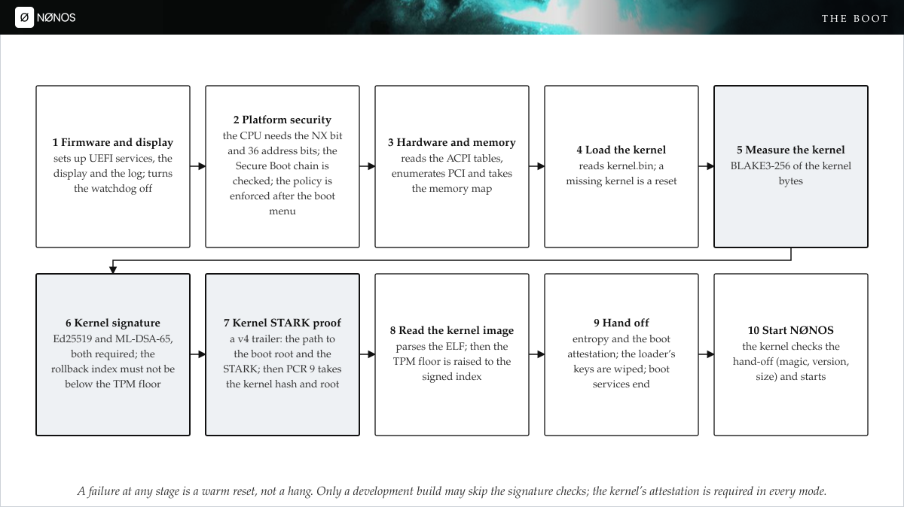

*Figure 3. The boot, stage by stage. Sources: [`nonos-bootloader/src/entry/pipeline.rs`](../../nonos-bootloader/src/entry/pipeline.rs), [`nonos-bootloader/src/display/boot/steps.rs`](../../nonos-bootloader/src/display/boot/steps.rs).*

*Figure 4. The boot chain and the TPM registers each stage uses. Sources: [`docs/security/boot-chain-and-signatures.md`](../security/boot-chain-and-signatures.md), [`docs/security/measured-boot-and-tpm.md`](../security/measured-boot-and-tpm.md).*

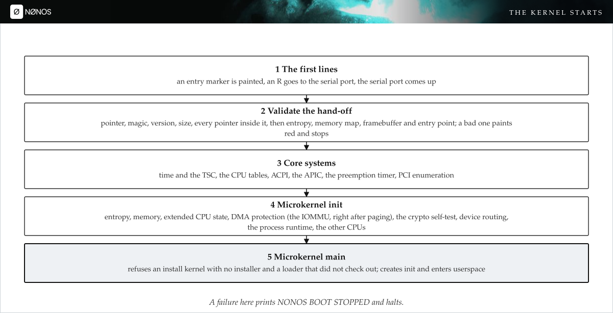

*Figure 5. From the hand-off to the first process. Sources: [`src/nonos_main.rs`](../../src/nonos_main.rs), [`src/kernel_core/init/entry/microkernel_init.rs`](../../src/kernel_core/init/entry/microkernel_init.rs).*

## Trust and rights

*Figure 6. Who proves and who verifies. Sources: [`docs/security/stark-attestation.md`](../security/stark-attestation.md).*

*Figure 7. Capsule admission. Sources: [`docs/security/stark-attestation.md`](../security/stark-attestation.md).*

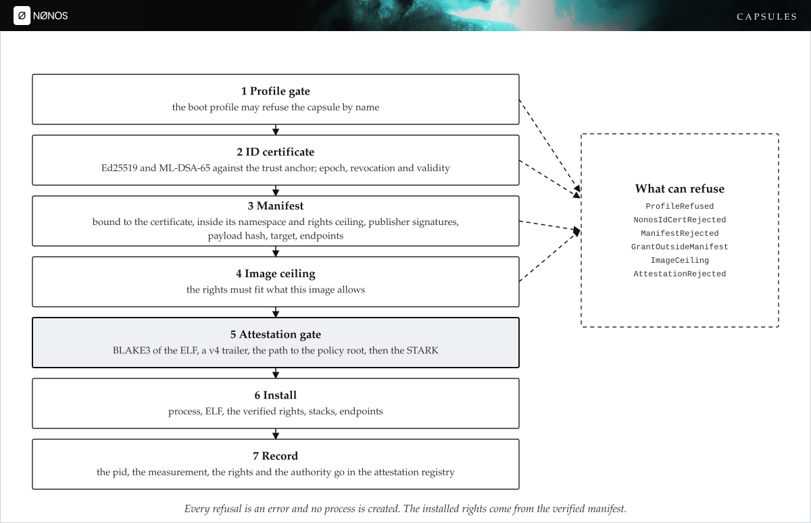

*Figure 8. The spawn path, check by check. Sources: [`docs/kernel/processes-and-spawn-gate.md`](../kernel/processes-and-spawn-gate.md), [`src/kernel_core/process_spawn/capsule_spawn/runner/preflight.rs`](../../src/kernel_core/process_spawn/capsule_spawn/runner/preflight.rs).*

*Figure 9. The capability check on every system call. Sources: [`docs/kernel/syscalls.md`](../kernel/syscalls.md), [`docs/kernel/capabilities.md`](../kernel/capabilities.md).*

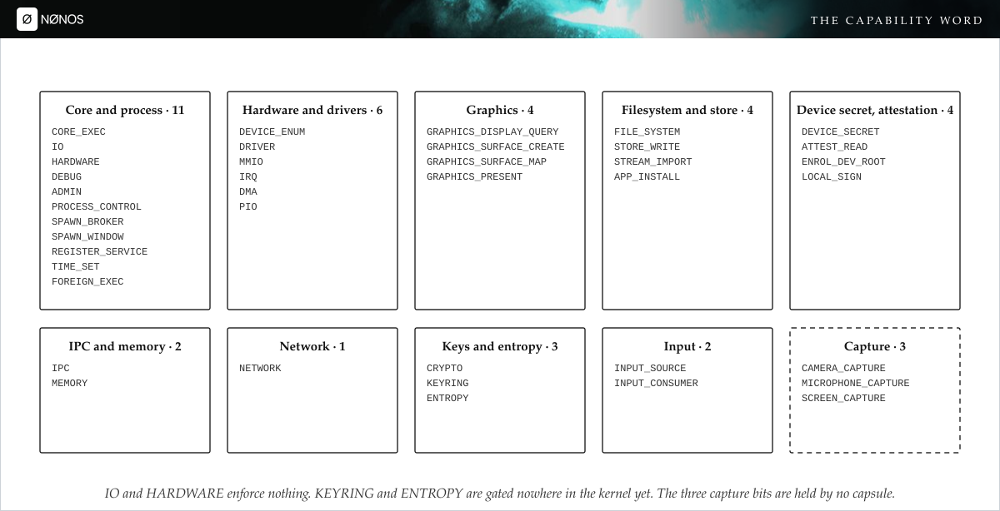

*Figure 10. The forty capability bits. Sources: [`abi/caps.toml`](../../abi/caps.toml), [`docs/abi/capabilities-what-a-capability.md`](../abi/capabilities-what-a-capability.md).*

*Figure 11. IPC between capsules: the gates on a send. Sources: [`docs/kernel/ipc.md`](../kernel/ipc.md).*

## Hardware

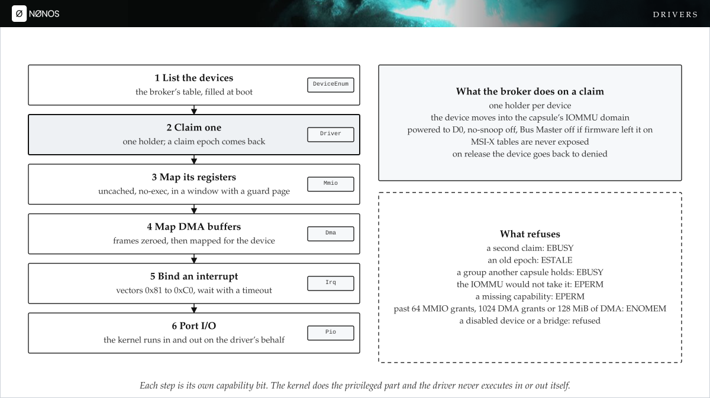

*Figure 12. How a driver capsule gets at its device. Sources: [`docs/kernel/hardware-broker.md`](../kernel/hardware-broker.md), [`docs/kernel/hardware-broker-mmio-dma.md`](../kernel/hardware-broker-mmio-dma.md).*

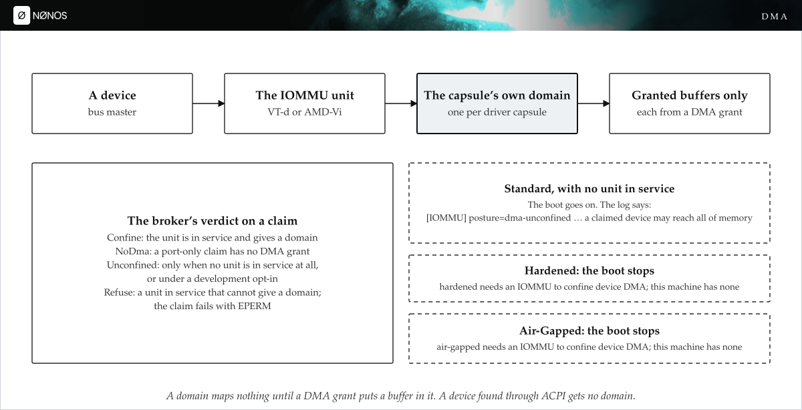

*Figure 13. Where a driver's DMA can go. Sources: [`docs/kernel/iommu-per-capsule-domains.md`](../kernel/iommu-per-capsule-domains.md), [`docs/release/0.9.3-security-limits.md`](../release/0.9.3-security-limits.md).*

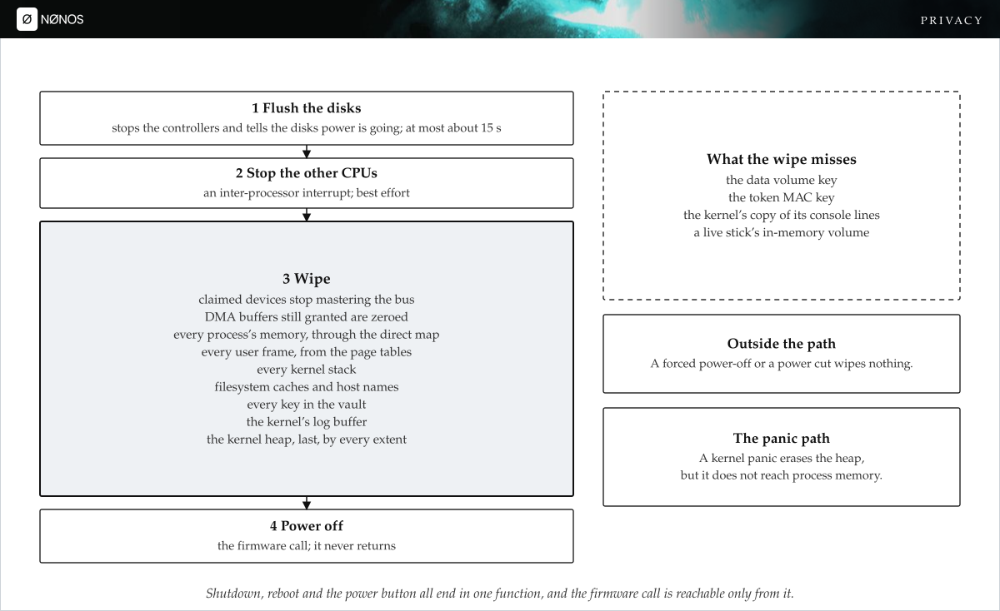

*Figure 14. The one way the machine powers off. Sources: [`docs/security/device-secrets-and-keys.md`](../security/device-secrets-and-keys.md), [`src/security/zerostate/terminate.rs`](../../src/security/zerostate/terminate.rs).*

## Network and keys

*Figure 15. How a program's traffic leaves the machine. Sources: [`docs/security/anonymity-transports.md`](../security/anonymity-transports.md), [`docs/using/privacy-network.md`](../using/privacy-network.md).*

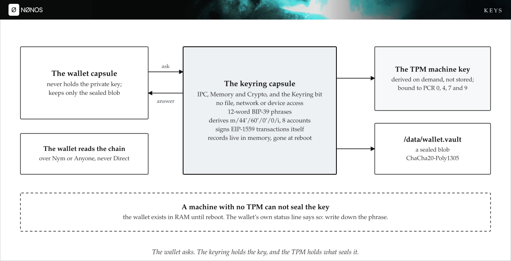

*Figure 16. Who holds the wallet's keys. Sources: [`userland/capsule_keyring/README.md`](../../userland/capsule_keyring/README.md), [`docs/security/device-secrets-and-keys.md`](../security/device-secrets-and-keys.md).*

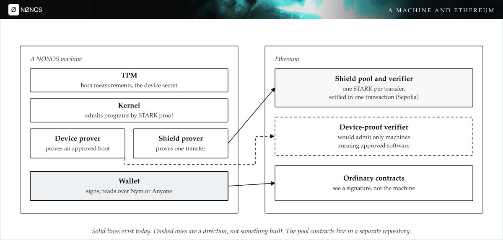

*Figure 17. A machine and Ethereum. Sources: [`docs/security/stark-attestation.md`](../security/stark-attestation.md), [`abi/NOX_CONTRACTS.md`](../../abi/NOX_CONTRACTS.md).*

## Linux programs and the Marketplace

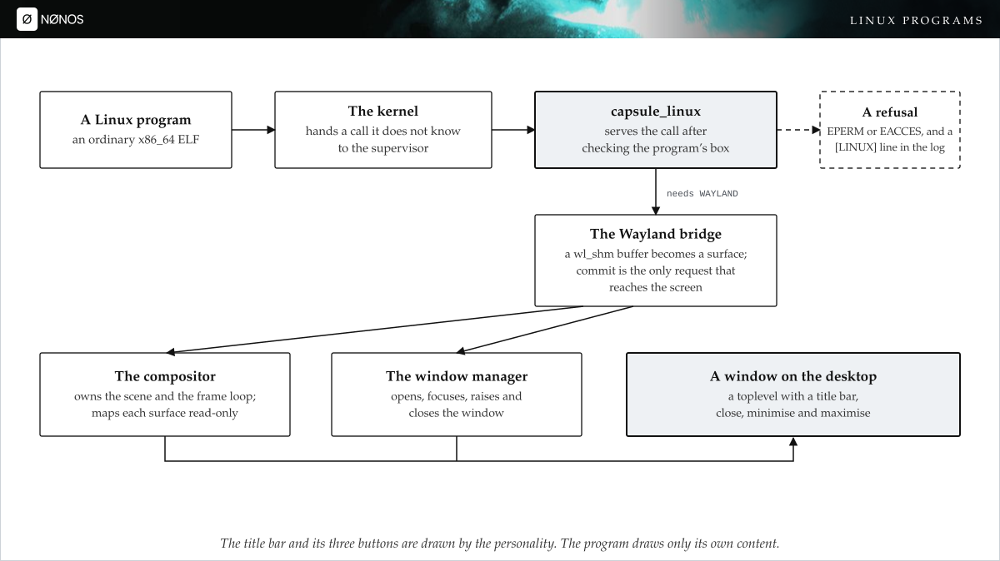

*Figure 18. From a system call to a window. Sources: [`docs/userland/linux-personality.md`](../userland/linux-personality.md), [`userland/compositor/README.md`](../../userland/compositor/README.md).*

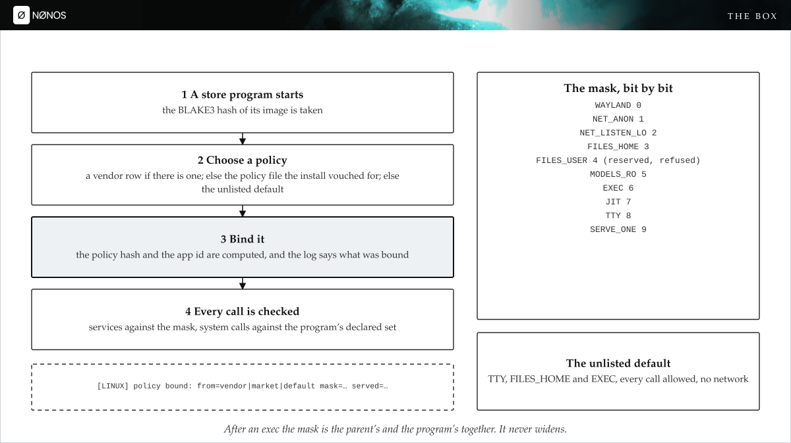

*Figure 19. How a program's box is bound at launch. Sources: [`userland/nonos_linux_policy/README.md`](../../userland/nonos_linux_policy/README.md), [`userland/capsule_linux/src/linux/app/bind.rs`](../../userland/capsule_linux/src/linux/app/bind.rs).*

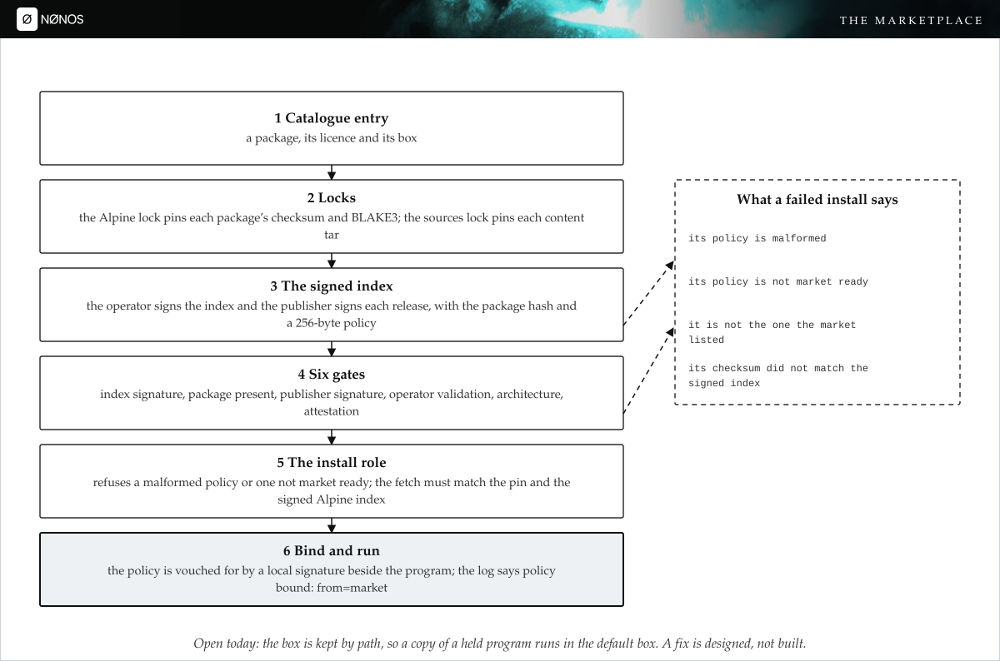

*Figure 20. How a listing becomes a running program. Sources: [`docs/using/marketplace.md`](../using/marketplace.md), [`docs/userland/marketplace-catalogue.md`](../userland/marketplace-catalogue.md).*

*Figure 21. From a Marketplace listing to a window. Sources: [`docs/using/marketplace.md`](../using/marketplace.md), [`docs/release/0.9.3-what-is-new.md`](../release/0.9.3-what-is-new.md).*

## Building and installing

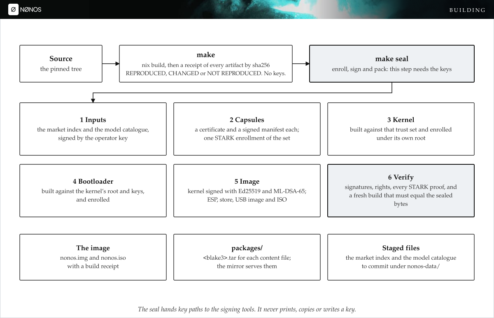

*Figure 22. From source to a sealed image. Sources: [`docs/build/seal.md`](../build/seal.md), [`docs/build/reproducible-builds.md`](../build/reproducible-builds.md).*

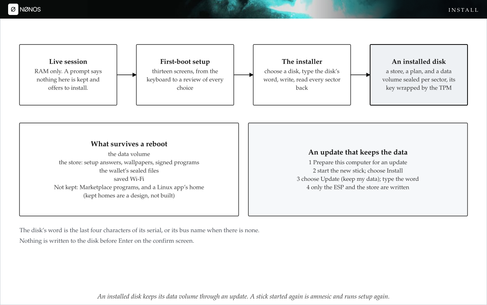

*Figure 23. From a live session to an installed disk. Sources: [`docs/install/first-boot.md`](../install/first-boot.md), [`docs/install/install-to-disk.md`](../install/install-to-disk.md), [`docs/install/update.md`](../install/update.md).*
