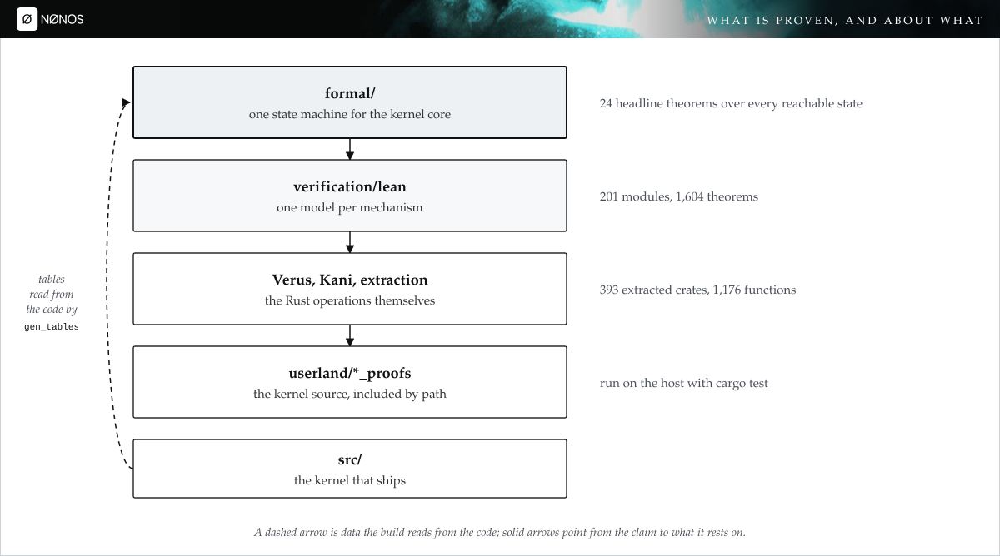
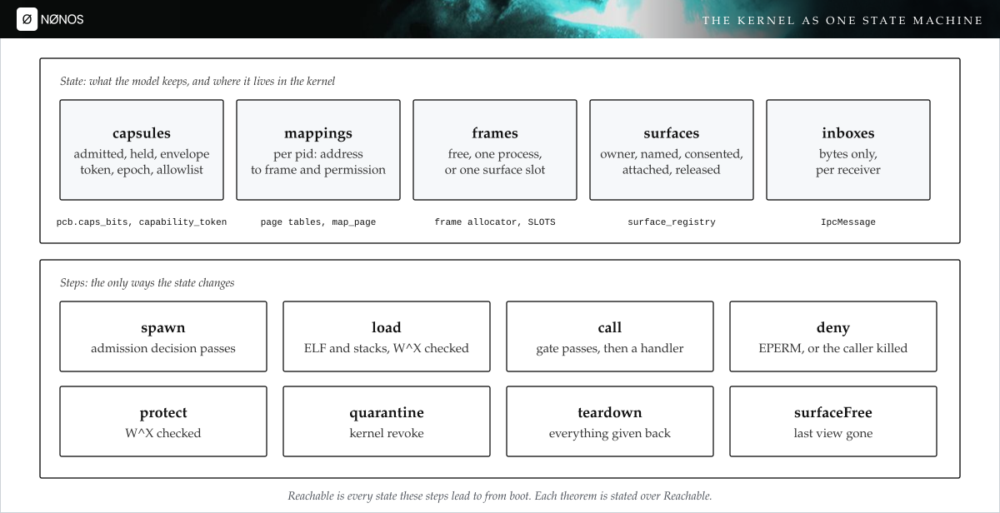
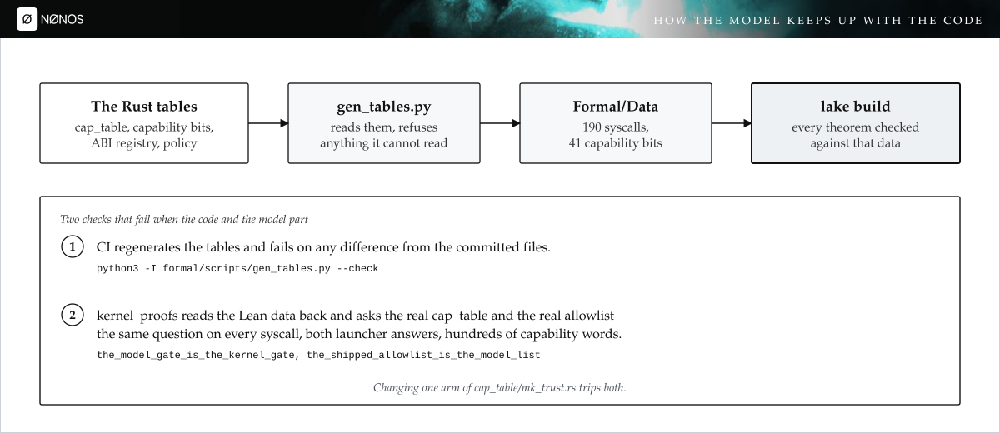
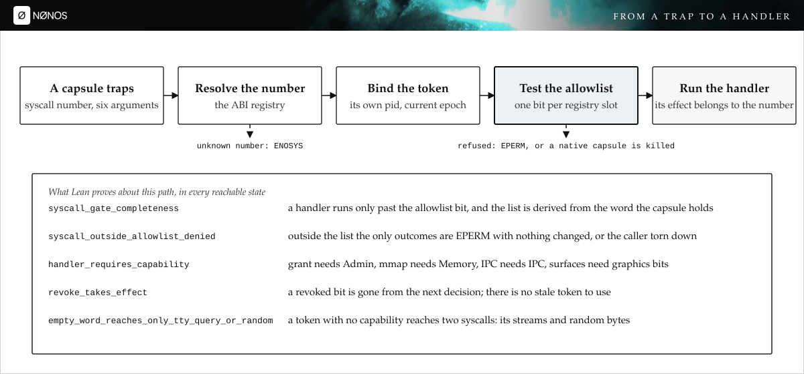
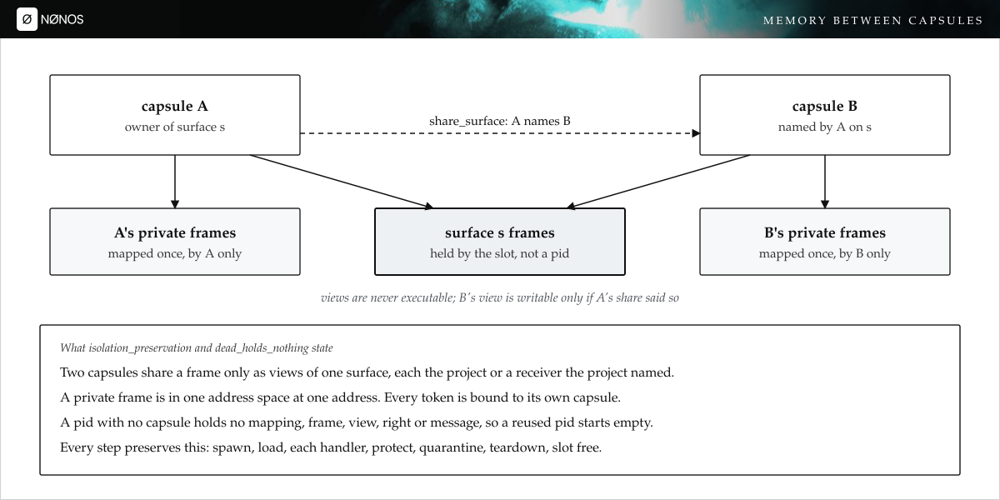
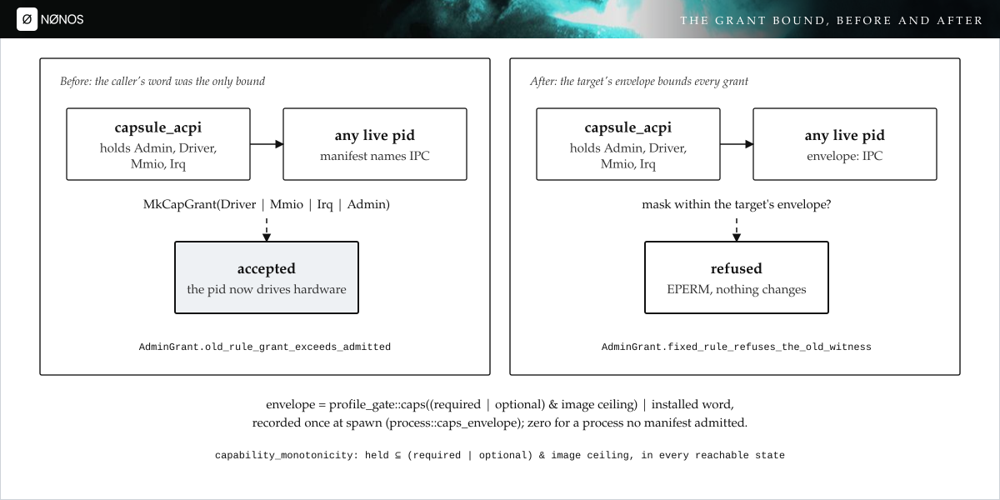
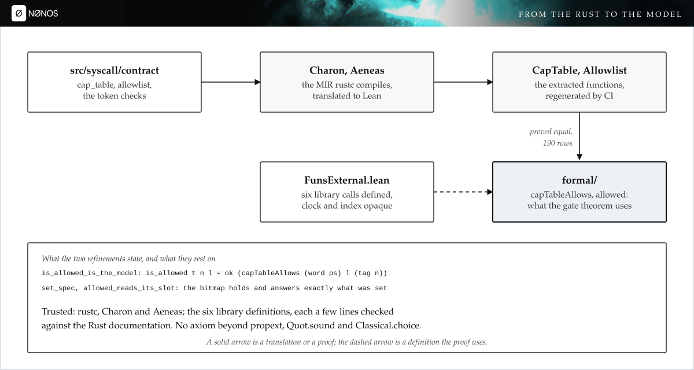

# Proving the NØNOS kernel core in Lean

eKisNonos, 2 November 2026

This page describes what NØNOS proves about its kernel in Lean 4, how the
proofs are tied to the Rust that ships, what the work found in the kernel, and
what it does not cover. It is written for someone who wants to check the claims,
so every statement names the file, the theorem or the test it comes from.

## What NØNOS is

NØNOS is an operating system for x86_64 computers. Its kernel is a capability
microkernel written in Rust. The kernel runs in ring 0. Device drivers, the
network stack, the desktop and the apps run in ring 3, each as a signed
capsule. A capsule starts with the capabilities its signed manifest asks for,
cut down by the publisher's certificate and by a ceiling baked into the image,
and with nothing else. On machines with Intel VT-d or AMD-Vi enabled, the IOMMU
confines each device's DMA to the buffers granted to the driver that claimed
it. A boot keeps nothing on a disk unless the person installs, and the browser
and terminal reach the network through the Nym mixnet unless the person picks
another route. [The overview](README.md) and [the architecture
page](architecture.md) give the full picture.


*Figure 1. The kernel in ring 0 and everything else in ring 3. Source: [`docs/overview/architecture.md`](architecture.md).*

A kernel like this makes a small number of promises that everything else
depends on. A capsule holds only the authority it was admitted with. A system
call reaches its handler only if the caller holds the capability the call
needs. No page is writable and executable at once. One capsule cannot read or
write another capsule's memory, except through a surface the project chose to
share. These are the properties this page is about.

## The checks that existed before

The repository already checked a great deal about its own code before the work
described here. There are four kinds of check, and Figure 2 shows how they
relate.



*Figure 2. What is proven, and about what. Sources: [`formal/README.md`](../../formal/README.md), [`verification/lean/README.md`](../../verification/lean/README.md).*

When this work started, `verification/lean` held 191 Lean modules with 1,503
theorems in 21,474 lines. Each module models one mechanism. `Nonos.SpawnCaps` proves that the
word `install_caps` puts on a new process is under the publisher's ceiling.
`Nonos.Dispatch` proves that an unregistered syscall is refused. `Nonos.Paging`
proves facts about page permission flags. The `Stark` directory proves the
field arithmetic, Merkle binding, FRI folding and constraint soundness that the
attestation verifier rests on. Each theorem in that tree has a counterpart
that checks the code, listed in its README.

Below the Lean layer, Verus and Kani check the bit operations themselves
(`verification/verus/src/capabilities.rs`, `page_permissions.rs`,
`page_global.rs`, `ipc_lengths.rs`). `verification/extraction` lowers kernel
functions through rustc's MIR with Charon and translates them to Lean with
Aeneas; at the start it covered 978 functions in 285 crates. The `userland/*_proofs` crates include the
kernel's own source files with `#[path]` and run them on the host with
`cargo test`; `kernel_proofs` alone has more than two thousand tests.

What the tree did not have was a model of the kernel as a whole. Each Lean
module looked at one function. None of them said what happens when spawn,
grant, revoke, map, unmap, IPC, surface sharing and teardown interleave in any
order, which is where the promises above can fail. `formal/` is that model.

## The model

`formal/` is a Lake project pinned to Lean 4.15.0 with no dependency beyond
core Lean and the existing `verification/lean` package, which it cites as a
path dependency. It builds from a clean checkout in about six seconds on the
machine used for this work.



*Figure 3. The kernel as one state machine. Sources: [`formal/Formal/State.lean`](../../formal/Formal/State.lean), [`formal/Formal/Step.lean`](../../formal/Formal/Step.lean).*

The state has five parts, each named after the kernel structure it stands for.

- Capsules. For each pid with a live capsule: the request it was admitted on,
  the word it was admitted with, the word it holds now, its grant envelope,
  its revocation epoch and its token. The token carries the subject pid, the
  epoch it was minted under, its permission word, and the syscall allowlist
  derived from that word.
- Mappings. For each pid and each virtual page, the frame mapped there and its
  permissions.
- Frames. Each physical frame is free, private to one process, or held by one
  surface slot.
- Surfaces. Each slot of the surface registry: its owner, the receivers the project named with their write bits, every receiver the project has ever named,
  the processes holding a view, and whether the project has released it.
- Inboxes. For each pid, the messages queued for it. A message is bytes.

The step relation lists every way the state changes. Spawn adds a capsule if
the admission decision passes. Load maps a fresh frame for the ELF loader or a
stack. Call runs a handler for a capsule that passed the syscall gate. Deny is
a refused call, which leaves the state alone for a Linux-personality process
and tears down a native capsule. Protect changes a page's permissions.
Quarantine is the kernel's own revoke. Teardown removes a process and
everything it held. Surface free reclaims a slot whose last view is gone.

The handlers with an effect in the model are capability grant and revoke, mmap
and munmap, IPC send, and the four surface calls: register, share, attach and
release. Every other handler is modelled as having no effect on this state.

`Reachable P g s` holds for every state `s` the steps can reach from boot.
Every theorem on this page is stated over `Reachable`, for every value of `P`
and, where it is not fixed, every grant rule `g`.

`P` is a `Platform`. It holds what the model does not compute: the signature
primitive (`alg_id::verify`), the publisher-key revocation list, the image
ceiling, the bits the boot profile leaves, and whether a caller is a launcher.
Because these are parameters, the model declares no axiom. A theorem that
holds for every `sigVerify` holds for the real one. What Lean cannot say is
that the real one is unforgeable; the README lists that as an assumption.

## Tables read from the code

A model of the syscall gate is only as good as its copy of the syscall table.
Writing the table by hand would let it drift from the code without anyone
noticing. `formal/scripts/gen_tables.py` reads it from the Rust instead.



*Figure 4. How the model keeps up with the code. Sources: [`formal/scripts/gen_tables.py`](../../formal/scripts/gen_tables.py), [`userland/kernel_proofs/src/formal_model/`](../../userland/kernel_proofs/src/formal_model/).*

The script reads four things:

- the 41 capability bits from `capability_table!` in
  `src/capabilities/types/defs.rs`;
- the 190 syscall numbers from `src/syscall/numbers/defs.rs`, kept to those
  the ABI registry resolves;
- every arm of the ten groups `cap_table::is_allowed` consults, in the order it
  consults them, with each `can_*` helper expanded into the capability test it
  makes;
- the algorithms `NONOS_PRODUCTION_POLICY` requires a signature for, which
  are Ed25519 and ML-DSA-65.

It writes them as Lean data under `formal/Formal/Data`. A syscall's
requirement becomes a small expression over `has i`, `valid`, `launcher`,
`not`, `and` and `or`. MkCapsuleLoad, for example, becomes
`valid and has CoreExec and has IPC and has Memory`. The parser refuses any
construct it does not recognise, so a new kind of check in the Rust stops the
script and does not get silently dropped.

Two checks hold the data to the code. CI reruns the script and fails if the
output differs from the committed files. The `kernel_proofs` crate reads the
Lean files back at test time and asks the real `cap_table::is_allowed`, and
the real allowlist the kernel derives from a token, the same question on all
190 syscalls, for both launcher answers and several hundred capability words.
During this work a work area added two syscalls, MkSurfaceFenceRelease and
MkSurfaceFenceWait. Both checks failed until the tables were regenerated,
which is what they are for.

## The five properties

`formal/Formal/Headline.lean` states each property, and `formal/Axioms.lean`
prints the axioms each proof uses. Every headline theorem uses `propext` and
`Quot.sound`, two of Lean's three standard axioms, and nothing else. The
script `formal/scripts/check_axioms.sh` fails the build on `sorry`, on any
other axiom, and on an axiom declaration anywhere in `formal/`.

### Capability monotonicity

`capability_monotonicity` says that in every reachable state, a capsule holds
no capability outside what its manifest declared, required or optional, under
the image ceiling. It also holds nothing above its publisher's certificate
ceiling, and nothing outside the envelope recorded when it was spawned. The
proof runs over every step, including the grant syscall, and needs no
assumption about who holds Admin. The first version of the model could not
prove this, for a reason given below under what the proofs found.

The Rust it abstracts is `caps_bits.rs` in
`src/security/capsule_manifest/verify/`, `image_ceiling::gate`, the profile
trim in `profile_gate::caps`, and the grant and revoke handlers. The tests in
`formal_model::capability_tests` and `admission_tests` run those functions on
the predicates the theorem states.

### Admission soundness

`admission_soundness` says that every live capsule was admitted on a request
that passed every check `preflight::run` makes. The manifest asks for nothing
above the certificate ceiling. The requested grant stays inside the manifest.
The install word is under the image ceiling. There is a verifying Ed25519
signature and a verifying ML-DSA-65 signature, each under a certificate key
that is not revoked and whose algorithm matches. The structural checks and the
attestation gate passed. The word on the process control block is the install
word trimmed by the boot profile.

The model keeps the request beside the capsule for its whole life, so the
theorem describes the capsule that runs, for as long as it runs. The proof that the install word is under the certificate ceiling
cites `Nonos.SpawnCaps.installed_within_ceiling` from the older corpus through
a small bridge between bit words and bit sets.

### Syscall-gate completeness



*Figure 5. From a trap to a handler. Sources: [`src/syscall/entry.rs`](../../src/syscall/entry.rs), [`src/syscall/contract/`](../../src/syscall/contract/).*

Every architecture's trap handler calls `syscall::entry::handle_syscall`. It
refuses a number the ABI registry does not know, then calls
`contract::dispatch`, which runs the resolver: the token's signature, expiry
and revocation, the boot session, the ASID binding, the revocation epoch, and
the allowlist bit for the call. Only then does `handle_syscall_dispatch` reach
a handler.

`syscall_gate_completeness` says that in every reachable state, a handler runs
for a capsule and a syscall number only if the capsule's token is its own and
current, and the token's allowlist permits the number. The allowlist is the one
derived from the word the capsule holds, so the generated table passes on that
word, and the handler's effect is one that belongs to that number.
`syscall_outside_allowlist_denied` gives the other side: outside the list, no
handler runs, and the only outcomes are a refusal with nothing changed or the
caller torn down.

The gate in the model follows its allowlist as it ships
(`src/syscall/contract/allowlist/`): `derive.rs` computes two bitmaps over the
registry's slots, one per launcher answer, from `cap_table::is_allowed` each
time a token is installed, and `decide.rs` tests one bit per call. The model
mints a token's list the same way at spawn, grant and revoke.
`formal_model::allowlist_tests` checks that the shipped bitmaps and the
model's list agree on every slot. Two pieces of this are now proved on the
extracted Rust: the table `derive` asks, and the bitmap it fills and `decide`
reads. [From the model to the code](#from-the-model-to-the-code) gives the
detail.

`syscall_within_manifest` ties the gate back to admission. Under the shipped
grant rule, a syscall is reached only if the table passes on the word the
manifest declared under the image ceiling. MkAttestDoc is the one exception,
and Lean proves it is the only one: its requirement refuses a holder of
Network, so a capsule whose boot profile removed Network may reach it although
its declared word would not.

### W^X preservation

`wx_preservation` says that W^X holds at boot, that every step preserves it,
and so that no reachable state maps a page writable and executable. Every path
that writes a page-table leaf refuses a writable and executable permission:
`map_page`, `map_page_in_asid` and `update_page_flags` in
`src/memory/paging/manager/`, the ELF segment check, and, since this work,
`AddressSpace::map_page` in `src/process/address_space/ops.rs`. A surface view
is mapped `user_rw` or `user_ro`, which are never executable.

`formal_model::wx_tests` runs every one of the 65,536 `PagePermissions` words
through `is_wx_violation` and `to_pte_flags`, and every `ProtectionFlags`
value through its refusal and its encoder, and checks that no permission that
passes the refusal is encoded as a writable, executable leaf.

### Isolation preservation



*Figure 6. Memory between capsules. Sources: [`formal/Formal/Proofs/Isolation.lean`](../../formal/Formal/Proofs/Isolation.lean), [`src/kernel_core/surface_registry/share/`](../../src/kernel_core/surface_registry/share/).*

The surface registry lets one capsule share a buffer with another. The
compositor depends on it. A model that left it out would prove an isolation the
kernel does not have, so the invariant states the share as an exception and
bounds it.

`isolation_preservation` says that the invariant holds at boot and that every
step preserves it. In a reachable state, two different capsules share a frame
only as views of one surface, and each of them is the surface's owner or a
receiver the project named. A private frame is mapped in one address space at
one address. Every token is bound to its own capsule. `caps_change_only_by_target`
adds that only an operation aimed at a capsule changes its capabilities.

`formal_model::isolation_tests` runs random sequences of the real share rule
(`share/rule.rs`) and rights rules (`rights_rule.rs`, `rights_attach.rs`)
against a record of who the project ever named, and checks that no view is given
to anyone else and that teardown and release drop the rights they should.

## What the proofs found

### Any Admin holder could grant anything to anyone

The first attempt to prove capability monotonicity failed. The reason was in
`sys_cap_grant`. A capsule holding Admin could OR any bits it held into any
live process, and nothing compared those bits with the target's manifest.
`capsule_acpi`, `capsule_policy` and `capsule_power` all requested Admin then.
`capsule_acpi` also holds Driver and Irq, and it parses firmware AML. A fault
in that parser could have handed Driver, Irq and Admin to any process on the
machine. Since the Admin split none of the three holds Admin: each holds a bit
for the calls it makes (AcpiOwner, PolicyPush, PowerControl), and no capsule
holds Admin.



*Figure 7. The grant bound, before and after. Sources: [`src/syscall/microkernel/capability/grant_rule.rs`](../../src/syscall/microkernel/capability/grant_rule.rs), [`src/process/caps_envelope.rs`](../../src/process/caps_envelope.rs).*

The model kept the old rule, so the failure is a theorem.
`AdminGrant.old_rule_grant_exceeds_admitted` builds a reachable trace in which
two signed capsules are admitted, the one holding Admin grants Admin to the
other, and the other ends up holding a capability its manifest never named.
Every step of the trace passes the real admission decision and the real gate.

The fix records an envelope for each capsule once, at spawn: the manifest's
required and optional bits under the image ceiling, trimmed by the boot
profile, together with the installed word. The value is set once through a
compare-and-swap and cannot change afterwards. `sys_cap_grant` now calls
`grant_rule::grant_decision`, which refuses a grant unless the caller holds
Admin and every bit it grants, and every bit lies inside the target's
envelope. A process no manifest admitted has an empty envelope, so nothing can
be granted to it. No code in the tree calls the grant syscall today, so the
fix changes nothing that runs.

`AdminGrant.fixed_rule_refuses_the_old_witness` shows that the new rule refuses
the grant the old trace made. `capability_monotonicity` then holds in full.
The regression tests in `formal_model::capability_tests` cover a grant outside
the target's manifest, a grant inside it, a caller lacking the bit, and a
grant to or from a process that does not exist.

### One page-table writer had no W^X refusal

`AddressSpace::map_page` wrote a leaf from `ProtectionFlags` without checking
for a writable and executable request. It has no caller in the tree, so no
running code could reach the gap, but nothing would have stopped a future
caller. It now returns an error for such a request, and the W^X tests cover
its rule and its encoder.

### Any Admin holder could revoke from anyone

`sys_cap_revoke` asked only that the caller hold Admin, then cleared any bits
from any process. The least trusted Admin holder could take IPC from the
compositor or Network from the net stack. the project adopted a bound, and it
is built: a process may drop its own bits with a valid token alone; revoking
from another process needs Admin and being init or the target's parent; a
process that owns the compositor, the input router, policy or a net stack
service answers to init alone. The rule is `grant_rule::revoke_decision`.
`revoke_bound` and `protected_service_answers_to_init` prove it over the
model, `Nonos.RevokeBound` proves it only narrows the old rule, and
`revoke_decision_is_the_model` proves the extracted Rust equals that model on
all 32 inputs, using no axiom at all.

## Further properties

These were added after the five properties above. Each is stated over every
reachable state.

`dead_holds_nothing` says that a pid with no live capsule has no mapping, owns
no private frame, holds no surface view or share right, and has no queued
message. Teardown gives back everything, and `spawn_starts_empty` follows from
it: a capsule spawned on a reused pid inherits nothing from the earlier holder.

`handler_requires_capability` says what each modelled handler costs. Grant needs
Admin. mmap and munmap need Memory. An IPC send needs IPC. The
surface calls need GraphicsSurfaceCreate or GraphicsSurfaceMap. The bit comes
from the generated table through a syntactic test, `Req.needs`, which Lean
proves sound.

`revoke_takes_effect` and `quarantine_takes_effect` say that after a revoke,
the target holds none of the revoked bits, and every syscall whose table entry
needs one of them is refused to it in the very next state. The revoke bumps
the epoch and mints a new token with a new allowlist in the same step, so no
token minted before the revoke can still be used.

`ipc_touches_only_receiver` says that an IPC send changes the receiver's inbox
and nothing else. A message carries bytes; no capability and no frame moves
with it, which matches `IpcMessage` in `src/ipc/nonos_channel/message.rs`.

Four theorems are about the shipped table as a whole and are checked by Lean
over all 190 entries:

- `empty_word_reaches_only_tty_query_or_random`: a token with no capability
  reaches MkTtyQuery and CryptoRandom (random bytes, every process's by a project decision) and no other syscall.
- `launcher_matters_only_for_app_launch`: only MkAppLaunch reads whether the
  caller is a launcher.
- `every_abi_number_is_claimed`: every number the registry resolves is claimed
  by some group of the table.
- `only_attest_doc_negates`: only MkAttestDoc's requirement contains a
  negation.

## Growing the corpus

The same work added to the two older trees.

`verification/lean` gained nine modules, each about code that had no Lean
model:

- `GrantEnvelope`, the grant rule and its envelope. It proves that no
  sequence of passing grants takes a process past its envelope and keeps the
  old rule's counterexample as a theorem.
- `SecretLog`, the spawn rule that withholds Debug from a holder of keys,
  input or a device secret. It removes Debug and nothing else, and only from
  such a holder.
- `ProfileTrim`, the boot profile's trim. No capsule keeps Network on an
  offline boot, and the secret bits pass through untouched.
- `ImageCeilingGate`, the image ceiling gate. It admits a request exactly
  when nothing is over the ceiling, and names only forbidden bits.
- `AllowlistBits`, its allowlist bitmaps. The derived list answers
  exactly what the capability tables answered, for every slot and both
  launcher answers.
- `ShareRights`, the surface share rights. Teardown and release drop the
  rights they should, a receiver view always comes from a recorded right, and
  no surface exceeds its receiver limit.
- `InheritBound`, what a process the kernel creates inherits. None starts
  with Admin or any other bit the ambient set forbids.
- `ResolverChain`, the resolver's five checks. A stale epoch, a foreign ASID
  or another boot's token is refused.
- `WordSet`, the bit-set lemmas the others share.

The tree now holds 201 modules and 1,604 theorems, with `RevokeBound` added for the revoke rule below.

The extraction tier grew through `tools/extraction/sweep.py`. The script
builds a crate around a kernel file, lowers it with Charon, translates it
with Aeneas and keeps the file only if every stage succeeds. Run over 196
candidate files, it kept 117. Nine of those produced Lean that does not
type-check and two collided with an existing crate name, so 106 were added.
Each new crate regenerates from the kernel source without a byte of
difference. The tier now has 391 crates and 1,169 extracted functions, up
from 285 and 978, and the whole project builds with no `sorry`. Six library
functions that Aeneas leaves opaque in the new crates are listed in
`verification/extraction/ASSUMPTIONS.md` with what each one models.

Several of the new crates carry rules this page is about, and their proofs go past the generated ones. Nine boolean rules have closed forms proven, with the security property each implies: no unconfined DMA in a production image, a hardened boot never shares an isolation group, keeping never turns off within a boot, an unmap always invalidates the IOMMU caches. Fifteen more rules carry properties proven on the extracted code. The
hardware broker always clears Bus Master when a driver claims a device, and
memory decoding too for a port-only claim. Decoding is off while a BAR is
sized. A wiped device leaves with no function reset pending and no snoop
bypass. A range whose end overflows 64 bits is treated as touching the
interrupt and device windows, so it is refused. A capsule that does not hold
a device reads its base address as zero. A command ring is never both empty
and full, and page-table address fields never carry a flag bit.
`CapabilityGrantRuleRefinement` proves that the extracted `may_grant` and
`within_envelope` compute exactly the `GrantEnvelope` model for all 64-bit
inputs. `ImageCeilingRuleRefinement` proves the same of the
extracted `over`. The theorems about the models therefore hold of the code
rustc compiles for the kernel.

## From the model to the code

Until this step the five properties were proved about the model, and the
model was held to the code by a generator and by tests. A test checks the
inputs it is given, and a generator can have a bug. For the capability table
and the allowlist bitmap, both are now backed by a proof about the code
itself.



*Figure 8. From the Rust to the model. Sources: [`verification/extraction/lean/NonosExtraction/CapTableRefinement.lean`](../../verification/extraction/lean/NonosExtraction/CapTableRefinement.lean), [`AllowlistRefinement.lean`](../../verification/extraction/lean/NonosExtraction/AllowlistRefinement.lean).*

`verification/extraction/sweep/cap_table` builds the kernel's own
`src/syscall/contract/cap_table`, the token type and every `can_*` check it
reads, by `#[path]` from the kernel tree. Charon lowers that code and Aeneas
translates it into `verification/extraction/lean/CapTable`. The theorem
`NonosExtraction.CapTable.is_allowed_is_the_model` then states, for every
syscall the kernel defines, every launcher answer and every process token:

```lean
syscall.contract.is_allowed t n l =
  ok (Formal.capTableAllows (word t.permissions.val) l (tag n))
```

The left side is the code rustc compiles, translated. The right side is the
function the gate theorem in `formal/` is stated over. `word` is the
capability word a token's list stands for, and `bit_is_two_pow` proves that
it is the word the kernel's own `Capability::bit` builds. `tag` is the
syscall's ABI number, read from the enum's discriminant. A process token
carries no expiry, and the theorem takes that as its one hypothesis.

The allowlist the gate actually consults is proved the same way.
`verification/extraction/sweep/allowlist` extracts
`src/syscall/contract/allowlist/set.rs` and `decide.rs`. Each process keeps
two bitmaps over the registry's slots, one answer for a caller that launches
apps and one for a caller that does not. `AllowlistRefinement` proves that
`plain` and `launcher` read bit `s % 64` of word `s / 64`, and that a slot
past the count is refused. It proves that `set` raises exactly the bits it
is asked to and leaves every other slot's answer as it was, which is the
step `derive` repeats once per registered slot. `EMPTY`, the list a token
gets when its MAC check fails, permits nothing. `allowed` refuses a number
with no registry slot, and otherwise reads the map the caller's standing
selects. The registry's hash table is built by `const fn` at compile time
and Aeneas does not translate it. The theorems are stated for any slot
lookup and any count that fits the bitmap, so they do not depend on it.

The capability-table proof needed three changes.

The first was to one kernel signature. `cap_table::is_allowed` took the
launcher answer as a function pointer, which Aeneas cannot translate. Every
caller passed a constant: the allowlist asks once with each answer, and the
deny-kill path always answers yes. The parameter is now a `bool`. The live
question is still asked lazily, in `allowlist::decide`, which the change does
not touch. `kernel_proofs` passed all 2,056 tests before and after, and the
generated tables came out byte for byte the same.

The second was to define five library calls instead of assuming them. The
table chains its ten groups with `Option::or_else`. `grants` is
`Iterator::any`, `is_valid` uses `Option::map_or` and `Vec::is_empty`, and
the checks that need several capabilities use `Iterator::all`. Aeneas has no
model for these and emits each as an axiom unless it is given one.
`CapTable/FunsExternal.lean` defines each by the behaviour the Rust
documentation states. A definition cannot make Lean inconsistent, and each is
a few lines a reader can hold against the documentation.

The third was to make the model build on both Lean releases. `formal/` is
pinned to Lean 4.15 and the extraction project to 4.30, and two core lemmas
changed names between them. `formal/Formal/Bits.lean` now proves those two
facts itself, so the extraction project imports the model unchanged.

The proof is one theorem per syscall. `tools/extraction/cap_table_rows.py`
writes the 190 rows from the extracted enum and the model's table, ten to a
module, and lake checks the 19 modules side by side. Each row is handed its model
entry, which Lean checks against the table by `rfl`. A shared tactic then
unfolds the extracted table and the token checks down to membership in the
token's list, and compares the two sides. CI reruns the script with
`--check`, so a syscall or capability added to the kernel fails the build
until its row is written and proved.

The kernel clock is the one item left opaque. It is declared without a body
in the extraction root, so in Lean it is an `opaque` constant. That asserts
only that a clock reading exists and adds no axiom. No theorem about a
process token depends on what the clock returns.

## What the model leaves out

The README in `formal/` lists every gap. The main ones are these.

The model covers capsules. Kernel-created processes, threads and the Linux
peers the foreign personality supervises are outside it. Threads and
kernel-created processes have an empty grant envelope in the code, which is
the safe value, but the model does not describe how they run.

The order in which `preflight::run` composes its checks, and the signature
loop in `verify/dispatch.rs`, are transcribed from the source into the model
and not executed on the host. The bit rules they compose are executed by the
tests.

The capability table and the allowlist bitmap are proved on the extracted
code. Three parts of the gate are still held to the model by tests alone:
`derive`'s loop over the slots, the token MAC check, and the resolver's
binding checks. The same is true of the handlers.

Tokens are modelled by subject, epoch, word and allowlist. Signature, boot
session, ASID and expiry checks are taken to pass for a capsule's own token.
The token's MAC is checked once, when its allowlist is derived at install,
and a token that fails the check gets an empty list and permits nothing. The
per-call check is opt-in. The model mints every token itself and takes the
MAC check to pass.

Device memory, IRQs and the hardware broker are not in the frame model. The
IOMMU proofs in `verification/lean` and the driver tests cover parts of that
ground.

Steps are atomic. Locks, atomics and interleavings across cores are not
modelled.

Capability words are unbounded natural numbers in Lean and `u64` in Rust. The
generator refuses a capability bit at 64 or above, so the two agree on every
bit that exists.

The signature primitive is a parameter. The theorems say that the check ran
and passed. They do not say that Ed25519 or ML-DSA-65 cannot be forged.

## Reproducing the results

```sh
cd formal
lake build                                   # every theorem checks
scripts/check_axioms.sh                      # 24 headline theorems, two axioms
python3 -I scripts/gen_tables.py --check     # tables match the Rust

cd ../userland/kernel_proofs
cargo +nightly-2026-01-16 test formal_model  # the model held to the code

cd ../..
python3 tools/extraction/regen.py --only cap_table      # Charon and Aeneas, no drift
python3 tools/extraction/regen.py --only allowlist
python3 tools/extraction/cap_table_rows.py --check      # one row per syscall
cd verification/extraction/lean
lake build NonosExtraction.CapTableRefinement NonosExtraction.AllowlistRefinement
```

The `formal` job in `.github/workflows/lean.yml` runs the first three on every
pull request and publishes the axiom profile. The `extraction` job in
`.github/workflows/verify.yml` runs the rest.

## The work in numbers

| Item | Count |
|---|---|
| Lean modules in `verification/lean`, before and after | 191, 201 |
| Theorems in `verification/lean`, before and after | 1,503, 1,604 |
| Extraction crates, before and after | 285, 393 |
| Kernel functions extracted to Lean, before and after | 978, 1,176 |
| Theorems in `verification/extraction`, before and after | 2,222, 2,794 |
| Syscalls whose extracted capability check is proved equal to the model | 190 of 190 |
| Theorems in `formal/` | 119 |
| Headline theorems in `formal/`, each on `propext` and `Quot.sound` only | 24 |
| Lines of Lean in `formal/` | 3,700 |
| Syscalls in the generated table | 190 |
| Capability bits in the generated table | 41 |
| Tests in `kernel_proofs/src/formal_model` | 32 |
| Tests in `kernel_proofs` | 2,056 |
| Kernel changes made because of the proofs | 3 (the grant envelope, the W^X refusal, the revoke bound) |
| Kernel changes made so the code could be proved | 1 (`is_allowed` takes a `bool`; behaviour unchanged) |

The model, its tables and its tests are in [`formal/`](../../formal/) and
[`userland/kernel_proofs/src/formal_model/`](../../userland/kernel_proofs/src/formal_model/).
The figures on this page are drawn by `formal/scripts/diagrams.py` from the
same banner and type as the other kernel diagrams.
