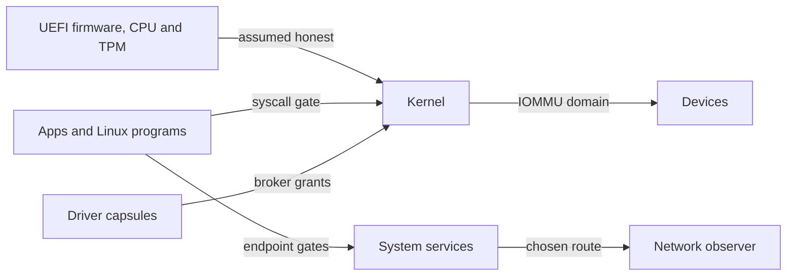

# Threat model: A tampered image or capsule

Part of [Threat model](threat-model.md).

### A tampered image or capsule

A capsule whose certificate, manifest, signatures or attestation do not verify
is never spawned; [Design
principles](design-principles-everything-that-runs.md#everything-that-runs-is-signed-and-measured)
walks through the checks. Attestation passes under the vendor root compiled into
the kernel or, when that refuses, under a root a person enrolled on this
machine, where a capsule built on this machine carries a keyed tag the kernel
minted instead of a STARK proof (`enrolled` in
`src/security/capsule_attest/against_root.rs:34-45`). The `[ZK-ATTEST] ok` line
names which authority admitted each capsule. The loader's boot menu names the
checks it makes on the kernel image before the kernel runs, and [Boot chain and
signatures](../security/boot-chain-and-signatures.md) and [Rollback
protection](../security/rollback-protection.md) cover that path. On a machine
whose TPM holds the [rollback floor](glossary.md#rollback-floor), the loader
also refuses an older signed kernel (`enforce_floor` in
`nonos-bootloader/src/boot/crypto/rollback/floor.rs:28-40`). Before init the
kernel checks the loader against the signed [boot-root
record](glossary.md#boot-root-record), and starts no program when that fails
(`refuse_unchecked_loader` in
`src/kernel_core/init/entry/loader_refusal.rs:27-48`). These checks hold each
part of an image to the rest of that image: the loader checks the kernel against
keys compiled into that loader, so with [Secure Boot](glossary.md#secure-boot)
off an image sealed whole with other keys passes them. The TPM then gives that
image another [machine key](glossary.md#machine-key), so this machine's data
volume and the records sealed under its key stay closed to it (`BOUND_PCRS` in
`src/security/tpm/machine_key/pcrs.rs:21-24`).

## Trust boundaries

Each arrow crosses a boundary. UEFI firmware, the CPU and the TPM sit below the
kernel and are assumed honest. Apps and Linux programs cross the syscall gate
into the Kernel, and the endpoint gates into System services. Driver capsules
reach hardware only through broker grants, and Devices reach memory through
their capsule's IOMMU domain where a VT-d unit in service covers them. Whatever
leaves the machine takes the chosen route before a Network observer sees it.

## Assumptions

NONOS relies on these without proof. They are the hardware, firmware, compiler
and hash rows of `verification/ASSUMPTIONS.md`. The file also lists every
third-party crate linked into ring 0 and into the loader, the in-tree primitives
that are tested but not proven, ChaCha20-Poly1305 and the STARK prover and
verifier among them, and the axioms behind the Lean models.

- The CPU implements x86-64 paging, rings, SYSCALL and SYSRET, SWAPGS and the
  TSS as documented, and SMEP, SMAP and NX work.
- UEFI firmware is honest until ExitBootServices, and the Secure Boot keys
  belong to the person who controls the machine.
- The TPM keeps its counters monotonic and its keys inside.
- VT-d translates and faults device DMA as its tables say. With no IOMMU, every
  DMA-capable device and its driver capsule can reach all of physical memory.
- RDRAND and RDSEED return unpredictable values.
- BLAKE3, SHA-2, SHA-3 and the width-8 Poseidon hash are collision resistant.
- Nobody has bus, JTAG or cold-boot access to the machine.
- The compiler, a Rust nightly, generates what the source says.
