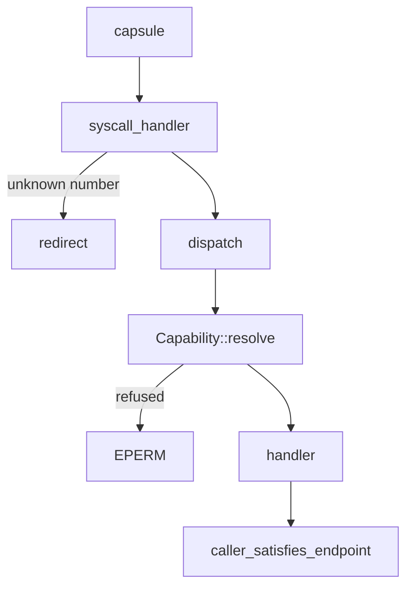

# Capsule isolation: The capability check on every NONOS system call

Part of [Capsule isolation](capsule-isolation.md).

## The capability check on every NONOS system call

A capsule's authority is a [capability
word](../overview/glossary.md#capability-word): a 64-bit mask in which 37 bits
are defined, one per entry of the `capability_table!` list that defines
`Capability` (`src/capabilities/types/defs.rs:18-75`). A compile-time check over
`Capability::all` refuses a build in which two capabilities share a bit or one
takes more than one (`src/capabilities/types/guard.rs:22-33`). The published
list is [abi/caps.toml](../../abi/caps.toml), and [ABI
capabilities](../abi/capabilities.md) explains each bit.

The kernel keeps the word inside a [capability
token](../overview/glossary.md#capability-token), and the token is what the
check reads. `new_token` binds the bits to the pid, the address space ID, this
boot's session nonce and the process's revocation epoch, then signs the result
(`src/process/caps.rs:38-59`). The signature, `mac64`, is two keyed BLAKE3
hashes over a 128-byte encoding of those fields
(`src/capabilities/token/material.rs:41-52`). Its key is 32 bytes drawn at boot
by `init_token_signing_key`
(`src/kernel_core/init/platform/token_signing_key.rs:19-31`). The key lives only
in RAM and changes every boot. The function halts the machine when the draw
reports a failure, but the draw never does: on a machine where no hardware
random source answers the kernel, the key comes from the cycle counter, as
[Randomness and
cryptography](randomness-and-cryptography.md#when-a-source-is-missing) explains.

Every system call enters through one function. On x86_64, `syscall_handler`
turns a known number into a `SyscallNumber` and calls `dispatch`
(`src/arch/x86_64/syscall/manager/entry.rs:38-60`). The aarch64 and riscv64
entries call the same `dispatch` (`src/syscall/contract/mod.rs:17-24`).

`dispatch` asks `Capability::resolve` for a witness and returns `EPERM` without
running the handler when it gets none
(`src/syscall/contract/dispatch.rs:31-40`). The witness wraps a private token,
and `Capability::resolve` is its only constructor
(`src/syscall/contract/capability.rs:26-35`). `resolve` runs five checks in
order (`src/syscall/contract/resolver/resolve.rs:31-43`):

1. `check_token`: the MAC verifies in constant time, the token has not expired,
   and its pid and nonce are not on the revocation list.
2. `check_session_binding`: the token was minted in this boot.
3. `check_asid_binding`: the token belongs to the address space that is running.
4. `check_revocation_epoch`: the token is not older than the process's last
   revocation.
5. `check_syscall_allowed`: the cap table admits this call for these bits.

The cap table, `is_allowed`, answers false for any number no table names
(`src/syscall/contract/cap_table/mod.rs:28-34`). Most calls need a specific bit.
A few need only a token that `caps.is_valid` accepts, such as `MkExit`,
`MkYield` and the clock reads (`src/syscall/contract/cap_table/mk.rs:25-38`).
`is_valid` is false for a token with no bits at all
(`src/capabilities/token/types/query.rs:44-47`).
