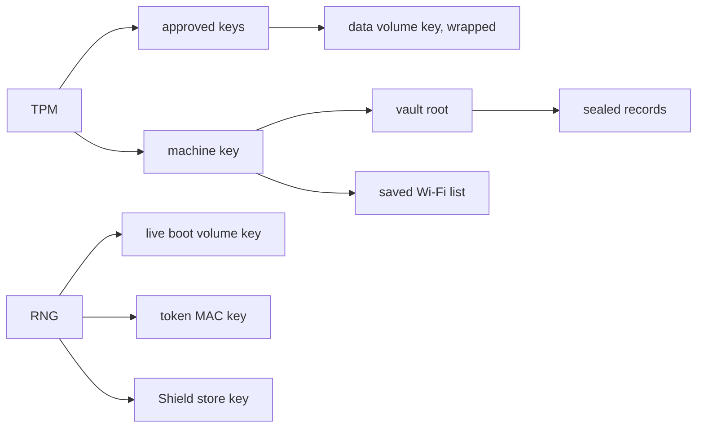

# Device secrets and keys

Where NONOS keeps secrets, what protects each one, what is lost at power off, and what an orderly shutdown wipes.

## The short version

- The keys that protect data across boots are derived from the [TPM](../overview/glossary-stark-proof.md#tpm) on demand and never stored. The same machine in the same boot state gets the same key; any other machine or boot state gets a different one.
- Key records in the keyring live in RAM and are gone at reboot. The wallet's sealed records are the exception, and they open only on this machine.
- On an installed disk, the [data volume](../overview/glossary-claim-epoch.md#data-volume) is encrypted per sector. On a live boot it lives in RAM under a key made for that boot.
- The capsule store on the NONOS disk, the [package store](../overview/glossary-linux-personality.md#package-store), is not encrypted. A file persisted there is readable by anyone who holds the disk, unless the [capsule](../overview/glossary-boot-root-record.md#capsule) that wrote it sealed it first.
- An orderly shutdown or reboot wipes process memory, kernel stacks, the kernel's key vault and its heap, but not the data volume key, the token MAC key or a live boot's in-memory volume. The desktop's Power Off and the installers' restart run it, through the power capsule (see [Wiped at shutdown and reboot](#wiped-at-shutdown-and-reboot)). A panic wipes the kernel heap and powers off, but not process memory (`src/security/zerostate/panic_wipe.rs`). A forced power-off or a power cut wipes nothing.

The TPM produces the [machine key](../overview/glossary-linux-personality.md#machine-key), from which the vault root and the key for the saved Wi-Fi list come, and, under the release's approval, the keys the data volume's own random key is wrapped under. The vault root in turn keys the keyring's sealed records. The RNG produces the keys that live for one boot only: the live boot volume key, the token MAC key and the Shield store key.

## The machine key

`derive` asks the TPM for a key in this order: start a policy session, fold the current [PCRs](../overview/glossary-linux-personality.md#pcr) into it, read the policy digest, create a primary key whose template carries that digest, run an HMAC over the caller's label, then flush the key and the session (`src/security/tpm/machine_key/derive.rs:43-63`). The result is 32 bytes. Nothing is written to disk to make it repeatable.

- The policy covers `BOUND_PCRS`, PCR 0, 4, 7 and 9: firmware code, the boot manager the firmware measured, the [Secure Boot](../overview/glossary-rollback-index.md#secure-boot) policy and the kernel hash the bootloader extends (`src/security/tpm/machine_key/pcrs.rs:21-24`). PCR 1 and 3 are left out on purpose, so a changed boot order does not lose the key.
- The primary key lives under the storage hierarchy, `TPM_RH_OWNER`, whose seed changes when the TPM is cleared (`src/security/tpm/machine_key/consts.rs:30-35`). Clearing the TPM therefore destroys every machine key and everything sealed under one.
- `OBJECT_ATTRIBUTES` leaves out `userWithAuth`, so only the PCR policy authorises the key, not an empty password (`src/security/tpm/machine_key/consts.rs:44-47`).
- A label is 1 to `LABEL_MAX` bytes, 64 (`src/security/tpm/machine_key/consts.rs:54-55`).

A capsule asks for a machine key with the `CryptoMachineKey` call, which `handle_machine_key` serves to any holder of the `Crypto` bit (`src/syscall/dispatch/crypto/machine_key.rs:39-49`). Labels that start with a zero byte belong to the kernel: `derive_for_kernel` adds that byte, and `is_user_label` refuses it from a capsule (`src/security/tpm/machine_key/kernel_label.rs:32-45`). Errors come back as `errno_for` maps them: 19 with no TPM, 13 when the TPM answers with a policy failure, 110 on a timeout, 22 for an empty or oversized label, and 5 for any other TPM error (`src/syscall/dispatch/crypto/machine_key.rs:68-79`). A kernel label is refused with 22 as well.

The kernel does not tie a label to a capsule. Any capsule holding `Crypto` that names a label gets the same key, as the Wi-Fi client's own comment on its `LABEL` says (`userland/nonos_wifi_client/src/saved/key.rs:15-18`). Many capsules hold `Crypto`, so a machine key protects data from someone holding the disk, not from another capsule on the same machine that holds `Crypto`.

| Label | Asked by | Used for |
|---|---|---|
| `blockfs.data.v1`, kernel only | the kernel, as `V1_LABEL` (`src/fs/blockfs_volume/key_pick.rs:33-42`) | the key of a data volume made before key headers, or on a boot with no approval (way 1) |
| `blockfs.data.v2`, kernel only, under the device secret's policy rather than the machine key's | the kernel, as `V2_LABEL` (`src/fs/blockfs_volume/key_pick.rs:34`, `src/fs/blockfs_volume/key_pick.rs:58-61`) | the key way 3 wraps the data volume key under |
| `blockfs.data.handover.v1`, kernel only, under that policy without PCR 4 | the kernel, as `LABEL` (`src/fs/blockfs_volume/handover/sector.rs:28-30`, `src/fs/blockfs_volume/handover/sector.rs:41-44`) | the key a handover seals the data volume key under, for one boot |
| `nonos.vault.root.v1` | the keyring, as `ROOT_LABEL` (`userland/nonos_vault/src/subkey.rs:32-36`) | the vault root for sealed records |
| `wifi/saved-networks` | the Wi-Fi client, as `LABEL` (`userland/nonos_wifi_client/src/saved/key.rs:15-18`) | the saved network list at `/nonos/wifi/saved` |
| `install.tpm-probe` | the installer, as `PROBE_LABEL` (`userland/capsule_install/src/install/source/tpm.rs:25`) | checking that a TPM answers; the key is wiped unread |
| `settings/security-probe` | Settings, as `LABEL` (`userland/capsule_settings/src/settings/state/machine_key_probe.rs:28-29`) | the status row on the Security page; the key is wiped unread |

Settings shows what the TPM answered on its Security page, for example `From the TPM, bound to this boot` or `The TPM refused: the boot state changed` (`said` in `userland/capsule_settings/src/settings/state/machine_key.rs:62-71`).

## The device secret

The anonymous device proof uses a second TPM-derived value, the [device secret](../overview/glossary-claim-epoch.md#device-secret). `sys_device_secret` asks the TPM for it on every call and keeps no copy (`src/syscall/microkernel/device_proof/device_secret.rs:35-67`). `device_secret_caller` hands it only to a capsule that holds `DeviceSecret` and whose authority is the vendor root; a developer root, a third-party [publisher](../overview/glossary-peer-list.md#publisher) or software built on the machine is refused even with the bit (`src/syscall/microkernel/device_proof/gate.rs:28-36`). [STARK attestation](stark-attestation.md) describes the proof.

## The keyring

The keyring capsule, `capsule_keyring`, stores key records for the capsules that use it and signs with the wallet's keys. Its [manifest](../overview/glossary-linux-personality.md#manifest) asks for `IPC`, `Memory` and `Crypto` (together 0x38) and the `Keyring` bit, `CAPSULE_REQUIRED_CAPS := 0x10000038` (`userland/capsule_keyring/Capsule.mk:17`), so it has no file system, network or device access.

- Records live in a `Store` in the capsule's memory and are gone at reboot (`userland/capsule_keyring/src/store/types/store.rs:20-23`).
- The store holds `MAX_KEYS`, 128 records, and at most `MAX_KEYS_PER_OWNER`, 16, for one capsule (`userland/capsule_keyring/src/store/types/constants.rs:17-21`).
- A request names its caller's pid, and `resolve_caller` accepts it only when it equals the pid the kernel stamped on the message; sender 0 is refused (`userland/capsule_keyring/src/server/caller.rs:22-30`).
- `retrieve` returns a record only to the pid that stored it, and never returns a wallet signing key (`userland/capsule_keyring/src/store/retrieve.rs:22-35`).
- `drop_ended` wipes and drops the records of a process that has exited (`userland/capsule_keyring/src/store/ended.rs:32-42`).
- The receive buffer is wiped with `wipe` after each request (`userland/capsule_keyring/src/server/runner.rs:52`).
- The kernel-side keyring client refuses any caller without the `Keyring` bit, through `gate_caller` (`src/security/keyring_capsule/capability.rs:26-35`), but no kernel code calls that client in this release. A capsule that sends to the keyring itself needs only `IPC`, so the keyring's own pid checks above are what hold.

## Sealed records

`nonos_vault` seals a small record so it can be stored anywhere and opened only on the machine that sealed it.

- The caller fetches the vault root, the machine key under `ROOT_LABEL`, `nonos.vault.root.v1`. `subkey` derives one key per record with HKDF-SHA256, using the label as salt and the record name as info (`userland/nonos_vault/src/derive.rs:23-50`). Recovering one record's key does not open another.
- `seal` encrypts with ChaCha20-Poly1305 and refuses an all-zero nonce, which is what a dead entropy source returns (`userland/nonos_vault/src/seal.rs:34-56`).
- The blob starts with `MAGIC`, `NONOSVLT`, and `VERSION` 2 in a 12-byte header that is also the associated data (`userland/nonos_vault/src/blob.rs:23-39`).
- `open_with_key` writes nothing usable when the tag fails: it wipes the output (`userland/nonos_vault/src/open.rs:51-66`).

Three records use it in this release:

| Record | Sealed by | Under |
|---|---|---|
| `keyring.wallet.account` | the keyring, for the wallet's account key, as `RECORD` (`userland/capsule_keyring/src/vault/record.rs:25-27`) | the vault root |
| `keyring.wallet.shield` | the keyring, for the wallet's recovery words, as `RECORD` (`userland/capsule_keyring/src/vault/shield.rs:16-28`) | the vault root |
| `shield.store.file-key` | the Shield capsule, for its store's file key, as `RECORD` (`userland/capsule_shield/src/guard.rs:31-32`) | a key drawn for this boot |

The wallet keeps the two keyring blobs under `/data`, as `VAULT_PATH` and `WORDS_PATH`, so they are persisted to the capsule store (`userland/capsule_wallet_nonos/src/wallet/vault/path.rs:19-29`). Only the wallet, in any of its three windows, may ask the keyring to seal or open either record: `dispatch` puts `OP_VAULT_SEAL`, `OP_VAULT_OPEN`, `OP_SHIELD_SEAL` and `OP_SHIELD_OPEN` behind the vault gate (`userland/capsule_keyring/src/server/dispatch.rs:55-60`), and `may_use_vault` checks the sender against `VAULT_HOLDERS` (`userland/capsule_keyring/src/server/vault_gate/rule.rs:28-37`). That rule is compiled into the `wallet_proofs` host tests as `vault_gate` (`userland/wallet_proofs/src/lib.rs:42-43`); at this commit the crate runs 184 tests and all pass.

The Shield capsule never uses the vault root in this release. `open_with` sets `live` to true on every boot (`userland/capsule_shield/src/ops.rs:131-140`), so its store is kept in memory under `ROOT_LIVE`, `/run/shield` (`userland/capsule_shield/src/ops.rs:43`). `root` then wraps the file key under a key `session` draws once for the boot (`userland/capsule_shield/src/guard.rs:39-55`). The store is gone at reboot, and the recovery words open the account again.

What a sealed record does not do, by design (`userland/nonos_vault/src/lib.rs`): it does not survive a firmware, bootloader or kernel change, because a moved PCR changes the root; and it does not stop rollback, because an older blob opens as well as a newer one. Keep the wallet's recovery phrase written down.

## The data volume

On an installed disk the data volume lies past the [disk plan](../overview/glossary-claim-epoch.md#disk-plan). `PLAN_LBA` is sector 245760, 120 MiB in, and nothing the plan names starts below `DATA_FLOOR`, 128 MiB in (`src/fs/blockfs_volume/plan_types.rs:35-39`). The capsule store sits below the plan.

Every 512-byte sector is sealed on its own. `seal` draws a random 12-byte nonce and encrypts 484 bytes with ChaCha20-Poly1305 under associated data made of `AAD_PREFIX` and the sector's LBA (`src/fs/cryptoblock/seal.rs:22-48`). A sector moved to another LBA, or altered, fails its tag, and `open_sealed` writes nothing for it (`src/fs/cryptoblock/sector_open.rs:41-73`).

The volume's key is random, made when the volume is first formatted, and the key header, the plain sector after the disk plan, says how it is reached (`src/fs/blockfs_volume/key_header.rs:17-29`). On a boot whose kernel the release approved, `fresh` wraps it with ChaCha20-Poly1305 under `approved_key` for `blockfs.data.v2`, which is the device secret's policy: the approved PCR 9, then PCR 0, 4 and 7 as they are on this machine (way 3; `src/fs/blockfs_volume/key_pick.rs:43-61`, `src/security/tpm/device_secret/approved_key.rs:37-42`). A kernel update the release signed computes the same wrapping key. A firmware update, a change to Secure Boot settings or another bootloader does not. A boot with no approval formats way 1 instead, its key derived under `blockfs.data.v1` and PCR 0, 4, 7 and 9, and says that volume will not outlive an update; a volume made before key headers opens the same way (`src/fs/blockfs_volume/key_pick.rs:36-56`).

A way-3 volume that this boot's key does not open, and that no handover opens, is refused, never formatted over: `opened` returns `VolumeError::Unopenable` (`src/fs/blockfs_volume/handover/moved.rs:34-59`). Its line goes to the structured log and is dropped. What does print is the answer a program gets when it asks for the volume: EIO, with `[DATA] refused with EIO: Unopenable` on the [serial console](../overview/glossary-rollback-index.md#serial-console) (`errno` in `src/syscall/microkernel/data/errno.rs:30-53`).

### The handover

A new bootloader changes PCR 4, so an update that brings one would leave a way-3 volume closed. Before such an update the installer, on the person's word, calls `MkDataHandover` (`sys_data_handover`, `src/syscall/microkernel/data/handover.rs:17-48`). `prepare_handover` seals the open volume's key once more under `handover_key` for `blockfs.data.handover.v1`: the same approved PCR 9, then PCR 0 and 7 only (`src/fs/blockfs_volume/handover/prepare.rs:35-72`, `src/security/tpm/device_secret/approved_key.rs:43-48`, `src/security/tpm/device_secret/consts.rs:43-46`). A policy over other PCRs makes another primary key, so the two keys never coincide. Only a boot whose own key opens way 3 to the key it holds prepares (`opens_to`, `src/fs/blockfs_volume/key_pick.rs:62-75`). The record lies in the key header's sector at bytes 128 to 196, sealed with the header's bytes 0 to 56 and its magic as the associated data (`src/fs/blockfs_volume/handover/place.rs:17-26`, `src/fs/blockfs_volume/handover/seal.rs:17-61`).

The next boot opens the volume under its own key when it can, and clears the record (`clear`, `src/fs/blockfs_volume/handover/sector.rs:55-62`). When it cannot, the record opens it, and `moved_to` wraps the key again under this boot's own key and writes the header twice, each write read back: first with the record kept, then without it, so the disk holds a header some boot opens at every step (`src/fs/blockfs_volume/handover/rewrap.rs:28-46`; `moved`, `src/fs/blockfs_volume/handover/layout.rs:27-36`). Either way the record lasts one boot. `[DATA] the handover opened the volume; it now opens under this bootloader` and `[DATA] a handover this boot did not need is cleared` go to the serial console.

What it costs: from the prepare to that boot, a kernel the release approved opens the volume on this machine's firmware and Secure Boot state, whatever bootloader measured it. With Secure Boot on, PCR 7 still says the firmware's keys allowed the bootloader. With it off, a bootloader that extends PCR 9 with an approved kernel's measurement and then starts another kernel would open the volume, and a copy of the disk taken in that window keeps the record. Prepare right before the update, not days ahead.

The kernel can also key the volume with a passphrase. `sys_data_passphrase` takes 1 to `PASSPHRASE_MAX` bytes, 256, and at least `CREATE_MIN`, 8, to create one, and wipes its copy afterwards (`src/syscall/microkernel/data/passphrase.rs:31-60`). The passphrase is stretched with Argon2id at `RECOMMENDED` settings: 64 MiB of memory, 3 passes and a parallelism of 4 (`src/crypto/util/argon2/params.rs:27-30`). No capsule in this release calls the libc wrapper `mk_data_volume_passphrase` (`userland/libc/src/data.rs:50-56`), and the setup wizard says there is no passphrase-keyed volume (`WHY` in `userland/capsule_setup_wizard/src/render/screens/mode.rs:21-31`).

On a live boot, where the disk carries the NONOS store but no plan, or a plan that keeps no volume, `open_session_volume` builds the volume in RAM under a key drawn from the RNG for this boot (`src/fs/blockfs_volume/session.rs:36-64`). It needs at least `LEAST`, 256 MiB (`src/fs/blockfs_volume/session.rs:32-34`), free beyond what `reserve` keeps for the system, the larger of 1 GiB and a quarter of memory (`src/fs/cryptoblock/ram.rs:55-59`). It is gone at power off.

Reading the volume takes `FileSystem`; importing into it takes `StoreWrite` and `FileSystem`; streaming a file in takes `StreamImport`, as `can_stream_import` checks (`src/syscall/contract/cap_table/mk_device.rs:42-48`).

## The capsule store is not encrypted

`sys_store_write` writes the bytes it is given to the disk, at LBA 256 or above and below the plan, and needs `StoreWrite` (`src/syscall/microkernel/store_write.rs:24-42`). The file service persists a file only when the kernel says the boot keeps (`MkKeeping`), which it does once the policy service tells it the field `Persistent` is set; first-boot setup sets it when the person chooses to keep state. `require_persistent` refuses every other persist (`userland/capsule_vfs/src/server/handlers/persist_gate.rs:32-47`). An allowed file is written with `append` as it is (`userland/capsule_vfs/src/server/handlers/store_persist.rs:57-63`). On an [amnesic boot](../overview/glossary-amnesic-boot.md#amnesic-boot) nothing is persisted.

On an installed system, a file persisted to the store is in the clear on the disk unless its capsule sealed it. The saved Wi-Fi list is sealed with the machine key, and the wallet's account key and recovery words are sealed by the keyring.

## Kept in RAM only

| Secret | Where it comes from |
|---|---|
| The [capability token](../overview/glossary-boot-root-record.md#capability-token) MAC key | 32 bytes from the kernel generator, `init_token_signing_key` (`src/kernel_core/init/platform/token_signing_key.rs:19-31`) |
| The boot session nonce bound into every token | 16 bytes from the same generator, `init_once_from_rng` (`src/security/boot_session.rs:33-42`) |
| Keyring records, apart from the two wallet records it seals | the keyring's `Store` (`userland/capsule_keyring/src/store/types/store.rs:20-23`) |
| The Shield store and its file key | `session` (`userland/capsule_shield/src/guard.rs:39-47`) |
| The live boot volume and its key | `open_session_volume` (`src/fs/blockfs_volume/session.rs:36-64`) |
| Every file on an amnesic boot | refused by `require_persistent` (`userland/capsule_vfs/src/server/handlers/persist_gate.rs:32-47`) |

## Wiped at shutdown and reboot

`AdminShutdown` and `AdminReboot` need `Admin` (`can_admin` in `src/syscall/contract/cap_table/admin.rs:20-28`), and both end in `terminate` (`shutdown` in `src/syscall/dispatch/router/admin/shutdown.rs:25-27`). The power capsule makes the call with `mk_admin_shutdown` when the desktop shell confirms a power-off on `power.off` (`userland/capsule_power/src/off/mod.rs:38`), and the shell's confirmation is the only way the desktop reaches it. The installers' restart reaches the wipe too: the window's Done screen and `install write --reboot` ask the `power` service for its reboot with `power_restart` (`userland/libc/src/admin/restart.rs`), which capsule_power allows the shell and the two installers alone (`op_allowed`, `userland/capsule_power/src/off/rule.rs`); neither installer holds `Admin` (S-14). `terminate` stops the other CPUs, runs the wipe, then hands the machine to the firmware (`src/security/zerostate/terminate.rs:35-39`).

`zerostate_shutdown_wipe` runs in this order (`src/security/hardening/memory_sanitization/api.rs:59-121`):

1. Stop every claimed device from mastering the bus.
2. Zero every frame a live DMA grant holds.
3. Wipe each process's code and memory regions in its own address space.
4. Scrub every user-space frame by walking the page tables, unless the paging lock is held.
5. Wipe the kernel stacks.
6. Clear the file system caches and the crypto file system state.
7. Wipe the host and domain names.
8. Zero the kernel's key vault.
9. Wipe the kernel's log buffer in RAM.
10. Erase the whole kernel heap, last.

What it does not reach:

- Kernel statics outside the heap. The data volume key is one: `VOLUME` holds it (`src/fs/blockfs_volume/state.rs:21-26`), and the wipe does not name it. The token MAC key in `SIGNING_KEY` is another (`src/capabilities/token/signing_key.rs:19`), and so is the copy of the serial console that `FIRST` and `TAIL` keep on standard, qemu and dev images (`src/sys/serial/tail.rs:39-47`).
- On a live boot, the in-memory volume. `Ram` keeps its sectors in frames taken as they are first written, outside the heap (`src/fs/cryptoblock/ram.rs:41-47`), and its key stays in `VOLUME`.
- A kernel panic. It erases the kernel heap, but it does not reach process memory (`src/security/zerostate/panic_wipe.rs:17-73`).
- A forced power-off or a power cut. Neither runs any code. The power button module notes that holding the button for four seconds still forces the machine off in hardware (`src/arch/x86_64/acpi/power_button.rs`). Memory contents then fade on their own time.

## See also

- [Measured boot and the TPM](measured-boot-and-tpm.md)
- [Randomness and cryptography](randomness-and-cryptography.md)
- [Protections and limits](protections-and-limits.md)
- [Capsule isolation](capsule-isolation.md)
- [Wallet](../using/wallet.md)
- [Install to disk](../install/install-to-disk.md)
- [Update](../install/update.md)
