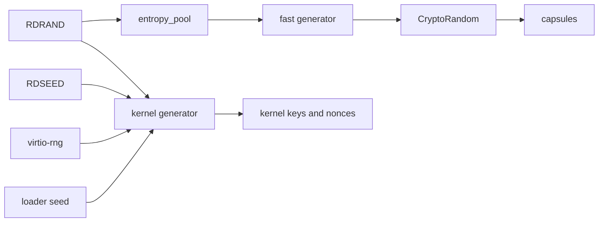

# Randomness and cryptography: the two generators

Part of [Randomness and cryptography](randomness-and-cryptography.md).

## Two generators

The kernel runs two ChaCha20 generators. The fast generator serves `CryptoRandom` to [capsules](../overview/glossary-boot-root-record.md#capsule) and takes its seeds only from the `entropy_pool` capsule. The kernel generator, `GLOBAL_RNG`, serves the kernel's own keys and nonces and is seeded from every source the kernel can read (`src/syscall/dispatch/crypto/random.rs:24-26`).

On x86_64, once it is seeded, every byte `CryptoRandom` serves is stretched from RDRAND output alone. RDSEED, virtio-rng and the loader seed reach only the kernel generator.

### The fast generator

`fill` keeps a 32-byte ChaCha20 key and a block counter, and answers each request with keystream under an all-zero nonce (`src/security/entropy_capsule/fast.rs:41-85`). After every request it runs `chacha20_block` once more and takes the next key from that block, which the caller never sees, so a key read out of memory later does not reveal earlier output (`src/security/entropy_capsule/fast.rs:87-93`).

It takes its first seed on the first request, and a new one once `RESEED_AFTER`, 1 MiB, has been served since the last (`src/security/entropy_capsule/fast.rs:37-39`). Each seed is 32 bytes that `get_random` asks the `entropy_pool` capsule for over IPC, and it replaces the key and resets the counter outright (`src/security/entropy_capsule/fast.rs:56-66`).

`handle_crypto_random` requires the `Crypto` [capability](../overview/glossary-boot-root-record.md#capability), refuses a null buffer or a request of 0 bytes or more than 4096 with `EINVAL`, and fills a kernel buffer from `fill` before copying it out (`src/syscall/dispatch/crypto/random.rs:33-43`). Linux programs reach it only through the [Linux personality](../overview/glossary-linux-personality.md#linux-personality): its `getrandom` hands out at most 256 bytes a call, and its random devices read through `crypto_random` too (`userland/capsule_linux/src/linux/call/thread.rs:47-55`, `userland/capsule_linux/src/linux/file/dev_io.rs:48`).

On x86_64 the capsule's source is RDRAND. Its `fill` checks CPUID leaf 1, ECX bit 30, and gives up a request after 32 failed attempts on one 64-bit word instead of using a weaker source (`userland/capsule_entropy/src/pool/source/x86_64.rs:23-44`). The capsule serves at most `MAX_RANDOM_BYTES`, 4096 bytes, a request, and answers `EMSGSIZE` above that and `EIO` when the source fails (`userland/capsule_entropy/src/server/handlers/getrandom.rs:27-42`). It keeps four counters and no samples (`Pool`, `userland/capsule_entropy/src/pool/types.rs:26-31`). Its reseed operation checks the length, at most 256 bytes, counts the call with `record_reseed` and mixes nothing in (`userland/capsule_entropy/src/server/handlers/reseed.rs:26-39`).

On aarch64, a [preview port](../architectures/aarch64.md), the capsule draws its bytes with `crypto_random`, which is `CryptoRandom` itself (`userland/capsule_entropy/src/pool/source/aarch64.rs:26-27`). `fill` holds the generator's lock while it waits for the capsule's seed (`src/security/entropy_capsule/fast.rs:54-62`), so on aarch64 the capsule's answer to a first seed request calls back into `fill` while the requester still holds that lock. This path was not run on aarch64 in this release.

### The kernel generator

`ChaChaRng` is a ChaCha20 generator with a 64-byte block (`src/crypto/util/rng/csprng.rs:26-37`), due for a reseed after `RESEED_INTERVAL`, 1,048,576 blocks or 64 MiB (`src/crypto/util/rng/csprng.rs:39-40`). `init_rng` seeds it from `collect_seed_entropy_secure` (`src/crypto/util/rng/global/init.rs:38-65`). That function hashes 32 bytes of virtio-rng output, four words each from RDSEED and RDRAND, 16 cycle-counter jitter samples, the stack pointer and a counter into one SHA-256, and fails unless at least 32 of those bytes came from hardware (`collect_seed_entropy_secure`, `src/crypto/util/rng/entropy/collect/pool.rs:37-73`).

Byte draws go through `draw`. Once the interval has passed it reseeds with a fresh `collect_seed_entropy_secure` seed hashed together with 32 bytes of its own output, and when the sources cannot answer it keeps its state and asks again on the next draw (`src/crypto/util/rng/global/reseed.rs:26-42`). `random_u64` takes words straight from the generator and never reseeds it (`src/crypto/util/rng/global/generate.rs:70-75`).

On x86_64 the boot seeds it in three steps:

1. `init_core_systems` ends in `init_platform_baseline` (`src/boot/main/core_init/init_core_systems.rs:68`). That starts virtio-rng, draws the 16-byte boot session nonce with `init_boot_session_nonce`, then the 32-byte [capability token](../overview/glossary-boot-root-record.md#capability-token) key with `init_token_signing_key` (`src/kernel_core/init/platform/baseline.rs:56-60`). The first of these draws finds the generator unseeded and seeds it with `init_rng`.
2. `log_security_status` hands the handoff to `log_entropy`, which applies the loader's seed, when it is not all zeros, with `seed_from_bootloader`, then wipes it from the handoff with `wipe_boot_seed` (`src/entry/security.rs:17-51`). `seed_from_bootloader` XORs the seed with a fresh local seed and the clock, and seeds or reseeds the generator with the result (`src/crypto/util/rng/global/seed.rs:75-113`).
3. `init_core_services` calls `init_rng` again and [stops the boot](../overview/glossary-amnesic-boot.md#boot-stop) if it fails (`src/kernel_core/init/entry/init_core_services.rs:34-36`).

On aarch64 the order differs: `microkernel_init` runs `init_core_services`, and with it `init_rng`, before `init_platform_baseline` draws the nonce and the key (`src/kernel_core/init/entry/microkernel_init.rs:45-64`).

`get_bytes_secure`, which draws the token key and the session nonce (`src/security/boot_session.rs:37-38`), XORs the generator's output with 64 bytes of virtio-rng output and with one RDSEED or RDRAND word for every 8 bytes (`src/crypto/random_api/basic.rs:38-42`, `mix_hardware_entropy` in `src/crypto/random_api/hardware_mix.rs:21-59`). The data volume draws a fresh 12-byte nonce for each sector with `fill_random_bytes` (`src/fs/cryptoblock/seal.rs:37-38`), and the PQClean code gets its randomness from the same generator through `nonos_randombytes` (`src/crypto/pqclean_support/mod.rs:37-45`).

The keyring, which makes wallet keys, XORs 32 bytes from `CryptoRandom` with 32 bytes it reads from RDSEED or RDRAND itself, and fails only when both sources fail (`gather_secret`, `userland/capsule_keyring/src/entropy/gather.rs:32-63`). A TLS client draws its X25519 key share, its client random and its session id with `crypto_random` (`client_flight`, `userland/nonos_tls/src/client_flight.rs:19-32`), and its P-256 key share the same way (`generate`, `userland/nonos_tls/src/p256_share.rs:27-30`).
