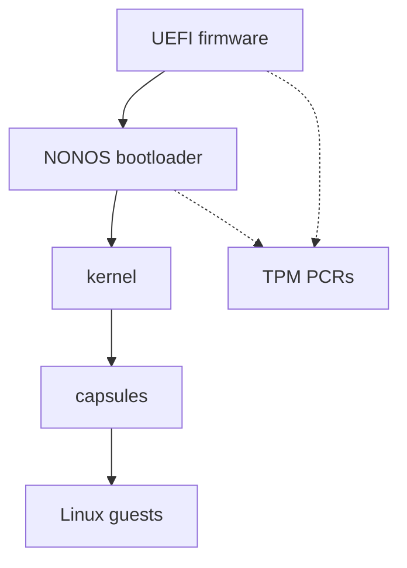

# Security: The trust model, continued

Part of [Security](README.md).

## The trust model, continued

Drivers are capsules too. A driver reaches its device only through the kernel's
[broker](../overview/glossary.md#broker), and a claimed device is moved into the
driver's own [IOMMU
domain](../overview/glossary-hardware-broker.md#iommu-domain) before it is
powered (`attach` in `src/hardware/broker/claim/claim.rs:33-37`). Where no
remapping unit is in service, that confinement does not exist, and the boot log
says so. [Capsule isolation](capsule-isolation.md) covers this.

The keys that protect data across boots are derived, not stored. The [data
volume](../overview/glossary-claim-epoch.md#data-volume) key comes from the TPM
through `derive_for_kernel` (`src/fs/blockfs_volume/open_machine.rs:75-78`). An
orderly shutdown or reboot goes through `terminate`, which wipes process memory,
kernel stacks, the key vault and the heap before handing the machine back to the
firmware, but leaves the data volume key and other kernel statics
(`src/security/zerostate/terminate.rs:35-39`). In 0.9.2 only the installer's
restart goes that way, since the desktop cannot shut down. [Device secrets and
keys](device-secrets-and-keys.md) lists what is kept, where, and for how long.

Solid arrows show which code starts which. Dotted arrows show measurements going
into the TPM PCRs, which the kernel later uses to derive keys and to check the
bootloader.

## What each layer enforces

| Layer | What enforces it |
|---|---|
| Capsule admission | `verify_with_publisher` checks the certificate binding, namespace, capability ceiling, signatures, payload hash, target triple and declared [endpoints](../overview/glossary-dma-pool.md#endpoint), in that order, then that the grant fits the manifest (`src/security/capsule_manifest/verify/mod.rs:37-63`) |
| System calls | `resolve` checks the token's MAC, the boot it was minted in, the address space, the revocation epoch, then the call itself (`src/syscall/contract/resolver/resolve.rs:31-43`) |
| IPC | `caller_satisfies_endpoint` refuses a send unless the sender holds every bit the endpoint requires (`src/syscall/microkernel/ipc/send_caps.rs:36-63`) |
| Devices | `claim` refuses a device that a remapping unit in service could not confine (`src/hardware/broker/claim/claim.rs:23-45`) |
| Data at rest | `seal` encrypts each 512-byte sector of the data volume with ChaCha20-Poly1305, bound to its LBA (`src/fs/cryptoblock/seal.rs:22-48`); the [package store](../overview/glossary-linux-personality.md#package-store) beside it is written unencrypted |
| Shutdown | `zerostate_shutdown_wipe` quiesces devices, then wipes DMA buffers, process memory, kernel stacks, file system caches, the key vault and the heap (`src/security/hardening/memory_sanitization/api.rs:59-110`) |

None of these defends against everything. [Protections and
limits](protections-and-limits.md) lists what NONOS addresses and what it does
not, each in one table.
