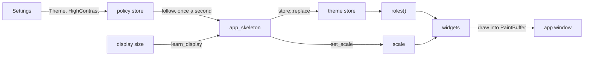

# Design system

The shared look of NONOS apps: one set of theme colours, one list of widgets, one display scale, and the theme the person picks reaching every app. An app imports a widget and draws it; it names no colour and does no pixel arithmetic of its own.

**Status:** built on `feat/toolkit-design-system`, phases 1 to 17 done at 8cf2e318a. Every app on the [app skeleton](../../overview/glossary.md#app-skeleton) draws with shared widgets, follows the theme and high contrast chosen in Settings, and scales with the display. The host proofs pass, and a boot at 8cf2e318a reached the desktop with the apps drawn at their usual size; no boot on a large panel has been made. The decision behind it is [ADR 0001](../../../adr/0001-toolkit-design-system.md).

## How it fits together

All of it except Settings and the policy store runs inside each app's own process, because the toolkit is a library linked into every app. The separate [toolkit service](toolkit-service.md) takes no part in drawing.

## The parts

| Part | What it is | Where | Page |
|---|---|---|---|
| Seeds | the five colours that define a theme | `userland/toolkit/src/theme/schemes/` | [Colours](colours.md) |
| [Roles](../../overview/glossary.md#role) | the 26 named colours widgets draw with, worked out from the seeds | `userland/toolkit/src/theme/roles/` | [Colours](colours.md) |
| Sizes | spacing, radii, heights, text sizes, in logical pixels | `userland/toolkit/src/design/` | [Sizes](sizes.md) |
| [Display scale](../../overview/glossary.md#display-scale) | logical to screen pixels, set per process from the display | `userland/toolkit/src/design/scale.rs` | [Display scale](scaling.md) |
| [Widgets](../../overview/glossary.md#widget) | `new`, builders, `draw`, `hit`, and the input that drives their state | `userland/toolkit/src/widgets/` | [Widgets](widgets.md), [Widget list](widget-list.md) |
| Icons | 92 masks, drawn at any size in any ink | `userland/toolkit/src/icons/` | [Widget list](widget-list.md#icons) |
| Theme choice | the setting, carried from Settings to every app | `userland/app_skeleton/src/runner/theme_follow.rs` | [Themes](themes.md) |
| Toolkit service | health check and animation clock, nothing drawn | `userland/toolkit/src/server/` | [Toolkit service](toolkit-service.md) |

To build a screen with all of it, start with [Building an app](building-an-app.md).

## Rules

- An app writes no ARGB literal. Its colours come from `roles()`, through the widgets. `scripts/check_ui_literals.py` fails on a new one.
- Every widget lives in `nonos_toolkit::widgets`. An app keeps no private widget.
- A widget's painter and its hit test call the same geometry function, so a click lands on what was drawn.
- Every size is logical until it goes through `scale().px` or `scale().font`.
- Text is measured with the TrueType metrics. Nothing is sized by counting characters.
- Toolkit code follows the repository's rules: `no_std`, `mod.rs` holds declarations only, no comments inside function bodies, and no file grows by more than 75 lines in one change.

## What it proves

- `theme_proofs`: 283 tests, every theme and high contrast, every widget at 4, 5 and 8 quarters, the contrast floors read back from drawn pixels, and the refusal of the retired service ops.
- `apps_proofs` and `desktop_proofs`: 314 and 244 tests, among them each app's geometry at four scales and the skeleton's scale and start-up.
- `capsule_browser_proofs`: pages laid out in CSS pixels and drawn at the display scale.

All passed at 8cf2e318a, with 11 more crates that depend on the toolkit.

## What it does not do

- A theme the person designs. The nine schemes and high contrast are what is offered.
- Widgets that keep their own state or call back into the app.
- A layout engine. A widget is drawn into a rect; `Column` and the `rect` helpers hand rects out.
- Animation of widget states.
- The installer and first-boot setup, which run before the desktop and keep their own scale.

## Pages

- [Building an app](building-an-app.md): one real app, the Clock, from window to proofs.
- [Colours](colours.md): seeds, roles, colour types, readability.
- [Sizes](sizes.md): spacing, radii, heights, text sizes.
- [Display scale](scaling.md): quarters, who sets them, windows and web pages.
- [Widgets](widgets.md): the widget contract, state, hover, press and focus, text, tests.
- [Widget list](widget-list.md): every widget, and the icons.
- [Themes](themes.md): how the person's choice reaches every app.
- [Toolkit service](toolkit-service.md): what the service still answers, and what it refuses.
- [Plan](plan/README.md): how it was planned and built, phases 1 to 17, kept as written.
