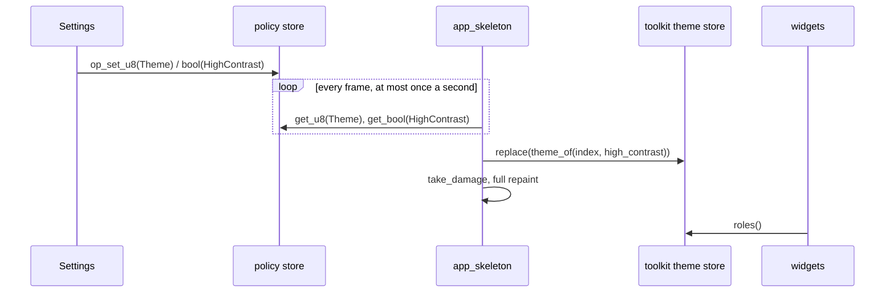

# Themes

How the theme and high contrast the person picks in Settings reach every app, within about a second, without the apps or the toolkit service exchanging a single colour.

## The path

1. Settings shows both choices in its Theme block, `Row::Field(Field::Theme)` and `Row::Field(Field::HighContrast)` (`userland/capsule_settings/src/settings/schema/blocks/appearance.rs:23-26`). A change goes to the policy store with `op_set_u8` (`userland/capsule_settings/src/settings/event/adjust_u8.rs:45`). Only Settings, its two extra instances and the setup wizard may write (`userland/capsule_policy/src/server/handle_set.rs:29-30`, `SETTERS`).
2. Every app built on the [app skeleton](../../overview/glossary.md#app-skeleton) calls `follow()` once per pass of its loop (`userland/app_skeleton/src/runner/frame_loop.rs:47`). It asks the store at most once a second (`userland/app_skeleton/src/runner/theme_follow.rs:28`, `CHECK_EVERY_MS`), through `get_u8` and `get_bool` (`userland/app_skeleton/src/runner/theme_follow.rs:52-56`), each a `mk_ipc_call_timeout` with a 200 ms limit (`userland/policy_client/src/call.rs:22`, `REPLY_TIMEOUT_MS`).
3. When either value moved, `follow` calls `store::replace(theme_of(index, high_contrast))` in the app's own process (`userland/app_skeleton/src/runner/theme_follow.rs:61`). `replace` stores the colours and bumps the revision last, so a reader that sees the new revision also sees the new colours (`userland/toolkit/src/theme/store/replace.rs:24-37`).
4. `follow` returning true makes the loop drop the app's partial damage and repaint the whole window, so no old colour survives in an undamaged corner (`userland/app_skeleton/src/runner/frame_loop.rs:47-50`).
5. Every widget asks `roles()`, which sees the moved revision and works the [roles](colours.md#roles) out again (`userland/toolkit/src/theme/roles/cache.rs:31-42`).

Only an index and a flag cross a process boundary. Every scheme is compiled into every app with the toolkit, so no colour travels, no new IPC operation exists for it, and no capability beyond the IPC every app already holds is needed.

## Why not through the toolkit service

The [toolkit service](toolkit-service.md) once carried the theme, through `TOOLKIT_OP_THEME_GET` and `TOOLKIT_OP_THEME_APPLY`. It waits in `mk_ipc_recv_from` with no timeout (`userland/toolkit/src/server/runner.rs:36`), so it could not poll the policy store on its own, and every app would still have asked it every frame. Reading policy directly is one hop fewer. Both operations are retired and now refused as unknown.

## Light

Light is the ninth label and the ninth scheme, index 8 (`userland/policy_proto/src/theme_labels.rs:17-18`; `userland/toolkit/src/theme/schemes/light.rs:23`, `LIGHT`). `every_theme_name_has_a_scheme` fails when a label is added without its scheme (`userland/theme_proofs/src/scheme_tests.rs:24`). Settings lists the labels from the table, so a new one shows with no change there.

## Apps on their own loop

| Capsule | How it follows |
|---|---|
| `capsule_desktop_shell` | calls the skeleton's `runner::follow_theme` on each pass of its own server loop (`userland/capsule_desktop_shell/src/server/runner/run.rs:30-40`) and works its chrome colours out from the roles (`userland/capsule_desktop_shell/src/render/palette/from_roles.rs:28-29`, `current`) |
| `capsule_setup_wizard` | runs before setup has stored a choice, so it draws the default |
| `capsule_boot_splash`, `capsule_wallpaper` | draw the default |

The Text Editor keeps its own picker, whose first choice, "System", follows this setting (`userland/capsule_text_editor/src/editor/theme/active.rs:52-58`, `name`).

## What it does not do

- An app with a long `tick_interval_ms` blocks that long between passes, so it sees a new theme that much later.
- The choice is not pushed. A running app learns it only by asking, and an app that never runs its loop never learns it.
- A theme the person designs. The nine schemes and high contrast are what is offered.
