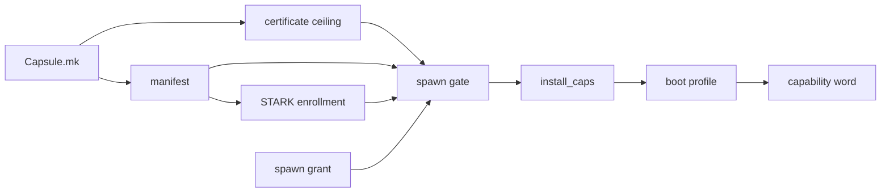

# Manifests and capabilities: How the word is fixed

Part of [Manifests and capabilities](manifests-and-capabilities.md).

## How the word is fixed

The word a capsule runs with is decided in three places, and none of them is the
capsule.



At signing. The certificate's ceiling is the required and optional sets together
unless `Capsule.mk` sets one (`nonos-mk/capsule.mk:70-74`,
`CAPSULE_CAPS_CEILING`). Before any certificate or manifest is signed,
`scripts/check_device_secret_cap.py` refuses DeviceSecret in every capsule but
`prove` (`scripts/check_device_secret_cap.py:31-40`, `DEVICE_SECRET_BIT`). The
kernel ties the bit to no name: it honours it in any capsule the vendor root
proved, and in none proved under a root enrolled on the machine
(`src/syscall/microkernel/device_proof/gate.rs:28-36`, `device_secret_caller`).
Among the capsules the vendor root proves, this build check is what keeps it to
one (`scripts/check_device_secret_cap.py:17-23`, `DeviceSecret`). Run with no
arguments it reads every `Capsule.mk`, the ten the build leaves out included:

```sh
python3 scripts/check_device_secret_cap.py
```

On this tree it prints `device-secret-cap: 107 capsules, 0 problems`.

At enrollment. The STARK
[enrollment](../overview/glossary-dma-pool.md#enrollment) takes each capsule as
its required capabilities, its ELF and the path of its [attestation
trailer](../overview/glossary-amnesic-boot.md#attestation-trailer)
(`mk/20-build.mk:604-605`, `NONOS_STARK_ENROLL`). At spawn the gate checks the
trailer against the ELF and the manifest's required set
(`src/kernel_core/process_spawn/capsule_spawn/runner/preflight.rs:67-77`,
`required_caps`), so a capsule whose required set changes needs a new
enrollment. The [STARK attestation](../security/stark-attestation.md) page
covers the proof.

At spawn. The spawn site offers a grant: a kernel mirror's `requested_caps`, or
for a capsule loaded from the file store, the caller's request masked to the
manifest
(`src/kernel_core/process_spawn/capsule_spawn/from_vfs/load/spawn.rs:66`,
`requested_caps`). A grant with a bit outside the manifest refuses the spawn.
Otherwise the capsule gets every required bit and the optional bits the grant
names, nothing else (`src/security/capsule_manifest/verify/caps_bits.rs:33-47`,
`install_caps`).

After that, the [boot
profile](../overview/glossary-amnesic-boot.md#boot-profile) can only take away.
On a boot without network, Network is removed from every capsule
(`src/kernel_core/process_spawn/capsule_spawn/runner/profile_gate.rs:48-55`,
`caps`), and the result is what `install_spawn` stores
(`src/kernel_core/process_spawn/capsule_spawn/runner/install/install_caps.rs:20-24`,
`install_spawn`). The boot modes themselves are described in [Boot
modes](../install/boot-modes.md).
