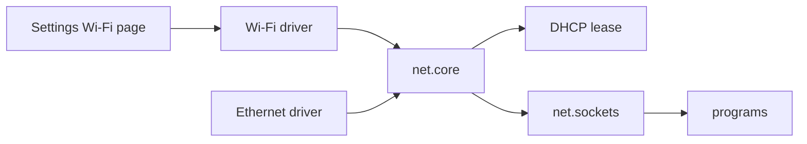

## Ethernet

Plug in a cable. There is nothing to configure. About once a second (1000 ms), `net.core` looks for a network card whose link is up, binds to it and starts DHCP. Its candidates are the Wi-Fi drivers first, then the wired ones.

Read from the code, a cable on real hardware gives no address in this release. `net.core` drops every frame received through the e1000, RTL8139 and RTL8169 drivers, so DHCP gets no lease through them. Only virtio-net, in a virtual machine, receives. See [the receive fault](../../drivers/ethernet/README.md#the-receive-fault).

The `e1000e` and `igc` driver capsules are in the source tree, but no 0.9.2 image carries them: no kernel profile embeds them. See [Intel Ethernet](../../drivers/ethernet/intel.md).

## USB tethering and USB Ethernet

Not available in 0.9.2 images. `net.core` lists the `cdc_ecm`, `cdc_ncm`, `rndis`, `ax88179` and `rtl8153` drivers among its candidates, and the drivers are in the source tree, but no kernel profile embeds them. A phone sharing its connection over USB, or a USB Ethernet adapter, is not used. See [USB networking](../../drivers/ethernet/usb-net.md).

## DHCP and DNS

On the desktop one [capsule](../../overview/glossary.md#capsule), `net.core`, is the whole network stack. When it starts it registers `net.tcp`, `net.udp`, `net.dhcp.client`, `net.dns` and `net.ip`. The Settings Wi-Fi page talks to the Wi-Fi driver to scan and join. `net.core` binds the Wi-Fi driver or the Ethernet driver once its link is up and takes a DHCP lease. Programs reach the network through `net.sockets`, which uses `net.core`.

- DHCP: on a lease, `net.core` sets the address, adds the default route through the router and opens a DNS socket for every server the lease names.
- DNS: a lookup asks every server at once and keeps the first IPv4 address any of them gives, within three seconds.
- IPv4 only. `net.core` is built with IPv4 and no IPv6, and lookups ask for A records.

The tree also holds a split stack, one capsule per layer: `capsule_net_dhcp`, `capsule_net_dns`, `capsule_net_ip`, `capsule_net_tcp`, `capsule_net_udp` and `capsule_net_l2`. Desktop images do not carry them; they carry `net.core` and `net.sockets` instead.

The programs NONOS ships look a name up in the clear, at the servers the lease named, only for a connection that goes Direct. A capsule built on Rust `std` looks names up through `net.dns` whatever the default; see [Rust std for capsules](../../userland/libc.md#rust-std-for-capsules). When the default network is Nym or Anyone, `ping` and `nslookup` refuse to run, and the programs that follow the default hand the name to the exit unresolved; see [Privacy networks](../privacy-network.md).

With no address, `ping` and `nslookup` say so at once instead of timing out. The line reads `ping: not connected to a network (no address yet). Plug in a cable or join a Wi-Fi network in Settings, then try again; nothing was sent`. On a boot that runs no network it reads `no network is running on this boot, so nothing was sent`.
